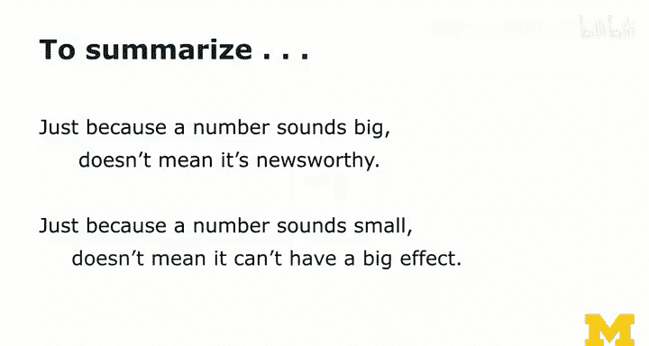

# 密歇根大学《理解数据》课程 - P17：理解大数与小数的意义 📊

在本节课中，我们将要学习如何理解新闻报道和日常信息中出现的极大或极小的数字。这些数字本身往往难以直观把握，我们需要借助背景和比较基准来解读它们的真实含义。

## 理解大数的挑战

当我们面对不熟悉的话题时，将数字置于具体情境中会变得格外困难，尤其是当这些数字非常庞大的时候。

以下是理解大数时可能遇到的困难：

*   **缺乏直观感受**：例如，不列颠哥伦比亚省没有家庭医生的人数从2003年的约34万增长到了2017年的90.8万，并且预计今年会更高。对于大多数人来说，很难想象90.8万人具体是什么规模。
*   **缺乏比较基准**：我们不知道这个数字与通常情况相比是否异常。它占全省总人口的比例是多少？没有这些背景信息，我们无法判断其重要性。
*   **数字脱离情境**：另一个例子是，“作为协议的一部分，周一离开乌克兰港口的船只运载了创纪录的35.45万吨农产品”。如果不了解农产品出口的正常水平，我们就无法判断35.45万吨是否真的“创纪录”或意义重大。

上一节我们介绍了理解大数时遇到的普遍困难，本节中我们来看看一个关键误区。

**核心误区：大 ≠ 有新闻价值**

仅仅因为一个数字听起来很大，并不意味着它具有新闻价值。有新闻价值通常意味着某事非同寻常，或者我们以新的视角看待寻常事物。

因此，我们必须使用**比较基准**来理解所报道的数字，尤其是在数字规模超出我们日常认知范围，或者涉及我们不熟悉的领域时。

## 理解小数的意义

与大数相对的是极小的数字或概率。在一个庞大的世界里，即使罕见的事件也可能频繁发生。

以下是理解小数意义的一个实例：

根据美国疾病控制与预防中心的年度报告，美国每年约有**1/100的妊娠**会导致严重的孕产妇健康并发症（实际数字在1/100到1/200之间，为简化取1/100）。这里的“严重并发症”指分娩者在医院记录中需要重大干预以避免损伤或死亡的事件。

> **请注意**：此统计主要测量“孕产妇健康并发症”，可能未能充分涵盖美国跨性别父母的数据。

如果我们进一步分析这个小数：

1.  起点是：美国每100次妊娠中，有1次对母亲构成严重健康风险。
2.  已知2021年美国有超过**360万**新生儿出生。
3.  通过计算可以得出，每年有超过 **5万名** 女性经历严重的妊娠并发症。

**两种视角看问题**：
*   **“1/100”** 听起来概率较低，似乎很罕见。
*   **“5万人”** 则是一个庞大的、实实在在的受影响人群数量。

这个例子表明，在一个事件总数巨大（大量人口、长时间跨度）的世界里，即使一件相对罕见的事情，也可能累积成大量的发生次数，影响到很多人。

## 课程总结

本节课中我们一起学习了如何辩证地看待数据中的大数和小数：

*   面对**大数**时，需保持警惕：数字大不一定代表重要。我们需要主动寻找**背景信息**和**比较基准**（例如占总数的比例、历史数据、行业常态）来评估其真正意义。
*   面对**小数**（或低概率）时，需考虑规模：即使单个事件发生的概率很小，如果基数（人口、时间、事件总数）足够大，其**绝对影响人数**可能非常可观。不能因为概率小就忽视其可能造成的总体影响。

理解数据的关键在于，永远不要孤立地看待一个数字，而应始终将其置于合适的上下文和规模中进行考量。