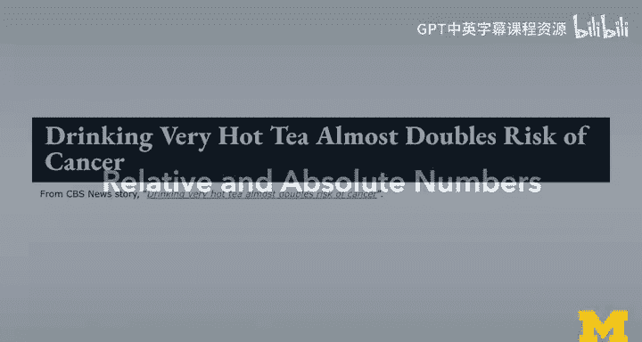
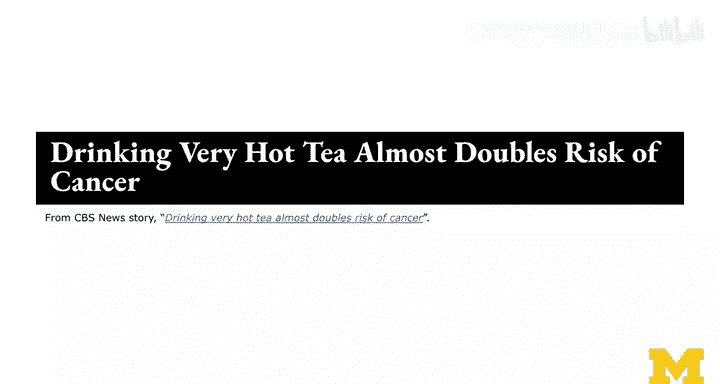
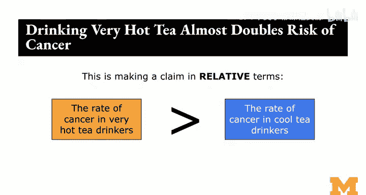
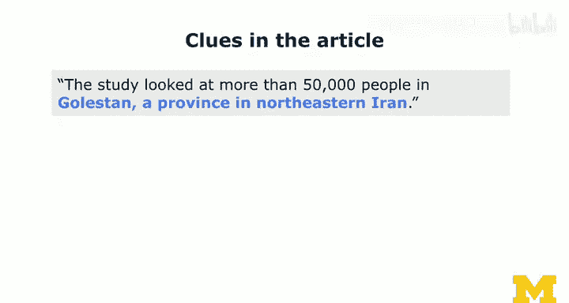
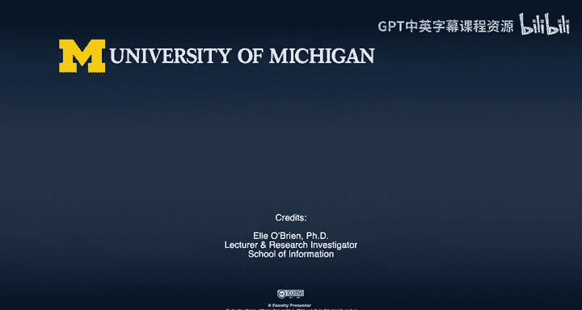

# 密歇根大学《理解数据》课程 - P18：相对数与绝对数 📊

在本节课中，我们将要学习如何解读新闻报道中的统计数据，特别是理解“相对数”与“绝对数”的区别。我们将通过一个关于“喝热茶与癌症风险”的新闻案例，来探讨为什么相对数听起来往往比绝对数更吓人，以及如何更全面地评估风险信息。

---

## 一则令人担忧的新闻标题

这里有一则看起来相当吓人的新闻标题：“饮用滚烫的茶水几乎使患癌风险翻倍”。

如果我们暂时忽略它听起来有多可怕，开始仔细审视，可能会发现这个说法是基于**相对**比较。

它比较了喝滚烫茶水的人群与喝温凉茶水的人群的癌症发病率，并声称前者的发病率更高。

## 相对数与绝对数的对比

但需要注意的是，像这样的**相对**陈述，听起来往往比**绝对**数字更吓人。

如果我们查看研究中给出的绝对数字，结果是这样的：

*   在喝滚烫茶水的人群中，每大约10，000人中有80例癌症病例。
*   在喝温凉茶水的人群中，每10，000人中有57例。

喝滚烫茶水的人群中，数字确实更高。但这看起来远没有那么可怕，部分原因是这些数字——80和10，000——仍然不算特别高。从长远看，这可能意味着很多病例，但很可能大多数人仍然不会患癌。

事实上，一个事件在**绝对**意义上越罕见，任何**相对**比较听起来就会越惊人。

以下是一个假设情况：

*   如果在10，000名喝温凉茶水的人中只有1例癌症，而在喝滚烫茶水的人中有2例（这可能只是偶然波动），那么癌症发病率就**翻倍**了。
*   如果喝滚烫茶水的人中有3例，那么风险就**增至三倍**。
*   如果有4例，就**增至四倍**。

即使在这种情况下，从绝对角度来看，该群体中任何人患癌仍然相当不常见。

---

## 另一个例子：坐垫与癌症风险

以下是另一种表述方式，这个例子来自英国癌症研究中心的博客：

> 假想的标题“坐垫使癌症风险翻倍”听起来很吓人。这被称为**相对风险**。如果有人告诉你，坐垫使患癌几率从百万分之一增加到百万分之二，这仍然是一个非常小的**绝对风险**。

这里的绝对风险是百万分之二，这是使用坐垫人群的风险，但仍然非常小——百万人中的大多数人不会患癌。对许多人来说，为了如此微小的风险增加而放弃使用坐垫是不值得的。

因此，你会因为这样一个数字而放弃坐垫吗？很可能不会，尽管从技术上讲，使用坐垫的人群癌症发病率确实翻倍了。

---

## 我们应该完全避免使用相对数进行报道吗？

上一节我们看到了相对数可能带来的误导性，但我们是否应该完全避免使用相对数进行报道呢？

我认为不必如此极端。不同风格的报道适用于不同的情境，有时信息会在传播中被误译。

以这项饮茶研究为例，它发表在一本公共卫生期刊上，面向的是从事公共卫生工作的科学家。这些科学家考虑的是世界范围内的人群、整个国家甚至大洲，涉及成千上万乃至数十亿人。因此，即使癌症的绝对风险很小，但对于一个相当庞大的人口基数来说，风险翻倍仍可能导致全球范围内出现大量病例，这对公共卫生工作者来说仍然值得关注。

然而，对于个人而言——比如正在读报、试图决定是否该喝茶的我——这个数字并不能帮助我了解自己患癌的可能性有多大。也许我应该承担这个风险，因为喝茶还有其他益处。仅凭这类数字，我无法确定。

---

## 个人如何评估风险信息？

那么，我会因为这项研究而停止喝茶吗？不会，原因有几个。

首先，我掌握的信息仍然不足。即使已确定喝茶风险更高，也许喝茶还有其他益处，而我对此没有信息。总的来说，我个人很难解析风险，因为我每天都在承担风险，而且我通常不会从绝对角度去思考这些风险有多大。因此，我个人并不清楚，风险需要高到什么程度，才足以让我改变行为。实际上，我在这方面需要更多帮助。

其次，对于这类问题，我通常会咨询我的医生。我会问他们，其他医生是否看到了这类研究，并建议我改变行为。我会信任专家来帮助我理清头绪，因为独自应对相当具有挑战性。

当然，并非总是可行。我知道不是每个人都有机会看医生。因此，有时值得去寻找——在你的社区里，是否有你信任的公共卫生机构？寻找你信任的专家，他们能为你提供可靠的信息，告诉你何时风险已高到足以让他们广泛建议人们改变行为。

但如果没有这类更广泛的声明，我通常不会追随个别的新闻报道，因为它们可能过于嘈杂，信息混乱。

---

## 文章本身提供的线索

最后，文章本身提供了一个线索，我认为这本身就削弱了其结论的说服力。

即使我不觉得上述理由适用，我认为文章实际上也给出了一个很好的理由让我不必理会它。在文章靠后的部分，在谈论癌症风险增加有多高之后，它写道：

> 这项研究调查了伊朗东北部戈勒斯坦省的50，000多人。

我不住在那里，我住的地方离那里很远——我住在美国密歇根州。也许这才是关键部分：

> 在美国和欧洲，很少有人饮用温度超过65摄氏度的茶，但在俄罗斯、伊朗、土耳其和南美等地，饮用如此热甚至更热的茶很常见。

事实上，被研究的行为——饮用超过65摄氏度的茶——在我居住的地方实际上相当罕见。因此，我可能并不经常像研究中那样喝茶。基于这个原因，我会说：

这项研究实际上并没有考察与我的行为非常相似的情况。它有特定的背景，适用于特定地区、特定文化的人群。那个关于癌症风险翻倍的头条新闻，确实没有考虑到我可能与研究人群不够相似，以至于结果无法推广到我自身的情况。

因此，对我来说，这应该仍然是一个公共卫生领域的故事，供关注该地区卫生政策的人士参考。但我并不认为这足以让我停止饮用我通常喝的、温度非常温和的茶。

---

## 总结

在本节课中，我们一起学习了如何批判性地看待新闻报道中的统计数据。我们通过“热茶与癌症风险”的案例，重点理解了**相对数**（如“风险翻倍”）与**绝对数**（如“每万人中的病例数”）之间的关键区别。相对数容易夸大感知风险，而绝对数能提供更实际的背景。在评估此类信息时，我们需要考虑研究背景、自身与研究对象的相关性，并寻求专家意见来做出明智的个人决策。记住，解读数据时，上下文和具体数字同样重要。