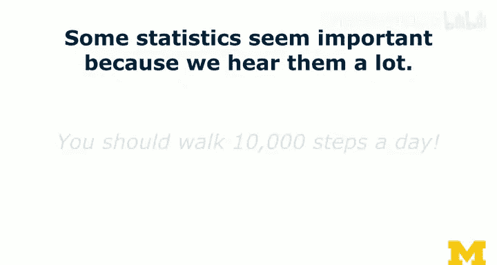
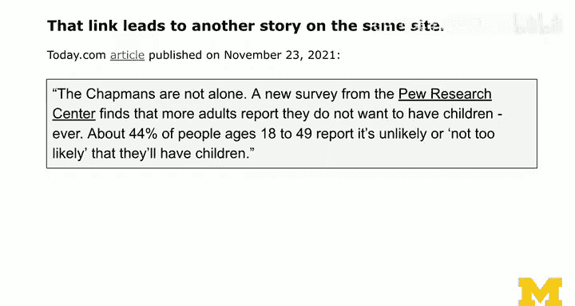
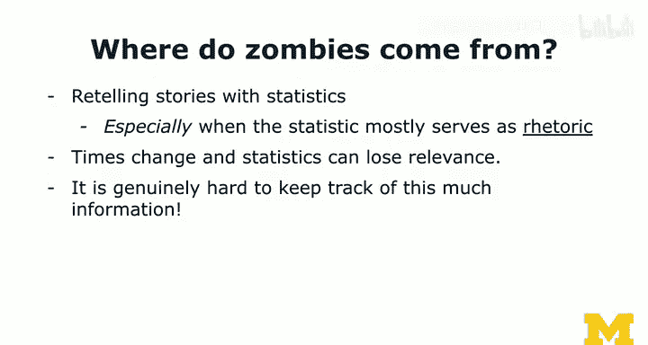

# 19：僵尸统计数据解析 🧟

在本节课中，我们将要学习一种常见的数据现象——“僵尸统计数据”。这些数据看似权威，被广泛传播，但其原始背景和含义在多次转述中已丢失或扭曲，如同“僵尸”般在信息世界中游荡。我们将通过具体案例，分析其产生原因，并学习如何识别它们。

---

许多统计数据似乎只是存在于世界的“以太”之中，我们并不确定它们来自何处。但由于我们经常听到它们，它们听起来非常重要。一个例子是“每天应该走一万步”。这个说法究竟从何而来？它来自一项大型研究吗？还是公共卫生机构的指导？

实际上并非如此。这个说法源自20世纪60年代日本一个名为“万步计”的计步器的广告。日本步行俱乐部采纳了这家计步器制造商对其产品的昵称“Manpo-kei”，字面意思就是“一万步计”。这并非科学结论，似乎只是因为这是一个朗朗上口的设备名称，并从此流传下来。

这是一个典型的例子，说明经过多次转述，我们可能会丢失关于一个数字的关键背景信息。

上一节我们看到了一个因商业广告而流传的僵尸数据，本节中我们来看看另一个在新闻报道中传播变形的案例。

以下是我遇到的一个例子。我在阅读一篇关于母性的文章时，看到这样一句话：“皮尤研究中心的一项调查发现，44%的美国人表示他们不太可能或非常不可能要孩子。”这句话有一个链接，于是我点了进去。

链接指向了同一网站的另一篇新闻报道，文中写道：“查普曼夫妇并不孤单。皮尤研究中心的一项新调查发现，更多成年人报告他们永远不想要孩子。大约44%的18至49岁的人报告说，他们不太可能或非常不可能要孩子。”这个比例很高——该年龄段44%的人。我非常想核实这个数字，因为它与我个人对世界的观察和生活经验大相径庭。于是，我点击查看了皮尤研究中心的原始研究报告。

原始研究报告的实际表述是：“大约44%的18至49岁的无子女者表示，他们将来要孩子的可能性不大或完全没有可能。”因此，我们讨论的实际上是**无子女者**。原始研究说的是**44%的尚无孩子的人**。

然而，经过这些转述，它变成了“44%的美国人”。这两者非常不同，对吧？对于18至49岁尚无子女的人群，绝对不等于所有美国人。因此，你可能会对这个数字产生截然不同的解读。事实上，在这些相互链接的博客文章中，这个数字被用来制造了非常戏剧化的效果。

除了完全忘记统计数据的关键背景，另一种可能发生的情况是，人们有时会做出微妙的写作选择，从而改变统计数据的含义。

以下是我看到的一篇关于如何获得幸福感的文章。文章写道：“科学表明，我们的境况——我们有多富有、从事什么工作、拥有什么物质财产——这些对幸福感的影响比我们想象的要小。桑托斯说，研究确实表明，较富有的人比较贫穷的人更幸福，但程度并不大。”于是我去点击查看了那项研究，它到底说了什么？结果发现，该研究实际上并非关于财富，而是关于**收入**。研究指出：“大量研究记录了家庭收入与幸福感之间虽不强烈但可靠的关联。”

我认为这很微妙，但**收入并不完全等同于财富**。收入是关于你每月或每年赚多少钱，而财富是关于你的所有资产。至少在美国，我认识很多收入低但财富高的人，这可能是因为他们的财富让他们能够在低收入环境中工作。因此，根据我的经验，这两者之间并不总是有非常强的联系。我并不是说这挑战了该研究的有效性、实用性或其相关性，但我认为重要的是要记住，拥有大量资产（比如家族房产、父母富有或获得遗产）与收入是不同的。因此，收入可能不是衡量某人财富的最佳方式。

除了背景丢失和概念替换，统计数据还可能因为时代变迁而过时。

让我们回到关于离婚率的例子。我们已经讨论过为什么这个数字本身具有挑战性，因为其计量单位并非人们通常所想的那样。但即使这是一种衡量个人经历离婚几率的好方法，仍然存在一个问题：离婚率一直在变化。在美国，离婚率在1980年左右达到最高，此后几乎一直在下降。

例如，这里有一张关于每千人离婚率的图表，这是衡量离婚普遍程度的另一种方式。我们在1980年左右画了一条线，可以看到在美国，这个数字一直在下降。因此，当人们谈论离婚率有多高时，往往是因为这在过去比现在更真实，他们没有考虑到这一事实已经发生了很大变化。我知道，我妈妈在她结婚前（我出生前）就听过这个统计数据。尽管实际情况已经发生了很大变化，但同样的统计数据仍在被使用，这有点不可思议。

那么，这些“僵尸统计数据”从何而来？这些不断存活并拥有自己生命的数据，其实际效用早已过去。

一种情况是，当我们用统计数据复述故事时，我们常常以一种随意的方式使用它们。我认为当统计数据被用作修辞手段，而不是我们共同试图理解的东西时，这种情况经常发生。例如，在那篇关于人们选择不要孩子的文章中，文章并非真正关于“谁选择要孩子或不要孩子的趋势”的统计数据，而是一个关于一位母亲反思母性的个人故事。我怀疑的情况是，作者在写作时，也许编辑说：“让这个故事听起来更好的一个方法是添加一些统计数据。”因为我小时候写文章或非虚构作品时，几乎总是被建议添加统计数据。但问题是，当统计数据并非真正处于核心地位，而只是被用作一点装饰来帮助为故事铺垫时，我们有时就容易只是复制粘贴，或者想“哦，别人在这里用了，所以我也要用”。

我认为即使在科学写作中也会发生这种情况。在撰写报告科研成果的手稿时，科学家经常需要引用大量内容来展示相关的前人工作。但要仔细阅读所有内容可能很困难，因为我们时间有限。在压力下，我们只想添加统计数据来支持一个论点，有时很容易忘记追溯它们的来源。

另一个原因是时代在变化，统计数据可能失去相关性，就像那个婚姻统计数据一样。但通常，一旦某件事出现在世界上，并成为一种文化符号，我们都在谈论它，就很难去纠正它。四处纠正每个人往往非常令人沮丧，也不是一件可以一直做的事情。

对于这个问题，我没有简单的解决办法，但时代在变，统计数据也会漂移。而且，要追踪如此多的信息确实非常困难。研究很多，数字也很多，我们想要讨论它们。每次我们这样做，都会让它们离原始背景更远一点。要追踪每个数字的来源可能很棘手。因此，我认为我们应该预料到这些错误有时会发生，即使我们非常勤勉，在某种程度上也难以完全避免。但了解这一点仍然是值得的，因为这些“僵尸”真的会阻碍我们看到真正发生的事情。它们可能成为知识的替身，使我们无法以全新的眼光看待事物。而当我们以全新的眼光审视统计数据的来源时，有时我们会看到一些比仅仅使用“僵尸数据”更有趣、更引人注目、通常也更接近真相的东西。

---

本节课中，我们一起学习了“僵尸统计数据”的概念。我们了解到，这些数据在传播过程中可能因丢失关键背景、概念被微妙替换或随时间过时而变得不准确甚至误导。它们常因被用作修辞装饰、转述时的复制粘贴或难以追踪所有信息源而产生。虽然完全避免此类问题可能很困难，但认识到它们的存在，并养成追溯数据原始来源、审视其具体定义和时效性的习惯，将帮助我们更清晰地理解数据背后的真实世界，避免被“僵尸”引入歧途。