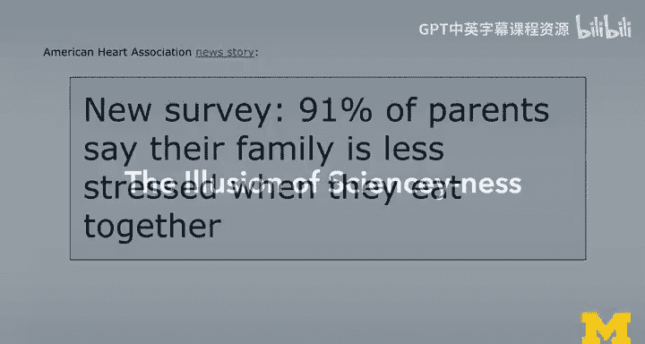
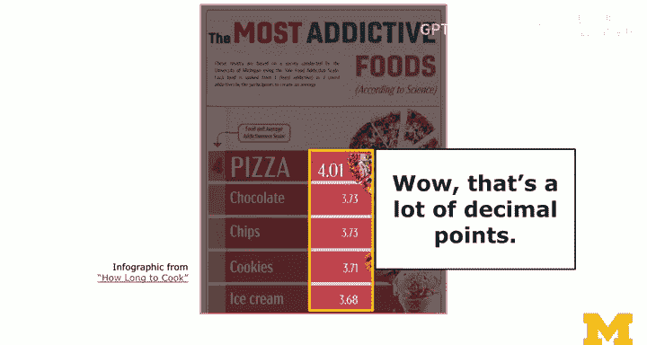
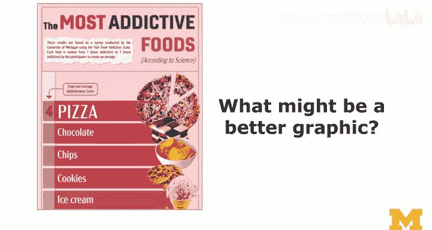
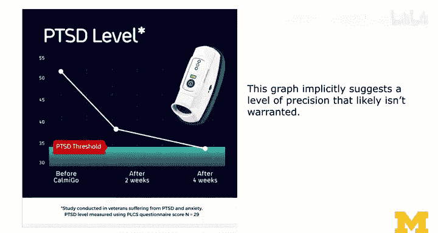
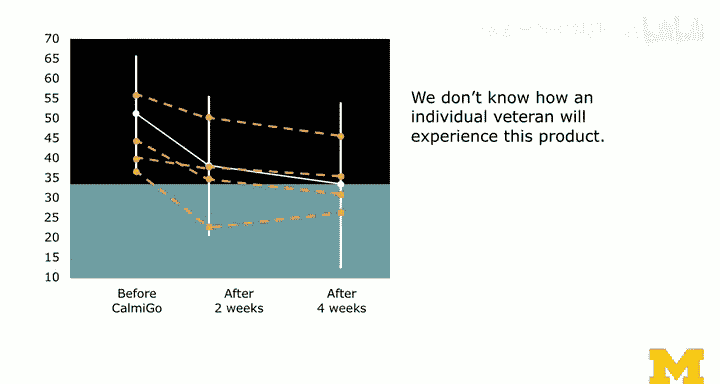
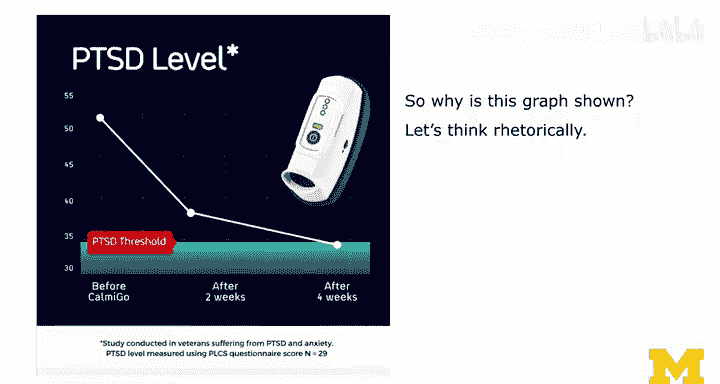

# 课程 P20：19_伪科学性的表象 🔍

在本节课中，我们将学习如何识别数据呈现中的“伪科学性”表象。这些表象通常通过过度精确的数字、忽略误差范围以及误导性的图表，让结论看起来比实际情况更科学、更确定。我们将通过几个具体例子，分析这些表象如何产生，并探讨如何更诚实、更清晰地呈现数据。

---

## 过度精确的数字

上一节我们介绍了伪科学性表象的概念，本节中我们来看看第一个常见现象：**过度精确的数字**。精确的数字常被用来赋予结论一种“科学性”的权威感，即使数据本身存在较大的不确定性。

最近，我看到一个标题写道：“新调查显示，91%的父母表示，一起吃饭时家庭压力更小。” 这个数字91%听起来非常精确，给人一种严谨、科学的感觉。然而，当我阅读新闻文章并查看研究时，发现这项研究的误差范围约为三个百分点。这意味着，如果调查设计良好，报告“与家人一起吃饭时压力更小”的父母真实比例在88%到94%之间。因此，是否就是91%？我并不确定。如果是我来写，我不会如此肯定地使用91%，我可能会说“约90%”或“十分之九”。我开始怀疑他们保留91%这个数字，是因为它听起来效果很好，像是一种凭证，仿佛在暗示：“如果我们没有进行非常严谨、有力的科学研究，怎么可能得到如此精确的数字？” 因此，当数字听起来很精确，但实际的误差范围可能大得多时，我往往会感到有些不妥。

以下是另一个我在网上找到的例子。这是一张信息图，标题是“科学认定的最容易上瘾的食物”。它展示了一项（巧合的是）在密歇根大学进行的研究数据。参与者被要求用1到7分来评价各种食物的成瘾性，然后计算了平均分。例如，披萨的平均分是4.01，巧克力是3.73，饼干是3.71。有人将这些研究结果制作成了信息图。

我不太喜欢这张图的一点是，它使用了两位小数来表示精度。披萨在成瘾性量表上不是4分，而是4.01分；薯片是3.73分，这比饼干的3.71分高出0.02分。这似乎以极高的精度暗示薯片确实比饼干更容易上瘾。但我个人很难相信这一点。我回头查阅了研究，虽然很难精确计算出误差范围，但可以肯定的是，误差范围绝不足以让我们在这个精度水平上检测出薯片和饼干之间的差异。请记住，每个数字周围都有误差范围，这些数字实际上是模糊的，远比两位小数所暗示的要模糊得多。

---

## 如何改进数据呈现

上一节我们看到了过度精确数字的问题，本节中我们来看看如何改进数据呈现，使其更诚实、更清晰。

如果我们想改进这张信息图，可以去掉一位小数。也许我们可以说披萨的平均分大约是4分，其他食物大约在3.7分左右。这样虽然看起来不那么“完美”和科学精确，但可能更诚实地反映了我们能够分辨的差异水平。根据研究固有的模糊性和我们只是取粗略平均值这一事实，我们实际上无法断定薯片比饼干更容易上瘾，我们认为它们非常相似。

我们甚至可以更进一步，直接去掉数字，只说这些都是位于成瘾性食物量表上端附近的食物。我个人认为，对于普通受众来说，这才是正确或理想的做法，因为它没有暗示超出我们实际拥有的精度。

---

## 误导性的图表

上一节我们讨论了数字呈现的改进，本节中我们来看看图表如何通过视觉元素制造伪科学性表象。

另一个例子是回顾这张图表。它来自一个关于可以在家治疗创伤后应激障碍（PTSD）的吸入器的广告。这张图展示了PTSD水平（一个我难以解析的单位）随时间的变化。原来，这个水平来自一份问卷，他们对29人实施了这份问卷。我仍然不知道这份问卷的典型分数是多少，也不知道需要多大的分数差异才能让人感觉从该设备获得了有意义的改变。但让我们暂时忽略这一点，继续这个例子。

这张图表实际上暗示了一种我认为并不完全合理的精度水平。我的意思是，看看这些点的位置。我们看到，在使用该工具之前，分数大约在50分；两周后，分数接近35到40分之间；之后，分数在35分左右。然而，我们在这里使用点来表示，这种选择暗示了一种我们对实际水平所不具备的确定性。

请记住，每次测量都有一个基于测量设备误差范围的合理值范围。同时请记住，这里的每个点都是29名参与者的平均分数。误差范围有时看起来像这样：我们会在点周围画一些小线，来表示合理的数值区间。根据该公司发布的数据，我们尽可能进行了重建，这些就是误差范围实际的样子。在使用设备前，分数范围大约在35到65分之间；两周后，范围仍然相当大；四周后，范围甚至可能更大一些。事实上，平均分数可能取值的合理范围存在很大的变异性。

---

## 个体差异与平均值的局限

上一节我们指出了图表忽略误差范围的问题，本节中我们将探讨一个更微妙但更重要的点：**个体差异**。

这个图表代表的是用户的平均结果，但当你实际使用该设备时，你得到的不是平均结果，而是你自己的结果。许多个体使用该设备可能会有不同的结果。我在这里画了一条橙色的虚线，表示一个个体用户的结果可能是什么样子。也许这个人获益甚微，或者模式相似但分数更低，有人可能获益非常少，有人可能在第一次测量时获益很大但随后又回升。我们并不真正知道真相。当我们只看平均值时，它掩盖了我们不知道个别退伍军人使用该产品会有什么体验这一事实。

那么，为什么还要展示这张图表呢？我认为它主要起到一种修辞功能，表明“看，使用这个产品后情况好转了”。它确实传达了“情况好转了”的信息。但我认为它没有很好地解释，如果你使用这个设备，你可以期待什么，你个人可能看到哪些可能的结果。在这方面存在相当大的变异性。我认为，如果这张图表真的想展示你会看到什么样的益处，那么它应该将量表转换成对设备的典型用户有意义的东西。可能使用该设备的人因为经常用这份问卷测量PTSD而非常熟悉它，但我怀疑这真的是常识。因此，我真正想在这里看到的信息是：人们报告了什么样的益处？从50分降到45分在感觉上到底意味着什么？这才是我真正需要看到的信息。

所以，我认为这张图表主要是为了修辞目的，表明“看，这个设备有效”。但我认为它并没有真正解释人们应该从中期待什么，因为你知道，结果会有很大的变异性，人与人之间非常不同，尤其是在治疗创伤后应激障碍这类问题时。因此，这里展示的结果变异性远低于实际情况。

---

## 总结

在本节课中，我们一起学习了如何识别数据呈现中的伪科学性表象。我们分析了过度精确的数字如何制造虚假的权威感，探讨了通过简化精度来更诚实地呈现数据的方法。我们还研究了图表如何通过忽略误差范围和个体差异来误导观众，使其对结果的确定性和普适性产生错误印象。

记住，真正的科学呈现会诚实地承认数据的局限性和不确定性。在解读数据或呈现自己的发现时，始终要问：误差范围是多少？个体差异有多大？这些数字或图表是否暗示了超出数据本身支持的确定性？保持批判性思维，才能更好地“理解数据”，在统计、科学和AI的世界中明智导航。