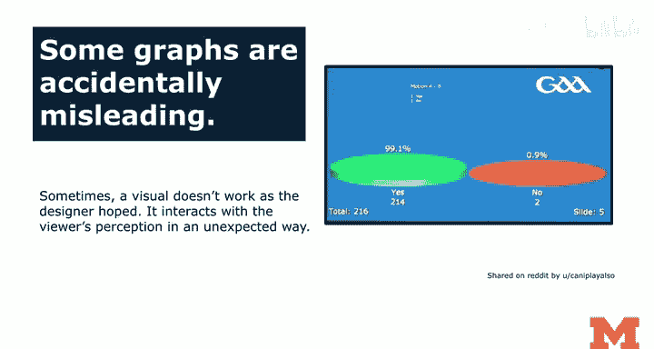
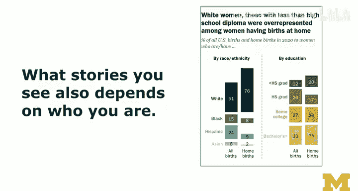

# 21：数据可视化的优势与局限 📊

在本节课中，我们将要学习数据可视化的核心优势与常见局限。我们将探讨可视化如何帮助我们理解数据，以及设计不当的可视化如何产生误导或混淆。理解这些概念，能帮助你更好地解读他人创建的可视化图表，并在自己创建图表时做出更明智的选择。

## 数据可视化的潜在陷阱

上一节我们介绍了数据可视化的基本概念，本节中我们来看看一些设计不当的可视化如何产生问题。你以前可能见过具有误导性的图表，请看下面这个例子。

这个图表哪里看起来有误导性？问题在于数字所暗示的信息与图片给人的印象之间存在差异。观察数字：29%的受访者支持加强疫情相关限制，仅比反对者（30%）低一个百分点。差异非常小。然而，从图片上看，这个差异显得相当大。我们从数字和图片中得到了不同的印象。

你可能会感觉，自己被可视化的制作者操纵了。这有可能是个意外，但至少对我来说，它让我怀疑：他们是否想通过这张图片引发我的某种情绪？

有些图表产生误导主要是出于意外。下面这个例子，我相当确定是个意外。首先介绍一下背景：这里有两个K-Pop组合，Weeekly和Red Velvet。一位粉丝在互联网上制作了不同K-Pop组合成员平均身高的图表。看起来Weeekly的平均身高最高。我猜他们计算了所有成员的身高平均值，结果大约是5英尺6英寸。Red Velvet的平均身高大约是5英尺3英寸。这是一个相当小的差异。但看这张图片，似乎Weeekly的成员会完全“碾压”Red Velvet的成员，看起来完全是不同的尺度。

我认为这里的问题是，视觉效果没有按设计者希望的那样工作。这些不同图标给人的感知，造成了比实际差异大得多的印象。我们可以画这些虚线来看：这是Weeekly和Red Velvet的身高，哇，看起来差异巨大！

事实上，如果我们试图更真实地绘制图表，身高的真实差异其实非常细微。她们的平均身高差异只有大约3英寸。Weeekly成员的平均身高约为5英尺6英寸，Red Velvet成员的平均身高约为5英尺3英寸。选择不同的图标，我们或许可以更准确地描绘出这种差异的大小。

以下是另一个例子。这似乎是爱尔兰某项投票的数据。图表的设计者认为引入三维元素会很酷，这些圆柱体的高度可以告诉我们有多少票投给了“是”或“否”。但不幸的是，在这种视觉呈现方式下，很难分辨这些圆柱体高度的差异。至少在我看来，这看起来几乎没有差别。而事实上，99.1%的人投了赞成票，不到1%的人投了反对票，这是一个相当巨大的差异，但这个差异真的很难察觉。

有些图表则纯粹令人困惑。这是我在浏览联合国儿童基金会（UNICEF）网站时发现的，网站上有关于世界各国的数据。看起来数据是关于他们的各种投资和某种供应，但对我来说，这简直让人不知所措。我不确定该看什么，也不知道如何解读，所以对我来说非常混乱。

## 为什么会发生这种情况？

在探讨了具体问题后，我们不妨退一步思考：为什么会发生这种情况？记住我们最初为什么要将数据可视化，可能会有所帮助。

一个快速的问题：如果你想了解纽约市航班延误的情况（你可能在之前的视频中记得这个例子），你更愿意要这张描绘各种航班延误频率的图表，还是更愿意要原始数据的表格，即超过30万行的航班延误数据？

很可能你更愿意要图片。这是因为数据可视化帮助我们高效地传达数据中的模式。

每个可视化都有几个要素，这些要素或多或少在我们的控制之中。这些要素包括：
*   **数据**：我们实际要可视化的内容。
*   **创作者的选择**：如果你是创作者，你对此有一定控制权。
*   **观看者的感知**：这可能更难以预测。

数据可视化的创作者可能有一些相互竞争的价值观。他们脑海中可能有一些不一定能同时实现的价值观念。一方面，如果我们把这看作一场拔河比赛，一方面他们可能希望**暴露数据**，让观看者可以自己探索。另一方面，他们希望**高效地讲述一个故事**，他们知道观看者的时间和注意力有限，因此传达数据中的核心思想很重要。

在“暴露数据让观看者自行探索”这一侧，这里有一个图表，我认为至少对我来说，这走到了一个极端。这是我在一份麦肯锡报告中发现的图表，内容是关于受COVID-19影响的行业，以及这些行业是女性比例过高还是男性比例过高。因为这个数据和研究领域我并不熟悉，而且这个图表暴露了数据的很多方面，我个人觉得这个图表有点让人不知所措，难以理解。但也许如果你是更熟悉这类数据的人，那么读起来会更容易。但对我来说，这里有太多需要探索的内容，让我感到有点压力。

另一方面，你可以走向另一个极端，即**高效地讲述故事**，但你真的隐藏了背后所有关于数据的信息。这是一段YouTube视频的截图，视频是关于“为什么现代艺术这么糟糕”。显然，它有一个非常强烈的观点要分享，因此它试图论证所谓的“标准”随着时间的推移已经下降。但不清楚“标准”是什么，或者它们是如何被测量的。不清楚这条蓝线来自哪里，我不知道它是否来自某人的实际测量，还是有人编造的。所以我完全不知道这些数据来自哪里。他们正在高效地讲述一个故事，但我无法自行探索这背后的任何信息。

因此，数据可视化的选择会对观看者能够辨别的内容产生影响，这意味着它们可能**暴露或隐藏相关的模式**。

这里还有一个例子。这来自皮尤研究中心一份关于美国家庭分娩的报告。这是关于在美国，有些人选择在医院分娩，也可能选择在家分娩的数据。在这个条形图中，我们可以看到，在2020年，家庭分娩的数量似乎更多（由更高的绿色条表示）。我们还有一个配套的图表，这个金色的折线图。在这个图中，我们可以看到家庭分娩的百分比似乎有所上升。快速思考一下，为什么这两个图表一起展示很重要？

我认为一个重要的原因是，如果我们只看到分娩的原始数量（即这个绿色条形图），有可能在2020年，我们只是了解到总体上分娩数量更多了，那么家庭分娩的数量也会更多，但不一定意味着家庭分娩在总分娩中的比例更高。如果总分娩数量有相应的增加，要辨别某件事作为分娩的百分比是否变得更受欢迎，我们需要将其表示为百分比，这就是折线图中的内容。因此，这两个图表是互补的，我认为它们对于理解趋势的规模都很重要。

从这些图表中，你得到了一个非常高层次的图景。但我们需要一个不同的图表来理解，并非所有家庭选择家庭分娩的可能性都相同。因此，在报告后面的一个图表中，我们可以看到按参与调查女性的种族、民族以及教育水平对这些数据的细分。从这些图表中，我们可以看到，选择家庭分娩的决定并非在所有种族和民族中同等发生。在白人女性中更常见，而且也不是在所有教育水平中都一样，似乎在高中以下学历的女性中更常见。

在这些不同的图表中，创作者强调了数据的不同方面。一方面，我们可以看到家庭分娩在美国越来越受欢迎，但我们需要另一个图表来理解，这种选择并非在所有种族和民族群体中同等受欢迎，并非在所有地方都以相同的方式发生。

## 视角决定解读

上一节我们看到，同一个数据可以有不同的呈现方式。而你能看到什么故事，也取决于你是谁。你会以不同的方式看待这个图表，并可能得出不同的信息。如果你是一个正在决定是否要在家分娩的人，如果你是你社区的卫生教育者，如果你是护士或医生，或者如果你是从事公共卫生和政策工作的人，当你看到这个图表时，你可能会想到不同的事情，这取决于你最初带入的视角。

数据可视化是一个庞大的主题，我们才刚刚开始触及表面。我希望你从这次非常简短的数据可视化速成课中带走的一点是：一个重要的主题是，可视化是其作者**许多选择的产物**，而**每个选择都有权衡**。数据的某些方面将被隐藏，而其他方面将被强调。这根本无法避免。所以，当你看一个图表时，请记住这一点，你可以思考：作者做了哪些选择？由于这些选择，他们强调了什么？又可能掩盖了什么？

## 总结

本节课中我们一起学习了数据可视化的优势与局限。我们了解到，优秀的可视化能高效传达数据模式，但设计不当则可能产生误导、混淆或隐藏重要信息。关键在于理解可视化是创作者一系列选择的产物，这些选择涉及暴露数据还是讲述故事，并最终决定了哪些信息被强调，哪些被弱化。作为观看者，保持批判性思维，思考图表背后的选择及其影响，是解读数据可视化的重要技能。