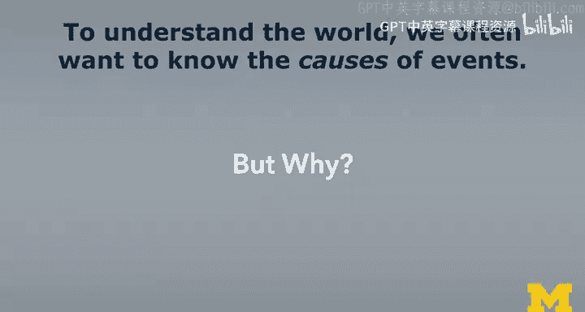
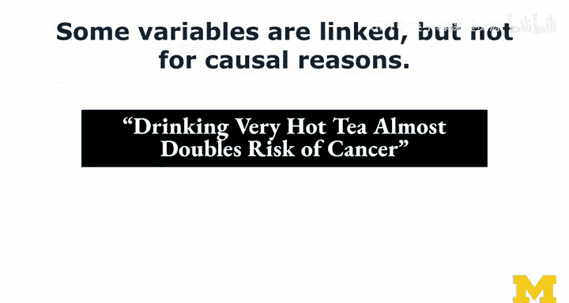
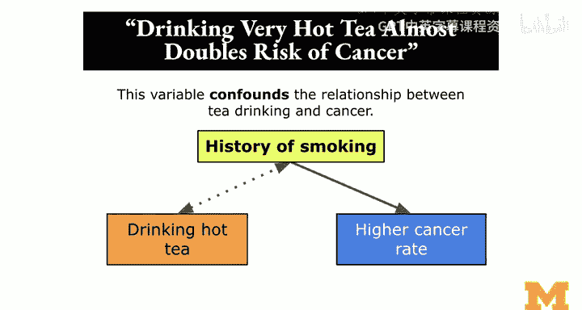
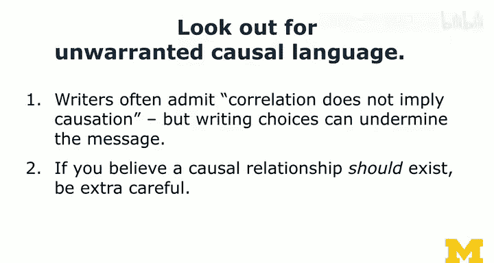

# 密歇根大学《理解数据》课程 - P23：质疑背后的逻辑 🔍

在本节课中，我们将学习如何审慎地评估因果关系。我们经常希望了解事件的原因，但要证明因果关系非常困难。世界上的许多事物会同时发生，但这并不意味着它们之间存在因果联系。我们将探讨虚假相关、混杂变量以及如何避免在解读数据时陷入因果推断的陷阱。

## 相关不等于因果 🤔

上一节我们介绍了理解因果关系的普遍需求，本节中我们来看看为什么确立因果关系如此困难。这是因为世界上许多事物会同时发生，但并不具有因果关系。

一个专门分享虚假相关的网站提供了这样的例子：缅因州的离婚率与人造黄油的年人均消费量存在相关。两条趋势线高度同步，看起来人造黄油的消费量与缅因州的离婚率密切相关。

以下是另一个例子：马苏里拉奶酪的人均消费量与颁发的土木工程博士学位数量相关。

像这样的关系很多只是虚假的，这正是该网站名称“虚假相关”的含义。这可能只是因为世界上发生的事情很多，有些恰好会同时发生。

“相关”这个词具有非常特定的技术含义。有些人认为，只有在确定其技术含义正确时才应使用它。但这个词在日常使用中已经非常普遍，因此在日常语境中，它通常意味着两件事物看起来有关联或相关，它们朝着相同的方向变化。

## 关联背后的混杂因素 🔄

现在，一些变量是相互关联的，但并非出于我们以为的因果原因。让我们回到关于喝热茶的例子。一项研究报告称，喝非常热的茶会使患癌风险几乎翻倍。该研究报告了一种关联：在热茶饮用者组中观察到的死亡人数多于凉茶饮用者组。

然而，一位科学家对此论文发表了评论。他们向期刊提交了反驳，指出研究中的两组人除了喜欢的茶温不同外，在其他重要方面也可能存在差异。这些组在性别、吸烟史和饮酒习惯上也不同。为什么这很重要？

根据新闻报道，如果我们看到喝热茶与更高的癌症发病率相关，报道似乎暗示存在直接的因果关系，即喝热茶导致了更高的癌症发病率。但评论者指出，可能还有其他因素在起作用。

热茶饮用者往往也有吸烟史，而吸烟史才是导致更高癌症发病率的原因。因此，喝热茶与更高的癌症发病率没有直接的因果关系，它是相关的，在这里它与吸烟史同时发生，而吸烟史才是因果因素。

我们会说，吸烟史这个变量混淆了喝茶与癌症之间的关系，它增加了一点迂回。

不幸的是，这两种因果路径都可能导致研究中出现喝热茶与癌症之间的明显关系。因此，仅仅知道热茶组有更多人死于癌症，我们实际上无法厘清究竟是这两种路径中的哪一种。

## 确立因果关系的门槛 ⚖️

由于这类问题，以及像马苏里拉奶酪和博士学位数量那样的虚假相关问题，确立因果关系的门槛非常高。因此，我们常常会怀疑：这真的是因果关系吗？

因果关系是一个非常深奥的话题，我们现在无法全面探讨。非常直白地总结：大多数科学家会接受特定类型的实验作为因果关系的证据，但前提是满足某些条件。有时，他们也会接受相关性作为证据。😊 而有时，这两种选择都不可行，我们无法完全达到我们期望的条件。

但这个门槛相当高，我们将在第二部分（关于科学的部分）中进一步讨论。

## 故事叙述中的因果暗示 📰

即使没有任何科学依据得出结论，也很容易暗示因果关系。以下是《纽约时报》的一篇文章。

到2019年，汽车事故年死亡率接近自20世纪20年代汽车成为大众商品以来的最低水平。但随后COVID-19疫情来了。事故和死亡人数在2020年夏天开始激增，这让交通专家感到惊讶，他们原本希望相对空旷的道路会导致事故减少。相反，攻击性驾驶的增加完全抵消了驾驶量的下降，并且在疫情后期人们重返道路时，事故持续增加。

这个故事对我来说暗示了一种特定的因果路径：COVID-19疫情可能导致更高的压力，从而引发更多的攻击性驾驶，而这种攻击性驾驶导致了交通死亡人数的增加。

但是，研究交通死亡事故的科学家们是怎么想的呢？通过阅读那篇报道，我找到了一个链接，指向一份研究报告，该报告呈现了关于死亡人数增加的数据。这份报告来自美国交通部，由一个专门研究交通死亡事故和该数据集的科学家团队撰写。

在那份报告中，研究人员提出了几种可能的因果路径：
*   可能是COVID-19疫情导致更多人居家办公，这意味着道路上的汽车减少。随着汽车减少，人们觉得可以开得更快，这导致了更多的交通死亡事故。
*   他们提出的另一种路径是，医务人员忙于应对疫情，导致对事故的响应时间延长。响应时间延长意味着人们会死于以往可能不会致命的伤害，这导致了更多的交通死亡事故。
*   另一种路径是，COVID-19疫情导致毒品和酒精使用增加，可能是作为应对压力和孤立的一种机制，这进而导致更多受损驾驶，从而引发更多交通死亡事故。
*   他们还提出，这种增加可能并不直接归因于疫情，但可能存在其他因素导致安全带使用率降低。安全带使用率下降的趋势难以解释，这可能导致了更多的交通死亡事故。
*   此外，他们还注意到更多分心驾驶的证据，其起源不明，可能是交通死亡事故的原因。

有趣的是，该报告完全没有提及攻击性，实际上根本没有提出这个攻击性假设。

因此，疫情 → 攻击性驾驶增加 → 交通死亡事故增加这条因果路径可能是真实的，但其他许多路径也可能成立。事实上，这并非公路研究人员注意到或考虑的一条路径。

所以，尽管我认为这篇报道的作者可能会说，你无法从数据中得出非常非常强的因果主张，但在故事叙述中，似乎夸大了对因果关系的确定性。我特别注意到像“但随后COVID-19疫情来了”这样的句子，我认为在故事叙述中，这确实设定了疫情是改变游戏规则的关键因素。然后我们看到，事故和死亡人数大约在那个时候开始激增。特别是“攻击性驾驶的增加完全抵消了驾驶量的下降”这句话，这听起来像是对正在发生的事情提出了一个相当强的机制性主张。

## 我们为何容易轻信因果？ 🧠

为什么会这样？为什么作者可以提出带有强烈因果暗示的主张，而实际的科学家却没有做出如此强烈的主张？

可能作者像我们许多人一样，希望他们认为不好的事情对世界产生坏的影响。也许他们个人深受隔离影响，觉得这让他们变得有攻击性，并且因为这是一种强烈的个人体验且显得如此负面，他们便将这种视角套用在这些数据上，而这些数据可能与攻击性有关，也可能无关。

同样，我们也希望好的事情产生好的效果。所以我认为，有时当我们想相信某件事在道德上是好的时，我们真的希望确信它正在世界上产生可衡量的好处。有时，因为我们带着这些欲望——希望我们不喜欢的事情产生坏的影响，认为好的事情产生好的影响——我们可能更容易倾向于想要解读事物对世界影响的强烈因果陈述。

## 审慎对待因果陈述 ⚠️

但我们必须对因果陈述非常小心。事物可能因为完全荒谬的原因而看起来相关，事物也可能相关，但原因并非我们最初假设的那样。

还有一个危险区让这件事变得格外困难，我们必须在这里格外小心。但人们犯错的另一种方式是，淡化已经确立的因果关系，比如吸烟与肺癌。现在已知，一种非常有效的虚假信息策略——烟草公司使用的策略——就是增加对吸烟与肺癌之间关系的怀疑，而这种关系在目前已经得到了相当充分的研究和确立。

因此，你需要警惕的是无根据的因果语言。作者常常会承认相关不等于因果，但同时，他们可能使用削弱这一信息的写作选择。

如果你相信应该存在一种因果关系，如果你认为某件事如此糟糕，以至于它必然对世界产生可衡量的坏影响，或者如此之好，以至于它必然对世界有益，那么请格外小心你接受哪些数据作为证据。

本节课中我们一起学习了区分相关与因果的重要性。我们看到了虚假相关的例子，理解了混杂变量如何扭曲我们对因果关系的看法，并认识到在故事叙述和数据解读中，无根据地暗示因果关系是多么常见。关键在于保持审慎，对因果主张提出质疑，并意识到我们自身的偏见可能会影响判断。确立因果关系需要严格的证据，而简单的关联远不足以证明因果。