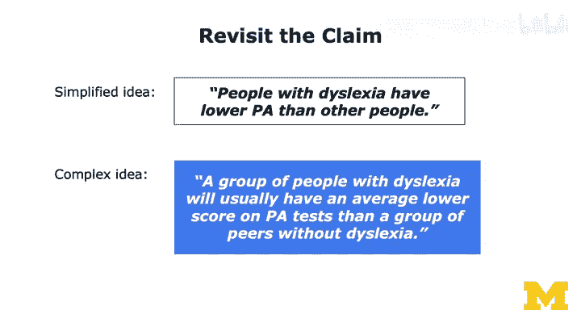
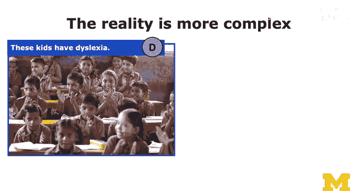
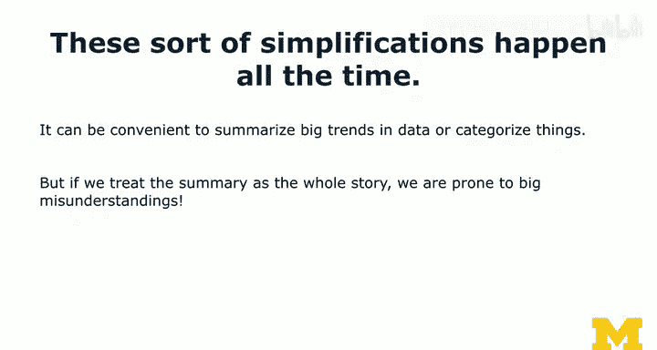

# 24：统计摘要与信息压缩 📊

在本节课中，我们将要学习统计摘要如何帮助我们压缩信息，以及在使用这些摘要时可能遇到的思维陷阱。我们将通过一个关于阅读障碍的具体研究案例，来理解简化信息带来的好处与风险。

## 统计摘要：信息的“速记法” 📝

上一节我们介绍了数据分布的概念，本节中我们来看看如何用统计量来概括数据。

统计量常被用来总结数据。我们不必讨论整个数据分布，而是可以谈论均值或中位数。换句话说，我们使用统计量作为一种速记法。例如，我们可以告诉某人某个机场航班延误的中位数，而不是展示整个分布或提供完整的数据集。

然而，这种速记法可能导致思维问题。人们很容易忘记速记只是一种方便的摘要，而非全部事实。

## 案例研究：阅读障碍与语音意识 🧠

为了具体说明，我们来看一个来自博士研究的例子，该研究是关于阅读障碍的。

阅读障碍是一种人们难以学习阅读的状况，其原因不易解释。这与资源或努力程度无关，对许多人来说，学习阅读本身就存在挑战。研究发现，有一些文字游戏是许多阅读障碍者觉得困难的。例如，告诉你单词“cup”，然后让你将其分解为“c”和“up”。这被称为语音意识，即注意到口语单词如何被分解成更小的单位。出于某种原因，有阅读障碍的人往往比没有阅读障碍的人觉得这项任务更具挑战性。

因此，我们常听到关于阅读障碍的陈述，例如：“有阅读障碍的人比其他人的语音意识更低”（有时缩写为PA）。但数据实际看起来是怎样的呢？

以下是来自“健康大脑网络”数据的一些可视化结果，这是对纽约市儿童的一项大型研究。每组大约有100名年龄相仿的儿童，一组有阅读障碍，另一组没有（在科学术语中，无任何诊断的组通常称为对照组）。

以下是两组在语音意识任务上得分的分布情况：
*   对照组倾向于获得更高的分数。
*   这是一个相当稳健可靠的发现：两组之间的平均测试分数（我用这些线标出，代表了分布的峰值）存在差异。
*   蓝色实线是有阅读障碍儿童组的平均分。
*   红色虚线是没有阅读障碍儿童组的平均分。
*   在这种语音意识的标准化测量中，对照组的儿童倾向于获得更高的分数。

但请注意，这两个分布有巨大的重叠区域。我在这里指出这个紫色的中心区域，紫色表示重叠，既不是纯红色也不是纯蓝色。

这意味着，有一些有阅读障碍的孩子（用带圆圈D表示）在语音意识测量中得到了大约8分。同时，也有一些没有阅读障碍的人（用C表示）在语音意识测试中得分更低，尽管他们没有阅读障碍，并且可能以后也不会发展出阅读障碍。

因此，当人们声称“有阅读障碍的人比其他人的语音意识更低”时，这实际上是一个更复杂概念的速记。完整的说法是：“一组有阅读障碍的人通常在语音意识测试上的平均分低于一组没有阅读障碍的同龄人。”这句话很长，所以我们想缩短它。

## 信息压缩带来的思维简化 🤔

上一节我们看到了数据摘要的具体形式，本节中我们来探讨这种压缩如何影响我们的思维。

但这种缩短对我们的思维产生了影响。当我们听到“有阅读障碍的人比其他人的语音意识更低”时，听起来像是在说：如果我们面前有两个孩子（比如这张图中正在阅读的孩子），被蓝色圆圈圈出的女孩有阅读障碍，旁边被红色圆圈圈出的女孩没有，那么这句话听起来就像在说：有阅读障碍的女孩比没有阅读障碍的女孩语音意识更低。

但现实更为复杂。我们并不知道那个有阅读障碍的女孩一定比旁边的女孩语音意识更低。现实情况是，如果我们有一个全是阅读障碍儿童的教室和另一个全是非阅读障碍儿童的教室，我们计算并比较这两个教室的平均分，我们很可能会看到平均分的差异，但两组之间会有大量的重叠。

这是一个例子，说明进行分类是如何减少信息的。当我们说“这些孩子都有阅读障碍”时，我们某种程度上是在简化，这种陈述有时会过度简化这些孩子的语音意识状况。

## 分类的本质与连续性现实 📈

这部分问题首先在于我们如何定义阅读障碍。事实上，没有完美的测试能准确告诉我们谁有阅读障碍。因为我们常常需要排除其他可能导致孩子学习阅读困难的原因。例如，如果我们发现一个孩子上学前没吃好早餐，饥饿就是他们在课堂上学习困难的很好理由；或者他们家里可能有压力很大的情况，而有时这很难被发现。由于需要排除许多因素，一开始就很难精确确定谁有阅读障碍。

此外，阅读能力在人群中是连续变化的。这是一篇关于发展性阅读障碍综述论文中的观点。在不同文化中，当我们根据某种标准化测量（衡量人们阅读速度和效率）来测量人群的阅读能力时，阅读障碍者往往只是处于那个连续体的较低端。它不像底部有一个单独的凸起，突然出现大量阅读障碍读者；它更像是一个正态分布。就像任何正态分布一样，有些人处于顶端（原因未知），有些人处于另一端（原因也不完全清楚）。

但我们划了一条阈值线。有些随意地，我们画了一条线，并说线这一边的所有人将获得治疗。我们做了一个二元决定，关于谁将被归为某一类，以便为他们提供服务和支援。

但这意味着，如果这两个女孩恰好落在这条线的两侧，她们之间的差异可能微乎其微。她们可能极其相似，仅仅因为我们强加了一个分界点，她们就可能被描述成非常不同的人，而实际上她们之间的差异可以忽略不计。

因此，当我们谈论有阅读障碍的人时，必须小心记住，他们与其他学习者并非处于完全不同的类别，他们实际上处于同一个连续体上。首先将阅读障碍作为一个类别来谈论，实际上是人类做出的一种简化选择。

## 总结与启示 🎯

本节课中我们一起学习了统计摘要作为信息压缩工具的双重性。

这类简化时刻都在发生。总结数据的总体趋势或对事物进行分类可能很方便，但如果我们把摘要当作完整的故事，往往容易产生巨大的误解。关键在于认识到摘要的价值在于其便捷性，但同时要牢记其背后隐藏着更丰富、更复杂的现实。在数据分析和科学沟通中，保持这种警惕性至关重要。