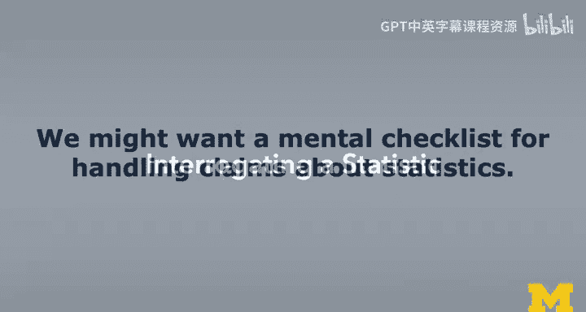
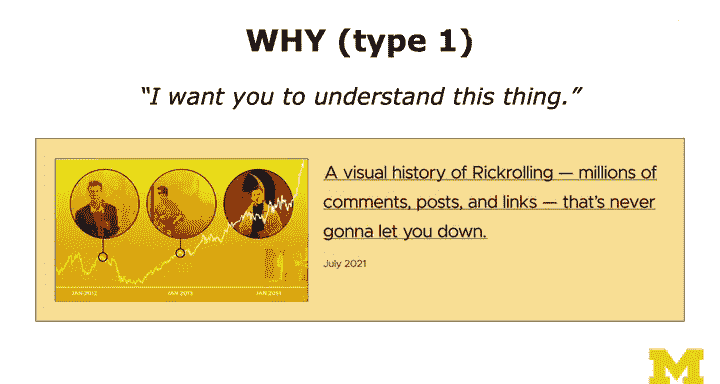
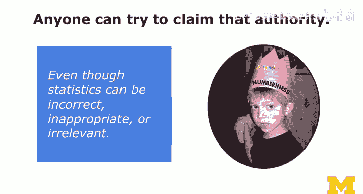
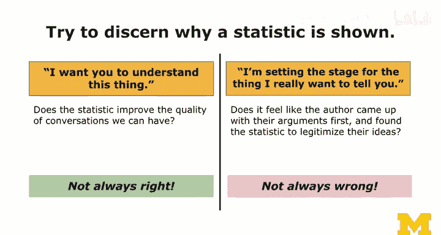

# 25：统计数据的审辨方法 🔍

在本节课中，我们将学习如何审辨日常生活中遇到的统计数据和相关主张。我们将介绍一个实用的“5W”检查清单，并通过具体案例来练习如何应用它，以判断一个统计主张是否可靠、清晰以及其背后的意图。

---

## 5W检查清单：审辨统计主张

为了系统地评估一个统计主张，我们可以使用一个包含五个“W”问题的检查清单。这五个问题分别是：**Who**（谁）、**What**（什么）、**How**（如何）、**When**（何时）以及**Why**（为什么）。

上一节我们介绍了审辨统计数据的重要性，本节中我们来看看这个具体的检查清单如何应用。

### 1. Who：关于谁？谁说的？

这个问题关注的是统计主张的主体和提出者。

*   **谁说的？** 我们需要考察提出主张的人或机构的资质和背景。他们是否有相关的专业知识或经验？
*   **关于谁？** 这个统计数据描述的是哪个群体或对象？

**案例分析：**
在一篇名为《我是一名纽约市护理人员，我从未见过这样的心理健康危机》的文章中，作者声称“在11月的最后一周，911调度员平均每天接到425个情绪失常人员（EDP）的呼叫”。
*   **谁说的？** 作者是一名在纽约市有近20年工作经验的医疗急救员。这使他具备谈论此话题的合理资质。
*   **关于谁？** 统计数据是关于纽约市的911调度员。

### 2. What：统计内容是什么？

这个问题旨在厘清统计数据的定义、单位和基准。

*   **单位是什么？** 统计数据以什么形式呈现？（例如：每天呼叫次数、百分比、绝对数量）
*   **基准是什么？** 与什么进行比较？所谓的“增长”是相对于哪个时期或数值？
*   **统计捕捉的是什么？** 核心概念是如何定义的？例如，“情绪失常人员（EDP）”的确切定义是什么？

**案例分析：**
*   **单位是**：`呼叫次数/天`。
*   **基准未知**：我们不知道在作者声称的“危机”时期之前，典型的呼叫量是多少。是200次？还是400次？没有基准，我们难以判断425次是否真的异常高。
*   **定义模糊**：我们不清楚“情绪失常人员”的具体判定标准，这会影响数据的准确性和可比性。

### 3. How：数据如何收集与分析？

这个问题探究数据产生的方法和过程。

*   **如何收集？** 数据是通过什么渠道、以什么方式记录下来的？不同来源的数据如何整合？
*   **如何分析？** 对原始数据进行了哪些计算或处理？（例如，是简单计数，还是计算了平均值？）

**案例分析：**
我们只能假设全市的呼叫中心有统一的记录系统，并且这些数据被标准化地汇总起来。分析方式似乎是简单的计数和求日平均值，但这只是我们的假设，文章并未说明。

### 4. When：数据来自何时？

这个问题关注数据的时间背景。

*   统计数据涉及哪个具体时间段？时效性如何？

**案例分析：**
时间点非常明确：**“在11月的最后一周”**。

### 5. Why：为何使用此统计？

这是最关键的问题，旨在洞察作者引用该统计数据的根本目的。通常有两种主要类型：

**类型一：旨在增进理解**
作者希望帮助你理解某个现象。例如，一个数据可视化网站用各种图表分析“瑞克摇”（Rickrolling）这种网络迷因的历史和模式，目的是拓展读者对这个现象的认识。

**类型二：为观点铺垫**
作者引用数据主要是为了给后续要阐述的个人观点或主张增加权威性和说服力，数据本身并非文章讨论的核心。

**案例分析：**
回顾护理人员的文章，其开篇主题句是：“在我近20年的医疗急救员生涯中，我从未见过纽约当前正在经历的这样的心理健康危机。”
*   文中引用的“日均425个呼叫”这个数据，似乎并非为了让我们深入理解呼叫中心的具体运作，而是为了**给作者的个人观察和经历增加分量**，用“客观数据”来证明“危机确实存在，并非我个人的主观感受”。
*   这一点可以从我们无法完全回答 **What** 和 **How** 中的细节问题得到佐证。如果目的是增进理解，这些信息通常会更明确。

---

## 关于“Why”的深入思考

为什么区分“Why”的两种类型如此重要？

首先，数字常被赋予权威性。在我们的文化中，数字常被视为最权威的证据形式。然而，任何人都可以尝试利用这种权威，就像孩子戴上纸皇冠模仿国王一样。一个统计数据可能本身是准确的，但被用在不相关或不恰当的论证中；反之，一个旨在增进理解的统计，也可能因为计算错误而变得不准确。

因此，**统计数据的目的（Why）与其正确性（正确/错误）是两个独立的维度**。我们不能因为一个数据被用来“铺垫观点”就断定它一定是错的，也不能因为一个数据旨在“增进理解”就认定它一定是对的。

关键在于，当统计数据并非文章核心时，对其呈现的严谨性要求**可能**会降低，但这只是一种倾向，并非绝对。作为审辨的读者，我们需要对这种可能性保持警惕。

---

## 总结

本节课中，我们一起学习了审辨统计数据的“5W”方法。通过 **Who、What、How、When、Why** 这五个问题，我们可以系统地剖析一个统计主张：
*   检查其来源和背景（Who, When）。
*   厘清其定义和基准（What）。
*   审视其产生过程（How）。
*   最重要的是，洞察其使用目的（Why）。

掌握这个方法，能帮助我们在面对海量数据信息时，不再盲目采信，而是能够提出关键问题，做出更明智的判断。记住，理解一个统计数据的“为什么”，往往是评估其价值和可靠性的第一步。