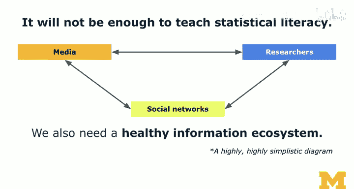

# 26：风格、权威与可信度 📊

在本节课中，我们将探讨如何评估日常遇到的各种统计数据和主张的可信度。我们将学习，由于时间和精力的限制，人们常常依赖表面线索（如风格、来源）来判断信息是否可靠，并理解这种方法的优势与潜在风险。

## 统计数据的背景缺失

上一节我们讨论了统计数据可能存在的陷阱。现在，我们来看一个具体的例子，它展示了当我们缺乏完整背景时可能遇到的问题。

在11月的最后一周，纽约市911调度员平均每天接到425个关于“情绪失常人士”（EDP）的电话。

对于这个统计，我们可能会产生许多疑问。以下是几个关键问题：
*   这些电话是如何被分类和计数的？
*   “情绪失常人士”这个类别，是否真的等同于我所理解的“心理健康危机”？
*   我应该将这个数字与什么基准进行比较？在当前危机之前，日均呼叫量是多少？
*   专家是否会首先同意这是一个有效的衡量指标？

## 验证的困难与现实限制

上一节我们提出了疑问，本节中我们来看看为什么亲自验证一个统计数据如此困难。

我尝试去验证这个统计数据，但这将非常困难，原因有以下几点：
*   **数据访问限制**：我无法轻易在互联网上找到纽约市所有的911通话记录。
*   **技术复杂性**：通话记录系统可能涉及从不同操作员那里汇总数据，这是一个技术上复杂的过程。
*   **专业知识的缺乏**：我没有医学专业知识来验证“情绪失常人士”这个分类标准是否有效。
*   **时间成本**：我没有足够的时间去完成所有这些验证工作。

我们每天都会遇到大量统计数据，而时间和脑力是有限的资源。因此，无论好坏，由于我们没有时间和精力去深入核查每一条信息，我们常常依赖**风格**来决定信任哪些来源。

## 通过风格评估可信度：实例分析

既然我们认识到依赖风格是常见做法，本节中我们来看看如何具体应用这种方法，并分析其局限性。

我将暂时摘下统计学家的“帽子”，尝试以普通人的视角，仅凭风格来权衡一个Instagram帖子的可信度。我们可以将信息来源分为两类：**真正的权威**和**伪装成权威**。

**第一个例子：一个关于婚姻的“事实”帖**
这个帖子声称：“事实：与最好的朋友结婚的人，离婚的可能性降低70%。”
*   **支持可信的线索**：它自称是“事实”；使用了看起来很专业的希腊字母符号；包含具体的数字“70%”；内容听起来合理。
*   **削弱可信的线索**：没有提供任何来源或引用；发布者明确要求“标记和分享”，有吸引眼球的动机；设计看起来有些业余；不清楚“心理学事实”这个账号背后是谁。

仅凭这些表面标记，我不会完全相信这个信息。

**第二个例子：一个关于抑郁的“事实”帖**
这个帖子声称：“事实297：最近一项研究表明，如果成年人在一周内活动量稍微增加，近12%的抑郁症病例本可以预防。”
*   **支持可信的线索**：数字“12%”听起来很精确；使用了“抑郁”、“稍微增加”等科学或专业术语；使用了“个体”而非“人们”这类更正式的词汇；有一个看起来很专业的蓝色大脑标志。
*   **削弱可信的线索**：同样没有提供研究来源；发布者要求“分享给需要的人”，虽然看似公益，但仍意在传播；不清楚“每日心理健康事实”账号背后是谁。

这个例子更难判断，可信度模棱两可。

**第三个例子：《纽约时报》的文章**
现在我们回顾最初关于911电话的报道，它来自《纽约时报》。
*   **支持可信的线索**：作者具备专业资质；文章使用了具体和技术性的语言（如“11月最后一周”、“EDP”、“日均425通”）；似乎提供了相关引用链接；《纽约时报》拥有事实核查团队，并曾发布过更正。
*   **需要注意的线索**：如果你不信任这个新闻媒体，你可能会将其归为不可信来源；此外，作者提到目睹更多心理健康危机，这与我个人的观察相符，这种共鸣虽然强烈，但属于主观判断。

## 依赖风格判断的风险与脆弱性

通过以上分析，我们看到依赖风格有其作用，但本节中我们必须正视这种方法的核心漏洞。

由于之前提到的种种原因，我很难亲自验证那个911的统计数据。因此，我最终可能根据表面信号来决定是否信任这篇报道。这些信号可能包括：
*   写作风格
*   是否显得“科学”
*   出版商和作者的资质
*   是否与我的世界观相符

这种方法的**脆弱性**在于：**任何人都可以用听起来权威的语言来呈现发现**。即使我们努力培养“不良统计检测器”，熟悉常见的报告错误，问题依然存在。

我们遇到的许多统计主张可能是**不完整**或**模糊**的。
*   **不完整**意味着我们缺少充分理解该统计数据的含义和来源所需的细节。
*   **模糊**意味着它们与多种解释相符，而不仅仅是作者暗示的那一种。

## 建立健康的信任基础与信息生态系统

那么，这是否意味着我们注定无法可靠地学习自身经验之外的知识呢？并非如此。

当我们拥有**健康的信任基础**时，我们就可以借助他人的专业知识进行学习。如果我们信任统计数据产生和呈现的**过程**，那么我们就不必亲自验证一切，可以依赖他人的专业知识。

当然，现实并非总是如此理想。我们生活在一个复杂的世界，需要一个**健康的信息生态系统**。这个系统需要多方协同工作：
*   **媒体**需要始终专业、诚信地行事，并在报道出错时迅速更正。
*   **研究者**在收集数据、进行分析和总结时必须具备能力并保持诚信。
*   **社交网络**中的公众人物、专家以及我们的朋友和家人，都需要以关心彼此的方式行事，帮助我们培育良好的信息环境。

## 总结与展望

本节课中，我们一起学习了评估信息可信度的现实挑战。我们认识到，由于信息过载，仅靠统计素养并不足够，我们不可避免地需要运用“信任”。在理想情况下，这种信任不应基于表面风格，而应基于对产生知识的**可靠过程**的理解。

这是一个高度复杂的话题。下图是一个非常简化的示意图，展示了从数据到我们最终接收到的“知识”或“主张”之间，可能经过的多个处理阶段和参与者，这说明了话题的微妙性。

`[知识/主张] <-- 解释/总结 <-- 分析 <-- 收集 <-- [原始数据/现象]`

最终，我们需要超越仅仅使用风格标记，努力在一个由媒体、研究者和社交网络共同构成的健康信息生态系统中，培养基于过程的、更深层次的判断力。

---
**本节课中我们一起学习了：**
1.  统计数据常常因背景缺失而难以评估。
2.  由于现实限制，人们常依赖风格（如语言、来源）快速判断可信度。
3.  通过实例分析了如何用风格评估信息，并识别了其核心风险：权威性可以被伪装。
4.  指出了统计主张可能“不完整”或“模糊”的问题。
5.  提出了解决方案：建立基于可靠过程的信任，并需要一个由媒体、研究者和公众共同维护的**健康信息生态系统**。