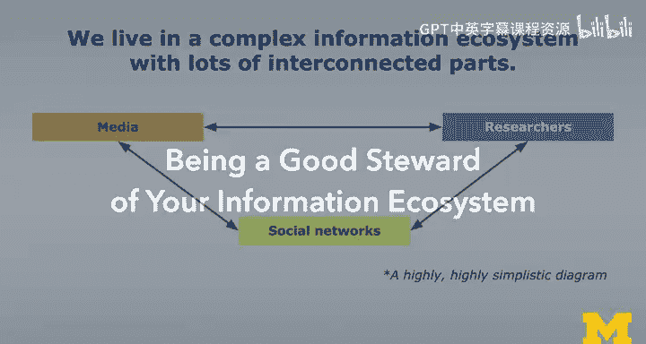
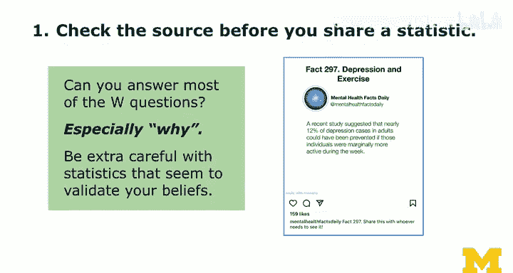
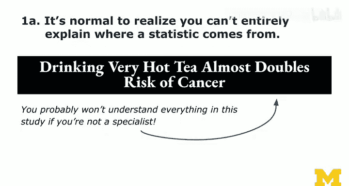
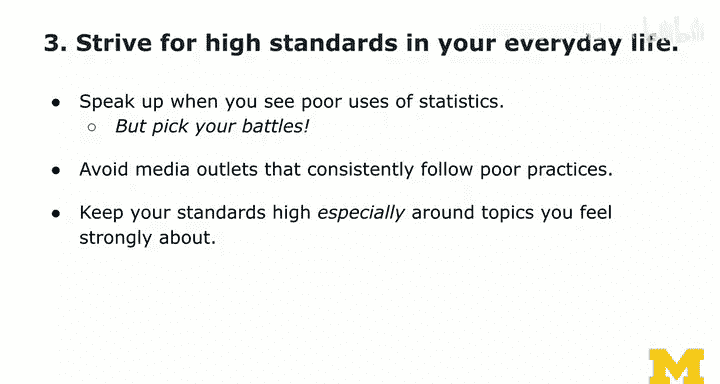

# 27：成为信息生态的合格管理者 📊

在本节课中，我们将学习如何在复杂的信息生态系统中成为一名负责任的管理者。我们将探讨在社交媒体网络中分享和评估统计数据时应遵循的关键原则，以帮助您更明智地处理信息。

正如我们刚才所见，我们生活在一个复杂的信息生态系统中，其中包含许多相互关联的部分。

现在，您可能身处其中，您可能是媒体的一部分，也可能是一名研究人员或统计数据的生产者。但我认为，所有观看本课程的人都是他人社交网络的一部分。因此，我想聚焦于社交网络这一部分，探讨如果您身处其中，可以做些什么。

## 1. 分享前核查来源 🔍

上一节我们介绍了信息生态的复杂性，本节中我们来看看作为社交网络中的一员，首先应采取的行动：在分享统计数据前核查其来源。

以下是核查时应遵循的步骤：
*   **运用“W问题”**：查看您打算分享的内容，尝试回答大部分“W问题”（如谁、什么、何时、何地、为何）。其中，“为何”这个问题通常最为重要。
*   **评估来源可信度**：观察信息来源是否通常能提供回答这些问题所需的大部分信息。
*   **警惕确认性偏见**：当遇到似乎能验证您原有信念的统计数据时，要格外小心。在这种情况下，我们往往更容易忽视其中的问题。

## 2. 正确看待统计数据的权威性 ⚖️

核查来源是第一步，接下来我们需要反思统计数据本身扮演的角色。本节中我们来看看如何避免过度依赖或误用统计数据的“权威性”。

以下是相关的行动指南：
*   **认识坏数据的危害**：一个糟糕的统计数据可能比没有数据更糟，因为人们通常非常严肃地对待统计数据，倾向于视其为权威，即使我们知道它们可能存在问题。
*   **接受测量的局限性**：如果无法很好地测量某事物，考虑完全不为其赋予数字。直接说明“没有好的方法来测量这个”是可以接受的。
*   **重视其他认知方式**：不必总是依赖统计数据。讲述个人经历是完全可以的。有时，直接询问“你在这里的经历如何”这样的叙述性方式，可能比试图获得一个数字更能提供所需信息，甚至是更好的信息。

## 3. 在日常生活中践行高标准 🧭

了解了评估和使用的原则后，最后我们来看看如何在日常互动中应用这些高标准，以改善整体的信息环境。

以下是您可以采取的具体做法：
*   **有选择地发声**：当看到对统计数据的误用时，可以提出意见，但建议选择“战场”。判断其利害关系和对方真正的沟通意图。如果它会影响人们的生活，或将被引为某项您不确定的变革的理由，这些就是应该发声的情况。
*   **避开惯犯媒体**：避开那些持续遵循不良做法的媒体渠道。您寻找的应该是那些会对建议和更正做出回应、进行尽职调查的媒体。如果您常读的媒体一再犯下本课程讨论过的错误，可以考虑将其从您的信息“食谱”中移除。
*   **在关切领域保持高标准**：在您深切关注的话题上保持高标准。这不仅关乎确保您能获得最充分的信息，也有助于为您所信仰的事业构建更坚实的论据。

在本节课中，我们一起学习了在信息生态中成为合格管理者的三个核心实践：分享前严谨核查来源、审慎看待统计数据的权威性而非盲目使用，以及在日常生活中有策略地践行高标准。通过应用这些原则，我们可以更负责任地参与信息传播，并帮助提升公共讨论的质量。