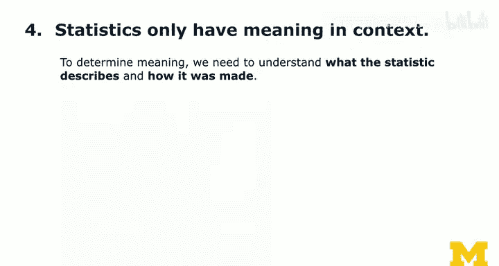
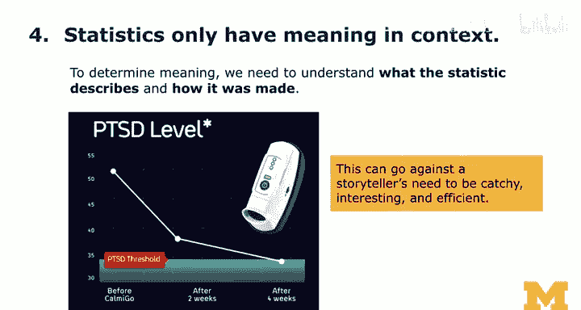
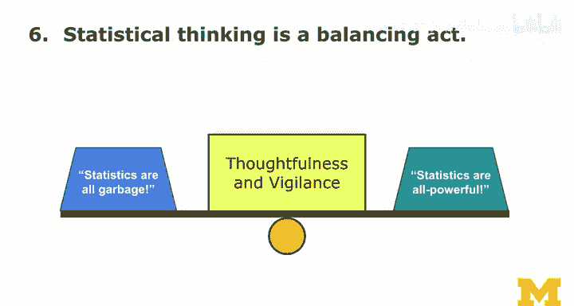
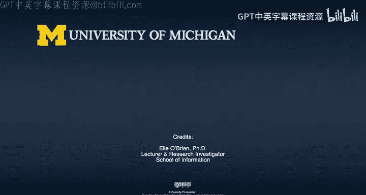
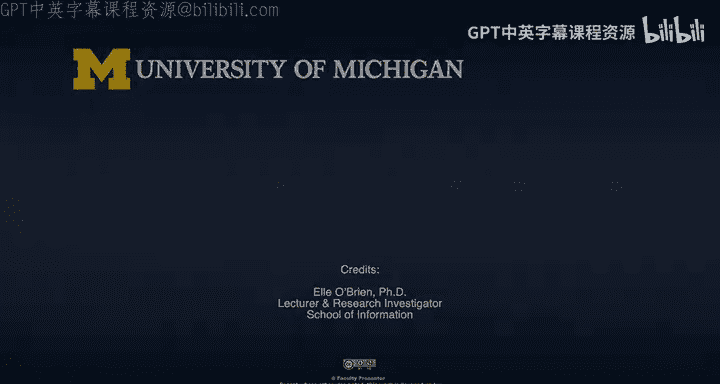

# 28：如何描述数据 📊

在本节课中，我们将对统计素养系列的第一部分内容进行一次全面的回顾。我们将梳理已学习过的核心概念，并探讨如何在实际中应用这些知识来理解和描述数据。

---

## 🔍 统计是由人创造和分享的

上一节我们介绍了统计的本质，本节中我们来看看统计作为工具的具体特点。我们曾用一棵树的图形来引发思考：如何测量树的大小？事实证明，存在多种可能的定义。

统计是理解世界的工具，但我们必须做出选择：我们要测量或计算什么（比如那棵树）？我们如何首先获取数据？我们将如何总结数据？我们如何解释结果？

---

## ⚖️ 有用的统计与恰当的总结

并非所有统计量都同样有用。一个统计量要有用，就必须是对你所关心事物的恰当总结。

以下是统计量需要满足“恰当性”的几个方面：

*   **总结方法的正确性**：我们讨论过**均值**和**中位数**，需要根据情况选择。例如，何时真正应该使用中位数？选择哪个统计量作为总结并非小事。
*   **测量的有效性**：你所测量的事物是否与你真正想理解的东西紧密对应？就像“情绪戒指”并不是对某人情绪的恰当总结，它实际上对应的是体温，这两者是不同的，其**效度**很低。因此，我们的方法和测量需要大体上符合我们希望理解的内容。

---

## 📉 统计永远伴随不确定性

每个统计量都具有不确定性，我们永远无法摆脱这一点。不同的度量尺度不同，并非所有的不确定性都是相等的，有些尺度优于其他尺度。

因此，说“总存在不确定性”并不等同于说“一切都是随机的，我们无法知道任何事”。我们可以努力减少不确定性，只是无法完全消除，它永远不会完全消失。

---

## 🧩 统计的意义在于语境

统计量只有在特定语境中才有意义。要确定一个统计量的含义，我们需要理解这个统计量描述的是什么，以及它是如何产生的。

例如，我们有一个显示“PTSD水平”的吸入器设备图表。我们确实能看到数字，但要理解其真正含义，你必须了解一些背景：这个水平是如何测量的？坐标轴代表什么？具体是什么在下降？“PTSD水平”究竟是什么？这对使用该设备的人有多大影响？因此，在统计学中，我们不能将数字与其语境割裂开来。

重要的是，我们需要理解统计数据的来源才能正确解读它们，但这可能与讲故事者需要吸引人、有趣或高效的需求相冲突。因此，制作图表的人可能与我（作为解读者）存在一些相互竞争的动机。

---

## ⚡️ 总结的效率与细节的隐藏

统计帮助我们进行高效的总结，但这些总结可能会隐藏细微差别。

例如，我们如何谈论属于两个不同群体（如有些孩子被诊断为阅读障碍，有些则没有）的人？这两个群体孩子的发展路径有很大重叠，他们并非完全不同的群体。而我们谈论群体差异时使用的语言，可能会极大地夸大我们在文化上对这些差异的认知。当我们把他们作为群体来谈论，并讨论关于平均差异的宏大总结时，我们常常会忽视：这些群体中个体之间的差异，往往比我们想象的要小得多。

---

## 🤹 统计思维是一种平衡艺术

最后，统计思维是一种平衡艺术，我认为这是我们许多人每天都在努力应对的挑战，这种挣扎可能永远不会完全消失。

我们可能处于两种极端之间：
一方面，我们可能认为统计都是垃圾，只是人们操纵数据以获得他们想要的数字，毫无用处。
另一方面，我们可能相信统计无所不能，只要我们拥有统计数据，一切都可以被认知。

我们可能会在这两者之间摇摆，要避免极端确实非常困难。但我们可以通过练习（这可能需要很多年，有时你可能会失去平衡）来找到一条中间道路。如果我们对所测量和阅读的内容进行深思，保持警惕（不轻易放弃或让任何信息蒙混过关），我们或许可以在这两个极端之间共存，并利用统计来进行更好的对话，更好地理解对我们重要的一些事情。

---

## 🎯 总结

在本节课中，我们一起回顾了描述数据的核心思想：
1.  统计是由人创造和分享的工具，其构建过程涉及一系列选择。
2.  有用的统计量需要是**恰当**的总结，包括方法正确和测量有效。
3.  所有统计量都伴随**不确定性**，我们可以管理但无法消除它。
4.  统计量的**意义完全依赖于其产生的语境**，脱离背景的数字毫无意义。
5.  统计总结在提升效率的同时，也可能**隐藏重要的细节和差异**。
6.  培养统计思维意味着在“全盘否定”和“盲目相信”之间找到一种**批判性且平衡的**中间立场。

---

## 🚀 下一步：科学与知识

既然你已经了解了这么多关于描述统计的知识，接下来我们将讨论**知识**。知识是我们认识世界的方式，这是一个极其有趣的话题。

我们知道统计是我们创造知识的一部分，但科学也是。科学是我们创造新知识、学习和检验假设的过程，本身就是一个奇妙而复杂的话题。

在课程的下一个部分，我希望提供一些见解，关于统计如何被用于科学中以检验假设、创造新知识，以及当前科学界关于“数字在创造新知识中扮演什么角色”的一些最大复杂性、张力和争论。我也希望这能让你对科学如何运作有一些有趣的见解，这些可能是你仅从消费科学新闻中无法获得的。我希望当你看到关于实验或科学突破的新闻报道时，能拥有更多的背景知识。

这也与我息息相关，因为我已经做了大约十年的科学家，并且热爱它。期待在那里见到你，我们将围绕科学展开一些对话。