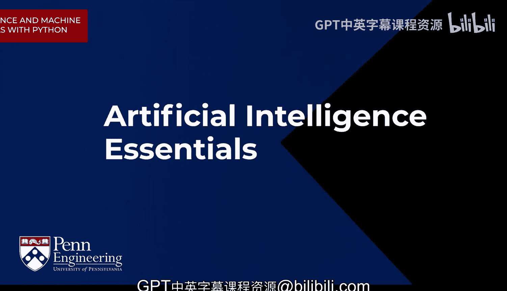

# 01：人工智能基础导论 🧠

在本节课中，我们将要学习人工智能的基础概念，包括对智能的哲学思考、AI系统的设计目标，以及本课程的核心内容——理性智能体和规划算法。

我叫克里斯·卡利森·伯奇，是宾夕法尼亚大学工程与应用科学学院的教授。欢迎来到我们的人工智能课程，这是“Python人工智能与机器学习基础”专项课程的一部分。

我们的专项课程将深入探讨核心主题，帮助你理解现代深度学习和经典人工智能背后的数学与算法基础。

## 什么是智能？🤔

上一节我们介绍了课程的基本情况，本节中我们来看看一个根本性的哲学问题：智能意味着什么？我们还将探讨科幻作品如何常常预示人工智能领域的科学进步。

我们将以科幻作品为起点，思考作为AI系统设计者，我们希望创建什么样的系统。以下是两种主要的设计思路：

*   我们应该构建像人类一样思考和行动的AI智能体吗？
*   还是应该构建能够理性思考和行动的系统？

## 聚焦理性智能体 🎯

在本课程中，我们将聚焦于**理性智能体**。我们将发展一套关于“理性行动”意味着什么的理论，并开发相应的算法。

理性智能体需要规划。规划智能体必须从众多可能的行动中进行选择，以创建一系列行动，从而以最优的方式达成其目标。

## 搜索算法：规划的核心工具 🔍

为了实现规划，我们将开发的第一组算法是一个广泛的类别，称为**搜索算法**。

我们将从经典的深度优先搜索和广度优先搜索算法出发，逐步构建，最终学习AI领域最著名的搜索算法之一：**A\*搜索算法**。

`A*搜索算法`最初是为机器人导航开发的，它正是你从智能手机获取驾驶路线指引功能背后的核心技术。

## 实践环节：Python编程 🐍

为了帮助你将这些AI算法具体化，你将完成一系列简短的Python编码作业。

作为本课程的一部分，我们将提供适合进阶初学者的全面Python复习。如果你刚刚开始学习编程，可以考虑尝试我们的另一个专项课程“Python与Java编程入门”。

## 课程总结与展望 📚

本节课中，我们一起学习了人工智能的入门概念，探讨了智能的本质，并明确了本课程将专注于理性智能体与规划算法。我们介绍了实现规划的核心工具——搜索算法，特别是A\*算法，并概述了通过Python编程进行实践的学习路径。

完成这门专注于理性智能体和规划等重要主题的课程后，你将有机会通过我们专项课程中的其他课程学习更多AI基础知识，这些课程将教你机器学习和深度学习的统计与数学基础。