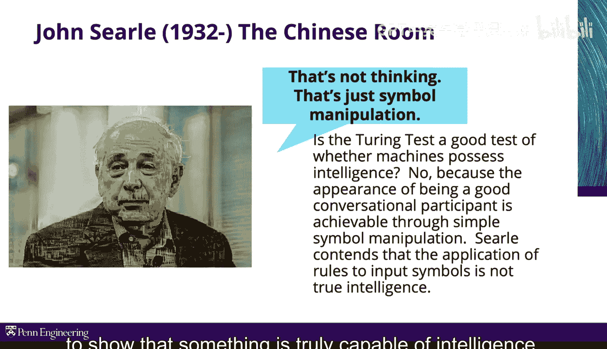
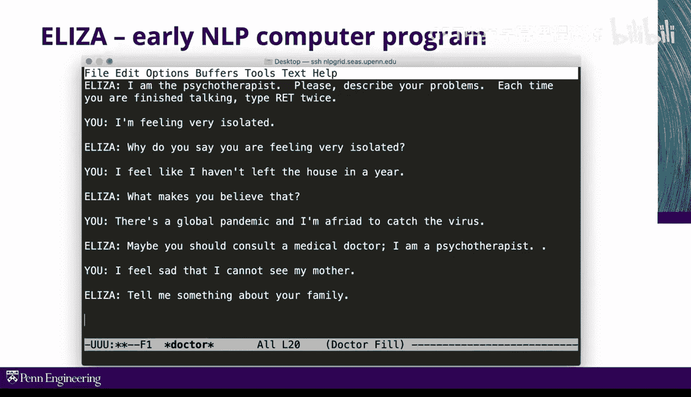
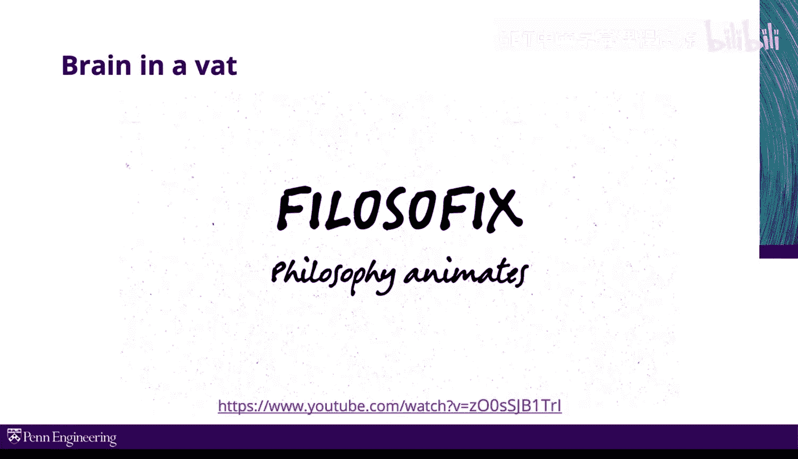

# 04：哲学中的AI-II

在本节课中，我们将继续探讨人工智能的哲学基础，重点关注约翰·塞尔对图灵测试的批判，以及他提出的“中文房间”思想实验。我们还将了解基于规则的早期AI系统（如ELIZA）如何运作，并讨论“强AI”与“弱AI”的哲学区分。最后，我们会看到哲学家丹尼尔·丹尼特如何通过一个有趣的假想实验来挑战塞尔的观点。

## 约翰·塞尔的批判

上一节我们介绍了图灵测试，本节中我们来看看哲学家约翰·塞尔对其提出的挑战。

塞尔认为，图灵测试不足以证明机器拥有真正的智能。他主张，图灵测试可以通过简单的符号操作来通过，而这种操作并非真正的智能。

想象一下，我给机器一个符号，机器只是通过查找该符号并执行一些预定的操作来回应。如果你把我的输入符号想象成对话中的一个回合，比如“你今天怎么样？”，那么机器可能通过查表输出一个看似合理的回答，比如“我很好，你呢？”。

塞尔认为，这种类型的符号操作仅仅是**语法**层面的。它只是在做一些基础的事情，类似于**正则表达式转换**。一个遵循语法规则的机器并不真正理解对话的**含义**。

如果你同意塞尔的观点，那么仅仅表现出对话的能力，并不足以证明某物真正拥有智能。

## 中文房间思想实验

为了阐明他的观点，塞尔提出了一个著名的思想实验，称为“中文房间”。

这个实验设想有一个人在一个房间里工作，他接收用中文写成的信息，然后生成同样用中文写成的回复。这个人并不懂中文；他手边有一本厚厚的规则手册，告诉他当看到特定形状的符号（输入）时，应该输出哪些特定形状的符号（输出）。他只是在机械地遵循符号操作规则。

这个实验传达的信息是：即使我们能够构建一个通过符号操作来产生看似合理对话的系统，我们可能也不会认为它的行为构成了智能行为。这就像房间里的人看着中文符号来想出一个好的中文回复，但他实际上并不理解中文。

## 基于规则的系统实例：ELIZA

以下是早期人工智能系统的一个著名例子，它使用基于规则的响应来模仿对话。

最早的著名AI系统之一是一个名为ELIZA的程序。ELIZA是一个模拟的心理治疗师，它模仿了一种称为“罗杰斯式”的心理治疗方法。在这种疗法中，你向治疗师诉说你的感受或困扰，而他们通过提问来回应。

罗杰斯式心理治疗很容易被模仿。你可以假装成一个罗杰斯式治疗师，只需把某人说的话转换成一个问题。事实上，这正是早期程序ELIZA的工作方式。

这是一个ELIZA与真人（本例中是我）交互的示例记录：

*   **ELIZA**：我是心理治疗师。请描述你的问题。每次你说完话，只需按两次回车键。
*   **用户**：我感到非常孤独。
*   **ELIZA**：你为什么说你感到非常孤独？
*   **用户**：我觉得我几乎一年没离开过房子了。
*   **ELIZA**：是什么让你相信这一点？
*   **用户**：全球大流行，我害怕感染病毒。
*   **ELIZA**：也许你应该咨询医生。我只是心理治疗师。
*   **用户**：我为不能见到母亲而感到难过。
*   **ELIZA**：跟我说说你的家庭。

你可以看到，ELIZA只是以一种确定性的方式转换用户输入来生成其响应。ELIZA的架构与“中文房间”的符号操作实验类似，而塞尔认为，这并非智能。

## 强AI与弱AI

塞尔的符号操作思想引出了“强人工智能”与“弱人工智能”的区分。

*   **弱AI**：一个并非真正智能，只是表现出智能表象的系统。塞尔认为，像ELIZA这样的系统就是弱AI。
*   **强AI**：一个真正拥有意识、理解和心智的智能系统。

塞尔进一步假设，人类大脑中必定有某种东西使我们拥有智能，并主张生物大脑是拥有智能的必要基础。然而，这个论点受到了其他哲学家的挑战。

## 丹尼尔·丹尼特的挑战

哲学家丹尼尔·丹尼特通过一个有趣的假想实验来反驳塞尔关于生物大脑是智能必要条件的观点。

在这个思想实验中，丹尼特想象自己被美国国防部招募去执行一项绝密任务：拆除俄克拉荷马州地下的一枚炸弹。由于炸弹泄漏大量辐射，军方无法派人直接维修，因为辐射会损伤大脑。于是他们提议，先将执行任务者的大脑取出，放在远处的一个容器里，然后用微型无线电收发器替换所有连接大脑与身体的神经元。

丹尼特自愿接受了这个任务。他的大脑漂浮在容器中，而他的身体则前往俄克拉荷马州。在拆除炸弹的过程中，他的身体受到辐射严重损坏，大脑与身体之间的所有神经无线电链接都中断了。他的大脑作为一个有意识的实体仍然存在于容器中。

后来，科学家们为他“复活”了一个新的合成身体，并且连同一个完全复制其原大脑信息流和计算水平的**合成大脑**。那么问题来了：那个生物大脑对于他拥有自我意识和与世界互动来说，真的是必要的吗？

这个实验旨在说明，智能可能更关乎**信息处理的结构和模式**，而非承载它的特定生物基质。

## 总结与课程方向

本节课中，我们一起学习了约翰·塞尔对图灵测试和符号操作AI的批判，了解了“中文房间”思想实验和早期AI程序ELIZA的工作原理。我们还探讨了“强AI”与“弱AI”的哲学区分，以及丹尼尔·丹尼特如何挑战生物大脑是智能必要前提的观点。

大多数人工智能研究者并不关心“强AI”假说。只要他们的程序能工作，他们并不真正在乎这是智能的模拟还是真正的智能。这不会是一门关于哲学的课程，本节内容已是我们将涉及的最哲学的部分。

像强AI与弱AI这样的概念，更多是一个哲学难题，而非已融入主流人工智能研究的问题。因此，我们将把“是什么使我们成为智能生物”以及“宣布一个系统智能的必要条件是什么”这些基础问题留给哲学家们去探讨。

在本课程中，我们将最终更多地关注**实用的算法**，这些算法将让我们能够构建出实现某些智能元素的程序。