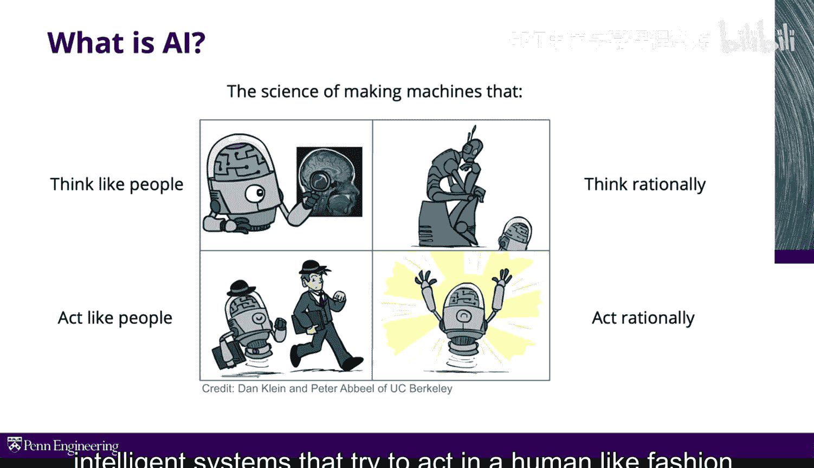
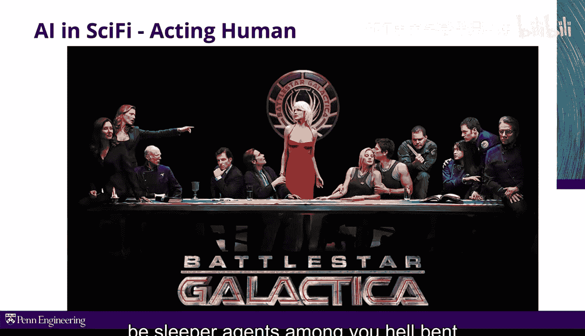
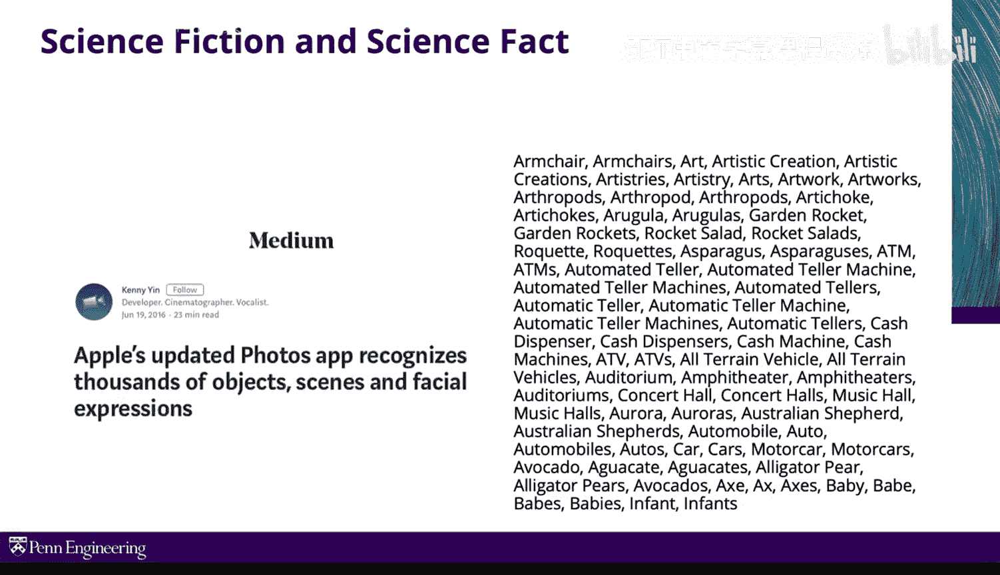

# 06：科幻中的AI 🚀

在本节课中，我们将探讨人工智能在科幻作品中的起源和描绘。科幻不仅激发了公众对AI的想象，也常常预示了技术发展的方向。我们将看到，许多科幻作品的核心主题——如如何定义人类、如何与智能体互动——直接呼应了AI领域的哲学与技术挑战。

除了哲学渊源，人工智能还深深植根于悠久的科幻传统。

上一节我们讨论了何为人工智能，以及如何设计一个智能体。本节中，我们来看看科幻作品如何描绘这些智能体。之前我们谈到，设计一个智能体可以有以下几种目标：使其像人一样思考、像人一样行动、理性地思考或理性地行动。

科幻作品中一个常见的主题是，试图创造出能以类人方式行事的智能系统。

以下是一些著名的科幻作品如何描绘这一主题：

*   **《星际迷航：下一代》**：其中的角色“数据”是一个安卓机器人，他的人生目标是尽可能像人类一样行事。他缺乏我们认为构成人性的许多要素，例如情感。他还有一些奇怪的癖好，比如出于某种原因，他不能使用缩写，必须说“cannot”而不是“can't”。
*   **《西部世界》**：这部HBO剧集（改编自1970年代同名电影）设定在一个仿照美国西部建造的主题公园，里面充满了人工智能体。人类游客在此实现幻想，并以极其可怕的方式对待这些AI系统，因为他们认为AI并非真人，只是被制造得看起来和行动像人。该剧的核心主题探讨了何以为人、何以为奴，以及AI系统是否可能具备足够的人性，从而应被视为人类并享有相应的尊重与尊严。
*   **《太空堡垒卡拉狄加》**：在这个科幻系列中，AI系统作为潜伏者混迹于星际飞船船员之中。被称为“赛隆人”的机器人制造得如此先进，以至于与人类几乎无法区分。该剧也是对当时新闻中恐怖主义等事件的寓言，飞船上弥漫的对赛隆人的猜疑，类似于人们可能曾有的“潜伏者就在身边”的感觉。
*   **《银翼杀手》**：这部电影直接探讨了人类如何辨别互动对象是人还是自动机器（复制人）。影片围绕一名追捕逃亡复制人的侦探展开，这同样是一个关于AI系统逃离人类控制并试图伪装成人的叙事。片中使用的“沃伊特-坎普夫测试”非常类似于图灵测试，直接映射了关于人工智能的哲学问题：如何判断某人是否是自动机器？这呼应了笛卡尔关于设计测试来检验某人是否为自动机器的想法。事实上，电影直接引用了笛卡尔，主角的名字“德卡德”显然是对“笛卡尔”的轻微改动。

科幻与人工智能有着美妙的联系，它常常预见AI领域的发展方向，并在相关技术真正实现前的几十年就想象出可能性。

有许多实例显示，科幻向我们展示了AI未来可能实现的能力，并在电影上映几十年后成为现实。

以下是《终结者》中的一个片段，展示了机器人的平视显示器。这是透过机器人眼睛看到的视图，你可以看到它所看到的景象以及它正在执行的计算机视觉任务，比如物体识别。你会看到它识别了一辆摩托车，读取了标志上的文字，识别了人物并进行扫描、估算其体重和身体尺寸。事实上，这个场景中，终结者全身赤裸地在酒吧里走动，寻找一个体型与自己相同的人，以便拿走他的衣服融入社会。（至于为何机器人能时间旅行却不能带上衣服，原因不明。）

《终结者1》和《终结者2》中展示的技术（拍摄于1980年代和1990年代初），在当时是科幻。随着人工智能的不断进步，终结者系列电影中的许多元素如今已成为科学事实。幸运的是，不是谋杀机器人那部分；遗憾的是，也不是时间旅行那部分。

过去几年，我们在计算机视觉领域取得了惊人的进展。我们现在能够进行图像分类，将图像输入计算机视觉系统，它就能告诉我们其中包含什么物体，比如这张照片中的人、一些羊和一只狗。计算机视觉可以在这些物体周围绘制粗略的边界框，或进行精确的分割，以指示照片中哪些像素对应这些物体。这正是《终结者》平视显示器中发生的事（当时是手绘动画）。如今，通过计算机视觉，终结者那种对图像进行推理的能力已成为可能，这非常了不起。你的智能手机现在可以自动识别数千种物体。在这些计算机视觉进步之前，你必须手动给照片添加标签才能搜索其中的内容。现在，你可以搜索照片中的任何东西，从扶手椅到摩天大楼，正是因为计算机视觉变得如此出色，以至于可以部署在智能手机上。

还有许多其他领域，我们已经从科幻跨越到了科学事实。有时，科幻作者想象的某些技术的用途与现实大相径庭。

我的一个朋友开了个关于《银翼杀手》中沃伊特-坎普夫测试的玩笑：面试官问里昂：“你准备好测试了吗？”里昂说：“我准备好了。”而在现实中，测试更像是这样：我们现在被要求通过挑出所有包含交通灯的方块来证明我们是人类。实际上，这就是我们现在被要求证明自己是人类的那种测试。这是谷歌验证码的一个例子，当你注册网络账户时，它会弹出，迫使你证明自己是人类而不是机器人。验证码是“全自动区分计算机和人类的公开图灵测试”的首字母缩写，并且常常导致相当程度的挫败感。

还有其他例子表明，科幻对计算机能力的想象走在了现实可能性的前面。

这是一部1980年代的电影，叫《战争游戏》。一个大学年龄的年轻人黑进了一个计算机系统，发现它可以下棋和一些其他游戏。其中一个游戏叫“全球热核战争”。然而，这并非游戏，实际上是计算机在管理美国的核武库。在这个场景中，计算机即将对俄罗斯发动攻击，控制室里的人们拼命想办法阻止它。这是一场与时间的赛跑，因为计算机正在破解核发射密码的加密。在计算机试图破解加密的同时，他们让它开始玩井字棋游戏。他们将玩家数量设置为0，让计算机自己跟自己下。他们希望说服计算机认识到，井字棋没有必胜策略。计算机学到了井字棋无法获胜，并由此推断出，全球热核战争也没有好的获胜策略。

本节课中，我们一起学习了人工智能在科幻作品中的丰富描绘。我们看到，从《星际迷航》的数据到《西部世界》的宿主，从《银翼杀手》的复制人到《终结者》的视觉系统，科幻不仅提出了关于智能、人性和伦理的深刻问题，也常常惊人地预见了技术发展的轨迹。许多昔日的科幻构想，如计算机视觉和自动化测试，如今已成为我们日常生活的一部分。理解这些科幻叙事，有助于我们更好地思考当前AI技术的发展及其对社会的影响。