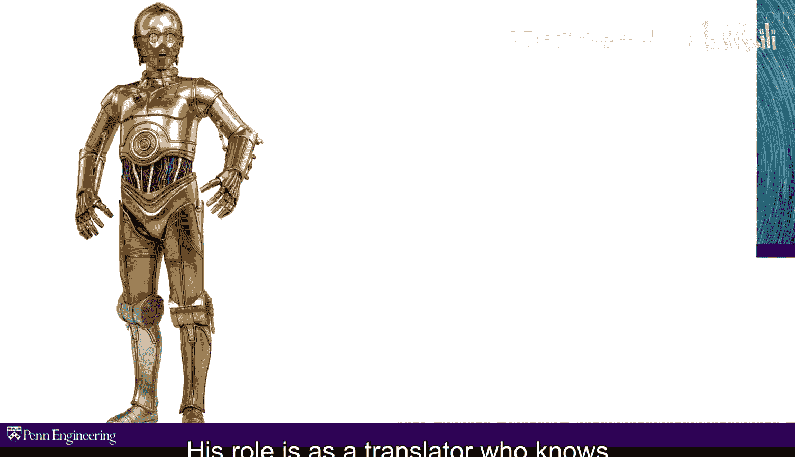
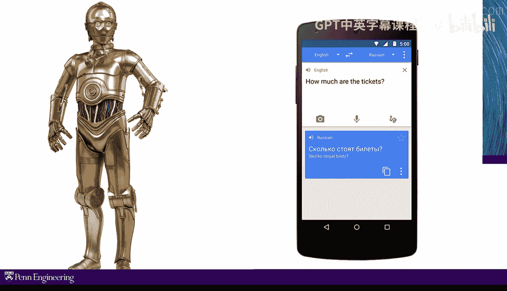
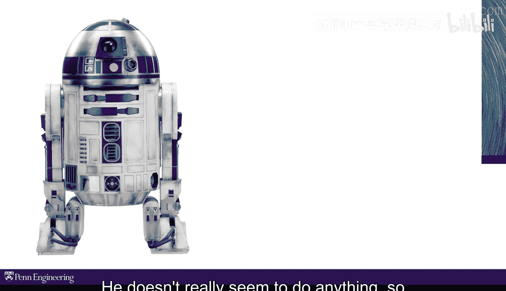
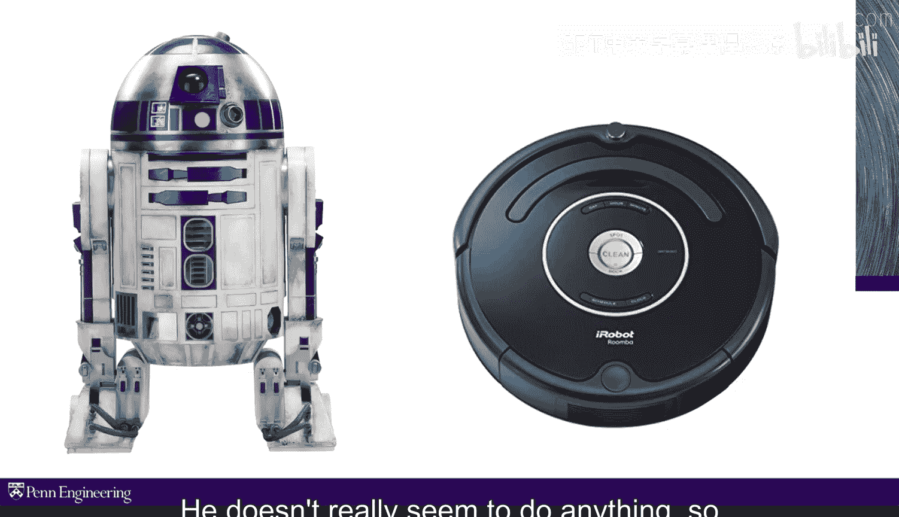

# 07：科幻中的AI-II

## 概述
在本节课中，我们将继续探讨科幻作品对人工智能发展的影响，并了解这些虚构概念如何逐步转变为现实技术。我们将回顾AI在游戏领域的里程碑，分析科幻电影中的AI设想，并介绍推动这些技术实现的关键研究项目。

## 游戏作为AI的试金石
上一节我们讨论了科幻作品中AI的早期形象，本节中我们来看看AI在现实世界中的一个经典应用领域：游戏。数十年来，计算机进行游戏对决一直是人工智能研究的核心课题。

多种游戏都曾作为AI的挑战性问题。在20世纪90年代末，IBM设计了一个名为**深蓝**的人工智能系统，它击败了国际象棋特级大师加里·卡斯帕罗夫。当时人们认为国际象棋需要人类的智慧，但深蓝证明了这是错误的。

一台下棋机器超越了世界上最好的人类棋手。如今，人类棋手基本上总是被机器彻底击败。

## 从国际象棋到危险边缘
2013年，IBM在AI游戏系统方面取得了另一项成功。他们设计了一个名为**沃森**的问答系统，用于参加电视智力竞赛节目《危险边缘》。

要在《危险边缘》中获胜，需要能够根据线索推断并回答琐碎问题。沃森在一场正面交锋中击败了保持该节目最长连胜纪录的肯·詹宁斯。

## 围棋：更宏大的挑战
2016年，谷歌DeepMind开发的一个名为**AlphaGo**的系统击败了围棋世界冠军李世石。围棋之所以有趣，是因为其可能的走法空间和棋盘配置空间远大于国际象棋棋盘上的配置空间。

因此，这是一个更具雄心的挑战，因为它需要AI系统为寻找游戏的可能解决方案而探索多得多的潜在配置。这个空间如此之大，以至于无法穷尽地探索所有可能的解决方案。

事实上，即使是国际象棋，也无法对其所有可能的解决方案进行穷举搜索。穷举搜索只适用于走法更有限的游戏，例如井字棋或跳棋。

在本课程的搜索模块中，我们将讨论游戏对弈、寻找最佳下一步的搜索，以及无法在整个可能走法空间中进行搜索所带来的影响。

## 科幻中的理性AI设想
在电影《2001太空漫游》中，有一个名为**哈尔9000**的机器人，负责控制宇宙飞船。有趣的是，电影制作人将哈尔表现为一个无形的声音。

以下是与哈尔进行访谈的电影片段。这个片段关联到那些被设计为理性思考的AI系统的理念。哈尔声称自己是完美的，不会犯错。但事实证明这并非事实。实际上，在电影后期，它最终谋杀了船员。

《2001太空漫游》于1968年上映，远在个人电脑出现之前。电影制作人对未来的计算技术有一个愿景。他们的愿景包括可以与计算机对话、计算机能够推理你所说的话，然后用自然语言回应的想法。

## 科幻成为现实
这个想法如今已渗透到我们的日常生活中，例如亚马逊的Alexa等设备。你可以发出像“Alexa，打开我的灯”这样的命令。这与40多年前科幻电影中设想的“关闭舱门，哈尔”的能力非常相似。

我们还有许多其他科幻想法已经转化为现实。这是《星球大战》中的C-3PO。他的角色是一个懂得数万种语言的翻译员。

C-3PO就像现在的谷歌翻译。

科幻已经变成了科学事实。这是我在《星球大战》中最喜欢的角色，R2-D2。他能做什么？嗯，实际上有点难说。它似乎并没有真正做什么。

所以也许它更像一个Roomba（扫地机器人）之类的。

## DARPA：推动AI前沿
人工智能前沿技术得以推进的一种方式是通过研究投资。美国AI研究的一个重要资助机构是一个名为**DARPA**的机构，即国防高级研究计划局。

DARPA自20世纪60年代以来一直在投资AI研究，并在2018年宣布将投入20亿美元用于AI研究。我本人的许多学术资金也来自DARPA。事实上，许多语言技术，如谷歌翻译、苹果Siri，都得益于DARPA的项目。例如，谷歌翻译就源于我在21世纪初参与的一个DARPA项目。

## 从挑战赛到自动驾驶
许多自动驾驶汽车技术可以追溯到2005年的DARPA大挑战赛。最初的大挑战是让全自动驾驶汽车在几条预定路线之一上穿越沙漠。

有5支队伍完成了比赛，他们的汽车完全自主地在沙漠中行驶。斯坦福大学以不到7小时的时间完成了路线。

几年后，DARPA赞助了城市挑战赛。与在沙漠中驾驶不同（在那里撞上东西也没什么大不了的），这次是让汽车在一个军事基地上行驶，风险要高得多。自动驾驶车辆必须应对其他更重大的障碍。

这张照片展示了宾夕法尼亚大学参加城市大挑战的参赛车辆。宾大是2008年实际完成城市大挑战的六支队伍之一。目前，自动驾驶汽车感觉即将到来。有几家公司已经将这项技术商业化，并试图让它成为我们日常生活的一部分。

## 机器人挑战
随着自动驾驶汽车变得越来越可行，DARPA已经开始应对更大的挑战。他们有一个名为机器人挑战赛的项目。在这个挑战中，研究人员必须设计能够完成诸如搬运锤子、拧水龙头和开门等任务的人形机器人。

尽管这些任务看起来很基本，但事实证明，机器人完成它们超级困难。这里有一个相当有趣的失误集锦，向你展示机器人完成这些任务到底有多难。

就像自动驾驶汽车因DARPA大挑战而进步一样，人形机器人也随着时间的推移变得更好，现在可以很好地完成这些任务。

一家名为波士顿动力的公司生产性能非常强大的人形机器人和四足机器人。他们的机器能够完成诸如举重、在崎岖地形上行走以及从意外干扰中恢复平衡等任务。

## 总结
本节课中，我们一起学习了科幻构想如何引领人工智能技术的发展。我们看到AI在游戏领域不断突破，从国际象棋到围棋；分析了《2001太空漫游》等科幻作品中对人机交互的前瞻性设想，这些设想如今已通过智能语音助手成为现实；最后，我们了解了DARPA等机构通过设立重大挑战赛，在推动自动驾驶、机器人等尖端技术从科幻走向现实的过程中所起的关键作用。许多来自科幻的激动人心的想法最终都变成了科学事实。因此，如果你想了解人工智能的未来可能是什么样子，可以看看科幻作品中那些富有想象力的事情。