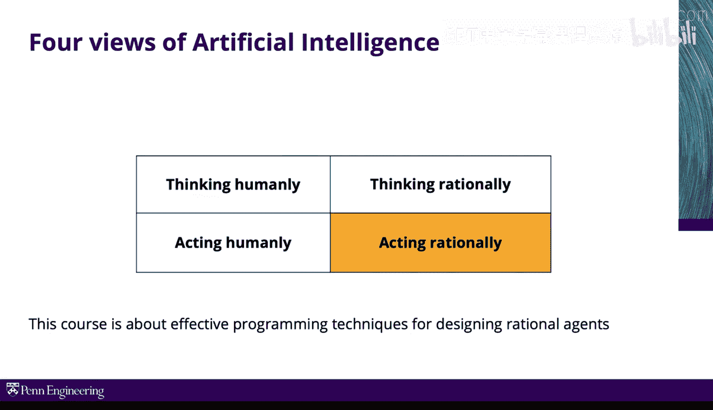
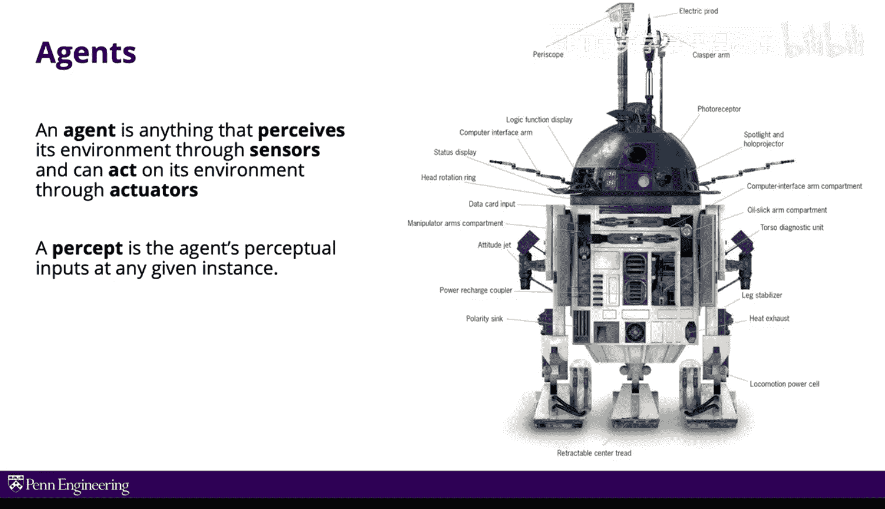
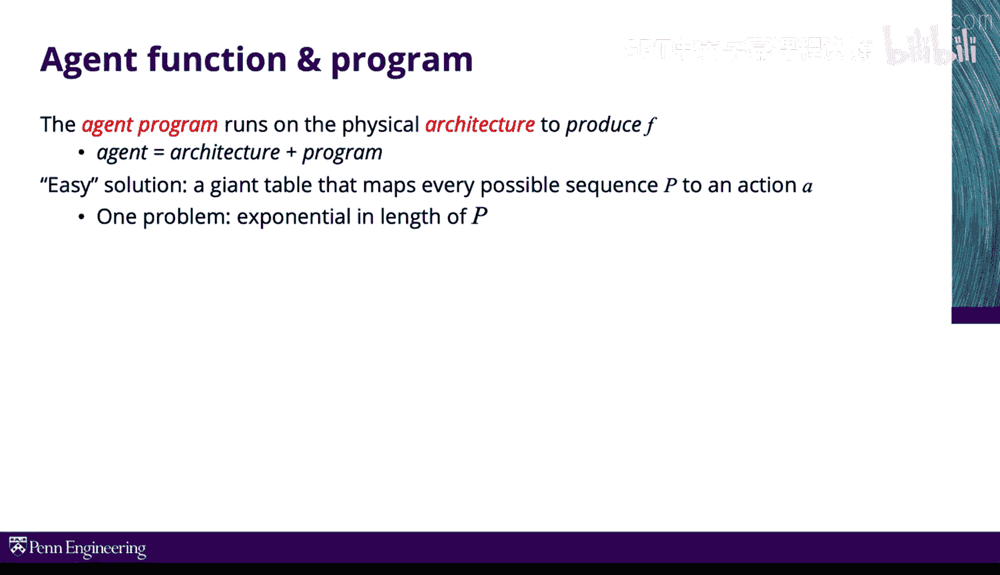
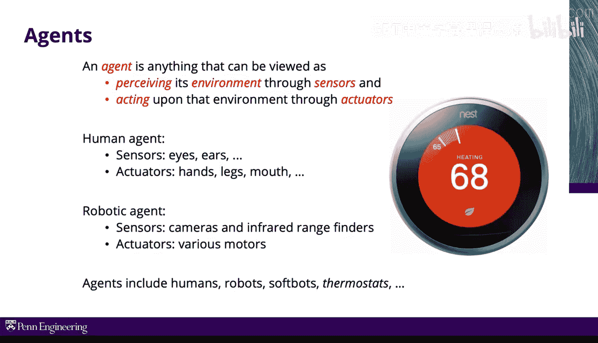
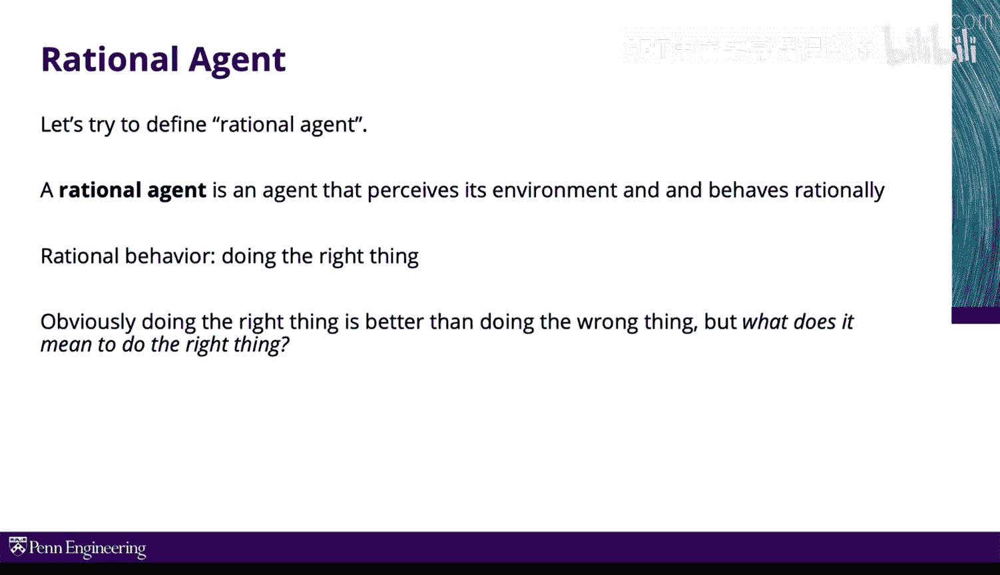
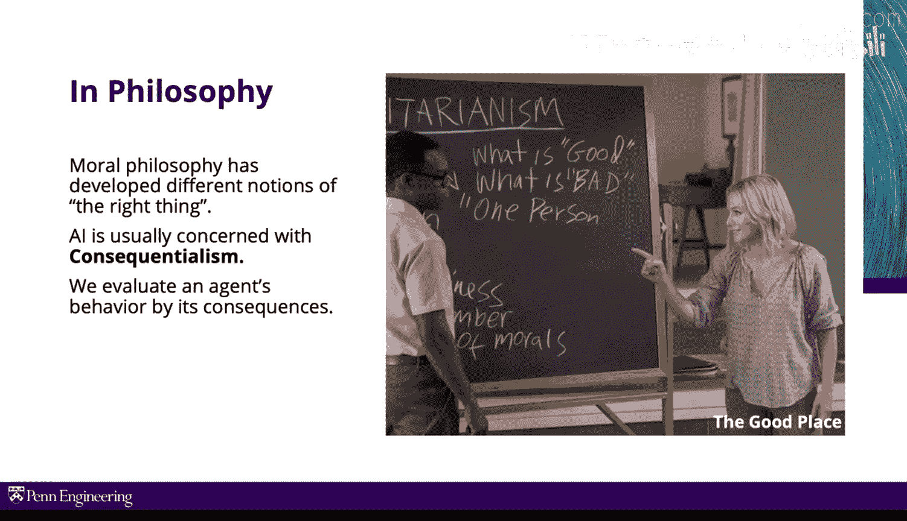

# 11：理性智能体-I

在本节课中，我们将要学习如何设计人工智能系统。我们将从一个核心概念入手：**理性智能体**。我们将探讨什么是智能体，什么是理性行为，以及如何将两者结合来构建有效的人工智能系统。

## 什么是智能体？

上一节我们介绍了构建人工智能系统的一种方法。本节中我们来看看构成这个系统的核心单元：智能体。

一个**智能体**被定义为任何能够感知其环境并对其采取行动的事物。

智能体用于感知环境的部分称为**传感器**，用于对环境采取行动的部分称为**执行器**。智能体从传感器接收到的信号称为**感知**。一个感知代表了智能体在某一时刻的感知输入，可以表示为一个向量，包含了智能体通过其传感器接收到的所有输入。

除了执行器和传感器，我们还需要考虑智能体与环境的关系。事实上，我们可以为智能体和环境建立一个数学表示。

以下是智能体与环境交互的基本模型：

*   **智能体函数**：智能体由一个称为**智能体函数**的函数来定义。该函数以一系列感知作为输入，并将该序列映射到一系列动作上。
*   **动作集合**：动作是从智能体可以通过其执行器执行的一组可能动作中选取的。例如，动作可以是“增加轮子转速”、“打开灯”或“发出声音”。具体的动作集合取决于智能体拥有的执行器。

我们需要区分**智能体函数**这个数学抽象和我们为实现该函数而编写的**智能体程序**。智能体程序是在某个物理系统上运行的具体实现。一个智能体函数可以通过各种程序来实现。

最简单的解决方案可以是一个**查找表**，它将每个可能的感知序列与给定该序列的最佳行动关联起来。然而，如果序列长度无限制或感知组合数量呈指数级增长，这种简单的查找表可能变得不可行。因此，我们将开始开发更复杂的算法来选取最佳行动。

值得注意的是，我们对智能体的定义非常通用，它包含了任何能通过传感器感知环境并通过执行器对其采取行动的事物。因此，智能体可以涵盖极广的范围：

*   **物理实体**：如机器人。
*   **软件实体**：如监控股市数据流（例如来自雅虎财经）并通过执行交易等操作来影响其环境的智能代理。
*   **人类**：我们的感官（视觉、听觉、触觉）是传感器，我们的肢体、手指、嘴巴或声音是执行器。
*   **简单设备**：如恒温器。它用温度计感知房间环境，如果温度低于某个阈值，则通过调节锅炉来提高散热器和房间的温度来改变环境。

这就是我们将要使用的智能体的工作定义。

## 什么是理性行为？

我们已经了解了智能体的概念。接下来，让我们转向**理性行为**的理念。我们真正关心的不仅仅是构建任何智能体，而是构建**理性智能体**。那么，我们首先需要问：什么是理性？

我们将从一个定义开始，然后逐步完善它，直到得到一个我们满意的最终定义。

让我们从简单的开始。一个理性智能体是某种感知环境，然后**理性行事**的智能体。让我们将理性行为定义为**做正确的事**。显然，做正确的事比做错事要好。

但这引出了一个问题：什么是“做正确的事”？当我们谈论理性行为时，如何定义“正确的事”？

## 定义“正确的事”

“做正确的事”意味着什么？这实际上是一个非常有趣且复杂的问题。我们可以从哲学路径来探讨。道德哲学对“做正确的事”或“什么是正确的事”提出了几种不同的观点。

人工智能领域通常专注于一种称为**结果主义**的哲学论点。结果主义的理念是，我们应该根据一个智能体（或一个人）所采取行动的**后果**来评估其行为。

当你将一个智能体置于环境中时，它会根据感知生成一系列动作。智能体的行为将影响其周围的环境。因此，我们想要说的是：智能体对环境产生的影响是否令人满意？我们可能希望将“做正确的事”定义为让智能体选择那些将导致**理想后果**的行动。

这是开始完善我们对理性行为定义的一种可能方式。它可以意味着做那些会产生**最佳后果**的事情。

## 理性是否需要全知？

如果我们应该选择会产生最佳结果的行动，这是否意味着我们应该有能力精确预见到我们行动的每一个结果？当我们承诺采取某个行动时，似乎不可能确切知道选择的结果会是什么。

想象一下这种情况：你在人行道上看到朋友，于是停下来打招呼。然后，楼上公寓的一个窗式空调机掉下来把你压扁了。你停下来和朋友打招呼的决定是不理性的吗？因为停下来导致了糟糕的后果。

试图选择能带来好结果（比如活下去）的行动显然是可取的，但说你行为不理性是不公平的，因为你根本无法预见到那个结果。

我们需要确保，我们对理性智能体的定义**不应该要求全知**。它不应该必须能够预见未来，看到每个行动的每个结果会是什么。理性不能要求像神一样的能力来预见“如果我选择这个行动，那么这将是最终结果”。

---

本节课中我们一起学习了人工智能设计的核心概念：理性智能体。我们首先定义了**智能体**是任何能够通过传感器感知环境并通过执行器对其采取行动的系统。接着，我们探讨了**理性行为**的含义，引入了**结果主义**的观点，即应根据行动的后果来评估行为，并明确了理性智能体的定义**不应要求全知**，即无需预知所有未来结果。这为后续设计具体算法来实现理性智能体奠定了基础。