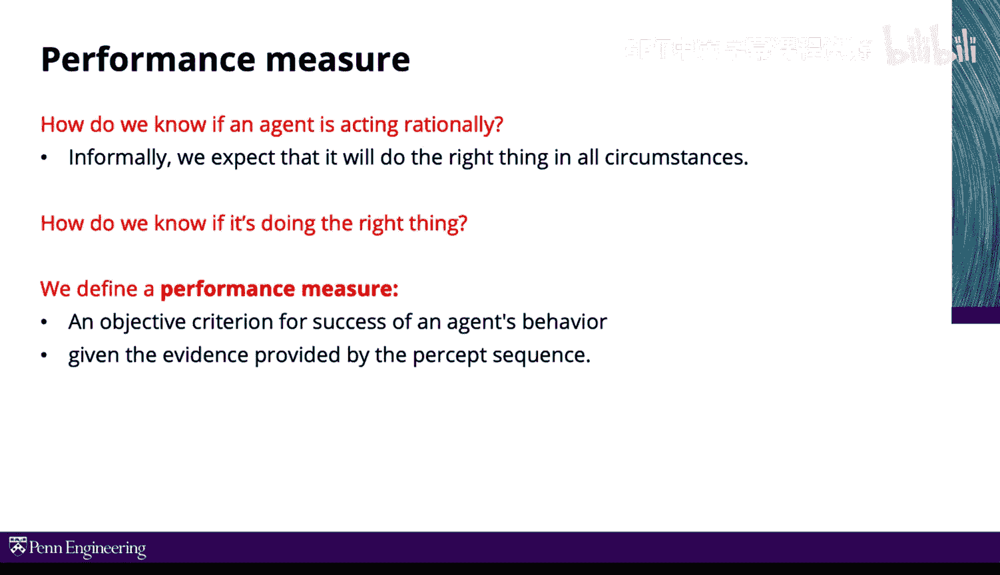
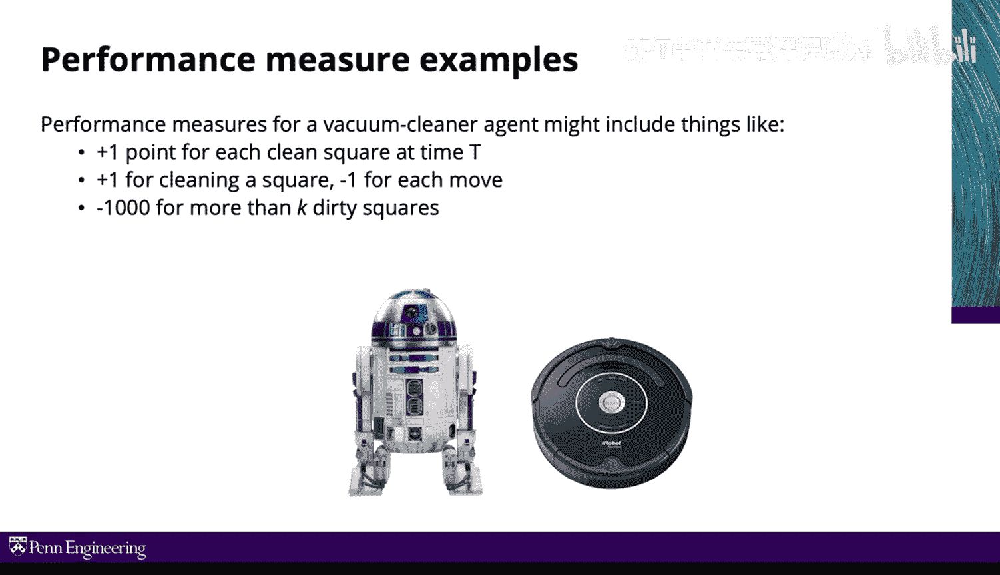
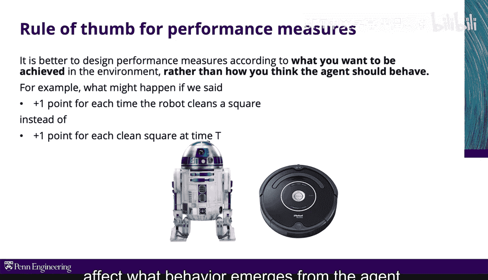
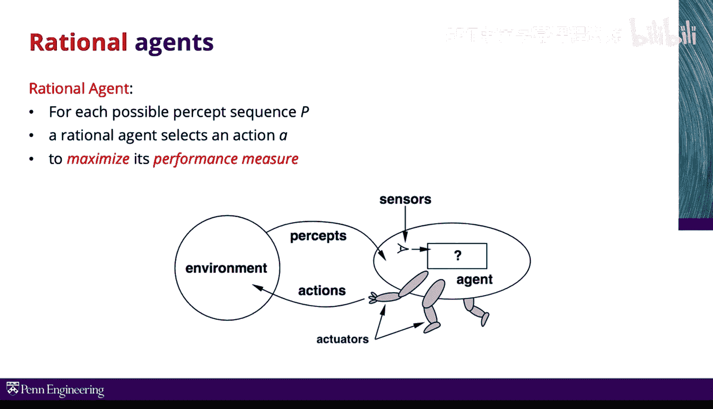
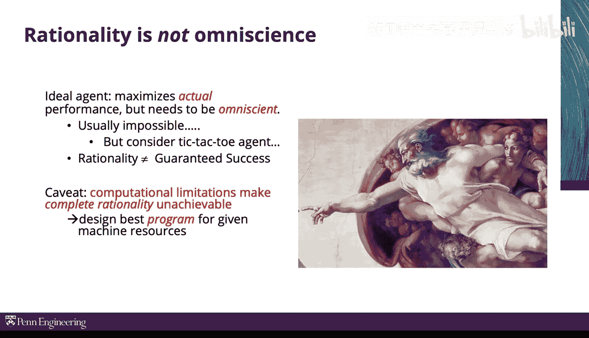
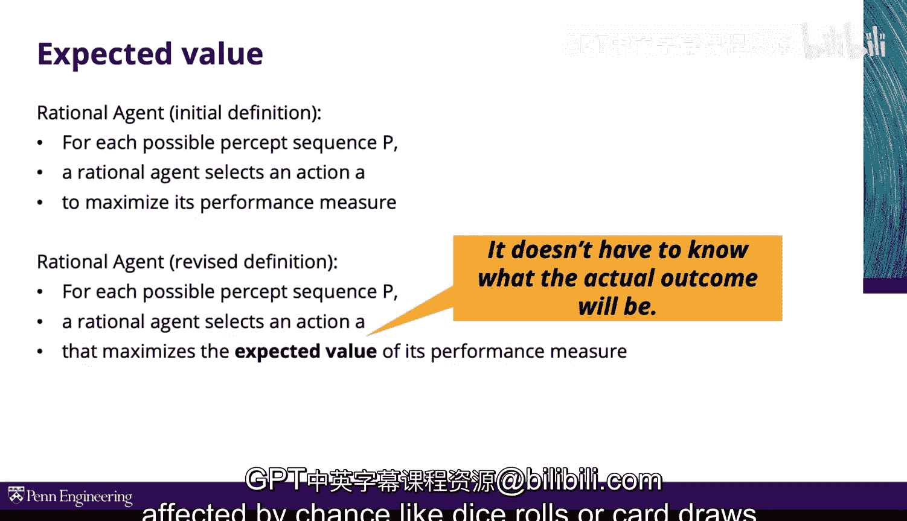

# 12：理性智能体-II

在本节课中，我们将要学习理性智能体的核心概念，特别是如何通过定义性能度量来评估智能体的行为是否理性。我们将探讨经济学中的理性选择理论，并将其与人工智能中的智能体设计联系起来。

## 理性选择理论与有限理性

经济学领域对理性行为有自己的定义。有一种理论称为**理性选择理论**，它包含了**有限理性**的概念。这意味着个体只能基于他们可获得的信息做出决策，因为他们不可能全知全能。理性选择理论由赫伯特·西蒙提出。

以下是他在1953年的开创性论文《理性选择的行为模型》中的一句话总结：“在这篇论文中，我提出了一个模型，用于描述具有有限计算能力的生物体的理性选择。”对我们而言，生物体可能就是智能体。有限的计算能力导致了经济学中的有限理性概念。有限计算能力的概念对人工智能也至关重要。

赫伯特·西蒙是一位经济学家、政治学家和认知科学家。他是唯一一位同时获得诺贝尔经济学奖和图灵奖的人。阿尔弗雷德·诺贝尔在1895年设立诺贝尔奖时，指定每年颁发五个奖项给“在前一年为人类带来最大利益的人”。他选择的五个领域是物理学、化学、医学、文学与和平。当时，计算尚未成为一个独立的领域，因此没有诺贝尔计算机科学奖。与之相当的奖项是图灵奖，赫伯特·西蒙因其对人工智能的贡献也获得了此奖。

理性选择理论是理解经济行为乃至更广泛社会行为的框架。其基本思想是，整个社会或市场的行动是个人行为的结果。每个个体都在考虑一组可能的替代方案后做出自己的决策。理性选择理论背后的基本假设是，个体以**自利**的方式行事，他们会选择对自己最有利的替代方案。

## 定义性能度量

“理性选择是挑选最理想的替代方案”这一概念仍需要我们定义一些东西。如果个体有偏好，允许他们在一组可能的结果中进行选择，那么我们就需要一种方法来评估每个结果的**效用**。

现在，我们将从**性能度量**的一般概念开始。我们如何知道一个智能体的行为是否理性？非正式地说，它应该做“正确的事”。理想情况下，如果它是理性的，它应该在每种情况下都做正确的事。我们如何客观地知道它是否做了正确的事？让我们定义一个性能度量。

这将是一个客观的、可衡量的成功标准，用于评估智能体的行为。这意味着它将根据某个行动带来的后果，为该智能体选择该特定行动的行为打分。我们可以定义这个分数，使其与我们作为系统设计者所关心的事情相关。这将使我们能够说，给定智能体选择的一系列行动，它是否选择了正确的行动来最大化其性能度量？如果是，我们就说它的行为是理性的。

以下是一个我们可以为机器人吸尘器创建的性能度量示例。假设我们讨论的智能体是Roomba。它有一组传感器和执行器。我们希望它的行为是理性的，因此我们可以给它一个性能度量让它去尝试最大化。

我们可以为Roomba设计什么样的性能度量？如果它试图通过最大化该性能度量来理性行事，它的行为会是怎样的？

我们可以用几种不同的方式来设计性能度量。例如，我们可以说，在某个时间点T，当它的清洁程序终止时，机器人每清洁一个方块就得一分。所以它应该尝试增加清洁方块的数量。或者，我们可以给它每清洁一个方块得一分，但每移动一次就扣一分。这将减少不必要的移动量，这实际上是一个非常适合Roomba的功能。我的机器人吸尘器往往以一种完全随机的方式清洁房间。它会反复多次清洁同一个地方，并且常常刚好错过一些本应清洁的脏污区域。

为了惩罚机器人错过太多脏污区域，我们可能会添加一个阈值，允许我们说，如果它没有足够彻底地清洁房间，那么它就未能完成工作。我们将给它一个大惩罚，比如扣100分。如果Roomba选择了一系列行动来最大化我们给它的性能度量，那么我们就说它的行为是理性的。如果它做了导致分数很低的事情，那么我们就说它的行为不理性。

## 如何设计好的性能度量

当存在许多可能的性能度量时，我们如何创建一个好的性能度量？一个好的经验法则是：**根据你希望达成的目标来设计性能度量，而不是根据你认为智能体应该如何行为来设计**。如果你试图规定智能体应该如何做它的工作，而不是你想要完成什么，那么这有时会导致奇怪的行为。

想想这个例子：我们之前说，在时间T机器人终止时，每有一个清洁方块就给一分。如果我们改为给机器人每清洁一个方块就加一分，而不是最终清洁方块的总数，会怎么样？这似乎是一个非常微妙的区别。我们现在没有说明结果应该是什么，而是试图告诉机器人我们认为它应该如何行为。事实证明，这是一个“小心你的愿望”的案例。因为如果机器人试图基于这个定义理性行事，那么它将尝试最大化这个新的性能度量。机器人最大化这个度量的一种方法是清洁一个方块，然后在上面倒上灰尘，然后再清洁它。这将是一种意想不到的坏行为，但它仍然会最大化分数。智能体的行为可能根据我们如何定义性能度量而**涌现**。因此，我们需要小心设计它们。在本课程后面，当我们讨论强化学习时，我们会谈到奖励函数，你将看到改变定义奖励函数的方式将如何影响智能体涌现出的行为。

## 理性智能体的定义

现在我们有了性能度量的定义，我们可以开始构建我们对理性智能体的定义。我们将说，一个理性智能体是这样一个智能体：对于每一个可能的感知序列 **P**，选择一个行动 **A**，以最大化其性能度量。显然，这将导致比那些会导致性能度量得分较低的行动序列更理想的一系列行动。

但是，等等。机器如何知道哪些行动将最大化其性能度量？

就像我们之前说的，我们不能要求全知全能来实现理性。因此，我们不能要求最大化实际性能，因为智能体必须对所有结果有完全的了解。这在大多数时候是不可能的。但在我们将考虑的一些问题中，比如玩井字棋这样的简单游戏，实际上有可能完全预测游戏的所有可能结果，因此你可以最大化实际性能。

一个有趣的注意事项是，计算限制使得完全理性对于几乎所有问题都是无法实现的，包括像国际象棋或围棋这样更复杂的游戏。我们将在课程后面看到，对于一个程序来说，考虑这些游戏的所有可能结果在计算上是不可能的。因此，我们希望修改理性智能体的定义，以包含计算约束和不确定性意味着机器不能全知全能这一事实。因此，不能要求它们最大化实际性能。

## 最终定义：最大化期望值

我们将最终确定理性智能体的定义。我们将说，一个理性智能体是这样一个智能体：对于每个可能的感知序列 **P**，应该选择一个行动 **A**，以最大化其性能度量的**期望值**。

这一变化意味着智能体不必知道实际结果会是什么。最大化期望值这一概念是一个非常强大的概念，在本课程中会反复出现。在下一个模块中，我们将学习**Minimax**和**Expectimax**算法。这两种算法都用于在游戏中最大化结果的期望值。Minimax算法适用于我们与一个同样试图最大化自己在游戏中得分的理性对手对弈的情况。而Expectimax算法适用于结果受机会影响的情况，比如掷骰子或抽牌。

## 总结

本节课中，我们一起学习了理性智能体的核心定义。我们从经济学中的理性选择理论和有限理性概念出发，引出了在人工智能中定义智能体理性行为的关键——**性能度量**。我们了解到，一个好的性能度量应基于目标而非行为方式来设计。最后，我们得出了理性智能体的最终定义：一个对于每个感知序列，都选择能最大化其性能度量**期望值**的行动的智能体。这一定义考虑到了现实世界中的计算限制和不确定性，为后续学习博弈论中的Minimax和Expectimax等算法奠定了基础。