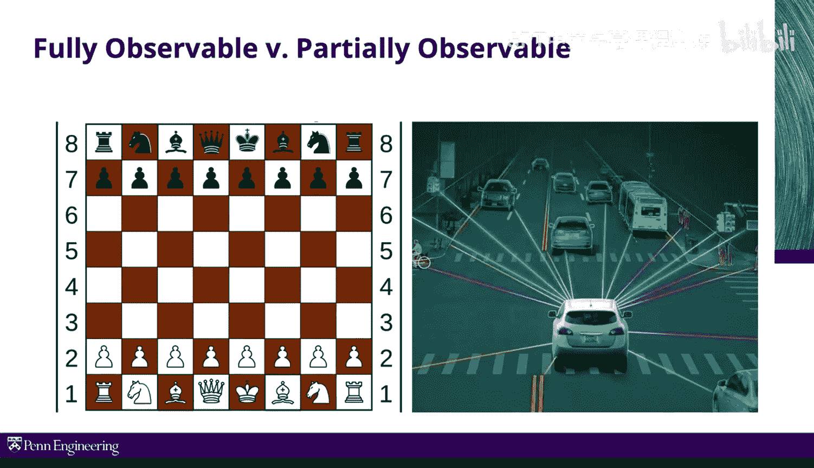
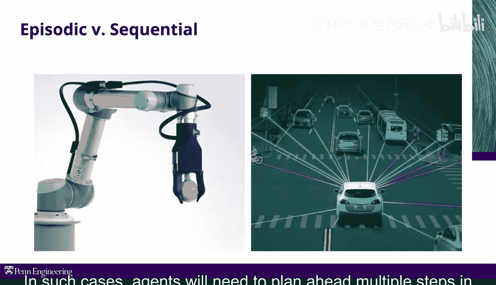
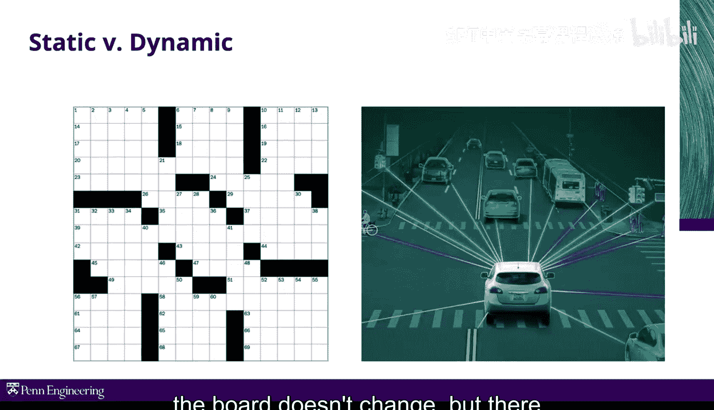
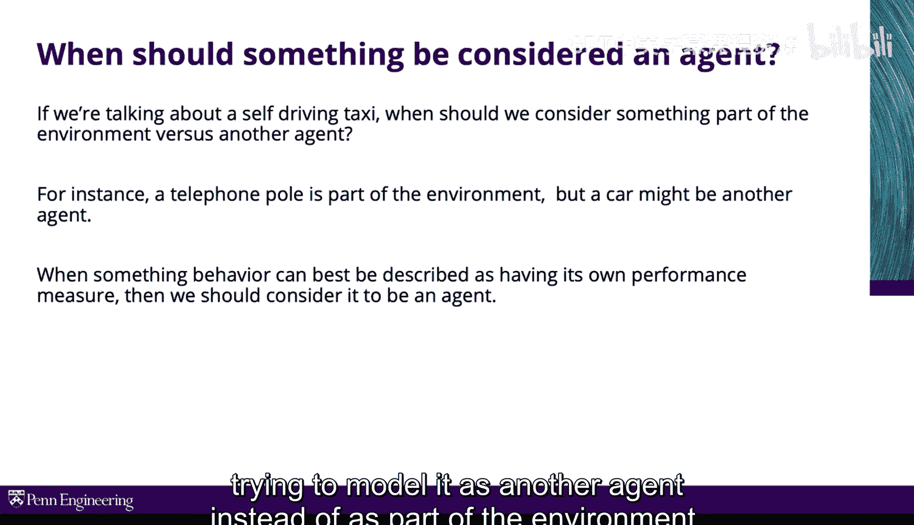
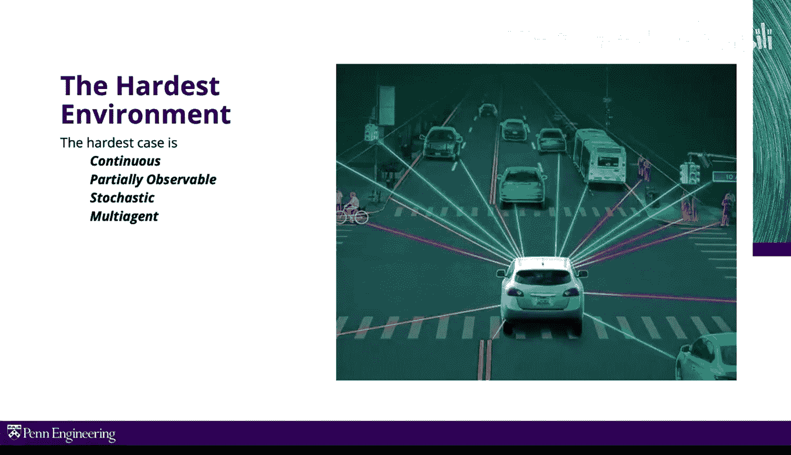
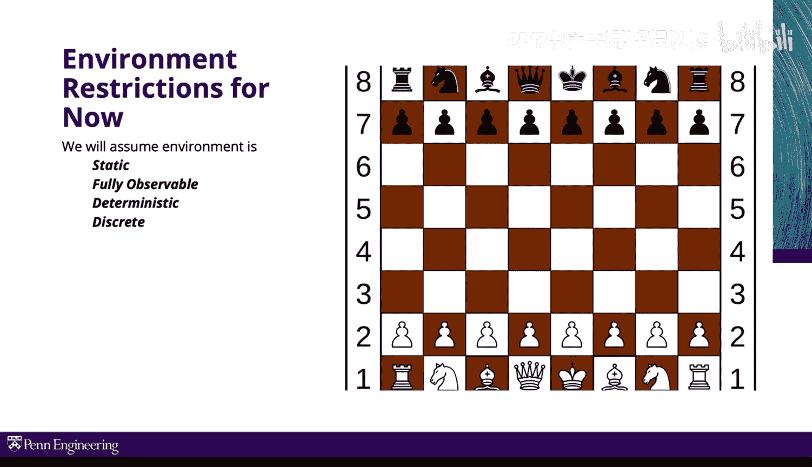

# 14：任务环境的属性 🧠

在本节课中，我们将学习如何描述和分类智能体（Agent）所面临的任务环境。理解这些属性对于设计有效的AI系统至关重要。

## 完全可观察与部分可观察

上一节我们介绍了智能体的基本概念，本节中我们来看看任务环境的第一个关键属性：可观察性。

一些任务环境是完全可观察的，而另一些只是部分可观察的。例如，如果我们设计一个下棋的智能体，它可以感知其环境的完整状态。下棋的AI系统能看到整个棋盘，没有任何信息对它隐藏。如果一个任务智能体的传感器能够检测到环境中与智能体选择行动相关的所有方面，那么该任务环境就被认为是完全可观察的。

与完全可观察的任务环境相反，许多任务环境只是部分可观察的。自动驾驶汽车在一个部分可观察的环境中运行。它们只能通过传感器感知信息。因此，它们可以获取一些关于其直接周围环境的信息，但无法获取完整的全局图景。例如，在自动驾驶汽车或自动出租车中，环境的某些部分可能被其他物体遮挡而无法观察。例如，行人可能被其他车辆遮挡，或者建筑物可能阻挡传感器，使其无法看到拐角处的情况。

部分可观察的环境也可能是由传感器噪声或不准确造成的。另一个部分可观察环境的例子，虽然不如自动出租车那么令人兴奋，是我们可靠的扫地机器人。它在部分可观察的环境中运行，因为它的传感器只能检测到正下方的灰尘。如果它有一张标明了所有脏污位置的房间完整地图，并且地图在清洁过程中会更新，那么这将是一个完全可观察的环境。

## 确定性与非确定性

接下来，我们探讨环境的另一个属性：确定性。

智能体函数接收一系列感知信息，然后返回一个行动。一个有用的区分是，当智能体选择采取哪个行动时会发生什么。你期望发生的结果是否保证会发生？

在像国际象棋这样的确定性环境中，当智能体选择一个行动，比如移动它的一个兵，那么我们可以确定地知道该行动的即时结果。如果智能体选择前进，兵就会向前移动；如果选择斜向移动，就会吃掉对手的棋子。思考确定性环境的另一种方式是，在智能体选择一个行动后，完成该行动后环境的状态将是完全可知的。世界的最终状态将完全由当前状态和智能体选择的行动决定。

如果不是这种情况，那么我们称该环境为非确定性环境。在非确定性环境中，智能体可以选择行动，但结果是不确定的。基于智能体执行该行动，环境可能产生许多种可能的结果状态。这可能出现在机会游戏中。我们人工智能课程中将讨论的许多问题设定都是游戏，因为它们是封闭世界，环境定义得非常明确。涉及掷骰子或抽牌的游戏与国际象棋不同，因为结果不是确定性的。这是因为有几种可能的结果。具有非确定性结果的环境在本质上是随机的。随机意味着概率性。如果我们能够量化每种可能结果的可能性，那么该环境就是一个随机环境。非确定性环境与此类似，只是我们尚未量化不同可能结果的可能性。

## 片段式与序列式

任务环境可以是片段式的，也可以是序列式的。

片段式环境是指智能体需要处理自包含的片段。智能体感知环境，然后执行单个行动，每个行动的选择不依赖于任何先前的行动。这方面的一个例子是装配线上挑选出有缺陷零件并将其丢弃的机器人。每次它检查面前的零件时，关于该零件是否有缺陷的决策都独立于它在序列式环境中的所有过去决策。

在序列式环境中，当前的决策会影响所有未来的行动。在这种情况下，一个即时决策将影响接下来可能的选择空间。对未来产生影响使得序列式环境比片段式环境更具挑战性。在这种情况下，智能体需要提前规划未来的多个步骤，以实现期望的结果。

## 静态与动态

任务环境中需要考虑的另一个维度是环境是静态的还是动态的。

如果环境在智能体思考采取什么行动时保持不变，那么它就是静态环境。这方面的一个例子是填字游戏，你可以在采取行动写出一个单词或输入一个字母之前思考任意长的时间。在智能体完成决定采取什么行动之前，没有任何变化。

这与动态环境形成对比。在动态环境中，当智能体正在思考采取什么行动时，其周围的环境正在不断变化。这使得许多任务更具挑战性，因为时间是关键。例如，如果一辆汽车或行人突然出现在它们的路径上，它们必须刹车。从接收到感知输入到决定汽车需要刹车之间经过的时间极其重要，因为汽车正在空间中疾驰。

也可能存在介于静态和动态之间的任务环境。如果一个环境实际上不随时间变化，但智能体的分数确实会变化，那么它可以被归类为半动态环境。这方面的一个例子是带有时钟的下棋游戏，棋盘的实际状态不会改变，但花费太长时间会受到一些惩罚。

## 离散与连续

接下来，我们有离散环境与连续环境的区别。

这种区别适用于环境的状态以及时间处理方式。在棋盘游戏中，环境可以用离散数量的不同状态来表示。在离散环境中，还有数量有限的明确定义的行动。这意味着智能体可以采取的行动集合是有限的。

在连续环境中，我们需要将环境的状态表示或我们处理时间的方式视为连续的。例如，如果我们正在构建一个控制炼油厂的AI系统，温度设置和石油输出将随时间平滑地经历一个连续的值范围。

## 单智能体与多智能体

我们将用来分类任务环境的最后一个属性是环境中是单个智能体在行动，还是存在多个智能体。

之前，我们讨论了确定性与非确定性环境。这还有另一种变体，即环境完全是确定性的，除了另一个智能体的行动。例如国际象棋。我们可以以战略性的方式对待其他智能体。当我们有一个竞争性的多智能体环境时，我们可以认为一个智能体在与另一个智能体竞争，那么我们将需要设计与其他智能体对抗的策略。我们可以假设其他智能体在游戏设定中也理性地行动。提高你自己的性能度量通常会降低对手的性能度量。

填字游戏是单智能体环境的一个例子。只有一个智能体试图找出谜题的解决方案。国际象棋是多智能体环境的一个例子，我们的智能体有一个对手。经典的视频游戏《吃豆人》有多个对手，所有这些小鬼魂都试图吃掉你。虽然大多数时候我们认为多智能体环境是竞争性的，但有时智能体的目标是一致的。在这种情况下，我们可以认为这些环境是合作性的。

## 什么应该被视为智能体

什么时候应该将某物视为智能体？如果我们谈论的是自动驾驶汽车，那么为什么我们觉得电话杆应该是环境的一部分，但另一辆汽车也许应该被视为一个智能体？

基本的经验法则是思考性能度量。如果某物有自己的性能度量，并且它试图优化该度量，那么这就是将其建模为另一个智能体而不是环境一部分的一个很好的理由。

## 总结

本节课中我们一起学习了描述任务环境的六个关键属性：可观察性、确定性、任务结构、动态性、状态/时间连续性以及智能体数量。所有这些任务环境的不同要素将帮助我们决定解决它们需要哪些要素。不同的参数化可能导致更容易或更难解决的问题。我们能想到的最困难的任务环境将是连续的、部分可观察的、随机的和多智能体的，很像自动驾驶汽车的例子。

目前，我们将把自己限制在相对简单的任务环境中。我们将从研究静态、完全可观察、确定性、离散的任务环境开始，比如国际象棋这样的棋盘游戏。随着课程的进展，我们将研究越来越复杂的任务环境。