# 15：Python复习-函数 🐍

在本节课中，我们将要学习Python中函数的核心概念。我们将从函数的基本定义开始，逐步探讨其与Java等语言的区别、参数的灵活性、变量的作用域以及函数作为“一等公民”的高级特性。通过对比和示例，你将清晰地掌握Python函数的强大与独特之处。

## 函数定义基础

上一节我们介绍了课程概述，本节中我们来看看如何在Python中定义一个函数。

一个函数定义以关键字 `def` 开始，然后是函数名、一对圆括号、参数列表、一个闭合的圆括号，最后是一个冒号。函数体需要缩进。

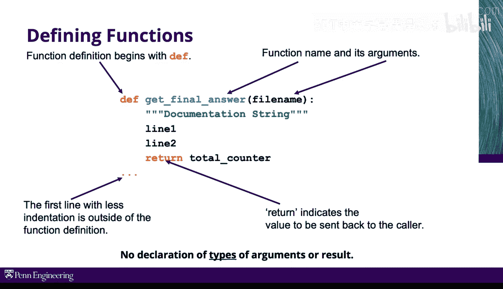

你可以在函数定义后立即添加一个可选的文档字符串。文档字符串由三个引号定义。

关键字 `return` 指示函数要返回的值。如果未给出 `return` 语句，Python使用 `None` 关键字。

函数体通过缩进来界定。第一行缩进减少的代码就落在了函数定义之外。Python使用空格来划分代码块，这与之前介绍的条件语句相同。空格定义了哪些内容属于函数内部，以及函数在哪里结束。

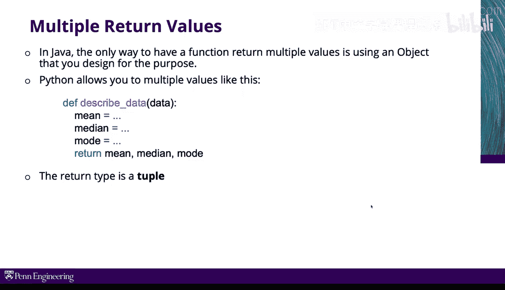

与Java不同，Python不声明返回类型或函数参数的类型。

**代码示例：**
```python
def function_name(arg1, arg2):
    """
    这是一个文档字符串。
    用于说明函数的功能。
    """
    # 函数体
    result = arg1 + arg2
    return result
```

## 多返回值与函数签名

了解了基础定义后，我们来看看Python函数与Java的一些关键区别。

Java和Python之间一个有趣的差异是，Python允许方法拥有多个返回值。在Java中，从函数返回多个值的唯一方法是创建一个专门为此目的设计的对象。在Python中，你可以通过在 `return` 语句后用逗号分隔列出所有值来轻松返回多个值。这会自动将你返回的不同值打包成一个元组。因此，具有多个返回值的函数的返回类型是一个元组。

**代码示例：**
```python
def get_user_info():
    name = "Alice"
    age = 30
    city = "New York"
    return name, age, city  # 返回一个元组

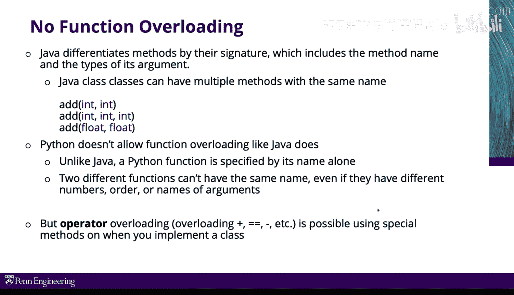

# 调用函数并解包返回值
user_name, user_age, user_city = get_user_info()
```

Java和Python在函数签名的定义方式上也有所不同。在Java中，方法签名包括方法名及其参数的类型。由于这种签名定义，Java允许类拥有多个同名方法，这些方法根据其参数的数量和类型进行区分。例如，如果一个类负责将数字相加，它可以有多个名为 `add` 的函数，这些函数接受不同数量或不同类型的参数。

与Java不同，Python中的函数签名仅仅是函数名本身。因此，不可能有两个具有相同名称的不同函数，即使它们的参数数量或顺序不同。不过，Python类确实允许运算符重载。因此，如果你需要用双等号比较两个对象或用加号运算符将两个对象相加，这是可能的，只需在该类中实现一个魔术方法即可。

## 参数的灵活性

尽管Python不允许你定义多个同名但参数数量不同的函数，但它允许同一个函数接受不同数量的参数。Python通过几种方式实现这一点。

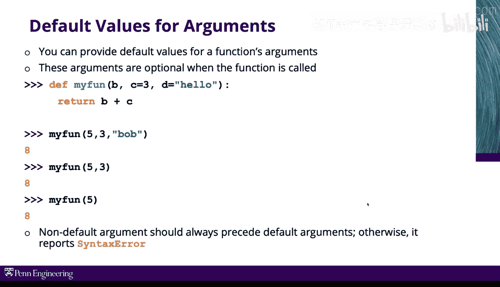

你可以为函数参数提供默认值。当你这样做时，这些参数就变成了可选的。这意味着在调用函数时，你可以为这些参数指定值，这将覆盖默认值；或者你可以省略这些参数，此时将使用它们的默认值。这意味着我可以用几种不同的方式调用我的函数：我可以传入所有参数，包括那些有默认值的参数，或者只传入那些没有指定默认值的参数。

Python要求非默认参数始终位于有默认值的参数之前。如果在函数定义中不遵循此要求，Python将返回语法错误。

**代码示例：**
```python
def greet(name, greeting="Hello"):
    print(f"{greeting}, {name}!")

# 多种调用方式
greet("Alice")           # 输出: Hello, Alice!
greet("Bob", "Hi")       # 输出: Hi, Bob!
```

Python在参数顺序方面也出奇地灵活。只要在调用中指定了参数，就可以不按顺序传递参数，这称为关键字参数。例如，如果我定义了一个带有参数A、B和C的函数，我实际上可以以任何顺序调用该函数，只要我明确使用它们的关键字。与其按A、B、C的顺序调用函数，我实际上可以按C、B、A的相反顺序调用，只要我指定 `C=某个值`、`B=某个值` 和 `A=某个值`。未明确给出参数名称关键字的参数被假定为默认顺序。

Python用来提供传递给函数的参数数量灵活性的另一种机制是通过使用 `*args` 关键字。`*args` 是一种将可变数量的非关键字参数传递到函数中的方式。

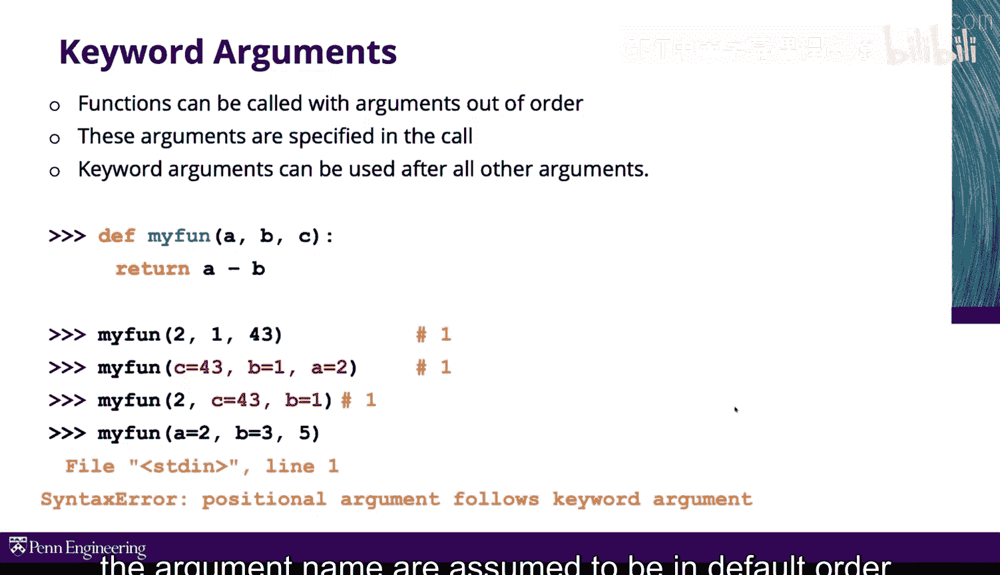

**代码示例：**
```python
def print_everything(*args):
    for thing in args:
        print(thing)

# 调用方式一：直接传入多个参数
print_everything("apple", "banana", "cherry")

# 调用方式二：传入一个列表并使用 * 解包
my_list = [1, 2, 3]
print_everything(*my_list)
```

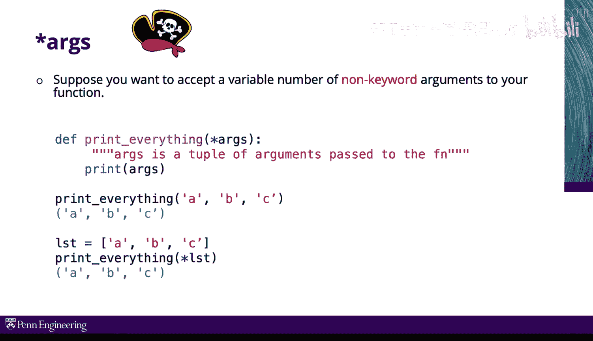

如果你想在函数中接受可变数量的关键字参数，可以像使用 `*args` 一样使用 `**kwargs`。`*args` 和 `**kwargs` 的符号有点复杂，因为我们使用了 `*` 和 `**`，但一旦你习惯了，它就成了一种传递任意数量参数的非常方便的方法。

以下是两种可以将关键字参数传递到使用 `**kwargs` 定义的函数中的方法示例：你可以直接传递带有关键字及其值的参数，或者可以传入一个字典。类似于使用 `*` 符号解包传递给使用 `*args` 的函数的列表，你可以使用双星号 `**` 来解包传递给使用 `**kwargs` 的函数的字典。

**代码示例：**
```python
def print_info(**kwargs):
    for key, value in kwargs.items():
        print(f"{key}: {value}")

# 调用方式一：直接传入关键字参数
print_info(name="Alice", age=30, city="NYC")

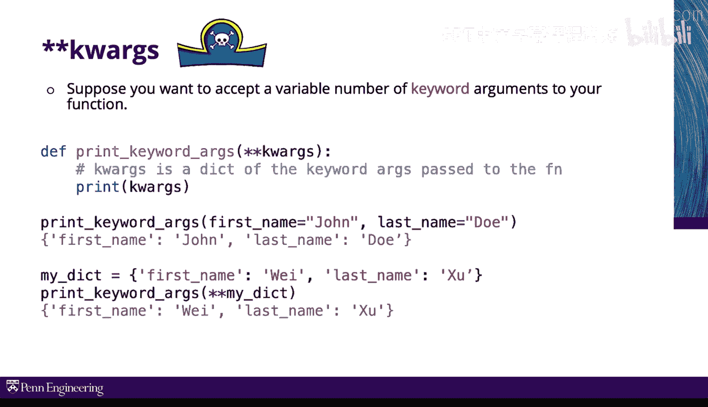

# 调用方式二：传入一个字典并使用 ** 解包
my_dict = {"job": "Engineer", "hobby": "Reading"}
print_info(**my_dict)
```

尽管Python没有像Java那样重载函数的能力，但其函数参数方面的灵活性可以说同样有用。

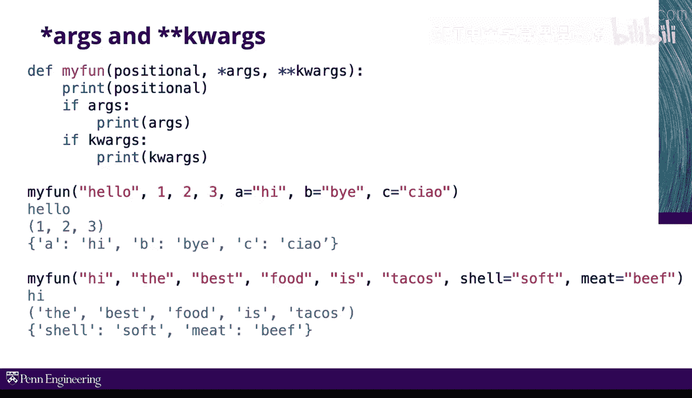

## 变量作用域与默认参数的妙用

Python在使用变量方面相当宽松。你可以定义一个函数并引用一个未在函数作用域内定义的变量。在这种情况下，函数会看到该变量的最新值。例如，在函数 `add` 中，我引用了一个变量 `i`，该变量未在函数本身内定义，而是在我代码的其他地方定义。当我更新 `i` 时，即使传入相同的值，函数 `add` 的输出也会不同，因为 `i` 在我代码的不同位置被赋予了不同的值。因此，函数看到的是 `i` 的最新值。

**代码示例：**
```python
i = 5

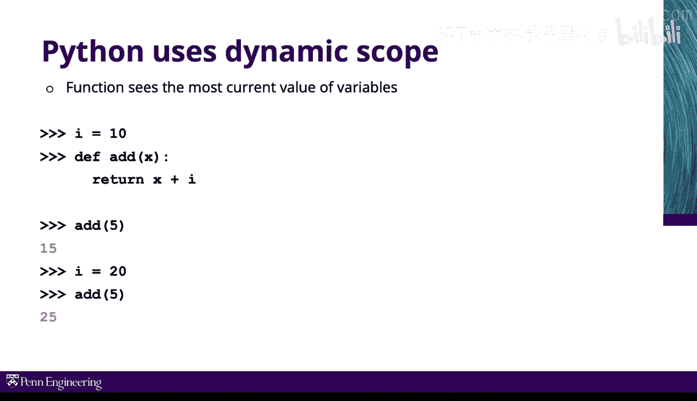

def add(a, b):
    return a + b + i  # 使用了全局变量 i

print(add(1, 2))  # 输出: 8 (1+2+5)

i = 10
print(add(1, 2))  # 输出: 13 (1+2+10)
```

默认参数的一个有趣特性是，你可以在一种称为动态规划的程序中非常巧妙地使用它们。动态规划是编码递归算法的一种高效方法。动态规划使用一个称为记忆化的过程。记忆化是一种优化技术，用于存储昂贵函数调用的结果并返回缓存的结果。这可以用于计算斐波那契数的程序中，其中每个数字都依赖于之前的两个计算。

我们可以使这个程序高效的方法是，每次计算某个数字N的斐波那契数时，我们将结果存储在名为 `fibs` 的Python字典中。在这里，你可以看到我将字典 `fibs` 作为我的 `fib` 函数的默认参数。我已经将 `fibs` 字典初始化为空。默认参数值只在我们第一次调用函数时被求值。因此，我不会在每次调用 `fib` 时都创建一个新的空字典。事实上，后续每次对 `fib` 的调用都会增加 `fibs` 字典的大小。这使我能够记住每个结果，因此我只为特定的N值计算一次斐波那契数。

**代码示例：**
```python
def fib(n, fibs={}):
    if n in fibs:
        return fibs[n]
    if n <= 1:
        result = n
    else:
        result = fib(n-1) + fib(n-2)
    fibs[n] = result
    return result

print(fib(10))  # 快速计算出结果，利用了记忆化
```

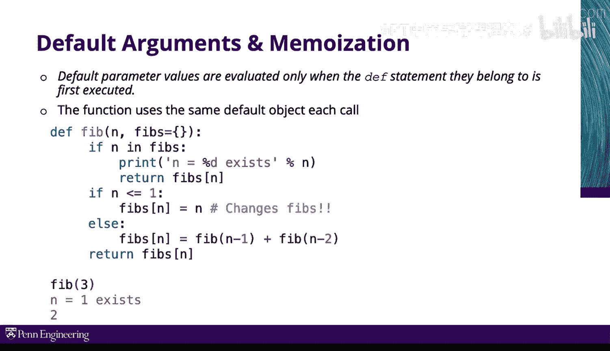

## 函数作为一等公民

Python和Java之间一个有趣的差异是，函数是一等对象。什么是一等对象？我指的是可以动态创建、销毁、传递给函数、作为值返回，并拥有与编程语言中所有其他变量相同权利的对象。在Python中，函数是真正的一等公民。你可以将函数作为参数传递给其他函数，可以将函数作为值返回，可以将函数赋值给变量，甚至可以将它们存储在数据结构中。这允许你做很多非常有趣、复杂的事情。

例如，我可以编写这个 `compose` 函数，它将函数 `F`、函数 `G` 和一些数据 `X` 作为参数。这个 `compose` 函数将是一个高阶函数，它首先将函数 `G` 应用于数据 `X`，然后将 `F` 应用于该结果。一旦我定义了这个组合函数，我就可以向它传递任何两个函数和任何我想要的数据。

**代码示例：**
```python
def compose(f, g, x):
    return f(g(x))

# 使用示例：先求和，再将结果转为字符串
result = compose(str, sum, [1, 2, 3])
print(result)  # 输出: "6"
```

## 总结

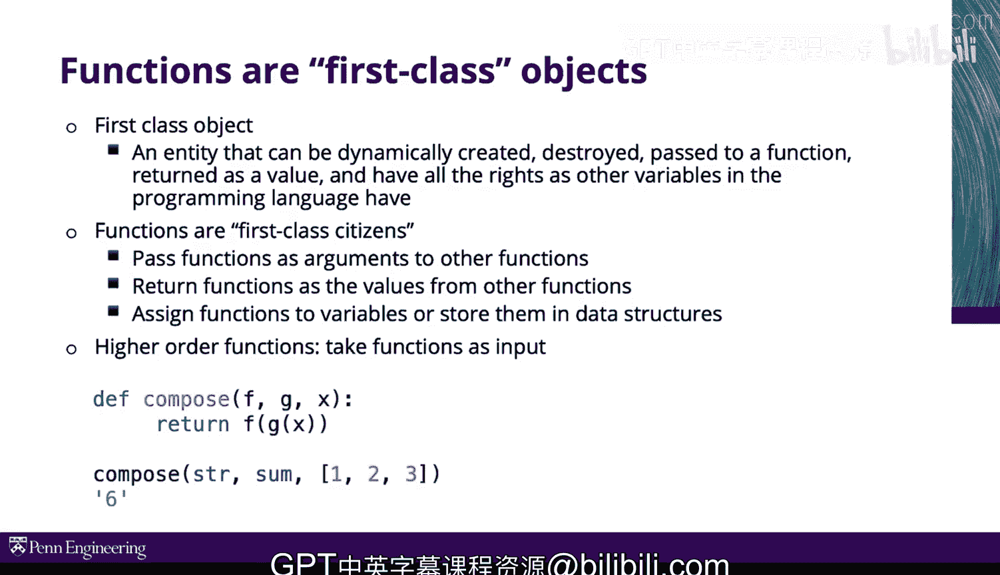

本节课中我们一起学习了Python函数的核心知识。我们从最基本的函数定义语法开始，了解了其与Java在返回值、签名上的区别。接着，我们深入探讨了Python函数参数的强大灵活性，包括默认参数、关键字参数、`*args` 和 `**kwargs`。我们还看到了Python宽松的变量作用域规则以及如何巧妙利用默认参数实现记忆化。最后，我们认识到函数在Python中是“一等公民”，可以作为参数传递和返回，这为编写高阶函数和更抽象的代码打开了大门。掌握这些概念，将帮助你更高效、更优雅地使用Python进行编程。