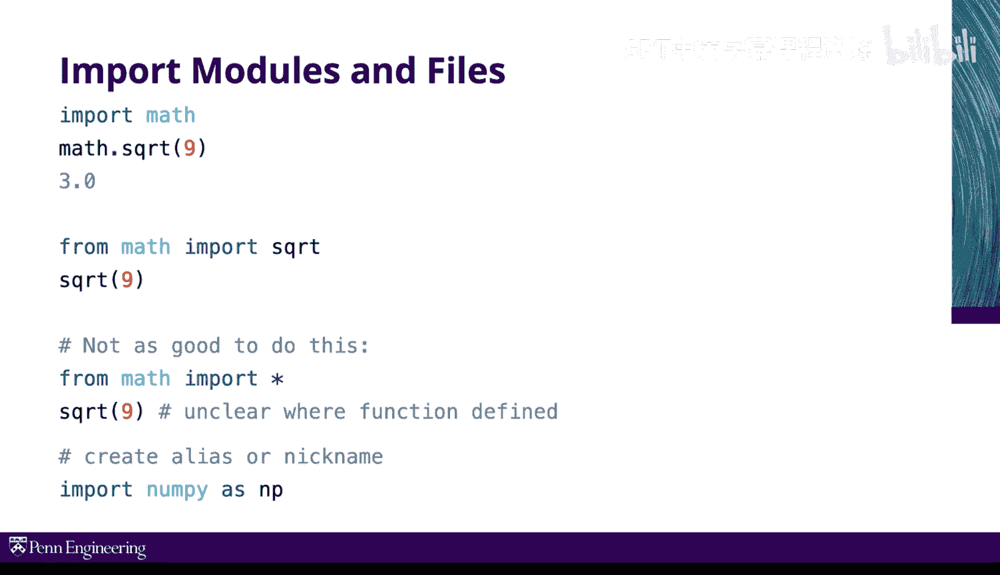
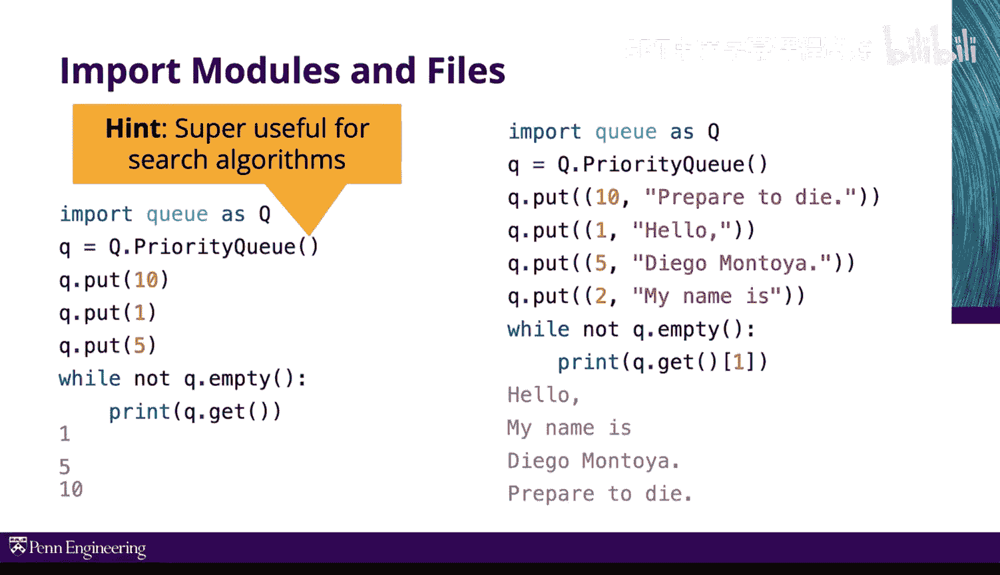
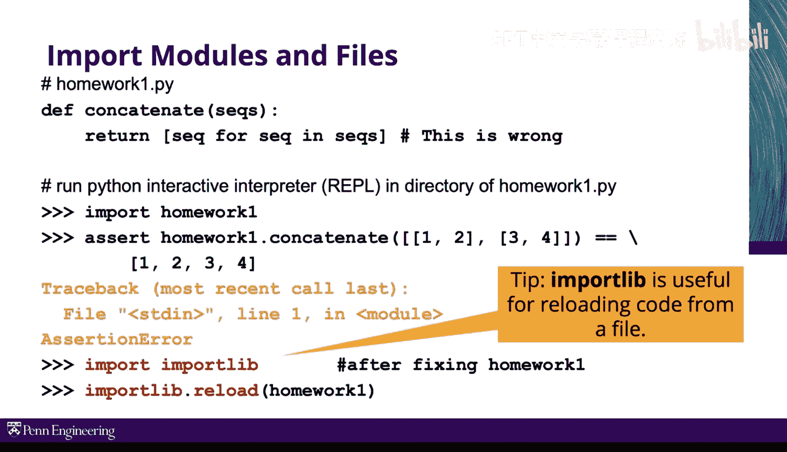
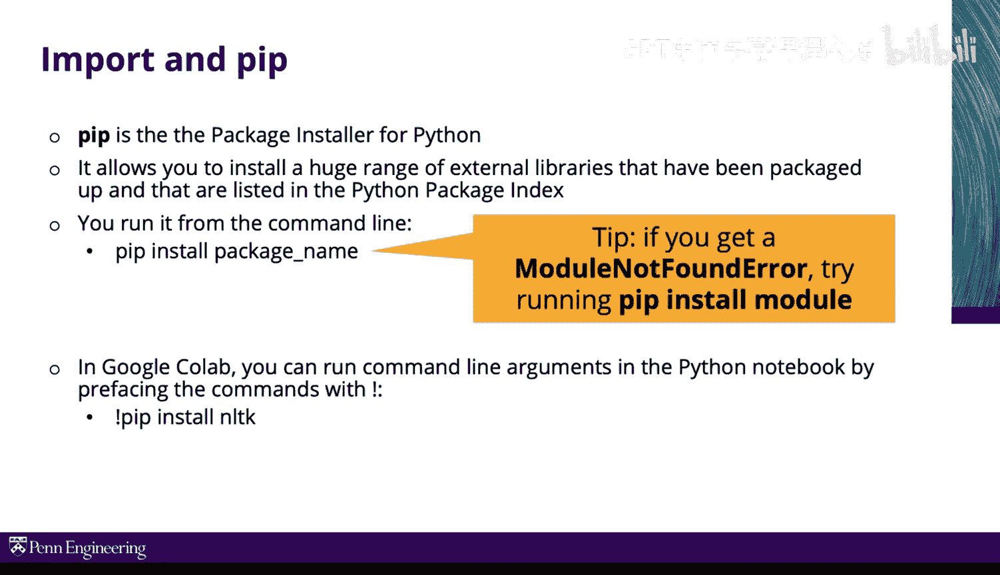

# 18：Python复习-导入模块 📦

在本节课中，我们将要学习Python中一个极其强大的功能：导入外部包和文件。这个功能允许你将他人开发的程序或自己编写的代码模块整合到你的项目中，极大地提高了代码的复用性和开发效率。

## 导入模块的基本语法

Python通过`import`语句来导入模块。其基本语法是使用关键字`import`，后跟模块的名称。导入后，你就可以访问该模块中已实现的函数。

以下是四种不同的导入方式示例：

**1. 导入整个模块**
这是最基础的方式。导入后，需要使用`模块名.函数名`的格式来调用函数。
```python
import math
result = math.sqrt(16)  # 调用math模块中的sqrt函数
```

**2. 从模块中导入特定函数**
如果你只需要使用模块中的某个特定函数，可以使用`from ... import ...`语法。这样可以直接调用函数，无需添加模块名前缀。
```python
from math import sqrt
result = sqrt(16)  # 直接调用sqrt函数
```

**3. 导入模块中的所有函数（不推荐）**
使用`from module import *`可以导入模块中的所有函数。这虽然方便，但可能导致命名冲突，通常不推荐在生产代码中使用。
```python
from math import *
result = sqrt(16)
```

**4. 为模块设置别名**
为了在保持代码清晰的同时减少打字量，可以为导入的模块设置一个简短的别名。
```python
import numpy as np
array = np.array([1, 2, 3])  # 使用别名np调用函数
```

上一节我们介绍了导入模块的基本语法，本节中我们来看看一个使用别名的具体例子。



## 使用别名导入：以`queue`模块为例

以下示例展示了如何使用别名导入`queue`模块，并利用其中的`PriorityQueue`（优先队列）对象。
```python
import queue as Q  # 为queue模块设置别名Q
pq = Q.PriorityQueue()  # 创建优先队列对象
```
优先队列允许我们放入多个项目，然后按照优先级顺序取出。下面的`while`循环演示了如何清空一个优先队列：
```python
while not pq.empty():
    print(pq.get())  # 获取并打印下一个项目
```
优先队列中的项目默认按升序（从小到大）取出。

屏幕右侧的代码展示了优先队列如何处理元组。它并非只处理整数值，而是根据元组中的第一个元素进行排序。这样，我们可以为任何类型的对象关联一个优先级。在下面的例子中，我为一系列字符串分配了优先级，以确保它们按照对话应有的顺序打印出来。

## 导入自定义文件



除了导入外部开发的模块，你还可以导入自己编写的Python文件。

例如，你可以在喜欢的文本编辑器中完成作业一的脚本编写。然后，在命令行中键入`python`启动Python交互式环境（REPL）。你无需将作业中的每个函数复制粘贴到命令行环境中，可以直接导入它。

导入自定义文件的语法与导入标准模块相同，只需省略文件末尾的`.py`扩展名。
```python
import homework1  # 假设你的文件名为 homework1.py
```
导入后，你就可以运行和测试你的代码了。这里我们展示一个使用`assert`语句测试`homework1`中`concatenate`函数的例子：
```python
assert homework1.concatenate([1, 2], [3, 4]) == [1, 2, 3, 4]
```
如果我们的`concatenate`函数实现有误，在修改并保存文件后，Python REPL环境并不会自动感知到文件的变化，我们需要重新导入它。

## 重新加载模块

为了重新加载已修改的模块代码，我们可以使用Python内置的`importlib`库。

`importlib`库对于从文件重新加载代码非常有用。你可以使用`importlib.reload()`函数来重新加载一个模块。
```python
import importlib
importlib.reload(homework1)  # 重新加载 homework1 模块
```



## 使用Pip安装第三方包

除了Python内置模块，还有大量由第三方开发的软件包可供使用。`pip`是一个程序，允许你轻松安装这些外部开发的Python包。

`pip`代表“Python包安装器”。只要包被列在Python包索引（PyPI）中，你就可以使用`pip`安装它。

运行`pip`非常简单，只需在终端中键入：
```
pip install package_name
```
如果你在运行他人开发的或你在另一台电脑上开发的Python脚本时遇到“ModuleNotFoundError”（模块未找到错误），通常的解决方法就是运行`pip install`并指定错误信息中报告的缺失模块名。

如果你在Jupyter Notebook（例如Google Colab）中开发或运行Python代码，同样可以使用`pip`命令。方法是在代码单元格中，在命令前加上感叹号`!`。在Python笔记本中，以感叹号为前缀的命令会自动在命令行中为你运行。
```python
!pip install nltk  # 在Jupyter Notebook中安装nltk包
```

## 总结



本节课中我们一起学习了Python导入模块的核心知识。我们掌握了四种导入语法：导入整个模块、导入特定函数、导入所有函数（不推荐）以及使用别名导入。我们还学习了如何导入和重新加载自己编写的文件，并了解了如何使用`pip`工具来安装和管理第三方Python包。这些技能是构建复杂Python项目、利用丰富生态库的基础，对于后续学习数据科学和机器学习至关重要。