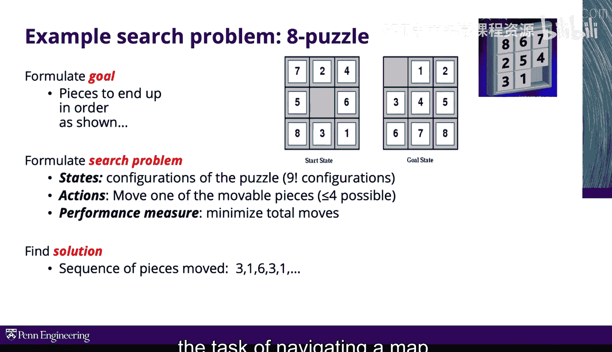
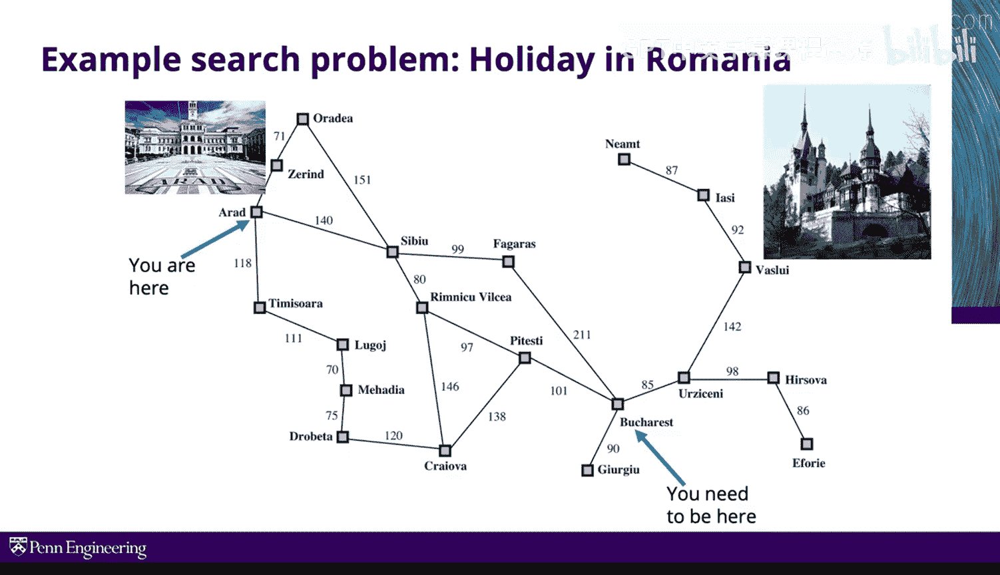
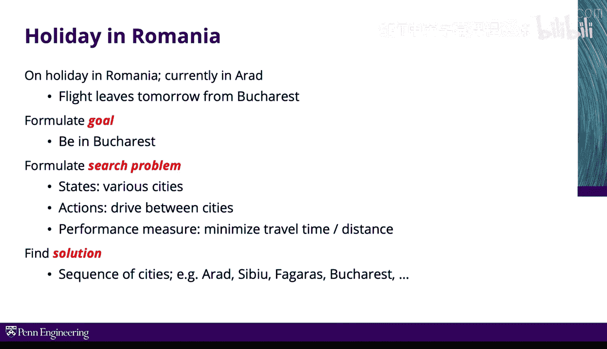

# 21：搜索问题-II 🔍

在本节课中，我们将学习如何将现实世界中的问题形式化为搜索问题。我们将通过两个具体例子——八数码拼图和地图导航——来理解搜索问题的核心构成要素，并看到看似不同的问题如何能用统一的框架来解决。

---

## 将拼图视为搜索问题 🧩

上一节我们介绍了搜索问题的基本概念，本节中我们来看看如何将拼图游戏形式化为一个搜索问题。拼图是人工智能中一个有趣的挑战，因为它们是**完全可观测**且**确定性的**，非常适合作为搜索问题的起点，并能清晰地定义其中涉及的数学要素。

我们将使用一个滑动拼图作为贯穿的例子。这个滑动拼图的实例被称为**八数码问题**。它由一个3x3的网格组成，其中包含编号为1到8的八个方块，以及一个位于第九个位置的空白方格。挑战在于通过一系列移动，将方块从初始配置转换到目标状态，即方块按数字1到8递增的顺序排列。

以下是定义搜索问题的关键步骤：

**1. 定义状态集合**
状态集合是拼图所有可能的配置，即八个方块和空白方格的所有可能排列顺序。

**2. 定义动作集合**
动作集合定义了在一个状态下可以执行的操作，这些操作会将我们从一个状态转移到另一个状态。在这个例子中，动作是滑动一个方块，也可以等价地看作是与相邻方块交换空白方格的位置。当空白方格在网格中心时，可能的动作最多（向左、向右、向上、向下移动）。当空白方格在边缘或角落时，可能的动作数量会减少。

**3. 定义性能度量**
在模块1中，我们讨论了理性智能体如何试图最大化性能度量。搜索问题也使用性能度量的概念。其目的是判断一个将我们带到目标状态的解决方案是否比另一个同样能达到目标的解决方案更好。对于拼图，性能度量应能回答“这个解决方案有多好？”显然，**最佳解决方案是移动步数最少的那个**。因此，我们不是最大化性能度量，而是最小化成本。在八数码问题中，每个动作具有**单位成本**，意味着向左、向右、向上或向下移动的成本相同。

**4. 定义解决方案**
搜索问题的解决方案是从起始状态到目标状态的一系列动作序列。在这个例子中，我们可以通过说明每一步移动了哪个方块来表示动作序列。

---

## 将地图导航视为搜索问题 🗺️

八数码问题是我们能形式化为搜索问题的一个例子。另一个看似无关但也能形式化为搜索问题的任务是**地图导航**。

我们这里的例子是在罗马尼亚度假。假设你发现自己身处阿拉德市，然后突然想起当天晚些时候有一班从布加勒斯特起飞的飞机。问题就变成了：**如何从阿拉德最快地到达布加勒斯特？**

这可以方便地用一个图来表示，图中的每个节点都用字母A到Z标记，代表各个城市。

让我们讨论如何将地图导航任务表示为搜索问题。

**1. 定义状态集合**
在这种情况下，状态集合是地图上的城市集合。当前状态是我们当前所在的城市。

**2. 定义目标状态**
目标状态是我们想要到达的城市，在这个例子中是布加勒斯特。

**3. 定义动作集合**
动作是从一个城市开车到另一个城市，前提是它们在图中是相连的。

**4. 定义解决方案**
解决方案是为了从初始状态（阿拉德）到达最终目标状态（布加勒斯特）而采取的一系列动作。我们可以将解决方案表示为按旅行顺序经过的城市列表。

**5. 定义性能度量**
最后，我们需要为地图导航任务定义一个性能度量。我们希望最小化诸如旅行时间或行驶距离之类的指标。

解决罗马尼亚度假问题，就是应用一个算法来找到从阿拉德到布加勒斯特的最短路径。我们将要学习的算法与谷歌地图为你提供路线时实际使用的算法非常相似。谷歌地图比我们的问题更复杂的唯一一点是，它必须考虑可能影响某些路段行驶时间的因素，例如交通拥堵或事故。

---

## 总结 ✨

本节课中，我们一起学习了如何将不同领域的问题形式化为统一的搜索问题框架。八数码拼图和地图导航看似完全不同，但两者都可以被形式化为具有**状态集合**、**动作集合**、**目标状态**和**性能度量（成本）** 的搜索问题。因此，我们可以应用完全相同的算法来解决它们。理解这个通用框架是设计和实现有效搜索算法的第一步。