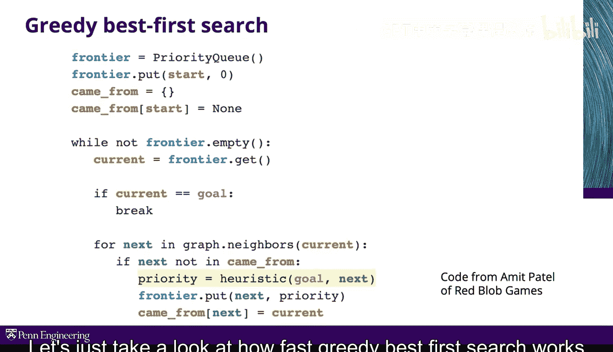
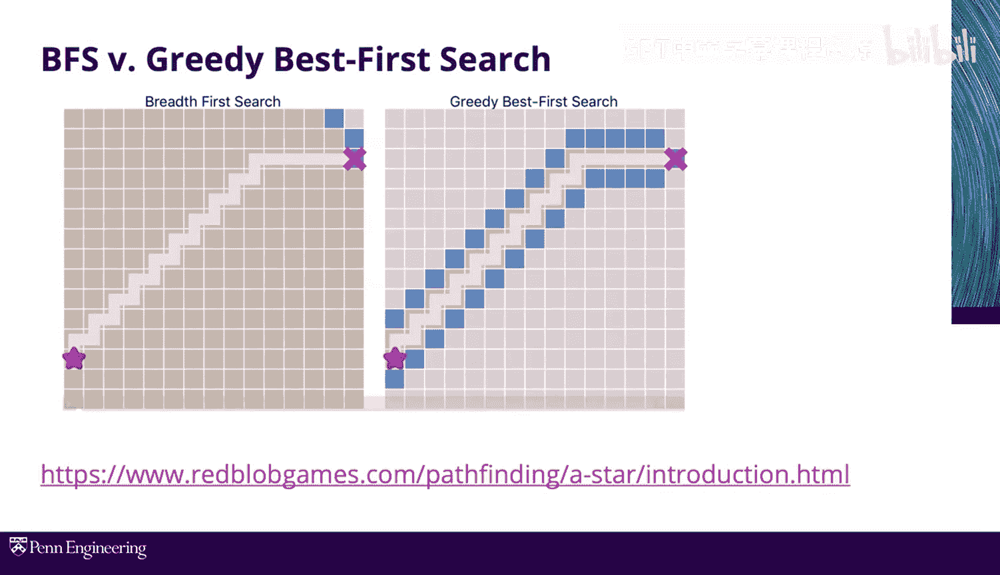
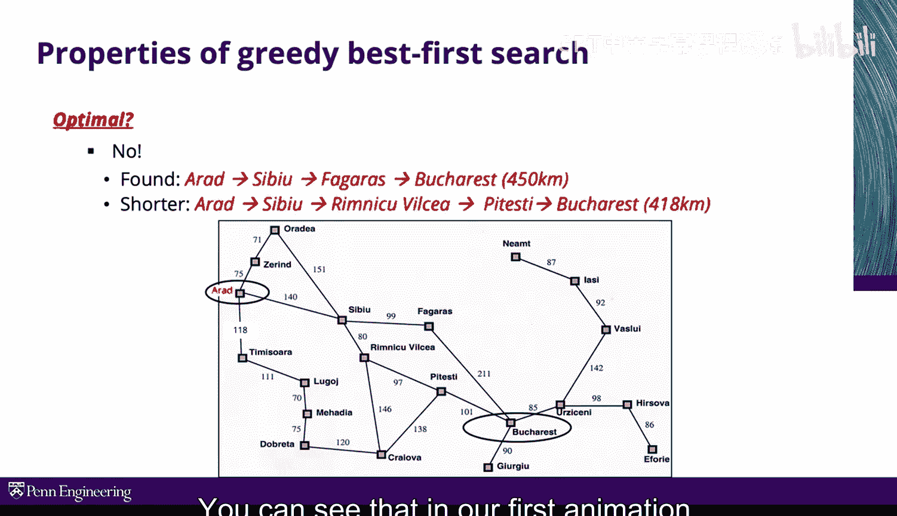
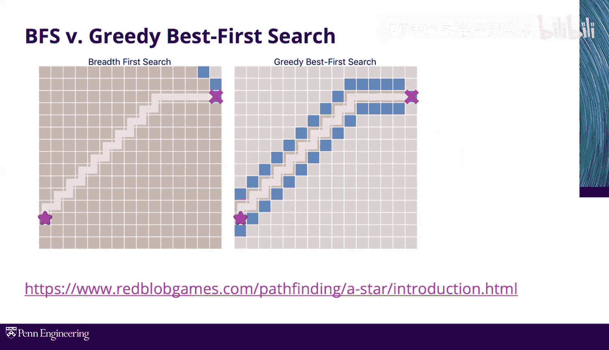
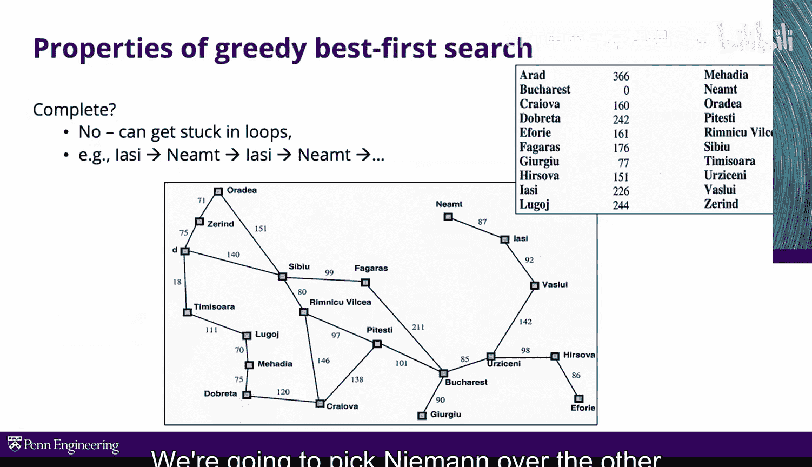
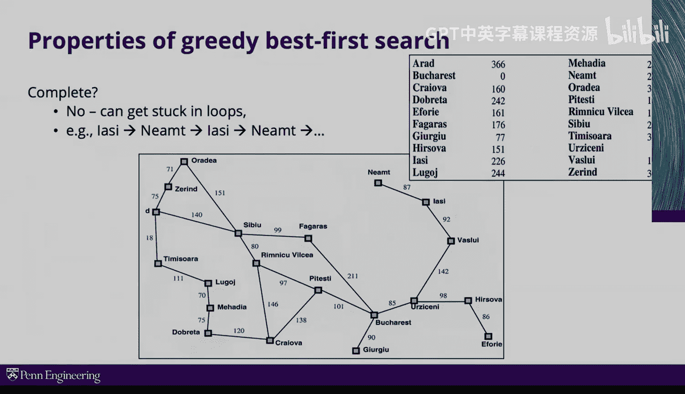

# 32：贪婪最佳优先搜索 🧭

在本节课中，我们将要学习第一个启发式搜索算法——贪婪最佳优先搜索。我们将了解其核心思想、工作原理、实现方式，并通过实例分析其优缺点。

上一节我们介绍了搜索算法的基本概念，本节中我们来看看一种具体的启发式搜索方法。

## 算法核心思想

贪婪最佳优先搜索的核心思想是：在每一步扩展节点时，总是选择**看起来**最接近目标的节点。它使用一个启发式函数 **h(n)** 来估计从当前节点 **n** 到目标节点的剩余距离，并基于此估计值做出决策。

其节点评估函数 **f(n)** 的公式为：
**f(n) = h(n)**

这与我们之前学过的**一致代价搜索**不同，一致代价搜索使用 **f(n) = g(n)**，即从起点到当前节点的实际路径成本。而贪婪最佳优先搜索**完全忽略已发生的路径成本 g(n)**，只关注对未来距离的启发式估计 **h(n)**。

## 算法实现步骤

以下是贪婪最佳优先搜索的实现流程，我们使用**优先队列**来管理待扩展的节点边界。

1.  **初始化**：将起始状态放入优先队列（边界）中，并记录路径来源。
2.  **循环搜索**：当边界不为空时，执行以下步骤：
    a. 从优先队列中弹出**评估值 f(n) 最小**的节点（即启发式估计最接近目标的节点）。
    b. 检查该节点是否为目标状态。如果是，则搜索成功，结束。
    c. 如果不是目标，则“扩展”该节点，即找出从该节点可以到达的所有相邻节点（后继状态）。
    d. 对于每一个未访问过的后继节点，计算其启发式估计值 **h(后继)**，并将其以该值为优先级加入优先队列。
    e. 记录从当前节点到每个后继节点的路径，以便最终重建完整路径。

## Python代码示例

以下是用Python实现贪婪最佳优先搜索的简化代码框架：

```python
import heapq



def greedy_best_first_search(start, goal, heuristic, get_neighbors):
    frontier = []  # 优先队列
    heapq.heappush(frontier, (heuristic(start, goal), start))
    came_from = {start: None}  # 记录路径
    visited = set([start])

    while frontier:
        _, current = heapq.heappop(frontier)

        if current == goal:
            break  # 找到目标

        for next_node in get_neighbors(current):
            if next_node not in visited:
                visited.add(next_node)
                # 优先级仅由启发式函数决定
                priority = heuristic(next_node, goal)
                heapq.heappush(frontier, (priority, next_node))
                came_from[next_node] = current

    # 重建路径...
    return came_from
```

## 启发式函数示例

启发式函数 **h(n)** 的选择取决于具体问题：
*   **在地图导航问题中**，**h(n)** 通常是当前城市到目标城市的**直线距离**（欧几里得距离）。
*   **在网格寻路问题中**，常用**曼哈顿距离**，即两点在X轴和Y轴方向上的绝对距离之和。公式为：
    **h(n) = |x₁ - x₂| + |y₁ - y₂|**

## 算法性能演示

为了直观比较，我们参考了Red Blob Games（一个非常有趣的算法教程网站）的示例。



*   **在开阔场地**：如下图所示，左侧是广度优先搜索（BFS），右侧是贪婪最佳优先搜索（Greedy BFS）。贪婪最佳优先搜索利用启发式信息，几乎直线冲向目标（X），速度非常快。


*   **在复杂地形中**：如下图所示，当存在障碍物时，贪婪最佳优先搜索的路径（右侧亮灰色区域）可能不是最短的。它因为“目光短浅”地追求当前看来最近的目标，而错过了更优的路径（左侧未被探索的浅灰色区域）。




## 罗马尼亚地图问题实例

让我们用经典的“从Arad到Bucharest”寻路问题来逐步分析算法。

1.  **第一步**：从Arad出发，扩展得到三个相邻城市：Sibiu, Timisoara, Zerind。查询它们到Bucharest的直线距离（启发值）分别为：253, 329, 374。优先队列排序后，选择Sibiu进行扩展。
2.  **第二步**：扩展Sibiu，得到新城市：Fagaras, Oradea, Rimnicu Vilcea。它们的启发值分别为：176, 380, 193。现在边界上的所有节点按启发值排序，最小的是Fagaras(176)，因此扩展Fagaras。
3.  **第三步**：扩展Fagaras时，发现其相邻城市包含目标Bucharest。将其加入边界并立即找到目标。
4.  **最终路径**：Arad -> Sibiu -> Fagaras -> Bucharest，总路径成本为450。

然而，存在一条更优的路径：Arad -> Sibiu -> Rimnicu Vilcea -> Pitesti -> Bucharest，总成本为418。这说明贪婪最佳优先搜索找到的**路径不一定是最优的**。

## 算法特性分析


基于以上实例和演示，我们可以总结贪婪最佳优先搜索的特性：


*   **不完备性**：不能保证找到解。如果启发式函数引导不当，算法可能会在环路中无限循环。例如，从Iasi出发，可能因为Neamt的启发值比Vaslui低而选择前往Neamt，但从Neamt只能返回Iasi，导致死循环。
*   **非最优性**：如罗马尼亚地图实例所示，它找到的解可能不是成本最低的路径。
*   **时间复杂度**：最坏情况下可能与状态空间大小成指数关系，但一个好的启发式函数可以极大提高效率。
*   **空间复杂度**：与广度优先搜索类似，在最坏情况下需要存储所有边界节点。

## 总结

本节课中我们一起学习了**贪婪最佳优先搜索算法**。它是一种启发式搜索方法，其核心在于每一步都选择启发式估计值 **h(n)** 最小的节点进行扩展，即选择“看起来”最接近目标的节点。


我们了解了它的工作原理、Python实现方式，并通过地图导航和网格寻路的实例，直观地看到了它的优势（在开阔场地的速度）和劣势（可能不完备、非最优、在复杂地形中表现不佳）。关键在于，它**只考虑了到达目标的估计成本，而完全忽略了目前已付出的路径成本**。





下一节，我们将学习一种能克服这些缺点的更优算法——A*搜索，它巧妙地结合了路径成本和启发式估计。