# 33：A*搜索算法详解 🧭

在本节课中，我们将要学习一种非常著名的搜索算法——A*算法。我们将了解它的核心思想、工作原理、关键要求，以及如何通过启发式函数来优化搜索过程。

---

## 什么是A*算法？

A*算法是最佳优先搜索算法中最著名的一种。它拥有一些非常出色的特性，能够保证其行为是最优的。

上一节我们介绍了最佳优先搜索的基本概念，本节中我们来看看A*算法的具体实现。

A*算法的核心思想是：我们希望剪枝掉那些已知代价高昂的路径，同时优先扩展最有希望的路径。到目前为止，我们只讨论了两种最佳优先搜索算法：
*   当 `F(n) = G(n)` 时，我们实现的是**一致代价搜索**。
*   当 `F(n) = H(n)` 时，我们实现的是**贪婪最佳优先搜索**。

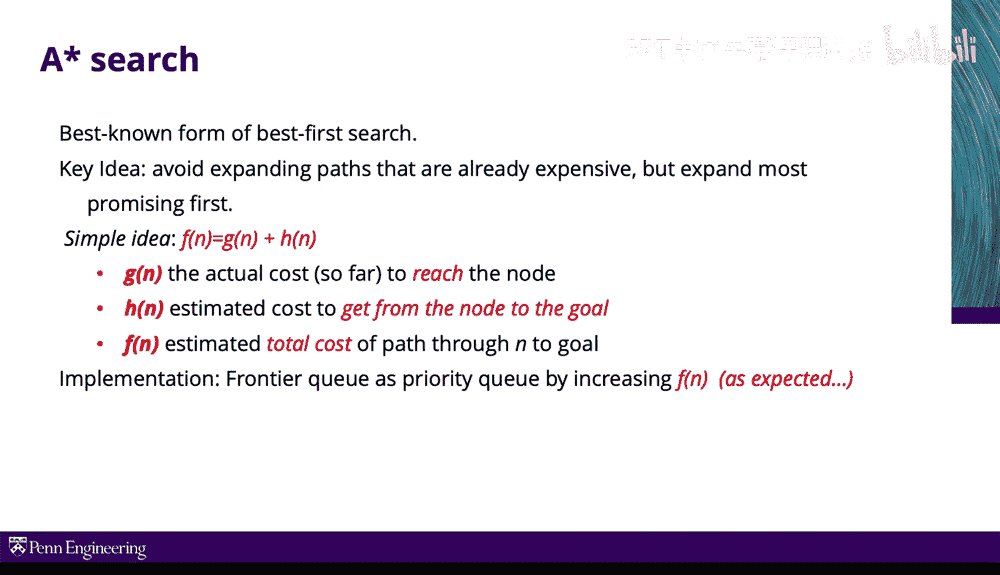

而当 `F(n) = G(n) + H(n)` 时，我们实现的就是**A*搜索**。其中：
*   `G(n)` 是从起始节点到节点 `n` 的实际路径代价。
*   `H(n)` 是从节点 `n` 到目标节点的**启发式估计代价**。

为了实现真正的A*搜索，我们需要对启发式函数 `H(n)` 有一个特殊的要求。

---

## 可采纳启发式函数

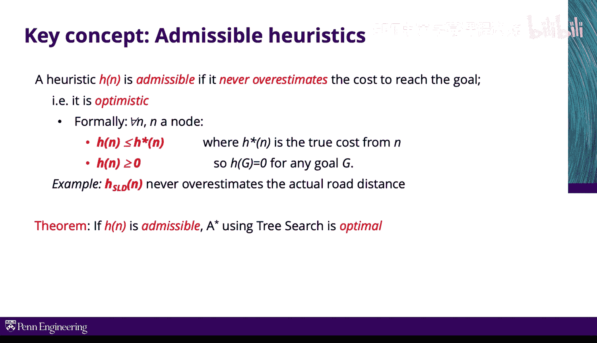

A*算法能够工作的关键概念在于，启发式函数 `H(n)` 必须是**可采纳的**。

可采纳性的定义是：对于图中的任意节点 `n`，`H(n)` **永远不会高估**从该节点到达目标的真实代价。换句话说，启发式估计总是**乐观的**，它总是小于或等于到达目标的真实距离。

用公式可以表示为：`H(n) ≤ h*(n)`，其中 `h*(n)` 是从节点 `n` 到目标的真实距离。当我们到达目标节点时，启发式值必须等于 `0`。

一个可采纳启发式的例子是我们已经见过的**直线距离**。在道路网络中，两点间的直线距离永远不会高估它们之间的实际道路距离。

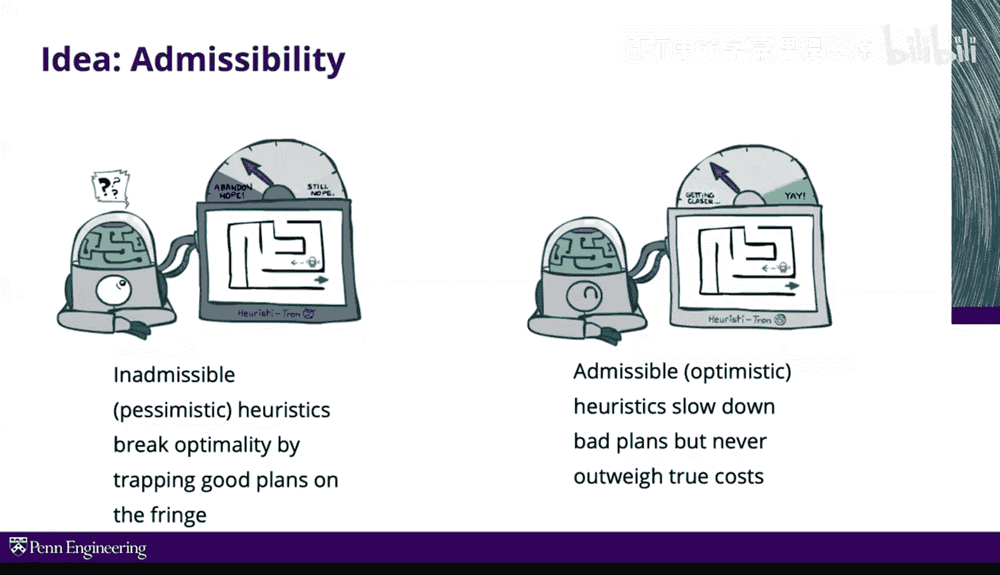

如果我们拥有一个可采纳的启发式函数，那么A*搜索就能保证找到最优解（即最短路径）。

---

## A* vs. 贪婪最佳优先搜索

让我们通过一个动画示例来比较A*搜索和贪婪最佳优先搜索的行为。

在贪婪最佳优先搜索中，节点旁边的数字表示它们被扩展的顺序。贪婪搜索并非最优，因为它从未探索真实的最低成本路径。

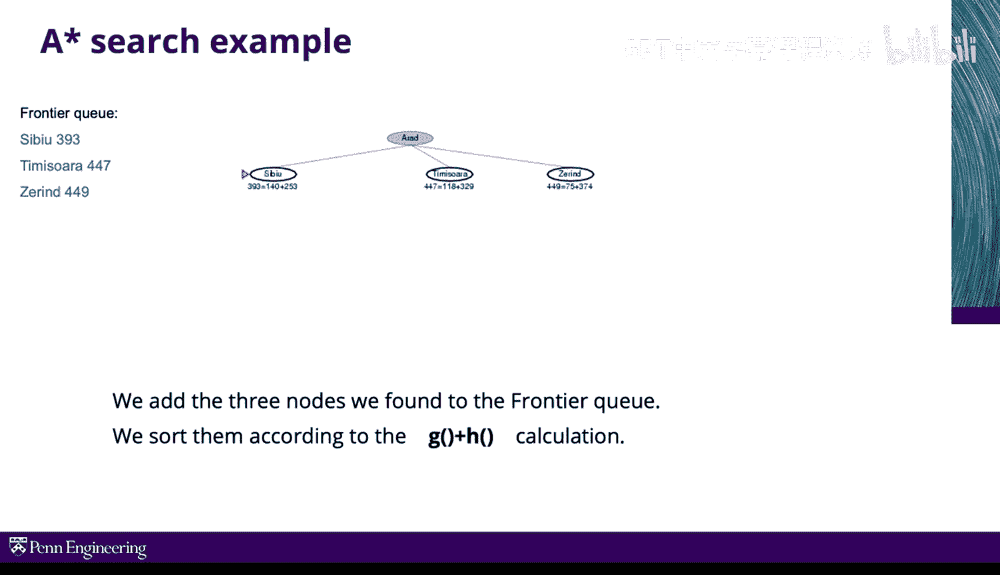

而在右侧，真正的A*算法找到了真实的最低成本路径。虽然它比贪婪最佳优先搜索扩展了更多的节点，但它保证总能首先找到到达目标的最短路径。因此，只要启发式函数是可采纳的，A*就是最优的。

可采纳性背后的思想是，它提供了一个乐观的剩余代价估计。它会“减慢”糟糕的计划，但永远不会超过到达目标的真实成本。

---

## A*算法工作流程示例

让我们以罗马尼亚地图为例，看看A*算法是如何工作的。

我们的起点是 `Arad`。我们将使用一个优先级队列作为边界。节点的优先级由 `F(n) = G(n) + H(n)` 决定。

从 `Arad` 出发：
*   路径成本 `G(Arad) = 0`。
*   启发式估计 `H(Arad)` 是到 `Bucharest` 的直线距离。

我们将 `Arad` 的三个邻居添加到优先级队列中。扩展 `Arad` 后，每个邻居节点都会有一个复合成本 `F(n)`：
*   对于 `Sibiu`：`G = 140`（从Arad到Sibiu的实际距离），`H = 253`（直线距离），所以 `F = 393`。
*   对于 `Timisoara`：`G = 118`，`H = 329`，`F = 447`。

现在我们的优先级队列中有不同的值，因此我们将扩展 `F` 值最小的节点，即 `Sibiu`。

一个很酷的特性是，我们不必显式地将已访问节点（如 `Arad`）从图中删除。因为当我们尝试从 `Sibiu` 再次扩展回 `Arad` 时，这条路径的 `G` 成本会变得很高（140 + 140），它会被推到优先级队列的很后面，以至于我们永远不会再处理它。

我们不断弹出 `F(n)` 值最小的节点进行扩展。当我们首次将 `Bucharest` 加入边界队列时，**我们不能立即返回这条路径**。我们必须继续扩展队列中 `F` 值比它小的节点，以验证当前到达 `Bucharest` 的路径是否确实是成本最低的。这是A*算法保证最优性的关键步骤。

最终，当 `Bucharest` 成为边界队列中 `F` 值最小的节点时，我们就找到了到达目标的最优路径。

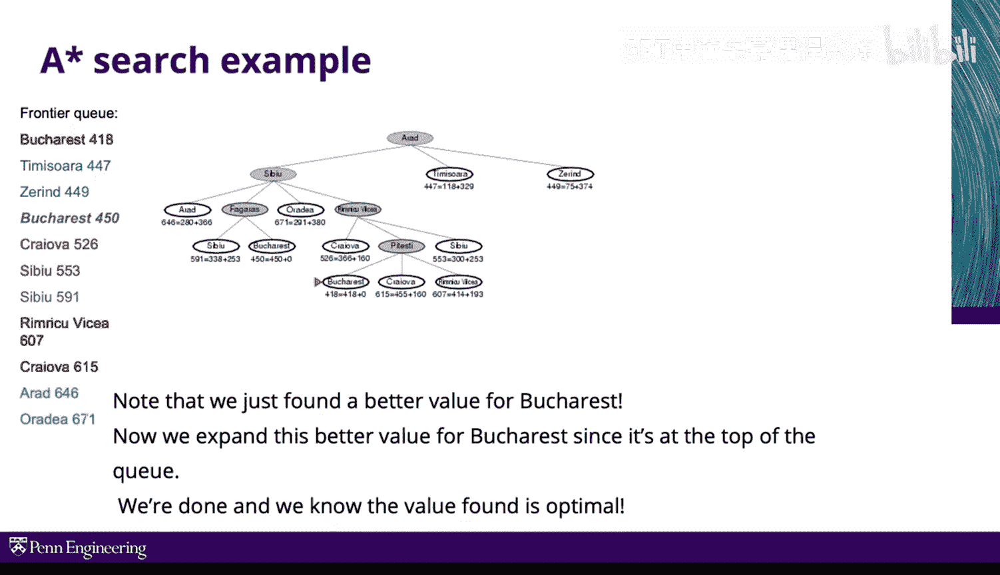

---

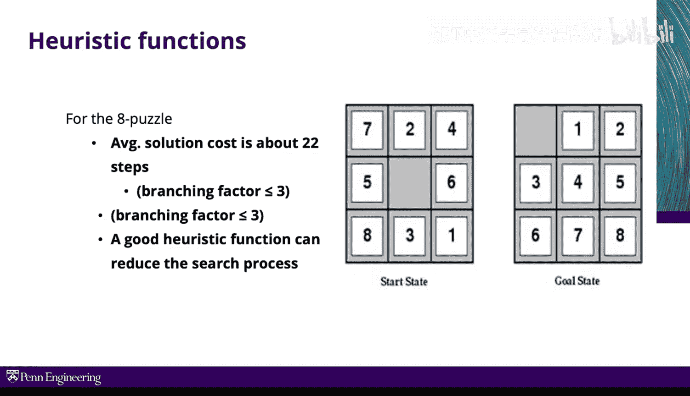

## 其他问题的启发式函数

我们也可以将其他问题（如八数码问题）表述为搜索问题。

八数码问题的分支因子不大，但平均解大约需要22步。一个好的启发式函数能显著减少搜索过程。

以下是两种可采纳的启发式函数：
1.  **错位棋子数**：计算不在目标位置的棋子数量。这至少需要移动那么多步。
2.  **曼哈顿距离**：计算每个棋子移动到其目标位置所需步数的总和（只计水平和垂直移动）。

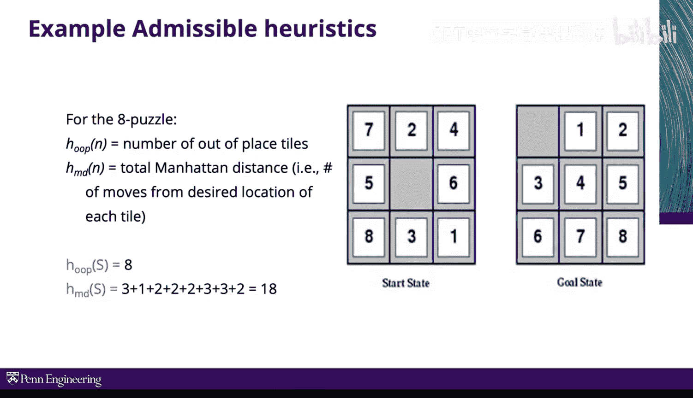

这两种启发式都是可采纳的，因为它们都低估了实际所需的移动次数。

---

## 通过放松约束生成启发式

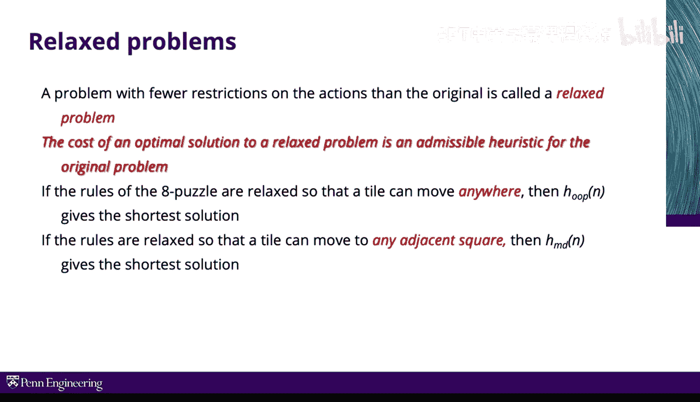

一种系统化生成可采纳启发式的方法是**放松约束**。我们取一个带有若干限制的问题，然后减少其中一个或多个限制，计算在这个放松后的问题中的解的成本。这个成本将成为原问题的一个可采纳启发式。

对于八数码游戏，规则是只能将棋子移动到相邻的空白格。
*   如果我们放松“只能移到空白格”的约束，只要求“可以移到任何相邻格”，我们就得到了**曼哈顿距离**启发式。
*   如果我们进一步放松，允许“将棋子移动到任何位置”（忽略相邻和空白格约束），我们就得到了**错位棋子数**启发式。

放松后问题的精确解的成本，是原问题所需步骤数的一个下界。

---

## 启发式的优劣：支配性

既然两种启发式都是可采纳的，我们如何知道哪个更好呢？它们都能帮助A*以最优方式运行，但需要扩展的节点数量不同。

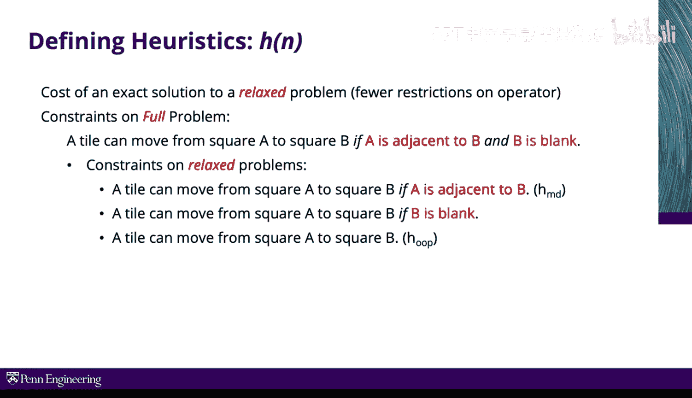

我们可以使用**支配性**这个概念来衡量一个启发式是否优于另一个。

启发式 `H2` **支配** 启发式 `H1`，如果对于搜索图中的**每一个**节点 `n`，都有 `H2(n) ≥ H1(n)`，并且两者都是可采纳的。我们希望启发式估计尽可能接近真实值。如果 `H2` 是乐观的，并且它返回的估计值总是大于或等于 `H1`，那么它对剩余成本的估计就更准确。

在八数码问题中：
*   使用错位棋子数启发式，平均需要扩展约227个节点。
*   使用曼哈顿距离启发式，平均仅需扩展约73个节点。

启发式估计越好，需要扩展的节点就越少，找到解决方案的速度也就越快。

---

## 最佳与最差的可采纳启发式

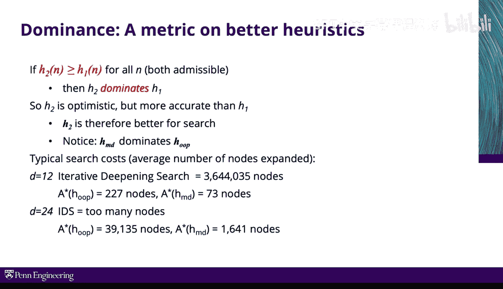

*   **最佳的可采纳启发式**就是**真实代价** `h*(n)`。如果我们知道真实距离，就可以直奔目标，这基本上就是知道了精确剩余距离的贪婪最佳优先搜索。
*   **最差的可采纳启发式**是**恒为0的启发式**，即 `H(n) = 0`。这很糟糕，因为它会使A*退化为**一致代价搜索**。

显然，真实代价启发式支配所有其他启发式，而恒为零的启发式被所有其他启发式支配。

---

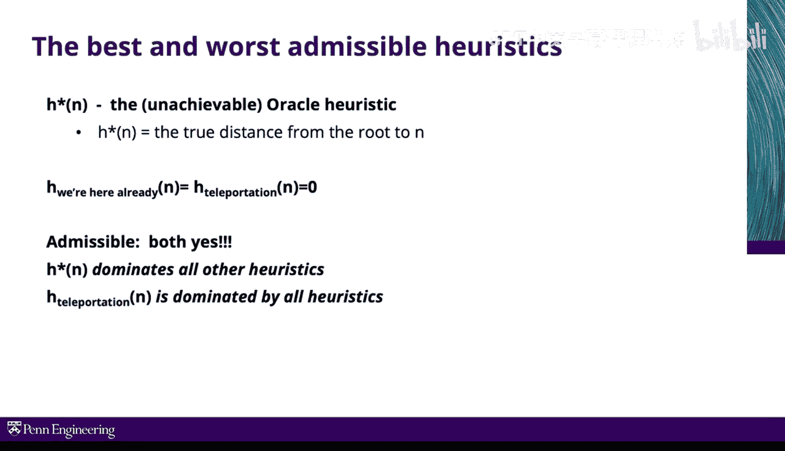

本节课中我们一起学习了A*搜索算法。我们了解了它的核心公式 `F(n) = G(n) + H(n)`，以及保证其最优性的关键——**可采纳的启发式函数**。我们还学习了如何通过放松约束来生成启发式，以及如何使用支配性概念来比较不同启发式的优劣。A*算法因其在保证找到最优解的同时，能有效利用启发式信息来指导搜索方向，而成为人工智能和路径规划等领域中最重要、最常用的算法之一。