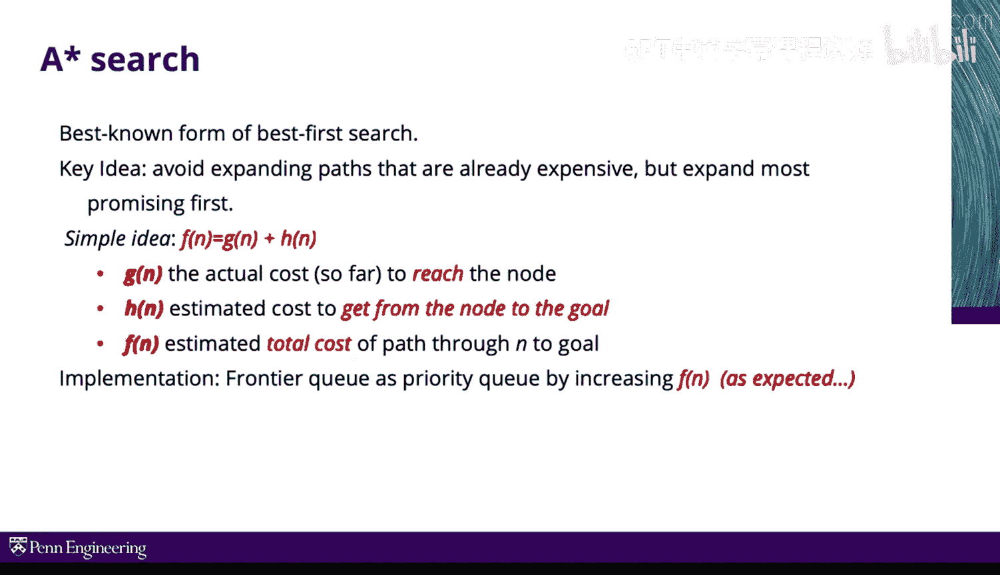
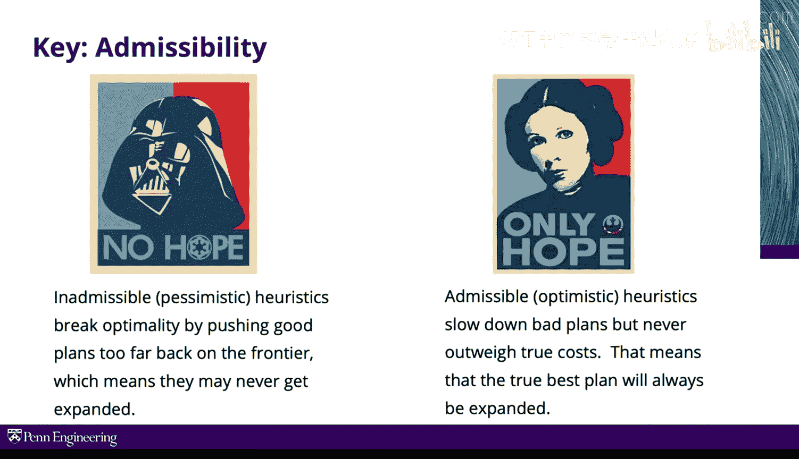
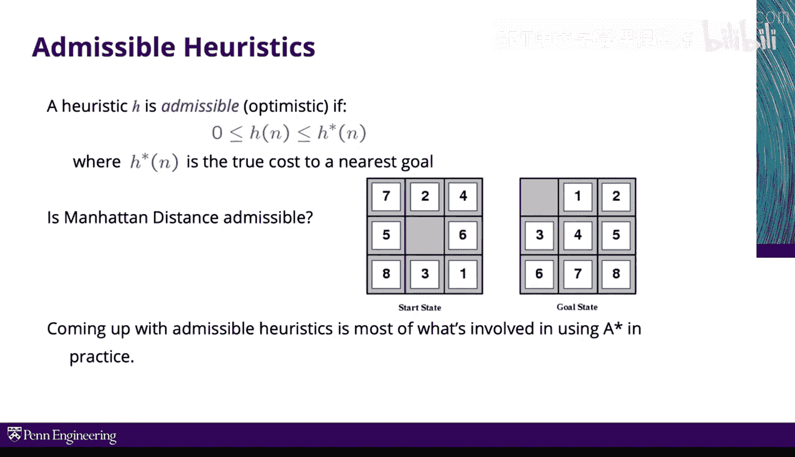
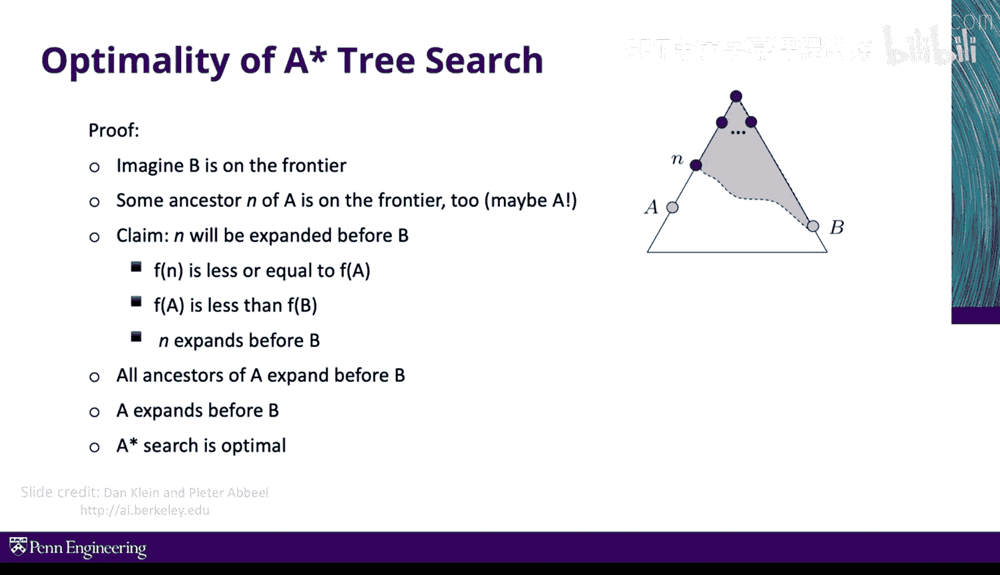

# 34：A*搜索算法-II

在本节课中，我们将深入学习A*搜索算法的核心原理，特别是其保证找到最优解的关键——**可采纳性**。我们将探讨启发式函数的设计要求，并通过一个证明草图来理解A*算法的最优性保证。

上一节我们介绍了A*搜索是一种最佳优先搜索，它结合了路径成本和启发式估计。本节中我们来看看如何确保这种算法能找到最优解。

## 可采纳性：乐观的启发式

A*算法能够保证找到最优解的关键在于其使用的启发式函数必须是**可采纳的**。可采纳性意味着启发式函数对剩余成本的估计必须是乐观的，即它永远不会高估从当前节点到目标节点的真实成本。

以下是可采纳启发式的核心思想：
*   **乐观估计**：启发式函数 `H(n)` 给出的估计值，必须小于或等于从节点 `n` 到目标节点的**真实**剩余成本。
*   **避免高估**：如果启发式函数高估了剩余成本（即过于悲观），它可能会让实际上的最优路径在优先级队列中排名靠后，从而被非最优路径抢先探索。
*   **形式化定义**：一个启发式函数 `H` 是可采纳的，当且仅当对于搜索树中的任意节点 `n`，都有 `0 <= H(n) <= 从 n 到目标的真实成本`。

在之前的八数码拼图例子中，曼哈顿距离就是一个可采纳的启发式函数。我们也可以通过**放松问题约束**（例如，允许方块直接“穿墙”）来构造可采纳的启发式。

实现A*算法最困难的部分通常就是设计一个合适的、可采纳的启发式函数。

## 启发式的优劣：支配性

并非所有可采纳启发式都是同等有效的。我们引入了**支配性**的概念来比较它们。

以下是关于启发式支配性的要点：
*   如果一个可采纳启发式 `H1` 对于所有节点 `n` 的估计值都**大于或等于**另一个可采纳启发式 `H2` 的估计值（即 `H1(n) >= H2(n)`），那么 `H1` **支配** `H2`。
*   被支配的启发式（`H2`）提供的信息量更少。虽然两者都保持乐观（不超估），但支配性启发式（`H1`）的估计值更接近真实成本，因此通常能引导搜索更高效地朝向目标。
*   在设计启发式时，我们的目标是在保持可采纳性的前提下，让估计值尽可能大（即尽可能接近真实成本）。

## A* 最优性证明草图

现在，让我们通过一个证明草图来理解为什么使用可采纳启发式的A*搜索能够保证找到最优解（即路径成本最低的解）。

我们将使用搜索树的表示法。假设我们有两个目标节点：
*   节点 **A**：最优目标节点，具有最低的路径成本 `G(A)`。
*   节点 **B**：次优目标节点，路径成本 `G(B) > G(A)`。

我们需要证明，在A*搜索中，**A（或它的某个祖先节点）一定会比 B 更早被从边界（优先级队列）中取出并扩展**。

以下是证明的逻辑步骤：
1.  **祖先节点的 F 成本**：设 `n` 是通往目标 A 路径上的任意一个祖先节点（包括 A 本身）。根据定义，其评估函数 `F(n) = G(n) + H(n)`。
2.  **F(n) 与 G(A) 的关系**：由于 `n` 在通往 A 的路径上，所以从起点到 `n` 的真实成本 `G(n)` 必然小于等于到 A 的总成本 `G(A)`。同时，根据可采纳性，`H(n)` 小于等于从 `n` 到 A 的真实剩余成本。因此，`F(n) <= G(A)`。当 `n` 就是 A 时，因为 `H(A)` 在目标处必须为0（否则会高估），所以 `F(A) = G(A)`。
3.  **F(A) 与 F(B) 的关系**：由于 A 是最优目标，`G(A) < G(B)`。同样，在目标节点处 `H(A) = H(B) = 0`。因此，`F(A) = G(A) < G(B) = F(B)`。
4.  **排序逻辑**：结合第2和第3步，对于 A 的任意祖先节点 `n`，有 `F(n) <= F(A) < F(B)`。
5.  **结论**：A*的边界队列总是优先扩展 `F` 值最小的节点。因为所有 A 的祖先节点的 `F` 值都严格小于 `F(B)`，所以它们都一定会比节点 B 更早被扩展。因此，算法必然会先发现最优目标 A，然后才发现次优目标 B。这满足了最优性的定义。

本节课中我们一起学习了A*搜索算法保证最优性的核心——**可采纳启发式**。我们理解了可采纳性要求启发式函数必须乐观估计（永不超估），并了解了如何通过支配性来比较不同启发式的效率。最后，我们通过一个证明草图，清晰地看到了A*算法为何能确保优先找到成本最低的解路径。掌握这些概念是有效应用和实现A*搜索的基础。