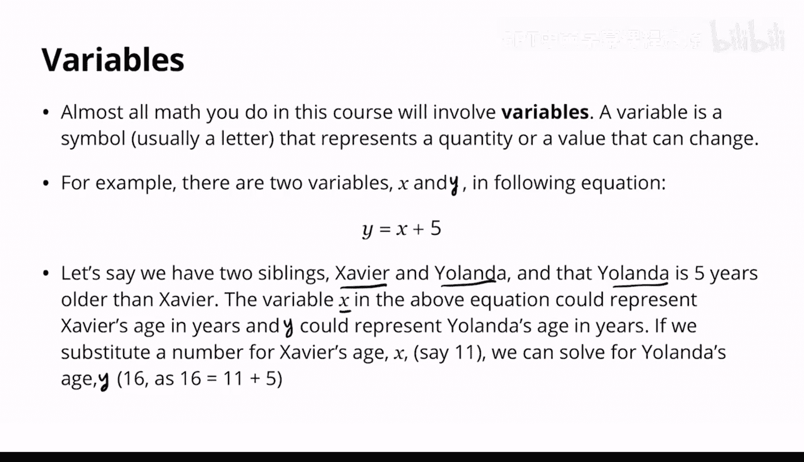
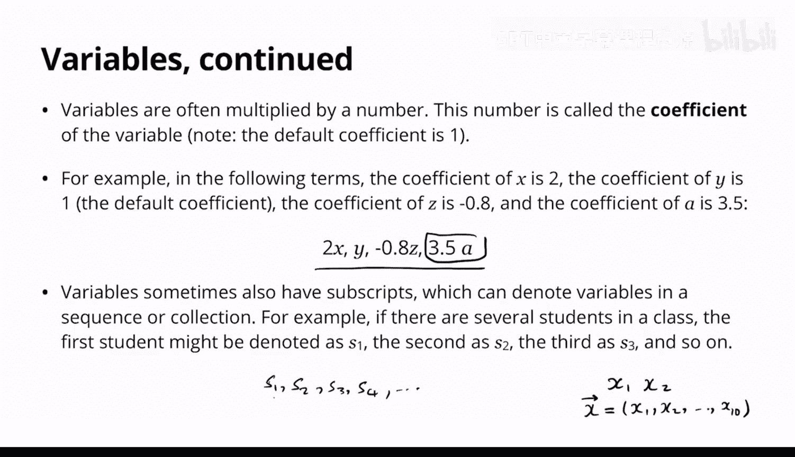
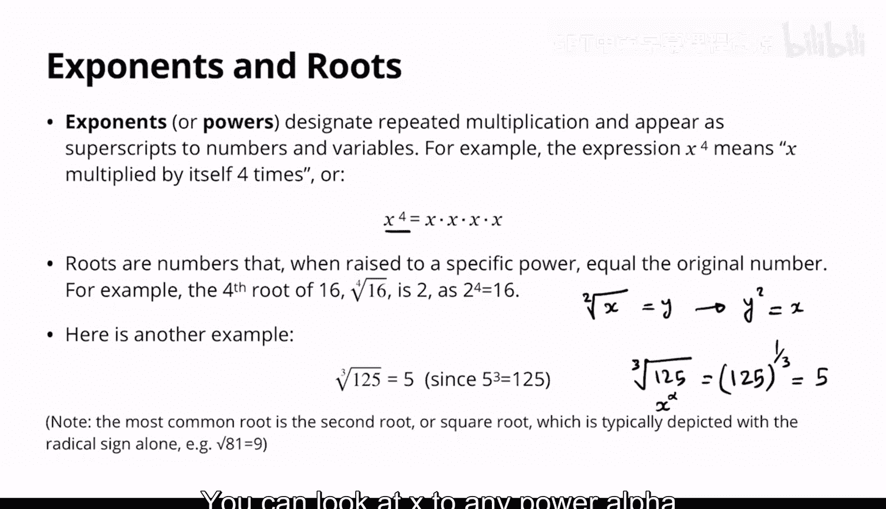
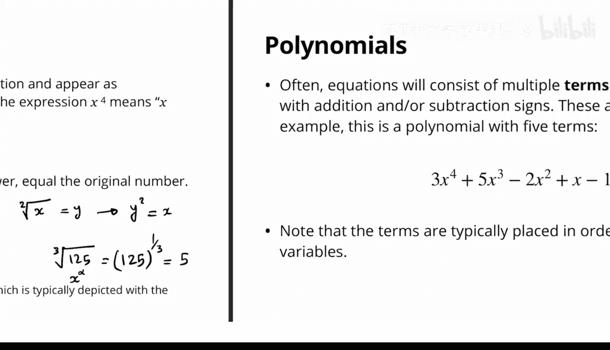
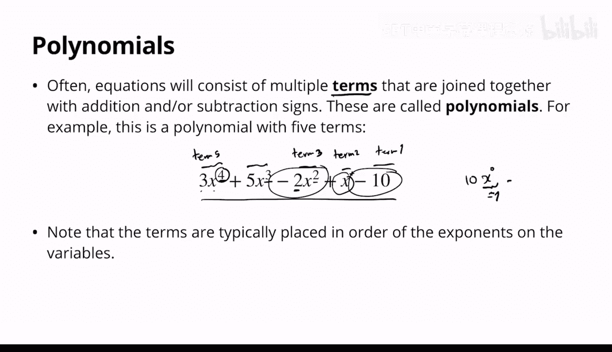
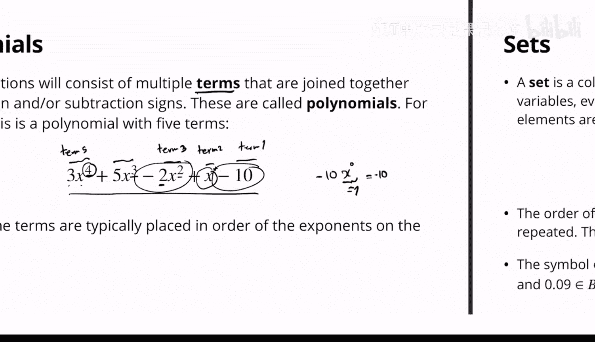
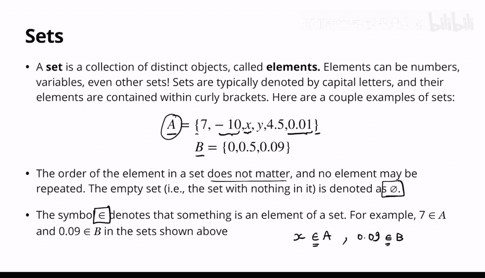
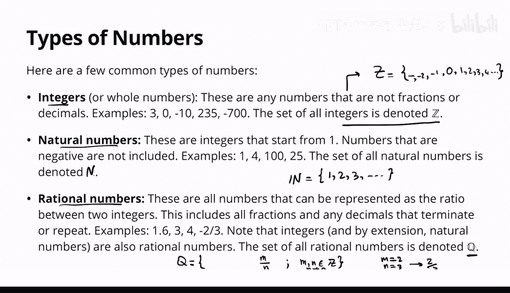
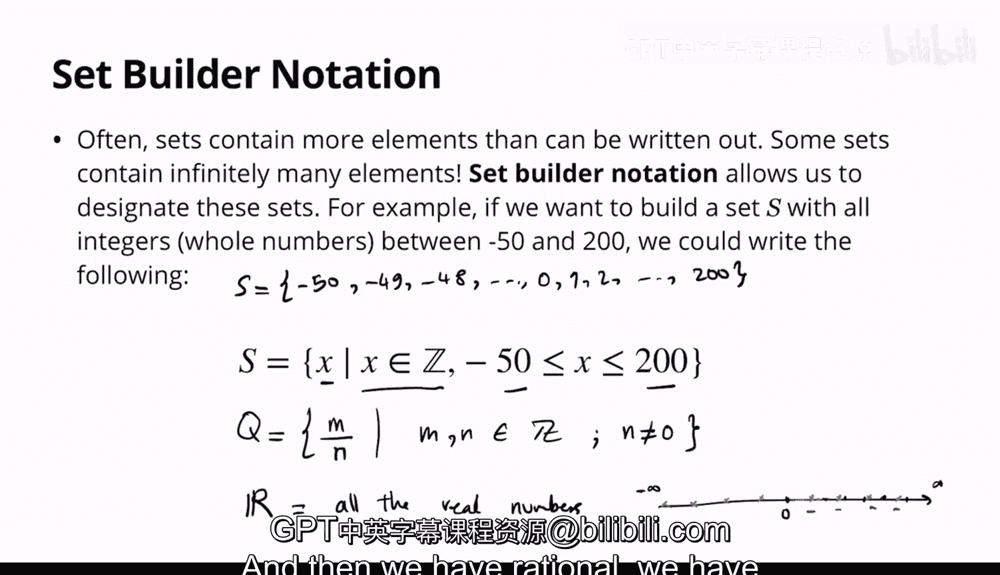

# 03：离散数学复习I - 变量、多项式、集合 📚

在本节中，我们将回顾离散数学中的一些非常基础的内容。我们将分为两个小节：离散数学复习I和离散数学复习II。正如你将看到的，这里我们只会涉及最基础的概念。这些内容对你来说应该非常熟悉，你可能在高中或大学已经学过。因此，我们将非常快速地过一遍，主要是为了唤醒你对之前所学知识的记忆。


## 变量 🧮

我们在数学中处理的第一个概念是变量。几乎在所有的数学以及本课程中，我们都会处理各种类型和形式的变量。一个正式的定义是：**变量**是一个通常用字母表示的符号，它代表一个可以变化的量或值。通常，你熟悉的方程中的 `x`、`y`、`z`，或者 `α`、`β`、`γ` 等，都是我们使用的所谓变量。我们通常在方程、序列、未知数中处理它们，而这些方程或未知数的基本构建块就是变量。

作为一个简单的例子，我们考虑这个方程：`y = x + 5`。`x` 和 `y` 是我们处理的两个变量，`y` 的值将是 `x` 的值加上数字 `5`。

再举一个简单的例子来表示这个方程。假设有两个兄弟姐妹，哈维尔和约兰达。我们知道约兰比比哈维尔大五岁。回到我们的方程，变量 `x` 可以代表哈维尔的年龄，`y` 可以代表约兰达的年龄。我们知道约兰比比哈维尔大五岁，这意味着 `y = x + 5`。如果 `x`（即哈维尔的年龄）是 `11`，那么 `y` 就是 `11 + 5`，即 `y = 16`。



## 系数、下标与指数 🔢

上一节我们介绍了变量的基本概念。本节中，我们来看看变量在方程中通常如何出现。变量要么带有一些**系数**（即一个标量数字乘以变量），要么被提升到某个幂次（例如，`x` 的 `4` 次方写作 `x⁴` 或 `x⁵` 等）。

首先介绍系数的含义。正如我所说，在我们的方程中，变量通常乘以一个标量值，这个数字被称为变量后面的**系数**。默认系数是 `1`（我们通常不写出 `1`），但它可以是任何其他数字，如 `2`、`5.2`、`-1`、`-2` 等。例如，`3.5 * a` 意味着 `a` 的值将乘以 `3.5`。

另一个重要的事情是，我们经常在序列中使用变量。我们有一个相同类型的变量序列，并使用**下标**来表示序列中的这些变量元素。例如，我们处理序列 `S₁`、`S₂`、`S₃`、`S₄`... 可以继续下去。这里的每个 `S` 都是一个变量，但这些变量因为被放在一个序列中而具有某种共性。下标 `i` 表示变量在序列中的索引。这强调了我们将使用下标（有时是上标）来表示变量属于同一类型，但由于下标或上标的不同，它们之间可能存在其他差异。例如，我们有时使用 `x₁`、`x₂`，有时使用向量表示法。一个向量 `x`（用向量符号表示）对应一个数字向量 `[x₁, x₂, ..., x₁₀]`，这是一个 `10` 维向量。这个向量的第一个坐标是 `x₁`，第二个坐标是 `x₂`，最后一个坐标是 `x₁₀`。我们到处使用 `x` 来表示向量及其坐标，因为它们共享某些概念，而 `xᵢ` 表示向量 `x` 的第 `i` 个坐标。

现在，正如我所说，我们也会在方程中使用变量的幂次。**指数**或**幂**表示变量的重复乘法，通常用一个上标数字来表示。例如，`x⁴` 表示 `x` 自乘四次。我们有时也会使用变量的**根**。平方根，表示为 `√x`（`x` 应为正数），是一个数 `y`，使得 `y² = x`。通常，`y` 或 `±y` 在平方后都等于 `x`。我们也可以考虑其他次数的根。例如，`125` 的立方根有时表示为 `125^(1/3)`，结果是 `5`。一般来说，我们可以处理 `x^α`，其中 `α` 是一个实数。它可以是 `1/3`、`1/2`、`1/5`、`0.2`、`-0.3` 等等。这表明幂次不仅限于整数，只要 `x` 来自正确的定义域，你可以看 `x` 的任何幂次。

## 多项式 ➕✖️

上一节我们讨论了指数和根。现在让我们把这些概念放在一起，谈谈**多项式**。通常，我们处理的方程涉及变量的多个幂次以及它们后面的系数。每个“幂次乘以系数”的组合被称为一个**项**。而一系列相加的项的组合被称为一个**多项式**。



以下是一个多项式的例子：
`P(x) = 3x⁴ - 2x² + x - 10`

每一项如下：
*   第一项是 `-10`（可以看作是 `-10 * x⁰`，因为任何数的 `0` 次方都是 `1`）。
*   第二项是 `x`（系数为 `1`，幂次为 `1`）。
*   第三项是 `-2x²`（系数为 `-2`，幂次为 `2`）。
*   第四项是 `3x⁴`（系数为 `3`，幂次为 `4`）。

多项式中最大的幂次通常被称为该多项式的**次数**。因此，这个多项式的次数是 `4`。通常，我们按照项的幂次降序排列来表示多项式。在这个例子中，第一项具有最大的幂次 `4`，然后是 `2`，接着是 `1`，最后是常数项 `-10`。

## 集合 📦



另一个我们将要使用的概念是**集合**。集合是称为**元素**的不同对象的集合。在下面的例子中，集合 `A` 由六个元素组成，这些元素可以是各种类型。

```
A = {x, 0.01, -10, 4.5, "hello", π}
```



例如，集合 `A` 中的一个元素是实数 `0.01`，另一个元素是变量 `x`，还有一个元素是数字 `-10`。这里我们使用的是非常一般的集合概念，一个集合可以是任何事物的集合。

集合通常用大写字母表示，它们的元素通常显示在大括号 `{}` 内。这是另一个集合 `B` 的例子，它只是三个实数的集合：`B = {1, 2, 3}`。集合 `B` 中的对象具有相同的类型，而集合 `A` 中的对象具有不同的类型。

集合中元素的顺序并不重要，重要的是集合本身这个整体。集合不包含元素的重复，如果一个元素在集合中，它只出现一次，重要的是对象本身，而不是对象的重复。





**空集**（不包含任何元素的集合）通常用符号 `∅` 或 `{}` 表示。

一些快速符号：
*   `∈` 符号表示**属于**。例如，`x ∈ A` 表示元素 `x` 属于集合 `A`。或者，`0.01 ∈ A`。
*   `∉` 符号表示**不属于**。

## 数字类型 🔢

正如我所说，我们正在快速回顾对本课程有用的不同概念，这些都是非常基础的概念，我相信你们都见过，只是一个快速的回顾。

我们通常处理三种类型的数字：**整数**、**自然数**、**有理数**，然后我们还有**实数**，它类似于有理数但比有理数更一般，目前这种区别对本课程来说并不重要。

*   **整数** 是没有小数点的数字，如 `-3`、`0`、`-10`、`235` 等。所有离散的数字，包括正数和负数。整数的集合用 `ℤ` 表示。
    `ℤ = {..., -3, -2, -1, 0, 1, 2, 3, ...}`



*   **自然数** 是严格为正的整数，如 `1`、`2`、`3`... 一直到正无穷。它不包括 `0`。自然数的集合通常用 `ℕ` 表示。
    `ℕ = {1, 2, 3, ...}`

*   **有理数** 是所有可以表示为两个整数之比的数字的集合，通常用 `ℚ` 表示。
    `ℚ = { m/n | m, n ∈ ℤ, n ≠ 0 }`
    例如，`2/3` 是一个有理数，它不是整数，属于 `ℚ`。

*   **实数** 是所有你能想象到的数字的集合，有理数是实数的一个严格子集。实数线上所有的点都代表一个实数。有些点是整数，有些是自然数（正的那些），有些是有理数（线上非常密集），还有一些不是有理数但却是实数（如 `π`、`√2`）。实数的集合用 `ℝ` 表示。

## 集合构造器符号 🛠️

最后，一个在本课程中对我们有用的符号是**集合构造器**符号。这是一种以更紧凑的形式书写集合的方式。

让我举个例子来说明这个符号。假设我们想以一种紧凑的形式写出所有介于 `-50` 和 `200` 之间的整数集合。

一种方法是写出：`S = {-50, -49, -48, ..., 0, 1, 2, ..., 200}`。



更紧凑的表示法是使用集合构造器：
`S = { x ∈ ℤ | -50 ≤ x ≤ 200 }`
这表示：集合 `S` 是所有 `x` 的集合，其中 `x` 的类型是整数，并且 `x` 在 `-50` 和 `200` 之间（包括两端）。

另一个例子是我在上一张幻灯片中使用的有理数集合：
`ℚ = { m/n | m, n ∈ ℤ, n ≠ 0 }`

我相信你以前见过这样的例子，这是一种非常紧凑地表示集合的方式。

让我再次强调，我们有实数集 `ℝ`，它是所有实数的集合。如果你看实数线，线上的任何点都代表一个实数。其中一些点是整数，一些是自然数（正的那些），一些是有理数，然后还有一些数字不是有理数但却是实数。实数集包含了所有你能想象到的数字。

## 总结 📝

在本节课中，我们一起回顾了离散数学的几个核心基础概念：
1.  **变量**：代表可变数值的符号，是构建数学表达式的基础。
2.  **系数、下标与指数**：系数是变量前的乘数；下标用于标识序列中的变量；指数表示变量的重复乘法。
3.  **多项式**：由变量幂次项及其系数相加构成的表达式，其最高幂次称为多项式的次数。
4.  **集合**：不同元素的无序集合，包含空集、属于关系等基本概念。
5.  **数字类型**：包括整数 `ℤ`、自然数 `ℕ`、有理数 `ℚ` 和实数 `ℝ`。
6.  **集合构造器**：一种用条件描述来精确定义集合的紧凑表示法。



这些概念是后续学习人工智能和机器学习中更复杂数学工具的基石。下一节，我们将继续复习离散数学的其他重要内容。