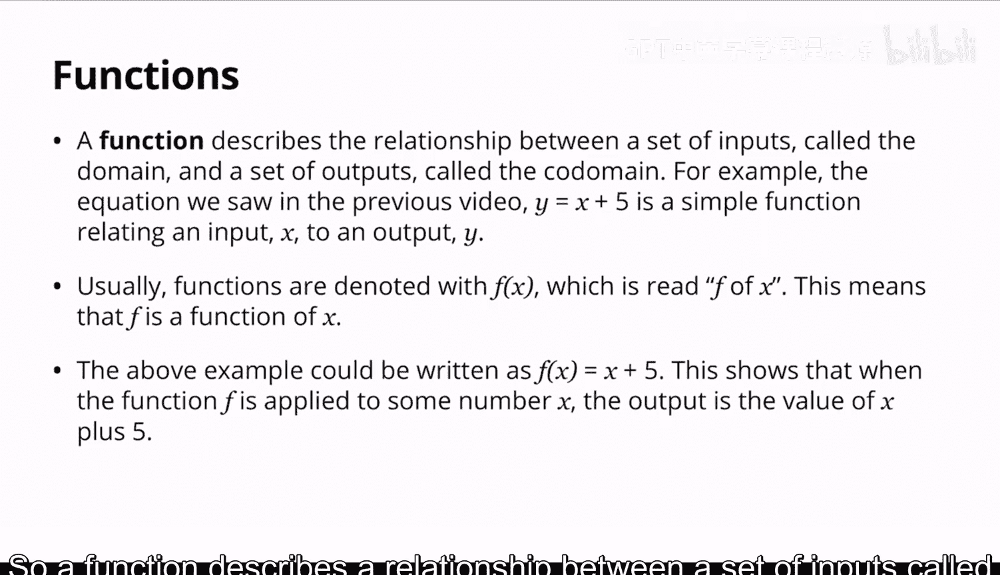
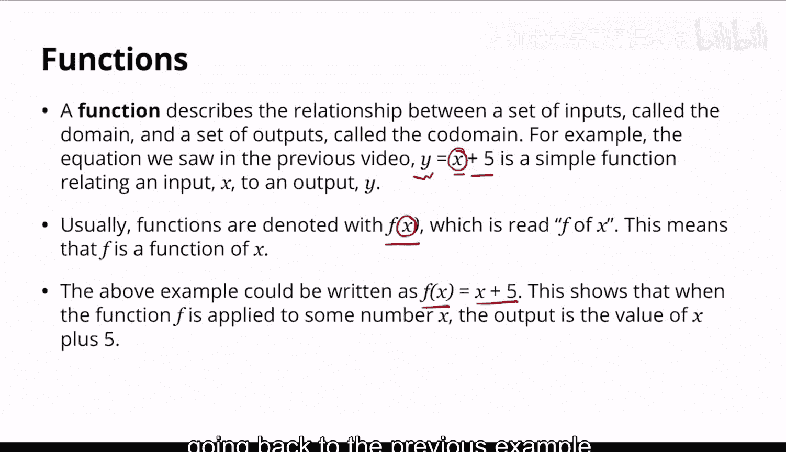
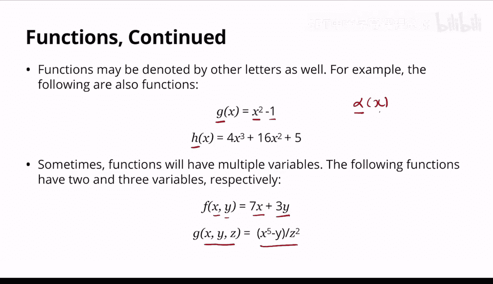
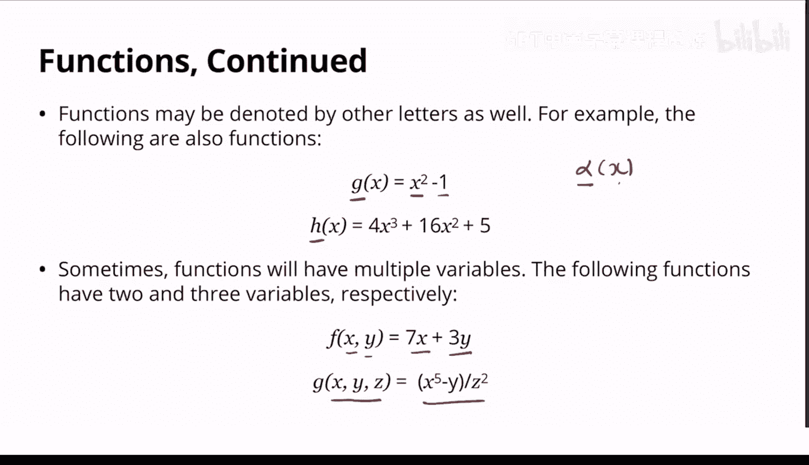
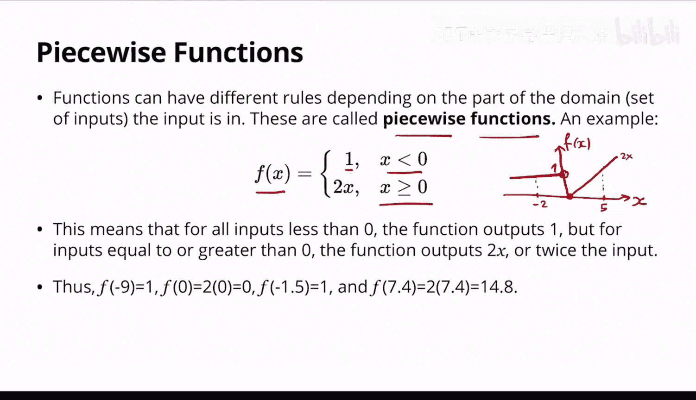
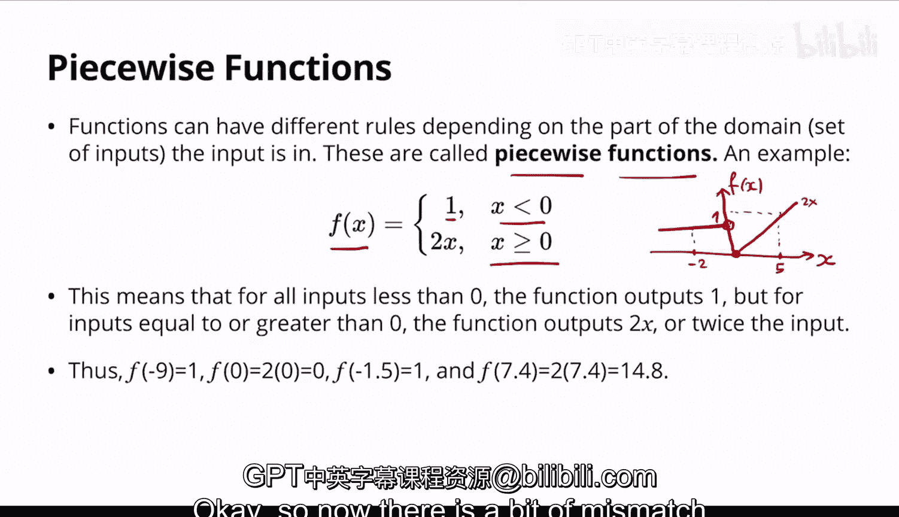

# 04：离散数学复习II-函数 📚

在本节课中，我们将要学习离散数学中的核心概念之一：函数。函数描述了输入集合（定义域）与输出集合（值域）之间的关系，是理解算法、数据映射和机器学习模型的基础。

上一节我们介绍了变量和集合的概念，本节中我们来看看函数。

## 函数的定义与表示

一个函数描述了一个关系，它将一个称为**定义域**的输入集合中的元素，映射到一个称为**值域**的输出集合中的元素。

例如，一个函数可以接受一个来自实数集的输入 `x`，并将其加上数字5。这个函数可以表示为 `f(x) = x + 5`。

我们通常用 `f(x)` 来表示函数，读作“f of x”。这里的 `f` 代表函数的功能，它作用于来自某个定义域的输入变量 `x`。

回到之前的例子，我们的 `f(x)` 就是 `x + 5`。

当然，我们也可以用其他字母来表示函数，例如 `g(x)` 或 `h(x)`。你可以将其视为任何函数。例如，`α(x)` 就是一个由 `α` 表示并作用于输入 `x` 的函数。

以下是另一个例子：
*   `g(x) = x² - 1`：输入值 `x` 被平方，然后减去1，结果即为函数的输出。

## 多变量函数

函数也可以依赖于多个变量。

例如，可以定义 `f(x, y) = 7x + 3y`。变量 `x` 和 `y` 可以来自实数域，`7x + 3y` 就是输出。

以下是另一个更复杂的例子：
*   `g(x, y, z) = x⁵ - y / z²`：这是定义这三个输入之间关系的另一种方式。

## 分段函数

函数不一定需要一个简短、明确的公式来描述其输入。函数可以是**分段函数**。

分段函数根据输入值的不同，具有不同的功能规则。

例如，定义以下函数 `f(x)`：
*   如果 `x` 是负数，则输出为 `1`。
*   如果 `x` 是非负数（即零或正数），则 `f(x) = 2x`。

如果我们想将 `f` 作为 `x` 的函数用图形表示，其图像如下：
*   当 `x` 为负数时，`f` 的值恒为 `1`，图像是一条水平线。
*   当 `x` 为非负数时，`f(x) = 2x`，图像是一条斜率为 `2` 的直线。

在图像上，我们通常用一个**空心圆点**来表示该点不包含在函数值中（例如，在 `x=0` 处，根据规则应取 `2x` 的值，即 `0`，而不是 `1`）。

这意味着：
*   如果 `x = -2`，则 `f(-2) = 1`。
*   如果 `x = 5`，则 `f(5) = 2 * 5 = 10`。

---

本节课中我们一起学习了函数的基本概念。我们了解到函数是定义域到值域的映射关系，可以用公式如 `f(x) = x + 5` 表示。函数可以是单变量的，也可以是多变量的，如 `f(x, y) = 7x + 3y`。此外，函数还可以是分段的，即根据输入的不同区间采用不同的计算规则。理解函数是学习更复杂数学和机器学习模型的关键一步。