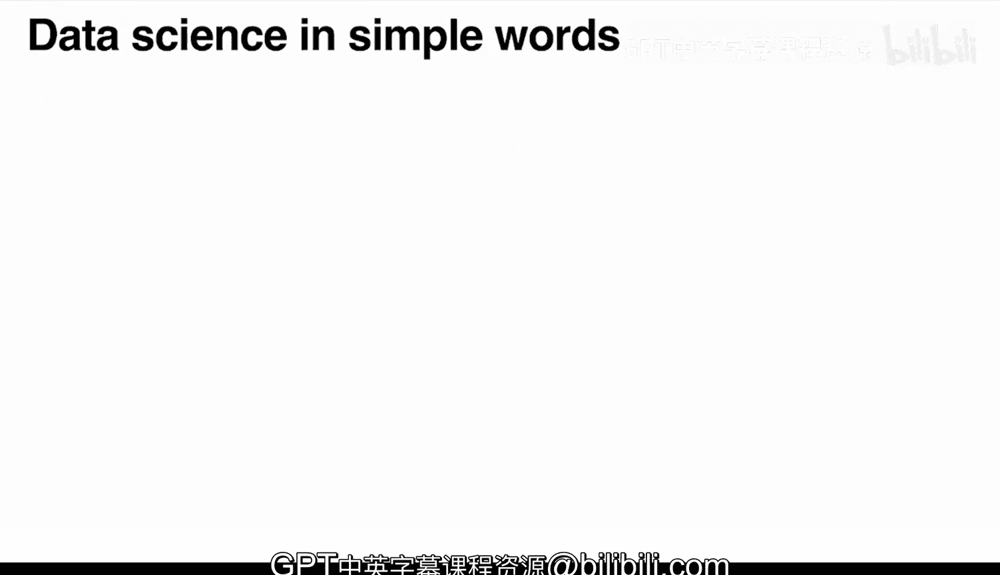
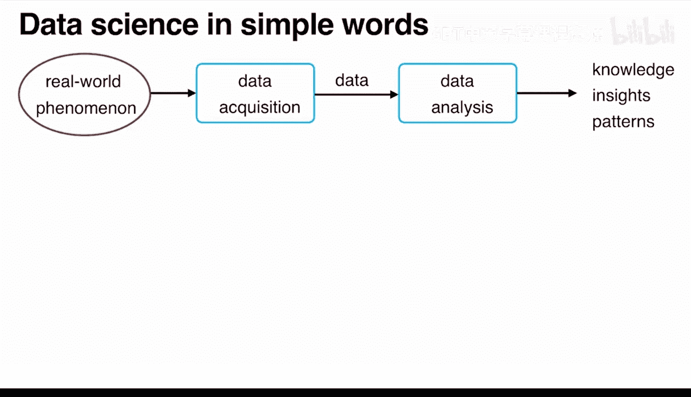
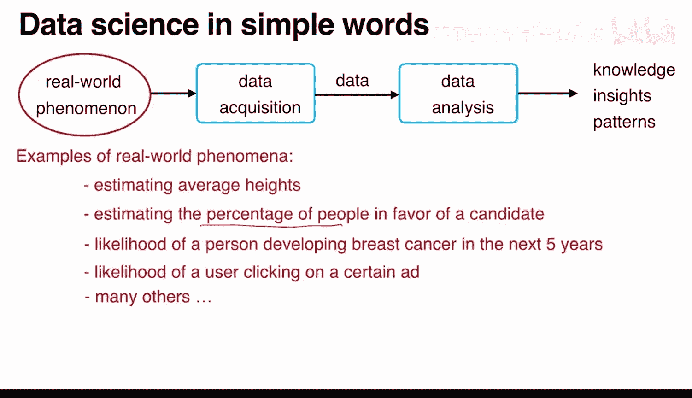
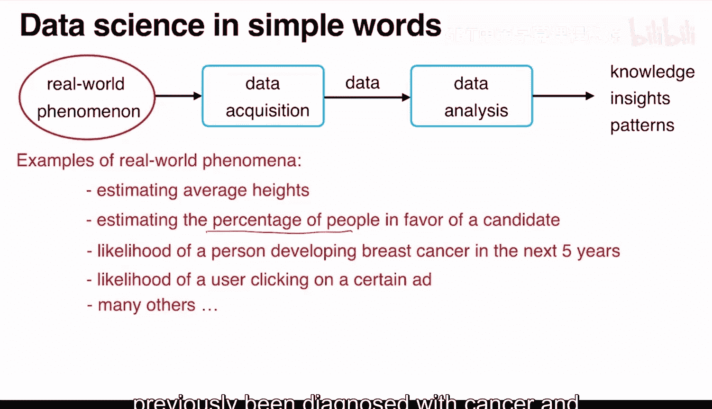
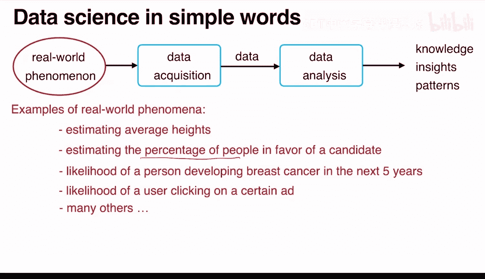
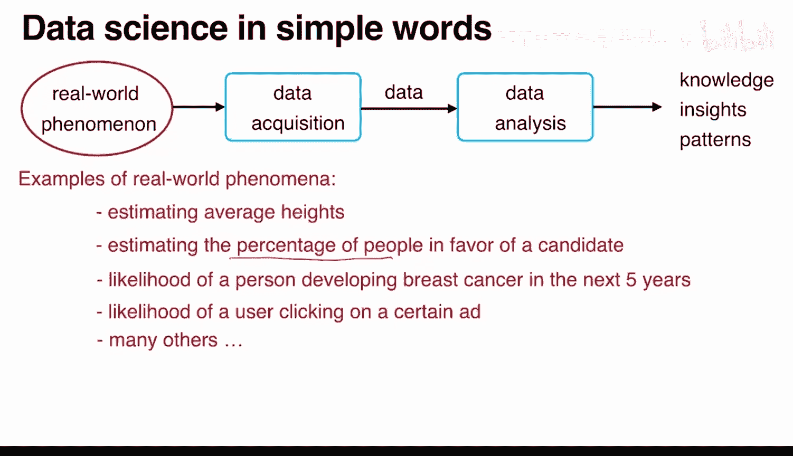
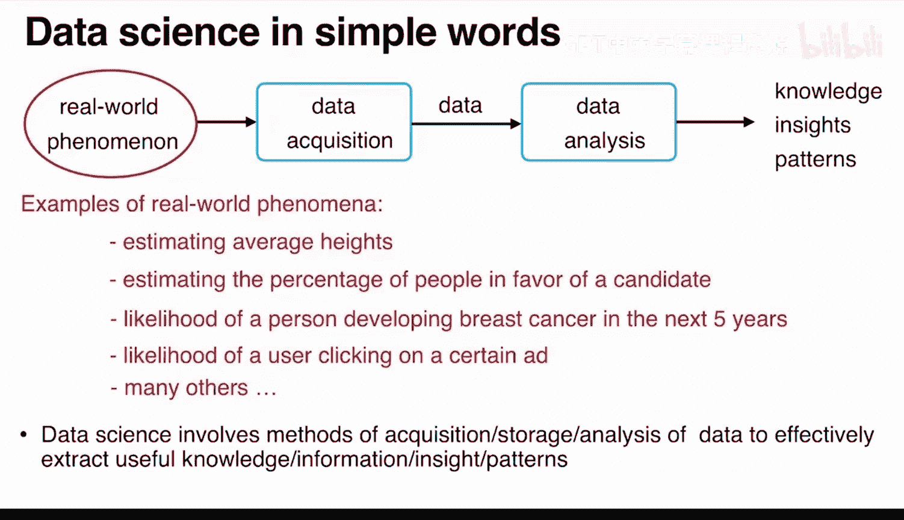
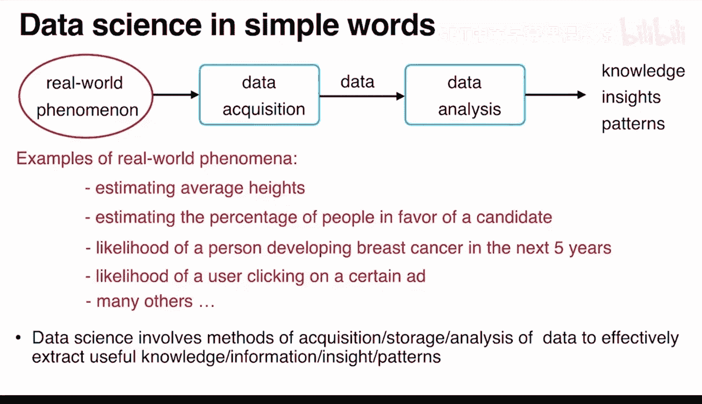
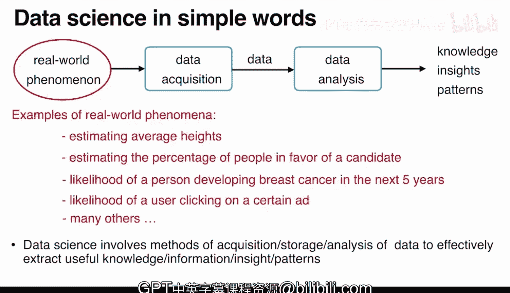

# 06：定义数据科学 📊

在本节课中，我们将学习数据科学的核心定义。我们将从一个简单的任务出发，逐步理解数据科学如何通过收集和分析数据，来研究现实世界的现象，并最终获得有价值的见解。

---

在上一节中，我们解决了第一个数据科学任务（计算平均身高）。现在，我们将尝试提出一个简单而广泛的数据科学定义。

通常，在数据科学中，我们的目标是研究某个现实世界的现象。这个现象可以是任何你想研究的物理或现实世界中的事物。

为了研究这个现象，第一步是从该现象中收集数据。在我们的例子中，计算平均身高这个非常基础和简单的任务里，收集数据就是随机抽取人群样本。

一旦你收集了关于这个现象的数据，下一步就是分析这些数据。你收集数据，然后分析它，以理解现实世界现象的某些方面。在计算平均身高的案例中，分析部分非常简单，就是计算随机样本子集的平均值。

你分析数据，最终获得关于你想要评估的底层现实世界现象的某种知识、见解或模式。这些本质上就是你在以通用和广泛的方式思考数据科学时，所能想到的所有基本组成部分。

当然，到目前为止，我们只讨论了非常非常简单的数据科学任务。还有许多更有趣、更重要的任务可以通过数据科学技术来解决。我们从简单的开始，比如估计平均身高或估计支持某位候选人的选民比例。第二个任务实际上是在选举期间，统计学家和公司通常会做的事情。这是一个真实且重要的任务。

但还有许多其他任务。例如，在医疗诊断领域，一个非常重要的问题是估计一个人在接下来五年内患上乳腺癌的可能性。这里，概率是你想要估计的参数。为了做到这一点，你必须收集数据，比如从之前被诊断出癌症和未被诊断出癌症的人那里收集数据。利用这些数据，你本质上想要理解模式或提出预测因子，来估计他们在未来五年内患癌的可能性。同样的问题也存在于其他疾病中，例如，你可以考虑阿尔茨海默病，估计未来20年内患病的可能性。这是一个非常重要的问题，数据科学一直在试图帮助解决。

同样，你可以想到医疗诊断领域内的许多其他场景。

如今，数据科学几乎可以应用于你能想到的任何领域。数据科学最重要的领域之一是在线营销。例如，再次是估计用户点击特定广告的可能性。亚马逊在商品推荐等方面对此投入了大量资金。或者，当你打开Facebook页面时，在右侧看到的广告。这些广告是根据你的个人资料高度定制的。在这些广告背后，运行着一个复杂的算法，它以你的个人资料作为输入，试图找出可能对你有益、且能最大化你点击概率的高度优化的广告。这里发生了许多有趣的事情，这同样是数据科学的另一个实例。人们还可以想到许多其他类型的任务。

综上所述，这里给出一个非常广泛的数据科学定义：**数据科学涉及数据的获取、存储和分析方法，以有效地提取有用的知识、信息、见解和模式。**

---

本节课中，我们一起学习了数据科学的基本流程和广泛定义。我们了解到，数据科学始于对现实世界现象的研究，通过**收集数据**、**分析数据**，最终获得关于该现象的**知识或见解**。我们还探讨了从简单的平均身高计算到复杂的医疗诊断和在线广告推荐等多个实际应用场景，认识到数据科学方法的普适性和强大能力。其核心目标是 **`有效提取有用的知识、信息、见解和模式`**。