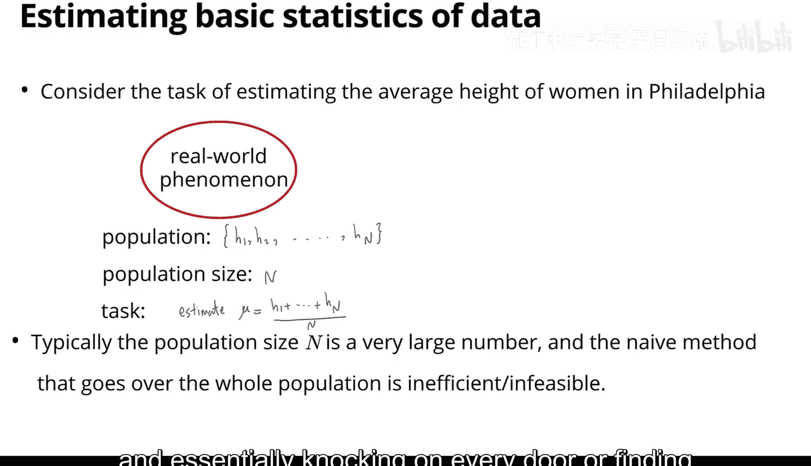
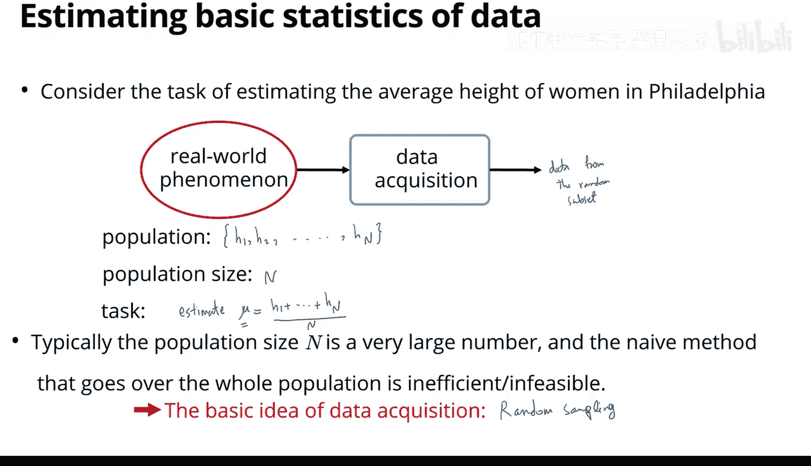
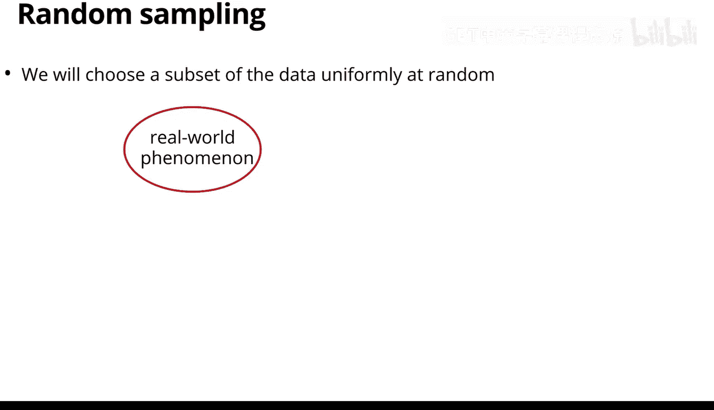
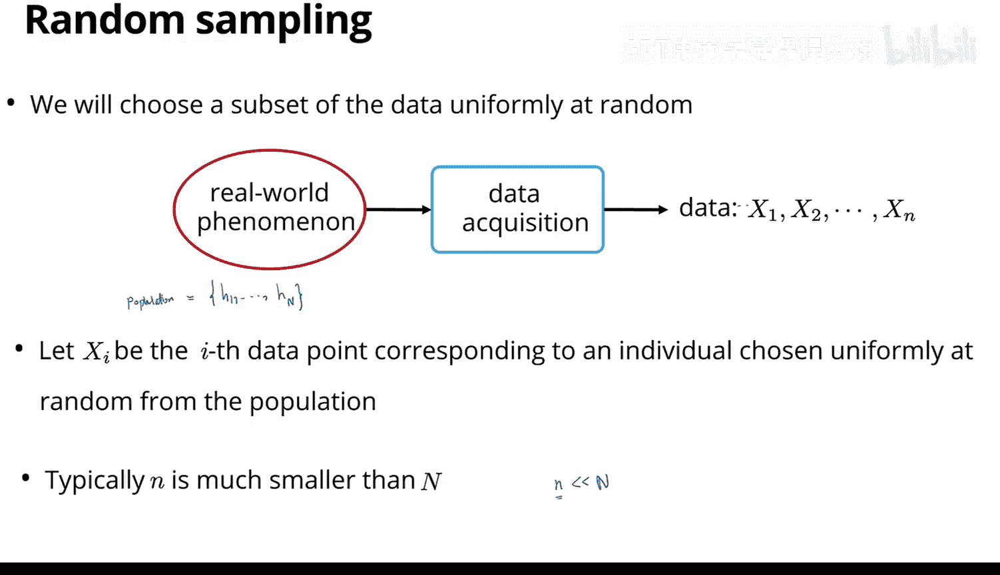

# 07：随机抽样 I

在本节中，我们将以更正式和数学化的方式，来理解我们之前为那个简单的数据科学任务（即估计平均身高）所提供的解决方案。这里将要学习的概念具有普遍性，虽然我们的例子是估计平均身高，但正如我们将看到的，这些概念适用于更广泛的数据科学或估计任务。

## 概述

我们将从一个具体问题出发：如何估计费城成年女性的平均身高。这是一个现实世界中的现象，涉及一个非常庞大的人群。我们将学习如何通过**随机抽样**来高效地收集数据，并利用这些数据来估计我们关心的总体参数。

## 问题定义

我们的目标是估计费城成年女性的平均身高。这是一个现实世界中的现象，涉及一个非常庞大的人群。

我们有一个包含大量个体的总体，其身高分别为 H₁, H₂, ..., H_N。这里的 N 代表总体规模，对我们来说，N 的数量级可能是数百万。在其他应用中，N 可能更大，达到数十亿甚至数万亿。

总体规模用 N 表示。我们的任务很简单：估计平均身高这个参数 μ。

μ 是总体中所有身高的平均值。μ 是未知的，我们必须从总体中收集一部分人的数据（即一个子集），才能对其进行估计。

正如之前提到的，通常总体规模 N 非常大，挨家挨户敲门或获取总体中的所有值通常是不可行或成本极高的。

## 数据采集的基本思路

因此，数据采集的基本思路是进行**随机抽样**。

随机抽样是指，我们本质上是从总体中选择一个子集，并尝试根据这个选定的子集来估计未知参数 μ。

在下一张幻灯片中，我将解释随机抽样，即当我们随机选择这个子集时。

一旦我们选择了这个子集（这是数据采集任务），我们就会收集数据。让我在这里标注为“来自随机子集的数据”。

收集到这些数据后，我们将在下一个模块中分析这些数据并进行估计。

## 随机抽样的具体操作

那么，随机抽样具体做什么呢？我们将从集合 {H₁, ..., H_N} 中**均匀随机地**选择第 i 个数据点。

这是我们一直在讨论的最简单的随机抽样方式。这就像你在费城随机选择一个地址，去敲门询问身高。

因此，X_i，即你选择的第 i 个随机地址所获得的数据点，将是从这个总体中随机选择的一个数字。

## 数据表示

于是，我们有了数据 X₁, X₂, ..., X_n。

这里的小写 n 是我们收集的数据点的数量。例如，我们均匀随机地选择了 100 个不同的人，询问他们的身高，这 100 个数字就是我们的数据点 X。从现在起，X_i 就是第 i 个数据点，例如，来自第 i 个随机地址的信息或身高。

## 数据点数量与总体规模的关系

我还想强调一个事实：通常，数据点的数量 n 远小于总体规模 N。

总体规模，即整个总体的大小，不是我们能控制的。为了提高效率，我们通常需要高效且智能地选择数据点。通常我们会有很多数据点，但我们选取的数据点数量 n 与实际总体规模 N 并不可比。

好消息是，即使数据点数量 n 远小于总体规模 N，你仍然可以对平均参数提供非常好的估计。

## 总结

本节课中，我们一起学习了随机抽样的基本概念。我们从估计费城女性平均身高这个具体问题出发，定义了总体、参数（μ）和数据（X_i）等核心概念。我们了解到，由于总体规模庞大，直接测量所有个体不现实，因此需要通过随机抽样来获取一个代表性的子集数据。随机抽样的核心是**均匀随机地**从总体中选择个体。最后，我们明确了即使样本量 n 远小于总体量 N，只要抽样是随机的，我们仍然能够基于样本对总体参数做出有效的估计。下一节，我们将探讨如何具体利用这些样本数据来进行估计。