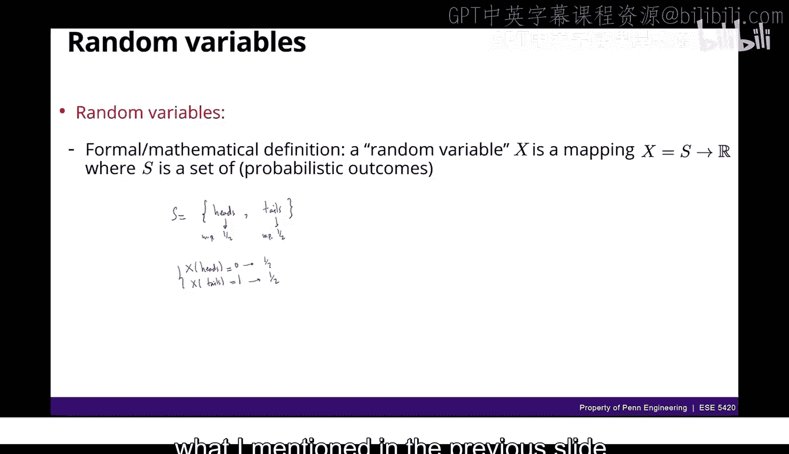
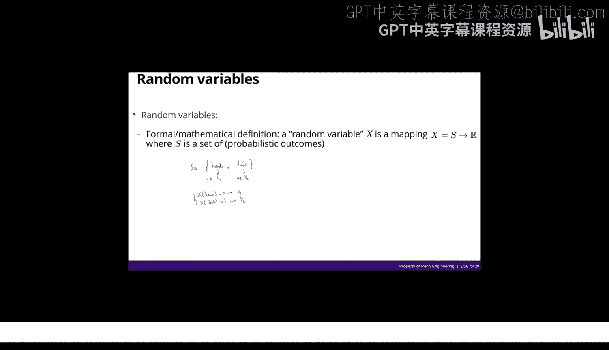
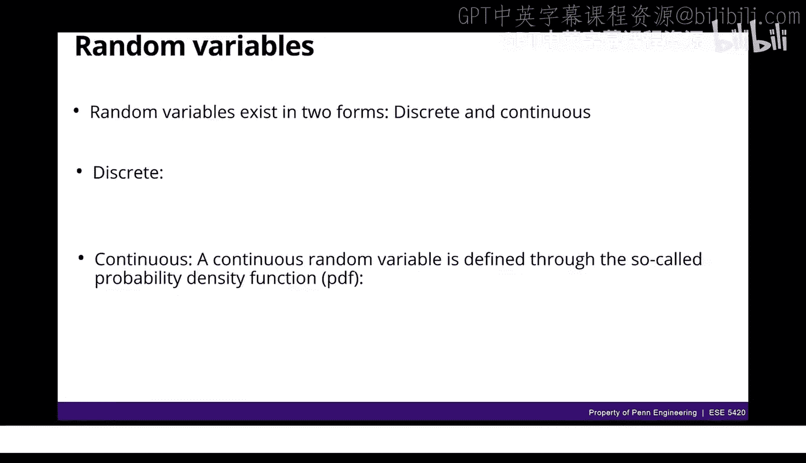
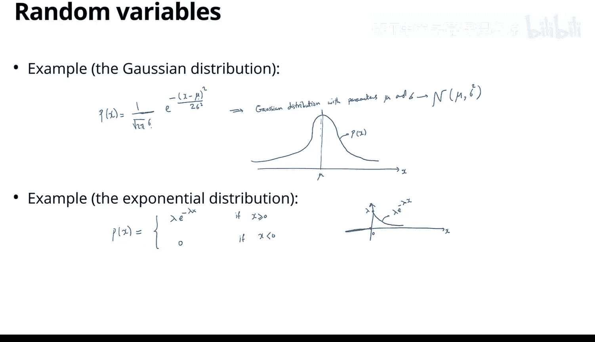

# 10：基础概率论 I 📊

在本节课中，我们将回顾概率论中的一些基本概念。这些概念对于分析我们的估计器以及后续课程中将要遇到的其他概念都非常有帮助。

## 随机变量

上一节我们介绍了课程概述，本节中我们来看看随机变量。什么是随机变量？我将先给出一个非正式的定义，稍后再给出更正式的定义。

非正式或直观地说，随机变量是一个可以取多个实数值，且每个值对应不同概率的变量。变量 `X` 可以取不同的值，例如 `x1, x2, ..., xk`。每个值 `xi` 被取到的概率为 `pi`。这些概率值 `pi` 介于 0 和 1 之间，并且所有概率之和为 1。

以下是几个简单的例子：

*   **抛硬币**：假设抛一枚公平的硬币。我们可以定义随机变量 `X`：当结果为正面时 `X=0`，概率为 0.5；当结果为反面时 `X=1`，概率也为 0.5。
*   **掷骰子**：掷一个公平的六面骰子。随机变量 `X` 可以取 1 到 6 的整数值，每个值出现的概率都是 1/6。

直观上，随机变量就是一个其值被随机选择的变量。

现在，我们来看一个更正式的定义。随机变量 `X` 是一个从某个概率结果集合 `S` 到实数集的映射。例如，在抛硬币的例子中，结果集合 `S = {正面, 反面}`。映射 `X` 定义为：`X(正面) = 0`，`X(反面) = 1`。这意味着 `X` 取值 0 的概率是 0.5，取值 1 的概率也是 0.5。

## 离散与连续随机变量

我们已经讨论了离散随机变量并列举了一些例子。离散随机变量是指其可能取值的集合是离散的、有限的集合，例如 `{x1, x2, ..., xk}`，每个值对应概率 `p1, p2, ..., pk`。

接下来，我们看看连续随机变量。连续随机变量通常通过**概率密度函数** 来定义。

概率密度函数给出了随机变量 `X` 取值的分布情况。这个函数记作 `p(x)`，其值在 0 到 1 之间，并且在整个实数域上的积分等于 1。从 PDF 我们可以知道，`X` 的值落在区间 `[a, b]` 内的概率，就是 `p(x)` 在该区间上的积分。

以下是两个著名的连续随机变量例子：

*   **高斯（正态）随机变量**：其概率密度函数 `p(x)` 由以下公式给出：
    `p(x) = (1 / (sqrt(2π) * σ)) * exp(-(x - μ)² / (2σ²))`
    其中 `μ` 和 `σ` 是参数。`μ` 表示分布的平均值（均值），`σ²` 表示分布的方差。高斯分布的 PDF 图形是一个关于 `μ` 对称的钟形曲线。

*   **指数分布**：其概率密度函数 `p(x)` 形式如下：
    当 `x >= 0` 时，`p(x) = λ * exp(-λx)`
    当 `x < 0` 时，`p(x) = 0`
    其中 `λ` 是参数。指数分布的 PDF 图形从 `λ` 开始，随着 `x` 增大而呈指数衰减至 0。

## 总结

本节课中我们一起学习了概率论的基础知识。我们首先介绍了随机变量的直观和正式定义，并通过抛硬币和掷骰子的例子加以说明。接着，我们区分了离散随机变量和连续随机变量，并重点讲解了连续随机变量的概率密度函数概念。最后，我们以高斯分布和指数分布为例，展示了两种重要的连续概率分布及其 PDF 形式。这些概念是理解后续机器学习中统计推断和模型分析的基础。