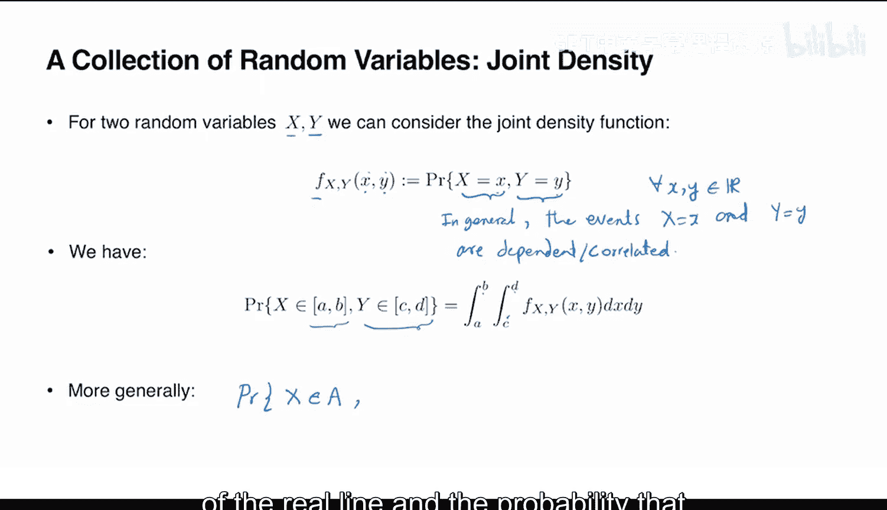
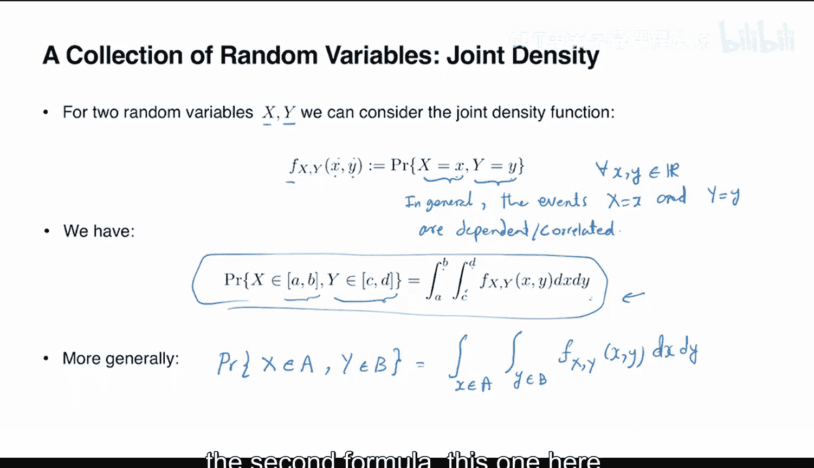
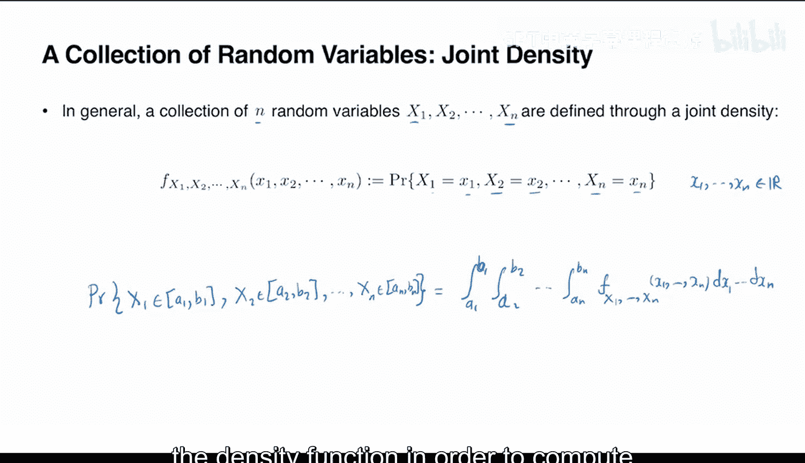
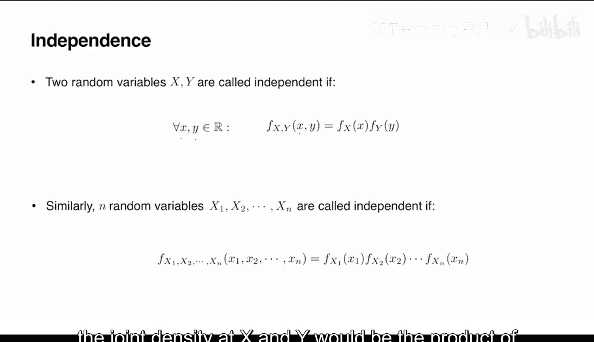
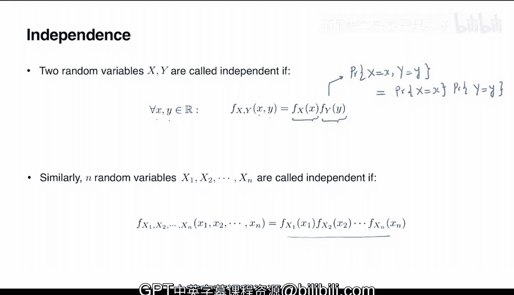

# 13：进阶概率论I 🎲

在本节中，我们将学习一组随机变量及其联合密度函数。我们将探讨这些随机变量取值的概率如何通过联合密度函数相互关联并量化。接着，我们将介绍独立性的概念，并探讨独立性在计算（例如某些随机变量的方差）中的意义。

## 联合密度函数

上一节我们介绍了单个随机变量的概率密度函数。本节中，我们来看看两个随机变量的情况。

给定两个随机变量 **X** 和 **Y**。**X** 可以取特定值 **x**，**Y** 可以取特定值 **y**。**X** 和 **Y** 的联合密度函数本质上给出了密度，或者更直观地说，给出了 **X** 取值 **x** 同时 **Y** 取值 **y** 的概率。这就是事件 **X = x** 和 **Y = y** 同时发生的联合概率。

这个函数对实数域上的每一个 **x** 和 **y** 都有定义。通常，事件 **X = x** 和 **Y = y** 是相互依赖或相关的。联合密度函数 `f(x, y)` 本质上就是用来量化或刻画这种相关性的。

给定联合密度函数 `f(x, y)`，我们可以计算 **X** 和 **Y** 不同事件的概率。以下是计算概率的通用方法：

例如，**X** 的值落在区间 **[A, B]** 内，同时 **Y** 的值落在区间 **[C, D]** 内的概率，可以通过对 **x** 从 **A** 到 **B**、**y** 从 **C** 到 **D** 积分联合密度函数 `f(x, y)` 来计算。

更一般地，**X** 的值落入某个集合 **A**（可以是区间、区间的并集或实轴上的复杂子集），同时 **Y** 的值落入集合 **B** 的概率，可以通过以下积分公式计算：

```
P(X ∈ A, Y ∈ B) = ∫∫_{x∈A, y∈B} f(x, y) dx dy
```

对于本课程而言，理解这个核心公式至关重要。

## 扩展到多个随机变量

现在我们已经定义了两个随机变量的联合密度函数，可以轻松地将这个概念推广到多个随机变量的集合。



给定 **n** 个随机变量 **X₁, X₂, ..., Xₙ**，它们的联合密度函数定义如下：

`f(x₁, x₂, ..., xₙ)` 直观上表示 **X₁** 取值 **x₁**，**X₂** 取值 **x₂**，...，**Xₙ** 取值 **xₙ** 的概率。

对于任何特定的值 **x₁** 到 **xₙ**，这个联合密度函数都会给出相应的概率。

同样地，我们可以使用联合密度函数来计算这些随机变量不同事件的概率。以下是计算多个随机变量落入指定区间概率的方法：



例如，**X₁** 落入区间 **[A₁, B₁]**，**X₂** 落入区间 **[A₂, B₂]**，...，**Xₙ** 落入区间 **[Aₙ, Bₙ]** 的概率，可以通过对 **x₁** 从 **A₁** 到 **B₁**，**x₂** 从 **A₂** 到 **B₂**，...，**xₙ** 从 **Aₙ** 到 **Bₙ** 积分联合密度函数 `f(x₁, x₂, ..., xₙ)` 来计算。

```
P(X₁ ∈ [A₁, B₁], ..., Xₙ ∈ [Aₙ, Bₙ]) = ∫_{A₁}^{B₁} ... ∫_{Aₙ}^{Bₙ} f(x₁, ..., xₙ) dx₁ ... dxₙ
```

## 随机变量的独立性

讨论了联合密度函数之后，我们现在可以通过联合密度的概念来定义随机变量的独立性。

两个随机变量 **X** 和 **Y** 被称为独立的，当且仅当它们的联合密度函数可以分解为各自边缘密度函数的乘积。

用公式表示，对于任意实数 **x** 和 **y**，有：

```
f(x, y) = f_X(x) * f_Y(y)
```



其中 `f_X(x)` 是 **X** 的边缘密度函数，`f_Y(y)` 是 **Y** 的边缘密度函数。

这直观地告诉我们：**X** 取值 **x** 且 **Y** 取值 **y** 的概率，等于 **X** 取值 **x** 的概率乘以 **Y** 取值 **y** 的概率。这正是我们熟悉的概率论中关于事件独立性的经典定义：两个事件交集的概率等于各自概率的乘积。

同样地，我们可以将独立性概念推广到 **n** 个随机变量。

**n** 个随机变量 **X₁, X₂, ..., Xₙ** 是独立的，当且仅当它们的联合密度函数 `f(x₁, x₂, ..., xₙ)` 可以分解为各自边缘密度函数的乘积：



```
f(x₁, x₂, ..., xₙ) = f_{X₁}(x₁) * f_{X₂}(x₂) * ... * f_{Xₙ}(xₙ)
```

## 总结

本节课中我们一起学习了概率论中的两个核心进阶概念。

首先，我们介绍了**联合密度函数**，它描述了多个随机变量同时取特定值的概率分布，是计算相关事件概率的基础工具。

其次，我们定义了**随机变量的独立性**，其关键判别条件是联合密度函数可分解为各变量边缘密度函数的乘积。独立性是简化许多概率计算（如方差计算）的重要前提。



理解联合密度与独立性，是深入学习机器学习中多维数据建模、贝叶斯推断等高级主题的基石。