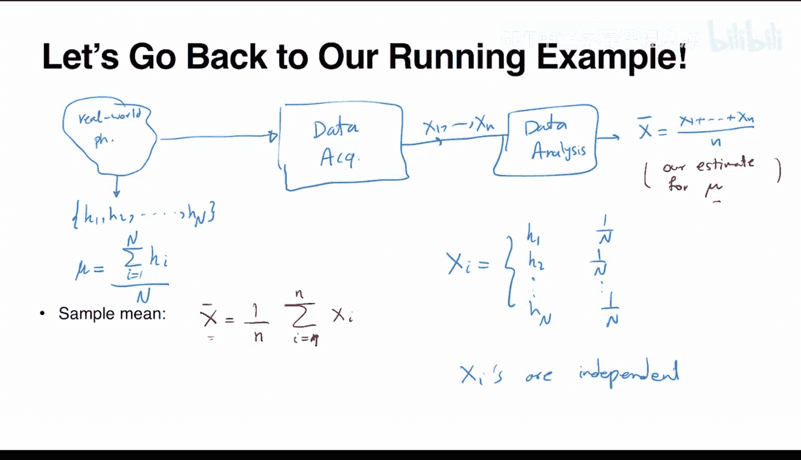
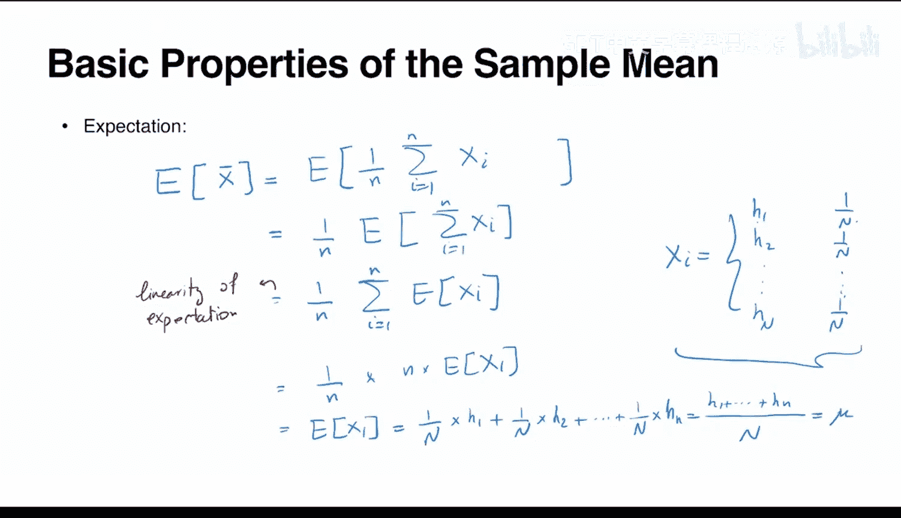
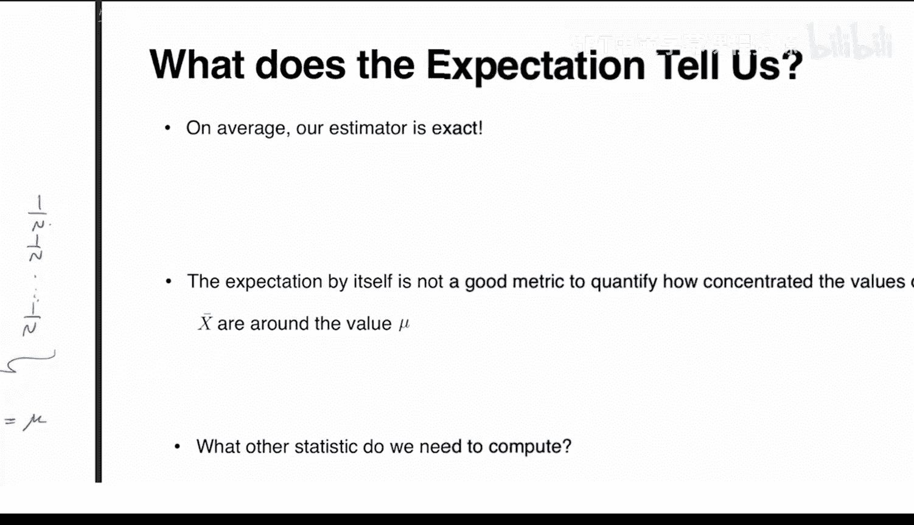
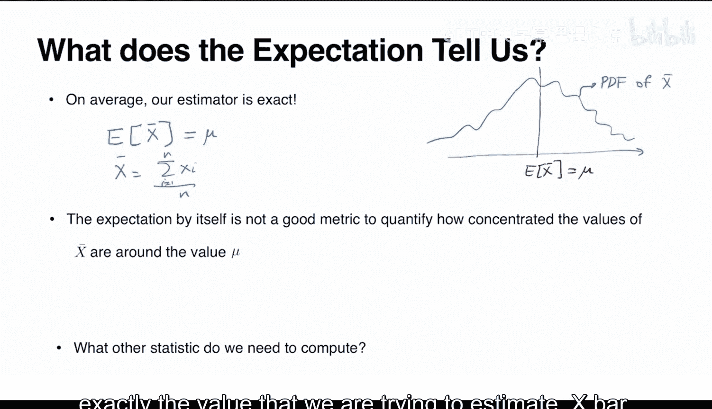
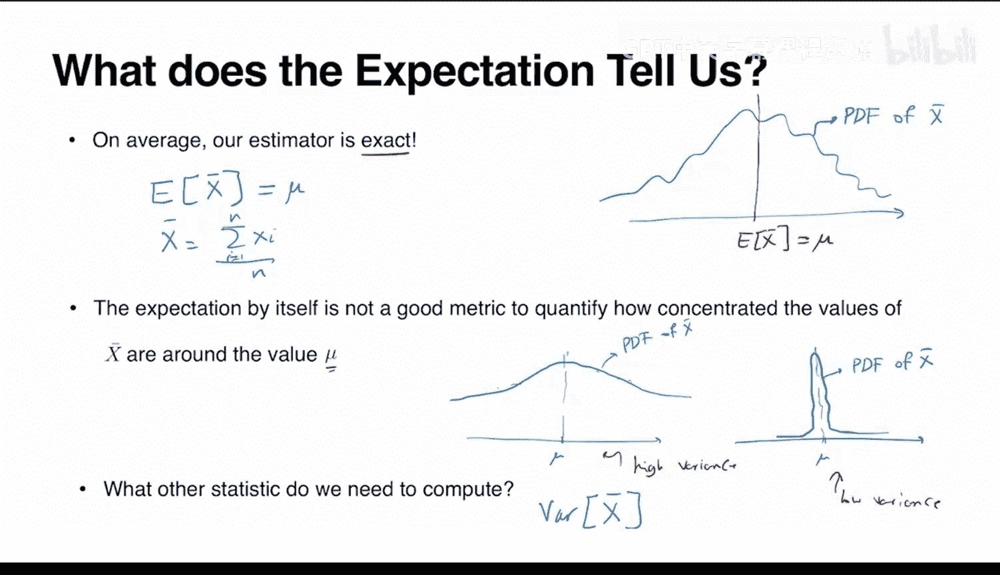

# 16：样本均值分析-期望 📊

在本节课中，我们将要学习如何分析样本均值这一估计量的期望性质。我们将回顾之前学过的概率论工具，并将其应用于一个具体的例子：估计美国女性的平均身高。通过计算样本均值的期望，我们将理解这个估计量在“平均”意义上的表现。

---

上一节我们回顾了两个随机变量的独立性与联合密度函数，并讨论了期望和方差的三个重要法则。现在，让我们回到贯穿始终的例子——估计美国女性的平均身高。在这个例子上，我们将讨论我们所设计的估计量的具体性质。掌握了概率论复习中学到的工具后，我们就能尝试估计这些我们将要看到的性质。

存在一个真实世界的现象。在我们的案例中，这是一个非常简单的任务。我们有一个身高总体，即第一个人的身高 H₁，第二个人的身高 H₂，一直到 H_N。请记住，总体大小 N 可能非常大，例如美国成年女性的总数可能达到数亿。我们的任务是估计平均身高。这个量就是所有身高从 1 到 N 的总和除以 N。这就是我们的任务。

我们希望通过从该总体中获得的数据来解决这个任务，估计这个平均身高。我们有一个数据采集模块，它为我们提供数据 X₁ 到 X_n。然后，我们希望通过样本均值来分析我们收集的这 n 个随机变量的数据（请记住，小写的 n 远小于大写的 N）。样本均值是 (X₁ + ... + X_n) / n，即 X̄。这就是我们的估计量。

我们还讨论过 X 的分布。X 的分布如下：X 是社会中第一个人的身高，概率为 1/N；是第二个人的身高，概率为 1/N；一直到第 N 个人的身高，概率为 1/N。同样重要的是，X 是独立的，因为每次我们选择一个新的人都是完全随机的，并且独立于之前选择的人。此外，所有 X 都具有相同类型的概率法则，因为每个 X 只是从社会中随机选择的一个人身高。

样本均值是我们的估计量，让我再写一遍：X̄ = (1/n) * Σ_{i=1}^{n} X_i。接下来，我将尝试估计 X̄ 的基本性质，例如它的均值和方差。从这些基本性质中，我们将看到这个估计量 X̄ 相对于真实值的好坏程度。

---

现在，让我们从样本均值的期望开始计算。我们要计算的是 E[X̄]。根据定义，X̄ = (1/n) * Σ_{i=1}^{n} X_i。因此，E[X̄] = E[(1/n) * Σ_{i=1}^{n} X_i]。1/n 是常数，可以提到期望外面，得到 (1/n) * E[Σ_{i=1}^{n} X_i]。

现在，我们应用上一节讨论的第一个关系：期望的线性性质。它告诉我们，和的期望等于期望的和。所以，E[Σ_{i=1}^{n} X_i] = Σ_{i=1}^{n} E[X_i]。

请记住，所有的 X_i 都具有完全相同的分布或法则。X_i 是一个随机选择的人的身高。它们都具有完全相同的概率分布。换句话说，所有 E[X_i] 彼此相等。所以，这等于 n 乘以其中任何一个 X 的期望。我们称之为 E[X₁]，因为所有 X 的法则相同。因此，结果是 (1/n) * n * E[X₁] = E[X₁]。

那么，E[X₁] 很容易计算。根据给定的概率法则，X₁ 以概率 1/N 等于 H₁，以概率 1/N 等于 H₂，一直到以概率 1/N 等于 H_N。因此，E[X₁] = (1/N) * H₁ + (1/N) * H₂ + ... + (1/N) * H_N = (H₁ + H₂ + ... + H_N) / N。这恰好就是总体平均身高 μ。

我们在这里学到了什么？我们学到的是，**在平均意义上，我们的估计量是精确的**。即，E[X̄] 恰好等于 μ。一般来说，样本均值 X̄ 是一个随机变量，它有一个概率密度函数，可能是一个复杂的密度函数。但重要的是，在期望中，或者说 X̄ 的期望值，恰好是我们试图估计的值 μ。所以，在平均意义上，我们的估计量 X̄ 是精确的，它没有偏差。

但我们也应该注意到，期望本身并不是量化我们的估计量在估计真实值 μ 方面好坏的良好指标。换句话说，我可以在这里给你两个具有相同平均值 μ 的随机变量的例子。X̄ 可能有两种不同的概率密度函数。一种可能是分布较为分散，虽然期望值也是 μ，但它所取的值可能离 μ 相当远。另一种可能是分布非常集中在 μ 周围，期望值同样等于 μ。然而，右边这个 PDF 非常集中在均值 μ 附近。因此，在大多数情况下，你得到的 X̄ 结果值非常接近 μ，而左边的 PDF 其值则离 μ 相当远。在期望上，两者都是精确的，都给出值 μ，但右边具有右侧 PDF 的估计量更集中在 μ 周围。换句话说，它的值相对于均值 μ 的变化要小得多。

这本质上提示我们，为了量化 X̄ 的误差，或者为了量化我们的估计量 X̄ 最终的好坏，我们需要计算 X̄ 的另一个性质：方差。如果我们回到这两个例子，右边这个方差低，左边这个方差高。通过计算 X̄ 的方差，我们就能本质上理解我们处于哪种情况。这就是我们下一个目标。