# 20：高斯分布及其性质 📊

在本节课中，我们将要学习高斯分布（也称为正态分布）及其一些关键性质。我们将介绍其定义、参数、标准形式，以及一个重要的概念——Z值。这些概念和符号将在后续的中心极限定理和置信区间计算中反复使用。

## 高斯分布的定义与参数

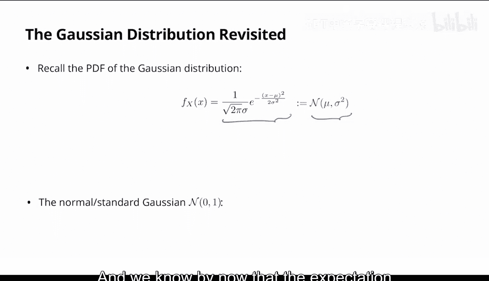

上一节我们介绍了概率分布的基本概念，本节中我们来看看最经典的高斯分布。

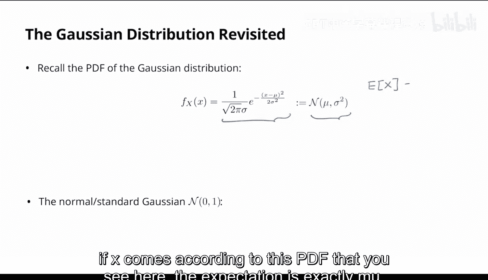

高斯分布通过其概率密度函数（PDF）定义。其PDF公式如下：

$$
f(x) = \frac{1}{\sigma\sqrt{2\pi}} e^{-\frac{1}{2}\left(\frac{x-\mu}{\sigma}\right)^2}
$$

在表示上，我们通常使用以下符号：$X \sim \mathcal{N}(\mu, \sigma^2)$。其中，$\mathcal{N}$ 代表正态分布，$\mu$ 和 $\sigma^2$ 是高斯分布的两个参数。

对于服从上述PDF的随机变量 $X$，其期望值（均值）和方差是已知的：

*   **期望值**：$\mathbb{E}[X] = \mu$
*   **方差**：$\text{Var}(X) = \sigma^2$

高斯分布的PDF图形是一个对称的钟形曲线，以均值 $\mu$ 为中心对称。方差 $\sigma^2$ 决定了曲线的宽度，$\sigma$ 越大，曲线越宽、越平缓。

## 标准高斯分布

通常，我们会特别关注均值为0、方差为1的高斯分布，称之为**标准高斯分布**或标准正态分布。其参数为 $\mu = 0$，$\sigma^2 = 1$。

标准高斯分布的PDF公式简化为：

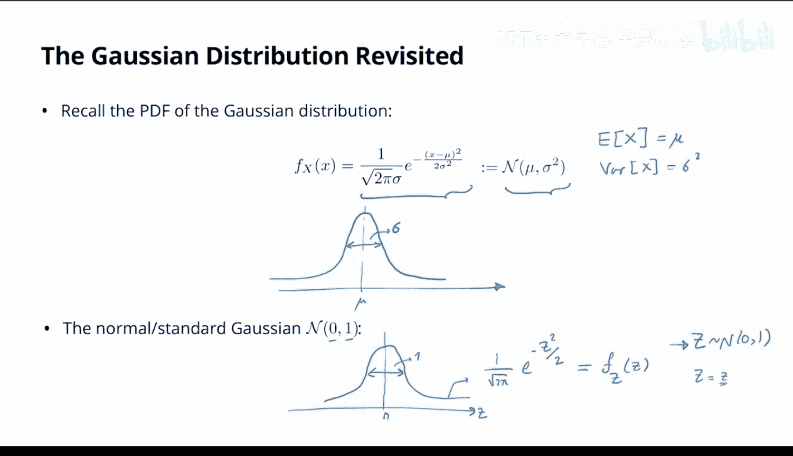

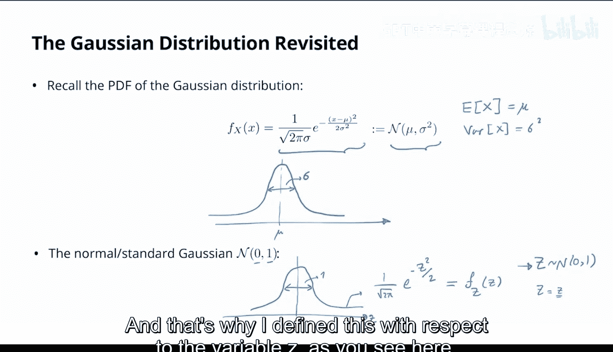

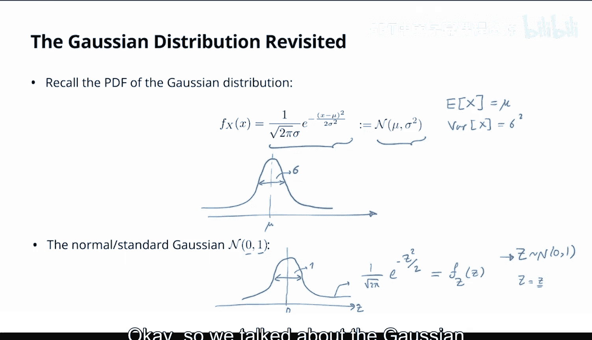

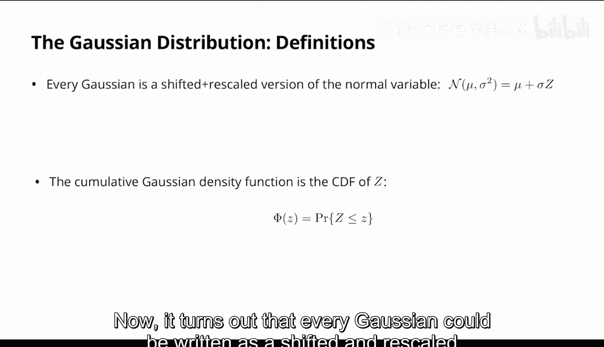

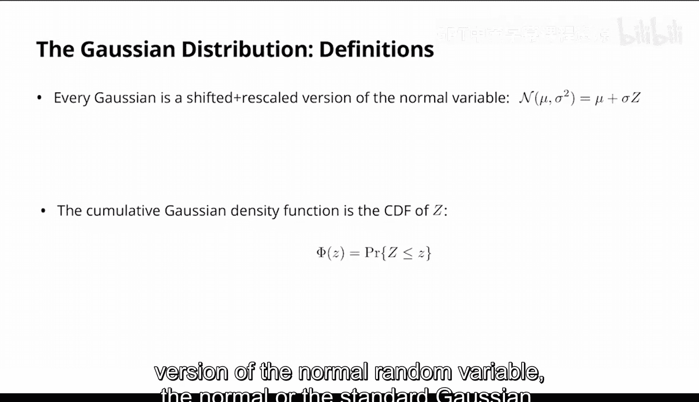

$$
\phi(z) = \frac{1}{\sqrt{2\pi}} e^{-\frac{z^2}{2}}
$$

在本课程中，我们将始终使用 $Z$ 来表示服从标准高斯分布的随机变量，即 $Z \sim \mathcal{N}(0, 1)$。而 $z$ 则用于表示该随机变量的某个具体取值（实现值）。

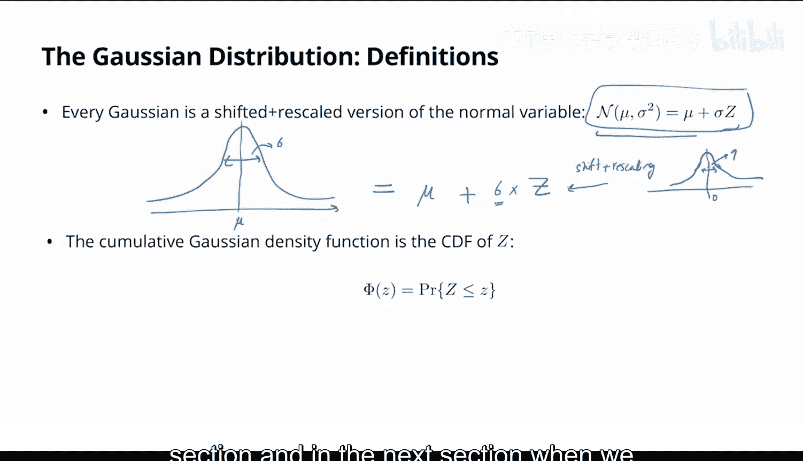

一个重要的关系是，**任何高斯分布都可以表示为标准高斯分布的线性变换**。具体公式如下：

如果 $X \sim \mathcal{N}(\mu, \sigma^2)$，$Z \sim \mathcal{N}(0, 1)$，那么：
$$
X = \mu + \sigma Z
$$
这意味着，一个一般的高斯随机变量 $X$，可以通过对标准高斯变量 $Z$ 进行缩放（乘以 $\sigma$）和平移（加上 $\mu$）得到。请记住这个关系，我们将在后续章节中用到它。

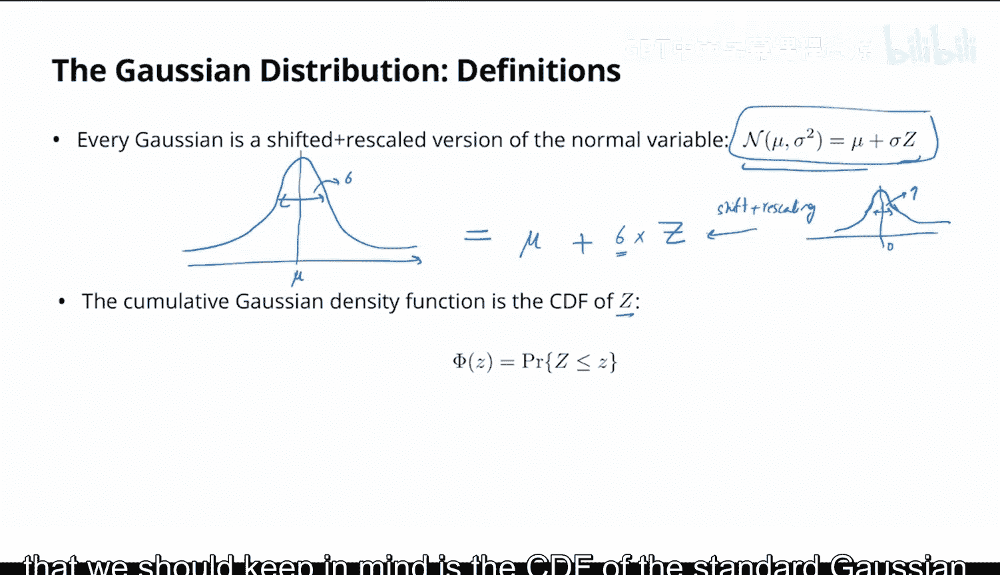

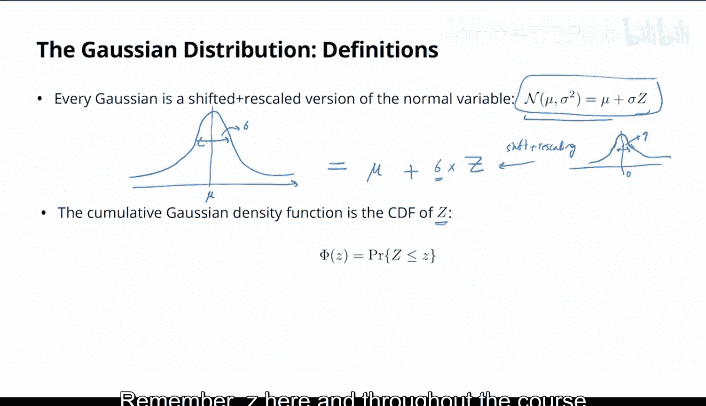

## 累积分布函数与Z值

现在，我们来定义与高斯分布相关的另外两个重要概念。

首先，是标准高斯分布的**累积分布函数（CDF）**。我们使用 $\Phi(z)$ 来表示它：

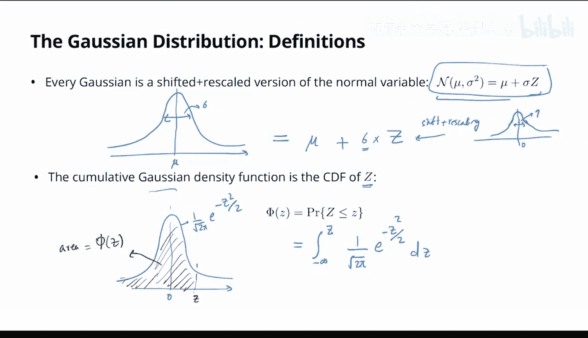

$$
\Phi(z) = P(Z \leq z) = \int_{-\infty}^{z} \frac{1}{\sqrt{2\pi}} e^{-\frac{t^2}{2}} dt
$$

从图形上看，$\Phi(z)$ 表示标准高斯PDF曲线下，从 $-\infty$ 到点 $z$ 左侧的面积。

其次，是一个称为 **$z_{\alpha}$ 值**（或Z值）的关键概念。以下是它的定义：

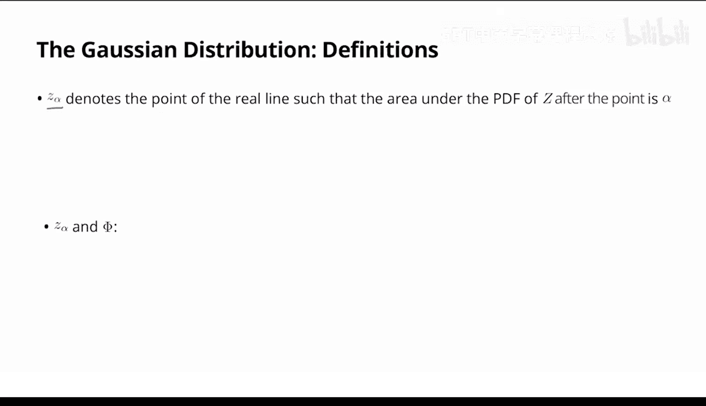

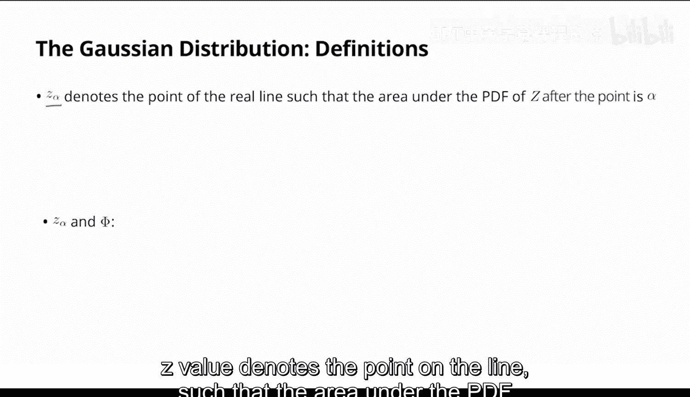

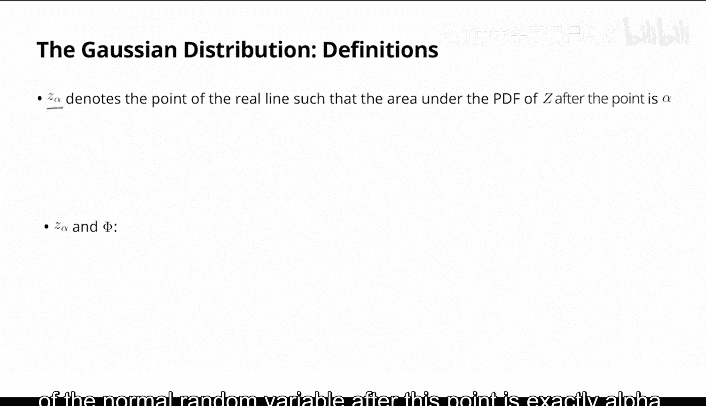

$z_{\alpha}$ 是实数轴上的一个点，满足标准高斯随机变量 $Z$ 取值大于 $z_{\alpha}$ 的概率恰好为 $\alpha$。用公式表达为：
$$
P(Z > z_{\alpha}) = \alpha
$$

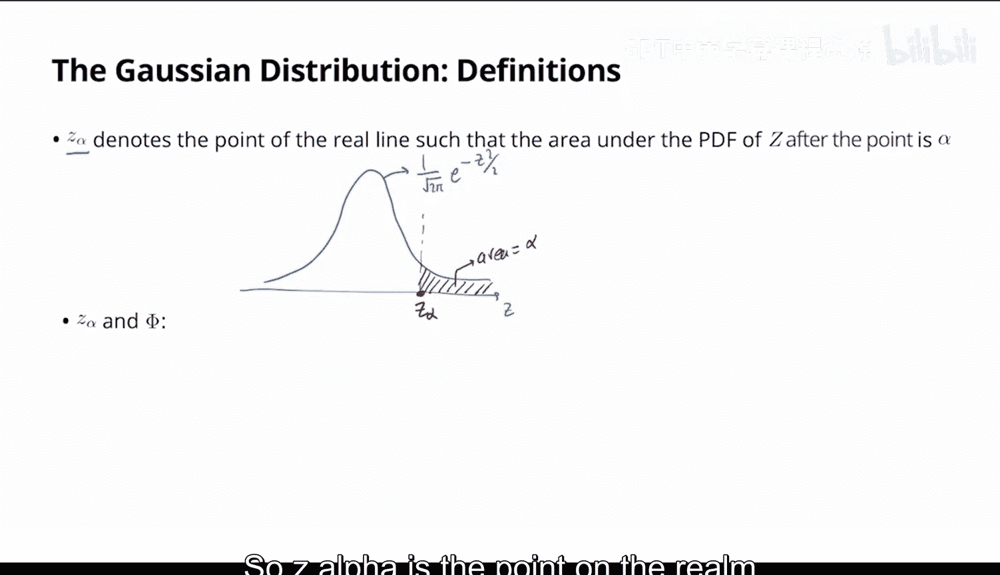

从图形上理解，在标准高斯PDF曲线下，$z_{\alpha}$ 点右侧的尾部面积正好等于 $\alpha$。

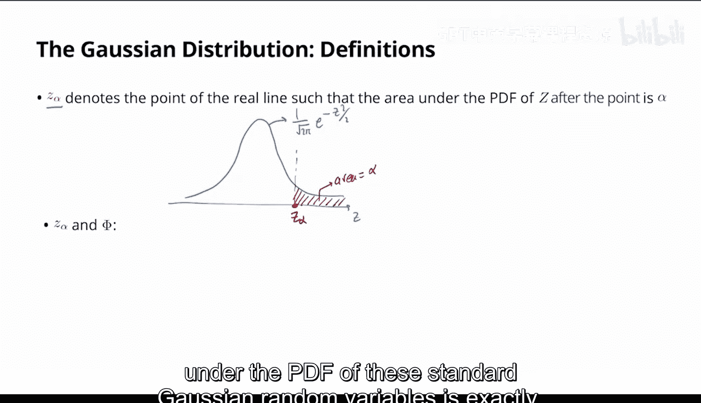

由于PDF曲线下的总面积为1，$z_{\alpha}$ 点左侧的面积就是 $1 - \alpha$。因此，$z_{\alpha}$ 值与CDF函数 $\Phi$ 存在一个简单的关系：
$$
\Phi(z_{\alpha}) = 1 - \alpha
$$
或者等价地：
$$
z_{\alpha} = \Phi^{-1}(1 - \alpha)
$$
其中 $\Phi^{-1}$ 是CDF的反函数。这个关系将概率 $\alpha$ 与具体的分位点 $z_{\alpha}$ 联系了起来。

---

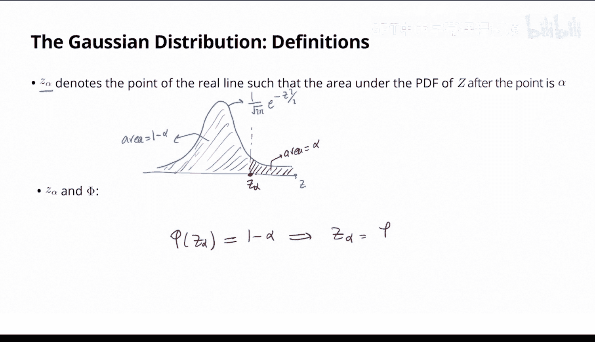

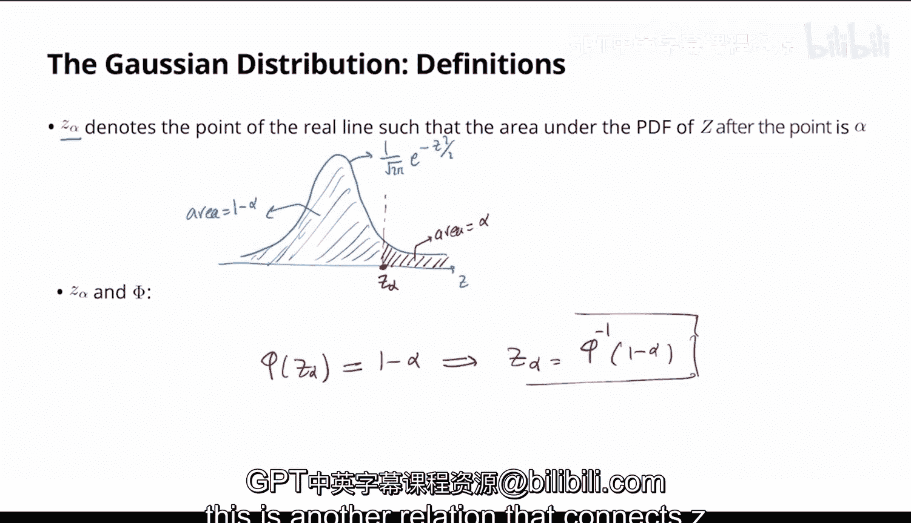

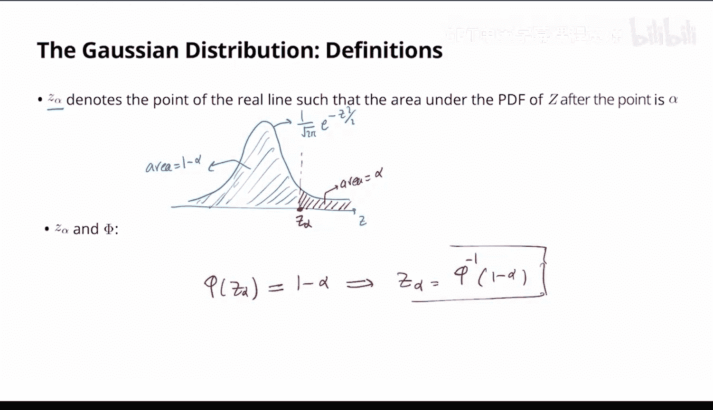

本节课中我们一起学习了高斯分布的核心内容。我们回顾了高斯分布的定义、参数（均值 $\mu$ 和方差 $\sigma^2$）及其图形特征。我们重点介绍了标准高斯分布 $\mathcal{N}(0, 1)$，并理解了任何高斯变量都可以通过 $X = \mu + \sigma Z$ 从标准形式变换得到。最后，我们定义了累积分布函数 $\Phi(z)$ 和至关重要的 $z_{\alpha}$ 值，它描述了分布尾部的概率。这些概念和符号是概率论与统计学的基石，将在机器学习和数据科学的后续学习中频繁出现。