# 21：中心极限定理 I 🧮

在本节课中，我们将要学习统计学中一个极其重要的定理——**中心极限定理**。这个定理不仅在统计学中至关重要，在物理学、数学、工程学等众多科学领域也广泛应用。我们将首先通过直观的方式理解这个定理，然后介绍其精确的数学表述。对于本课程而言，理解其直观图像和近似应用更为关键。

## 中心极限定理的直观图像

上一节我们介绍了中心极限定理的重要性，本节中我们来看看它的核心思想。中心极限定理主要处理一组**独立同分布**的随机变量。

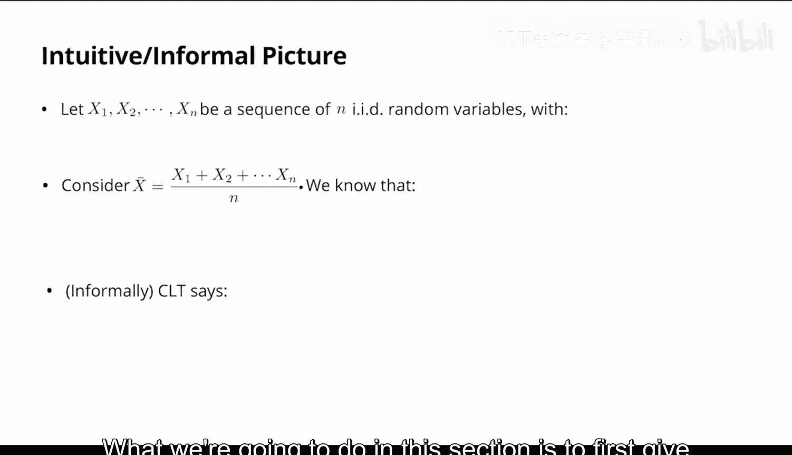

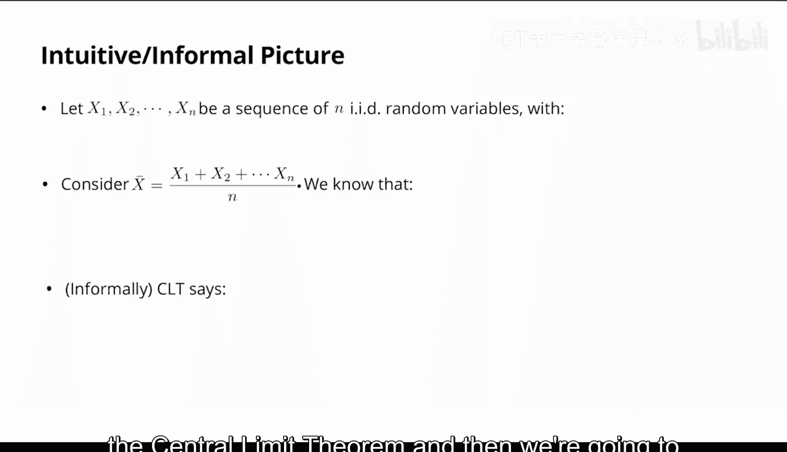

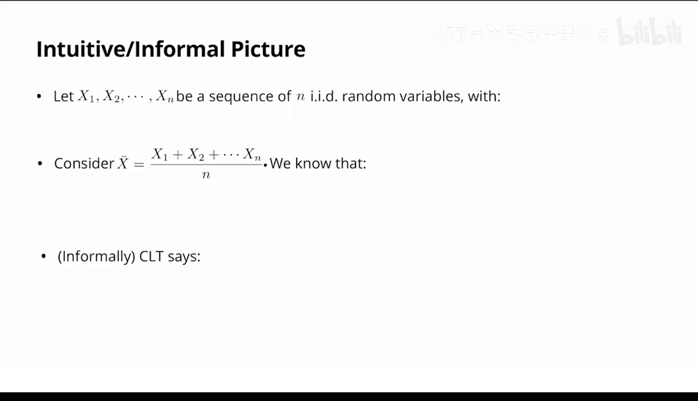

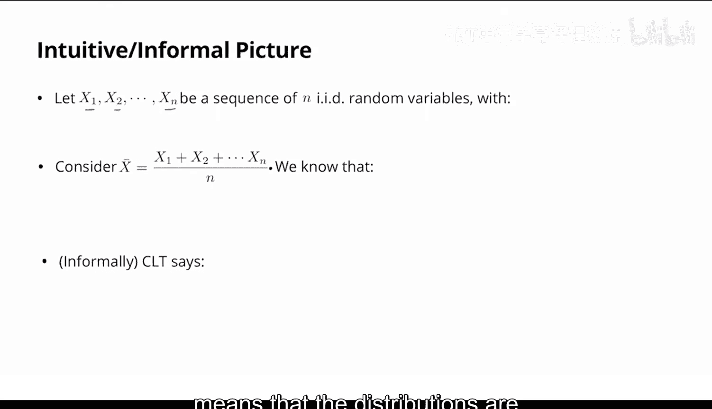

以下是其核心设定：
*   我们有一组独立同分布的随机变量：`X₁, X₂, ..., Xₙ`。
*   “独立同分布”意味着这些变量相互独立，并且具有完全相同的概率分布。
*   我们关心这些随机变量的**样本均值**，其计算公式为：
    `X̄ = (X₁ + X₂ + ... + Xₙ) / n`

中心极限定理的核心结论是：**无论原始随机变量`Xᵢ`服从何种分布，只要样本数量`n`足够大，样本均值`X̄`的分布就会近似于一个正态分布（高斯分布）**。

## 深入理解均值和方差

为了更具体地理解这个近似，我们需要知道这个近似正态分布的参数。我们首先回顾样本均值`X̄`的均值和方差。

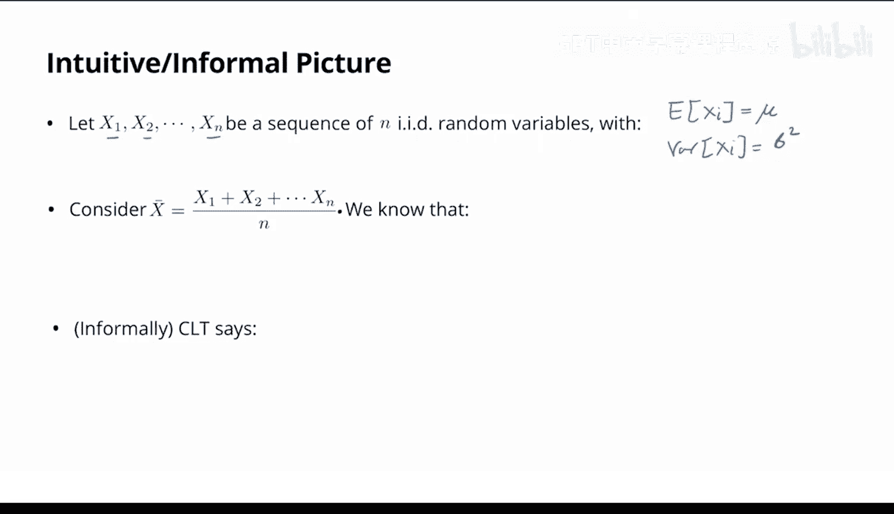

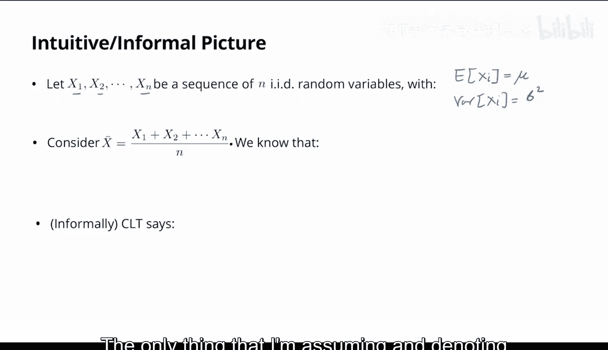

以下是相关定义和计算：
*   设每个随机变量`Xᵢ`的总体均值为 `μ`，总体方差为 `σ²`。
*   根据期望的线性性质，样本均值`X̄`的期望值（均值）为：
    `E[X̄] = μ`
*   样本均值`X̄`的方差为：
    `Var(X̄) = σ² / n`

可以看到，样本均值的方差比单个变量的方差缩小了`n`倍。这意味着随着样本量增加，`X̄`的取值会越来越集中在总体均值`μ`附近。

## 中心极限定理的近似表述

基于以上讨论，中心极限定理的直观近似可以表述为：当`n`很大时，样本均值`X̄`近似服从一个正态分布。

我们可以将其写作：
`X̄ ≈ N(μ, σ²/n)`
这里的“≈”表示近似，并且包含一个随着`n`增大而趋于零的误差项。在实际应用中，当样本量`n`较大时，我们通常会忽略这个误差，直接使用正态分布来进行计算和推断。

因此，我们近似认为`X̄`服从一个均值为`μ`、方差为`σ²/n`的正态分布。正态分布由其均值和方差唯一确定，所以我们就能完全描述`X̄`的近似分布了。

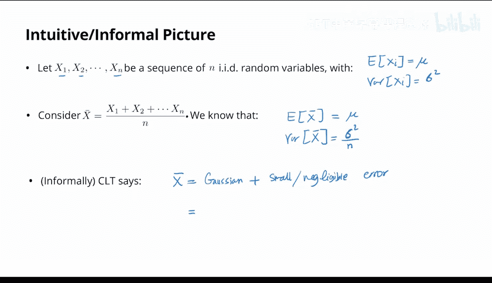

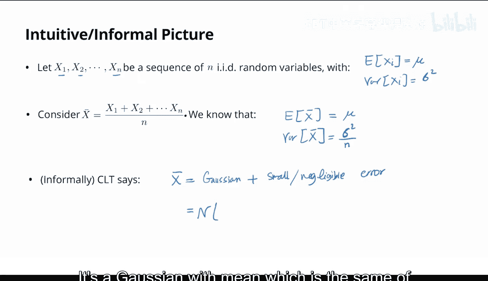

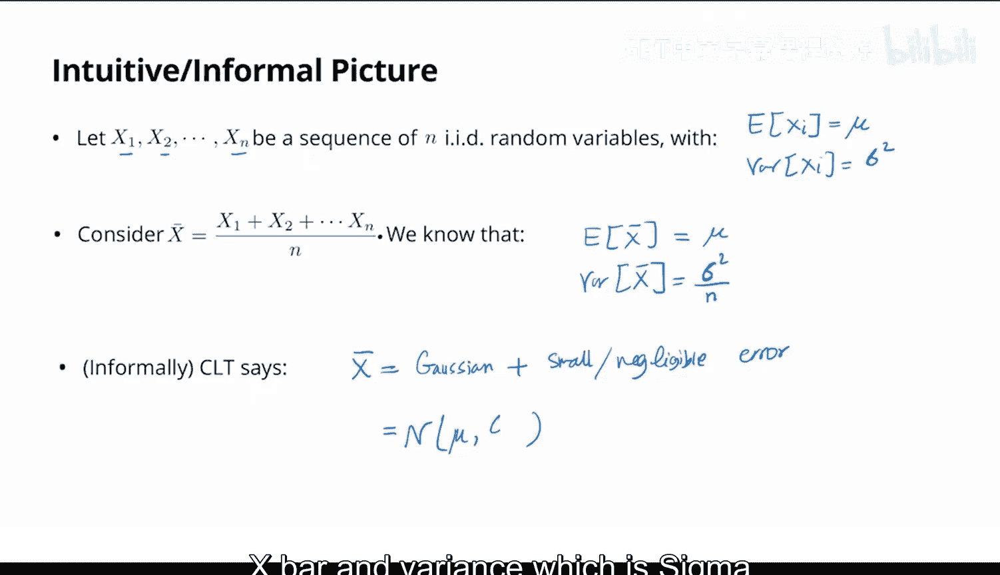

## 概率密度函数的图像化理解

让我们从概率密度函数的角度来直观感受中心极限定理。假设原始变量`X`的分布是任意的（例如不对称的），其概率密度函数可能形状不规则。

以下是随着样本量变化的趋势：
*   当样本量`n`较小时，样本均值`X̄`的分布可能仍保留一些原始分布的特征。
*   随着样本量`n`不断增大，`X̄`的概率密度函数形状会越来越接近一个**钟形曲线**，即正态分布的图形。
*   这个近似正态分布的**中心（均值）** 在`μ`处。
*   这个近似正态分布的**宽度（分散程度）** 由标准差 `σ/√n` 决定。`n`越大，曲线越瘦高，表示`X̄`的取值越集中。

需要再次强调，这是一个帮助理解的直观图像，并非严格的数学表述。例如，当原始变量是离散型时，谈论概率密度函数就不完全精确。我们将在后续讨论更正式的表述。

## 总结

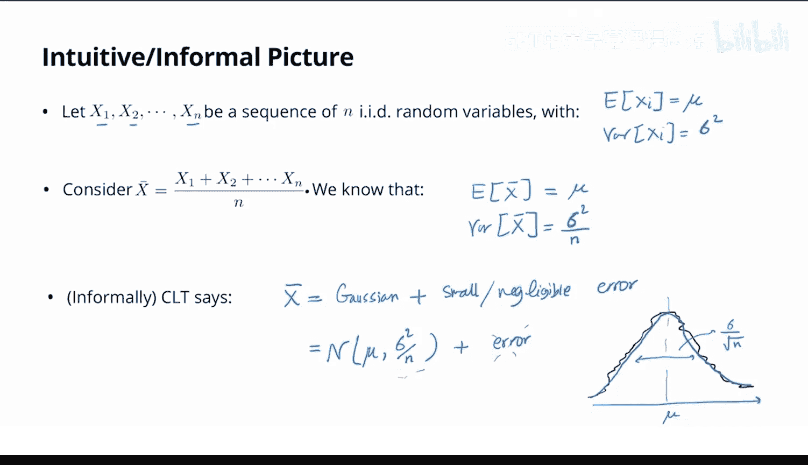

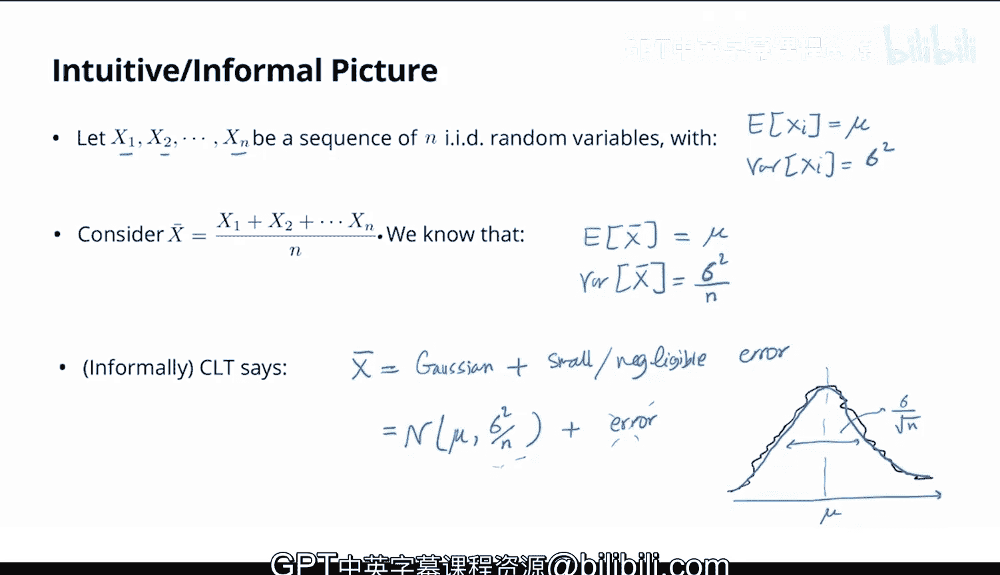

本节课中我们一起学习了中心极限定理的直观思想。我们了解到，对于来自同一总体的独立随机样本，其样本均值`X̄`的分布，在样本量足够大时会趋近于正态分布`N(μ, σ²/n)`。这个定理的强大之处在于，它对原始总体的分布形式没有特殊要求，奠定了许多统计推断方法（如参数估计、假设检验）的理论基础。在后续课程中，我们将直接应用这个近似结果来解决实际问题。