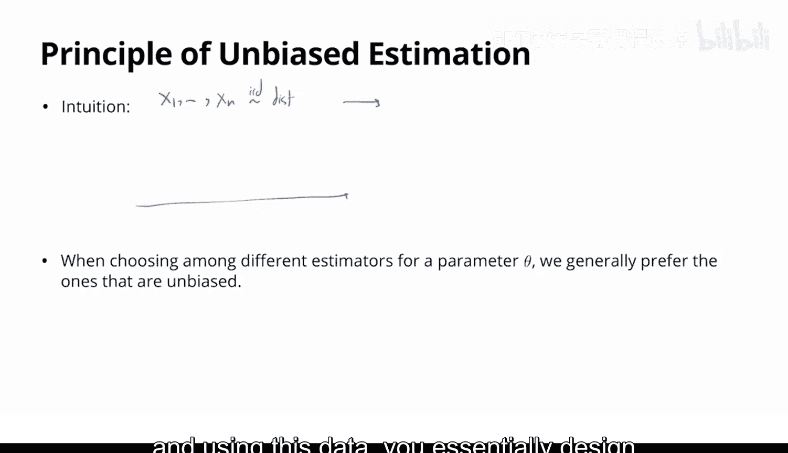
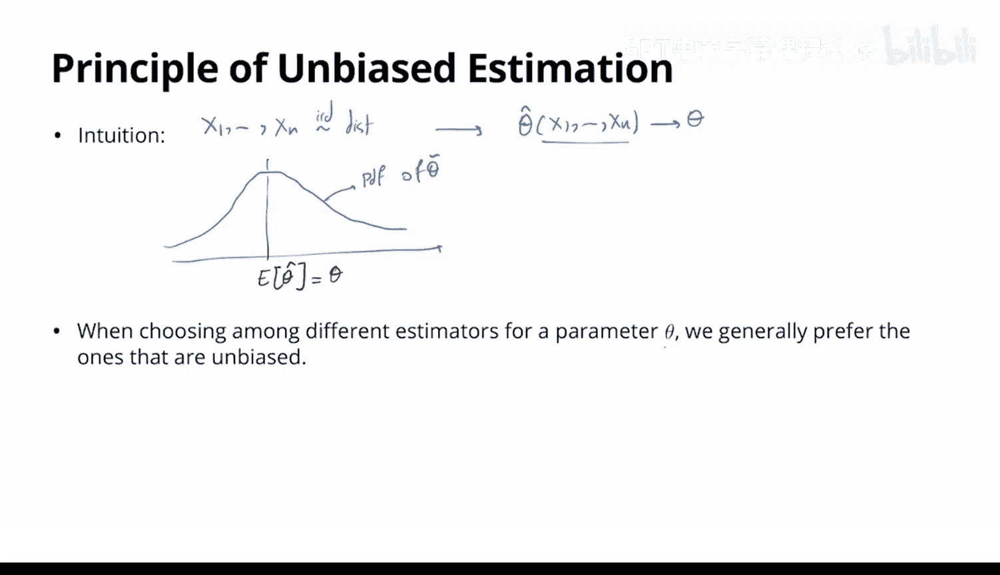
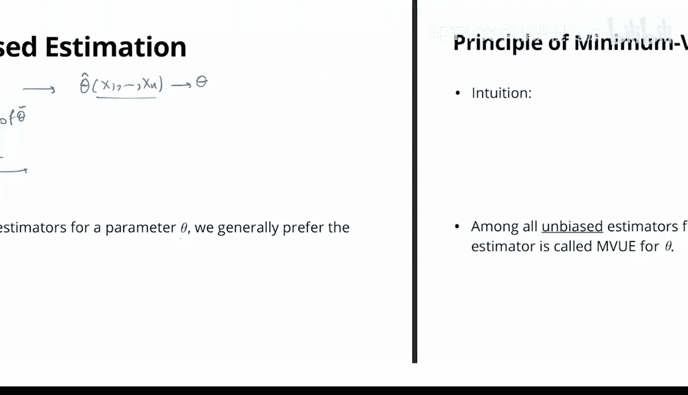
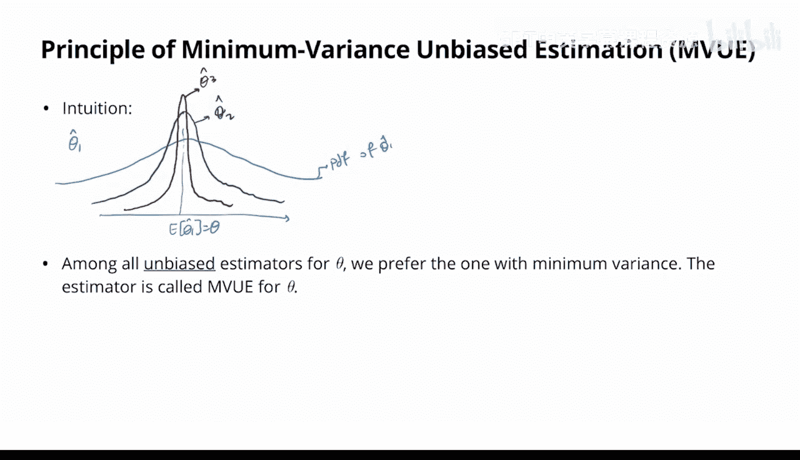
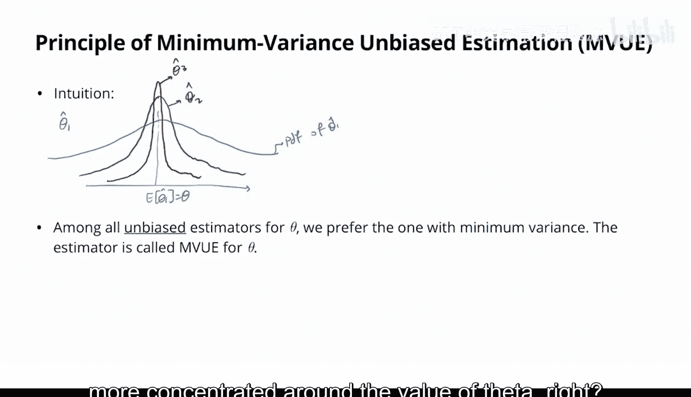
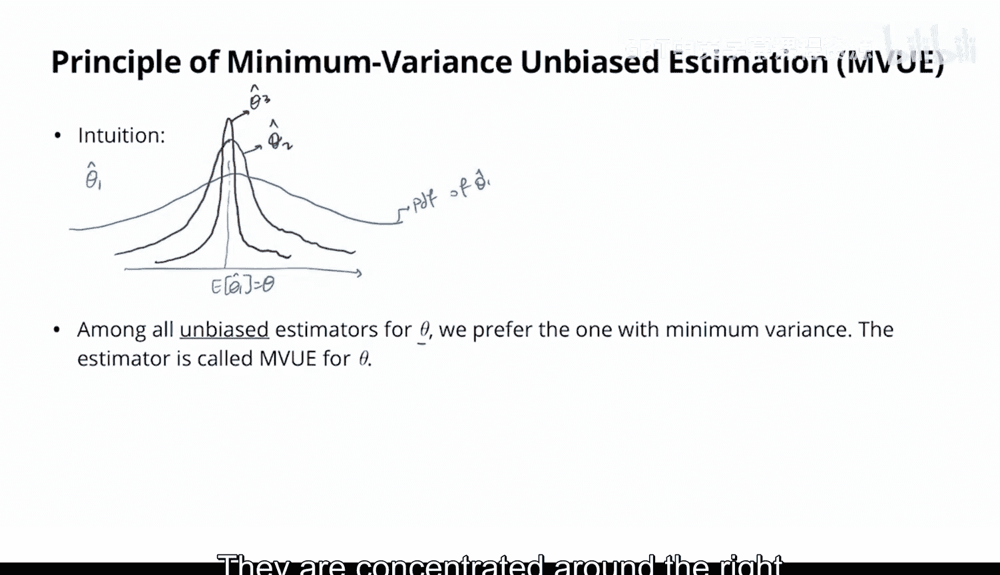
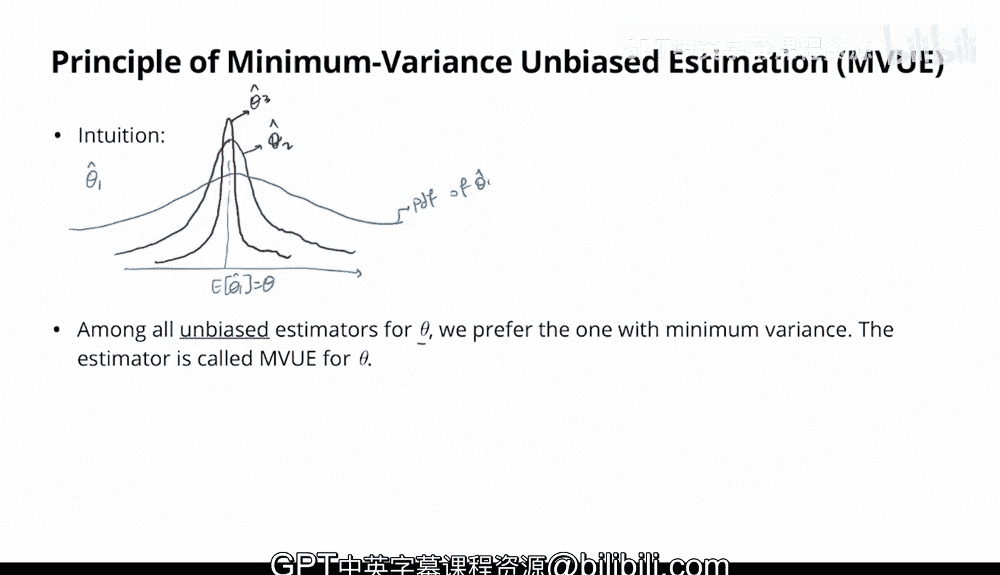

# 29：点估计的两个原则 📊

在本节课中，我们将要学习点估计的两个核心原则：无偏估计原则和最小方差无偏估计原则。我们将理解为什么无偏性是一个好的性质，以及如何在多个无偏估计量中做出选择。

## 概述

上一节我们介绍了估计量，并指出我们通常更倾向于使用无偏估计量。这是因为无偏性是一个优良性质，它意味着估计量的期望值等于我们试图估计的真实参数值。

本节中，我们将正式探讨点估计的两个主要原则。第一个是无偏估计原则，我们将以更正式的方式阐述它。接着，我们将介绍第二个原则，这个原则在后续学习中非常有用。

## 无偏估计原则

首先，我们来正式定义无偏估计原则。其基本设定如下：假设我们有从某个分布中独立同分布抽取的样本数据 `X1, X2, ..., Xn`。

利用这些数据，我们设计一个估计量 `θ_hat(X1, ..., Xn)` 来估计底层参数 `θ`。

由于 `X` 是随机变量，估计量 `θ_hat` 本身也是一个随机变量，因此它有自己的概率密度函数。

无偏估计原则告诉我们，我们希望估计量 `θ_hat` 的期望值（对数据 `X` 求期望）恰好等于真实参数值 `θ`。这意味着估计量的偏差应为零。

用公式表示，即：
**E[θ_hat] = θ**

当我们为参数 `θ` 在多个不同的估计量中进行选择时，我们通常更偏好那些无偏的估计量。因为平均而言，这些估计是准确的。

## 最小方差无偏估计原则

接下来，我们介绍第二个原则：最小方差无偏估计原则。

让我们先通过一个直观的例子来理解这个原则。假设我们有三个无偏估计量，它们都用于估计同一个参数 `θ`。它们的概率密度函数如下图所示。

*   第一个估计量 `θ_hat1` 的概率密度函数分布较宽。
*   第二个估计量 `θ_hat2` 的概率密度函数分布更集中一些。
*   第三个估计量 `θ_hat3` 的概率密度函数分布最为集中。

这三个估计量都是无偏的，因此它们都满足第一个原则。

现在的问题是：在这三个估计量中，你更倾向于选择哪一个？

答案是第三个估计量 `θ_hat3`。通常，我们会更偏好一个在真实参数值 `θ` 附近更集中的估计量。

从数量上讲，“更集中”意味着它具有更小的方差。方差的公式是随机变量与其均值（期望）之差的平方的期望值。对于无偏估计量，其均值就是 `θ`。因此，方差衡量了估计量围绕真实值 `θ` 的波动程度。

方差越小，估计量在 `θ` 附近的分布就越集中。

这就是第二个原则：在所有用于估计参数 `θ` 的无偏估计量中，我们通常更偏好具有最小方差的那个。这样的估计量被称为参数 `θ` 的**最小方差无偏估计量**。

请注意，我们是在所有无偏估计量中寻找方差最小的。因为我们希望最小化方差的同时，确保我们的估计量是无偏的，即它们围绕的是正确的值——我们试图估计的底层参数的真实值。

## 总结

本节课中我们一起学习了点估计的两个核心原则。

1.  **无偏估计原则**：一个好的估计量，其期望值应等于待估参数的真实值，即 **E[θ_hat] = θ**。这保证了估计量在长期平均意义上是准确的。
2.  **最小方差无偏估计原则**：在满足无偏性的所有估计量中，我们应选择方差最小的那个。方差 **Var(θ_hat)** 衡量了估计量的波动性，方差越小，估计结果越稳定、越精确。

理解这两个原则为我们评估和选择统计模型中的估计量提供了基本框架。