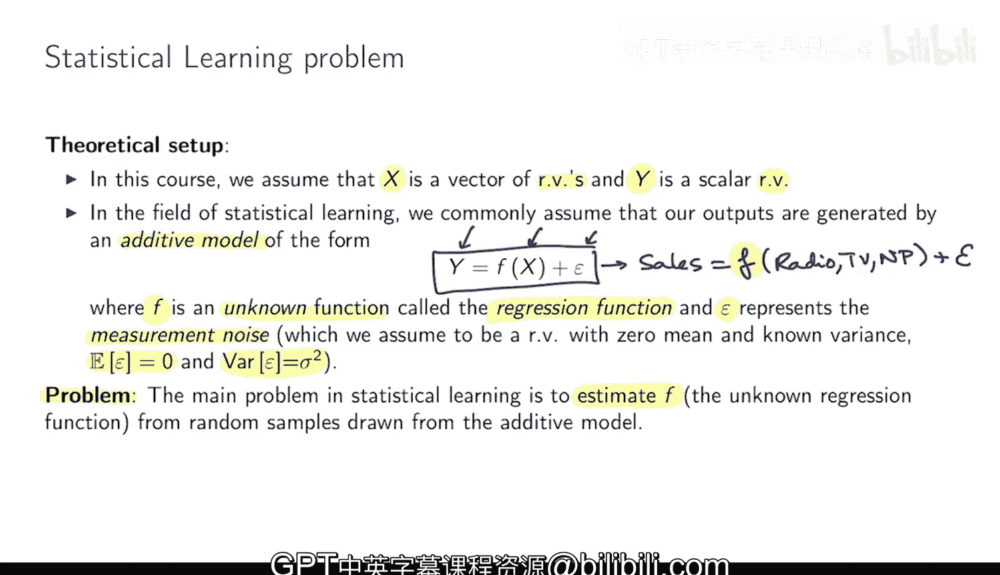

# 03：统计学习入门 📊


在本节课中，我们将要学习统计学习的基本概念。我们将从一个简单的例子开始，介绍核心术语和理论框架，为后续深入学习机器学习方法奠定基础。

## 从示例开始

为了理解统计学习，我们来看一个非常简单的例子。假设我们拥有包含200次营销活动的历史数据。对于每次活动，我们记录了在广播、电视和报纸广告上的投入金额，以及最终产生的总销售额。

在这个例子中，我们有一个希望预测的输出变量“销售额”，以及三个用于预测的输入变量：广播、电视和报纸广告投入。换句话说，我们试图回答的问题是：**如何利用前述三种渠道的投入金额来预测销售额？**

我们期望找到一个函数，能够将销售额近似地表示为这三个参数的函数。在下图中，你可以看到Y轴上的销售额与电视、广播和报纸广告投入之间的关系。例如，在第一张图中，我们可以选择一个特定的投入水平，并查看历史上所有围绕该投入水平的营销活动所产生的平均销售额。

## 核心术语与符号

上一节我们通过一个例子引出了预测问题，本节中我们来正式定义将要用到的符号和术语。

我们将用大写字母 **X** 表示输入向量。这是一个包含 **X₁** 到 **Xₚ** 的向量，这些是我们将用于进行预测的输入特征。同时，我们将使用小写粗体字母 **x** 来表示这个输入向量的一个具体取值。这同样是一个p维向量，包含 **x₁** 到 **xₚ** 这些条目。

在之前的例子中，我们有三个输入，因此 **p**（即用于解决预测问题的特征或输入的数量）等于3。具体来说，我们可以设定 **X₁** 对应电视投入，**X₂** 对应广播投入，**X₃** 对应报纸投入。

请注意，大写向量 **X** 包含的是作为输入的变量，这与具体的数值不同。为了澄清大写 **X** 和小写 **x** 的区别，我们可以看一个具体例子。我们可以定义一个包含三个值的小写向量 **x**：

```
x = [1000, 800, 900]
```

因此，如果我们说 **X = x**，这表示 **X** 的第一个分量（即电视投入）等于1000，意味着在电视上投入了1000个单位；**X** 的第二个分量（广播投入）等于800；**X** 的第三个分量等于小写 **x** 的第三个分量，即900个单位。通过令 **X = x**，我们实际上是指定了输入向量 **X** 中所有输入的一个具体取值。

类似地，我们将使用大写字母 **Y** 表示输出变量，而输出的一个具体值将用小写 **y** 表示。在之前的例子中，我们的输出变量是销售额，我们将变量 **Y** 分配给销售额。如果我们说 **y = 2500**，并且令 **Y = y**，那么我们实际上是在说销售额等于2500个单位。

## 理论框架：加法模型

现在，让我们转向研究统计学习问题的适当理论框架。在本课程中，我们将假设 **X** 是一个随机变量向量，而 **Y** 是一个标量随机变量。

在统计学习领域，通常假设输出变量是使用所谓的**加法模型**生成的。该模型的形式如下：

**Y = f(X) + ε**

这个公式本质上说明，你观察到的实验输出值 **y**，是输入变量的某个函数值加上一个 **ε** 值。以下是其中每个元素的解释：

*   **f** 是一个未知函数，称为**回归函数**。这个回归函数将是本课程中一个非常重要的组成部分。
*   **ε** 是我们所称的**测量噪声**。这是一个随机变量，我们已知其均值为0，方差为 **σ²**。

例如，在我们之前的广告示例中，根据这个模型，我们有：

**销售额 = f(广播投入， 电视投入， 报纸投入) + ε**

有一个非常重要的点需要注意：这个回归函数 **f** 对你来说是未知的。这是“自然”用来生成你在实验中观察到的数据的函数。

## 统计学习问题

上一节我们介绍了数据生成的理论模型，本节中我们来看看统计学习要解决的核心问题。

统计学习问题，如前所述，就是利用历史数据（即从加法模型中抽取的随机样本）来估计这个未知的回归函数 **f**。

本质上，**f** 是未知的，你只能访问一个数据集，而你真正想要确定的是这个函数 **f** 是什么——即“自然”用来生成数据的函数。因此，本课程的一个重要部分将是尝试开发各种技术来估计 **f**。

## 总结



本节课中我们一起学习了统计学习的入门知识。我们从预测销售额的实例出发，定义了输入变量 **X**、输出变量 **Y** 以及它们的取值表示。接着，我们介绍了描述数据生成过程的**加法模型 Y = f(X) + ε**，并明确了回归函数 **f** 和测量噪声 **ε** 的概念。最后，我们指出统计学习的核心目标就是利用观测数据来估计这个未知的回归函数 **f**。理解这些基础概念是后续学习各种具体机器学习算法的关键。