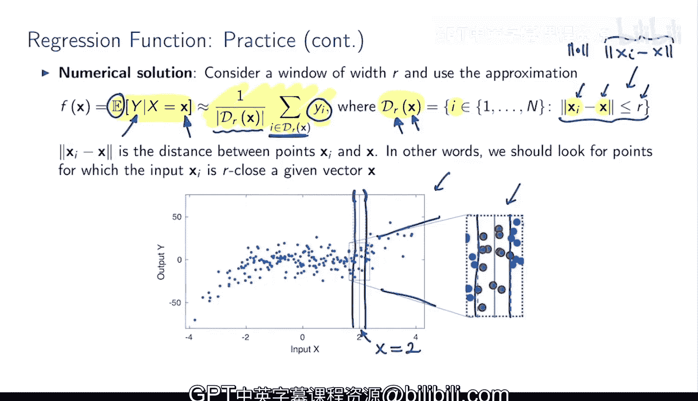

# 04：回归函数 📈

在本节课程中，我们将学习回归函数的核心理论及其在实际应用中的估计方法。我们将从理论定义出发，探讨其与条件期望的关系，并最终介绍一种基于数据集的实用估计方法。

## 理论回顾：回归函数与条件期望

上一节我们介绍了回归函数的基本概念。本节中，我们来看看它的数学定义。

从统计学角度可以证明，回归函数等于给定输入 **x** 时输出 **y** 的条件期望。其公式如下：

**F(x) = E[y | x]**

如果我们已知条件概率密度函数 **f(y|x)**，则可以通过积分计算这个期望值：

**F(x) = ∫ y * f(y|x) dy**

请注意，对 **y** 积分后，结果将是输入向量 **x** 的函数。然而在实践中，我们通常无法直接获得这个条件概率密度函数。

## 优化视角：最小化均方误差

从优化理论的角度，同样可以证明回归函数是以下优化问题的解：

**F = argmin_g E[ (y - g(x))^2 ]**

这个优化问题在所有可能的函数 **g** 中寻找一个解，使得 **y** 与 **g(x)** 之差的平方的期望值最小。

以下是关于此优化问题的一些关键点：
*   **均方误差**：期望项 **E[ (y - g(x))^2 ]** 被称为均方误差。它衡量了使用函数 **g** 进行预测时的平均误差大小。
*   **最优解**：可以证明，这个优化问题的最优解正是我们之前定义的回归函数 **F(x)**，即条件期望 **E[y | x]**。

## 实践设定：从数据中估计回归函数

在理论部分，我们了解了回归函数的性质。现在，我们转向实践中估计回归函数的重要细节。

在实际场景中，我们假设无法直接获取条件概率密度，但拥有从以下加性模型生成的样本数据：

**y_i = f(x_i) + ε_i**

其中 **ε_i** 是噪声，满足 **E[ε] = 0** 且 **Var(ε) = σ²**。函数 **f** 的形式未知。

我们的问题是：给定一个包含 **n** 对观测值的数据集 **D = { (x_1, y_1), ..., (x_n, y_n) }**，如何找到一个对真实回归函数 **f** 的估计，我们将其记为 **f_hat**。

为了直观理解，考虑下图（假设输入 **x** 为一维标量）。每个数据点 **(x_i, y_i)** 对应图中的一个散点。我们的目标是从这些散点中估计出潜在的函数关系 **f**。

## 初始方法：精确匹配的局限

一种直观的想法是利用回归函数是条件期望这一事实，并使用经验均值来近似理论期望。

具体方法是：对于想要预测的特定值 **x**，找出数据集中所有输入 **X_i** 恰好等于 **x** 的点，然后计算这些点对应输出 **Y_i** 的平均值。公式如下：

**f_hat(x) = (1 / |D_x|) * Σ_{i ∈ D_x} y_i**
**其中 D_x = { i | X_i = x }**

然而，这种方法并不实用。原因在于，对于连续取值的 **x**，在数据集中找到恰好等于某个具体实数值的 **X_i** 的概率极低。通常，我们可能一个都找不到。

## 改进方法：基于邻域的估计

为了克服上述限制，我们需要采用另一种方法。其核心思想是放宽“精确等于”的条件，转而考虑“足够接近”的点。

我们不再要求 **X_i** 精确等于 **x**，而是考虑那些与 **x** 的距离小于等于某个半径 **r** 的点。定义邻域索引集如下：

**N_r(x) = { i | ||X_i - x|| ≤ r }**

然后，我们计算落在这个邻域内所有数据点的输出平均值，作为对 **f(x)** 的估计：

**f_hat(x) = (1 / |N_r(x)|) * Σ_{i ∈ N_r(x)} y_i**

这个过程可以形象地理解为：以 **x** 为中心，开设一个宽度为 **2r** 的“窗口”，然后使用窗口内所有数据点的 **y** 值来计算局部平均值。通过选择合适的半径 **r**，我们总能找到一些邻近的点来进行估计。

## 总结

本节课中我们一起学习了回归函数的理论定义及其实际估计方法。

我们首先了解到回归函数在理论上等于条件期望 **E[y|x]**，并且是均方误差最小化问题的解。接着，我们探讨了在实际统计学习问题中，如何利用数据集来估计这个函数。最初的精确匹配法因数据稀疏性而不可行，因此我们引入了基于邻域的估计方法。该方法通过计算目标点附近一个邻域内数据输出的平均值，来近似条件期望，从而实现对回归函数的有效估计。