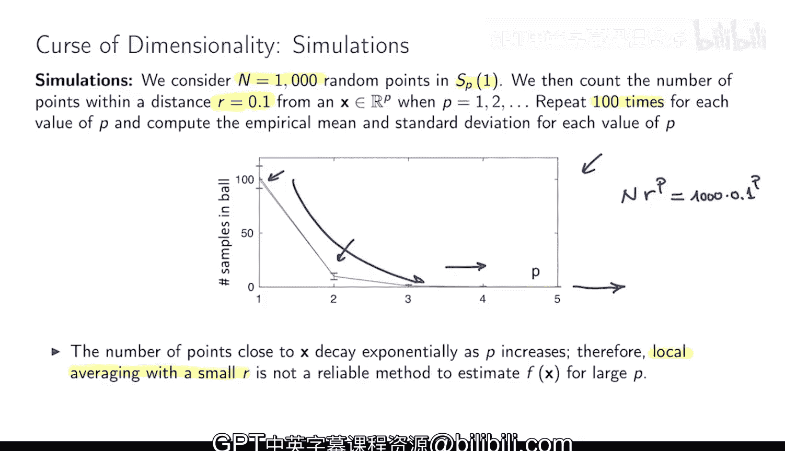

# 05：维度灾难 📈

在本节课程中，我们将探讨一个在机器学习中至关重要的概念——维度灾难。我们将从回顾局部平均法开始，逐步理解当数据维度增加时，这种方法为何会失效。

## 回顾：局部平均法

在上一节中，我们学习了如何使用局部平均法来估计回归函数 **f(x)**。具体做法是：对于一个给定的输入点 **x**，我们考虑一个以该点为中心、宽度为 **2R** 的窗口，然后计算落入该窗口内所有数据点的 **y** 值的平均值，以此作为 **f(x)** 的估计值。

这种方法在一维数据（即 **p = 1**）中效果良好，如下图所示，绿色线代表通过局部平均得到的估计函数。

## 维度灾难的引入

既然我们已经有了估计 **f(x)** 的方法，那么问题是否就解决了呢？答案是否定的。这是因为存在一个被称为“维度灾难”的现象。

维度灾难是指，当问题的输入变量数量（即维度 **p**）远大于1时出现的问题。在我们之前的一维示例中无法体现这一点，但当 **p** 很大时，数据集中的点往往会彼此远离，导致局部平均法变得不可行。

为了说明维度灾难，我们将考虑不同维度 **p** 下的场景。

## 不同维度下的期望点数分析

以下是分析步骤，我们将从一维开始，逐步增加维度。

### 一维情况 (p = 1)

假设有 **n** 个点均匀随机分布在区间 **S₁ = [-1, 1]** 上。我们选取其中一个点 **x**（用红点表示），并考虑一个以 **x** 为中心、长度为 **2R** 的窗口 **Dᵣ(x)**。

由于点是均匀分布的，单位长度上的期望点数为 **n / 2**。因此，窗口 **Dᵣ(x)** 内的期望点数 **E[N]** 为：
**E[N] = (n / 2) * (2R) = nR**

### 二维情况 (p = 2)

现在，考虑 **n** 个点均匀随机分布在半径为1的圆盘 **S₂** 内。我们同样选取一个点 **x**，并考虑一个以 **x** 为中心、半径为 **R** 的小圆 **Dᵣ(x)**。

单位面积上的点密度为 **n / π**。小圆的面积为 **πR²**。因此，小圆内的期望点数为：
**E[N] = (n / π) * (πR²) = nR²**

### 高维情况 (p 为任意值)

我们将概念推广到 **p** 维空间。考虑一个 **p** 维超球体 **Sₚ**，其半径为1，中心在原点。其体积 **Vₚ** 与 **Rᵖ** 成正比，即 **Vₚ ∝ Rᵖ**。

在 **Sₚ** 内均匀随机分布 **n** 个点。对于其中任意一点 **x**，考虑一个以 **x** 为中心、半径为 **R** 的小超球体 **Dᵣ(x)**。

大超球体内的点密度为 **n / Vₚ(1)**。小超球体的体积为 **Vₚ(R) ∝ Rᵖ**。因此，小超球体内的期望点数为：
**E[N] ≈ n * Rᵖ**

总结规律：
*   **p = 1**： **E[N] = nR**
*   **p = 2**： **E[N] = nR²**
*   **p = p**： **E[N] ≈ nRᵖ**

## 模拟实验与结果

为了验证上述理论，我们进行了一个模拟实验。

实验设置如下：
*   在 **p** 维单位超球体 **Sₚ** 内随机生成 **n = 1000** 个点。
*   对于球内任意一点 **x**，计算与其距离小于 **R = 0.1** 的点的数量。
*   对维度 **p = 1, 2, ..., 5** 分别重复上述过程100次，计算经验平均值和标准差。

实验结果如下图所示。红色曲线表示理论预期值 **1000 * (0.1)ᵖ**，蓝色曲线表示模拟得到的经验平均值。

## 核心结论：维度灾难的影响

模拟结果的关键发现并非仅仅是理论值与经验值吻合，而是揭示了随着维度 **p** 的增加，半径为 **R** 的小超球体内包含的点数会以指数级速度急剧减少。

这意味着，当我们处理输入维度 **p** 非常高的问题时，以任何点 **x** 为中心的局部小区域内，数据点的数量将变得极少。在实践中，对于非常大的 **p**，这个数量几乎为零。

因此，如果我们想在高维空间中使用基于小半径 **R** 的局部平均法，我们将在局部窗口（即高维超球体）内找不到足够的数据点进行平均，从而导致方法失效。

## 本节总结

在本节课中，我们一起学习了维度灾难的概念。我们首先回顾了局部平均法，然后通过数学推导和模拟实验证明，随着数据维度的增加，数据点在空间中的分布变得极其稀疏，使得依赖局部邻域的估计方法（如局部平均）需要海量数据才能保持有效性，这在实际应用中构成了巨大挑战。理解维度灾难是学习后续降维技术和选择合适机器学习模型的重要基础。