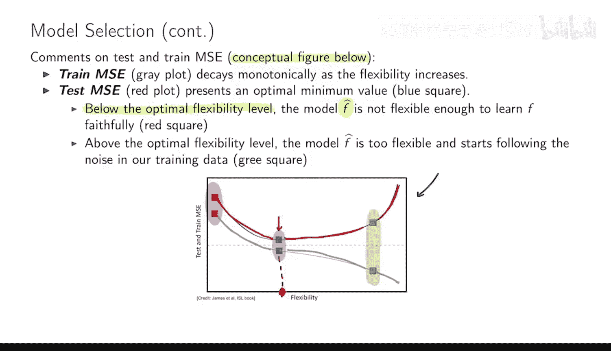

# 07：模型质量评估 📊

在本节课程中，我们将学习如何评估机器学习模型的质量。核心在于理解训练误差与测试误差的区别，以及如何利用它们来选择一个“恰到好处”的模型，避免模型过于简单或过于复杂。

## 概述

评估模型质量是机器学习流程中的关键步骤。我们将区分两种类型的数据：**训练数据集**和**测试数据集**。通过计算这两种数据集上的误差，我们可以判断模型在“见过”的数据和“未见”的数据上的表现，从而选择泛化能力最佳的模型。

## 训练误差与测试误差

上一节我们介绍了参数模型的概念。本节中，我们来看看如何量化模型的预测表现。

在解决实际的机器学习问题时，我们需要区分两种类型的数据。

一方面，我们有**训练数据集**，记作 **D_TR**。这个数据集包含 **n** 个训练点，用于估计我们所考虑的参数模型 **f̂** 的未知参数 **θ**。

一旦我们训练好模型的参数，**训练均方误差** 定义如下。具体来说，训练过程的均方误差根据以下公式定义：

**MSE_train = (1/n) * Σ_{i=1}^{n} (y_i - f̂(x_i))^2**

本质上，我们有 n 个点，因此用因子 1/n 进行归一化。然后，我们对训练数据集中的所有点对 (x_i, y_i) 进行求和，求和项是模型预测值 **f̂(x_i)** 与实际输出值 **y_i** 之间的误差的平方。我们计算这些平方误差的经验平均值，称之为均方误差。

另一方面，我们还有**测试数据集**，记作 **D_T**。在这种情况下，我们有 **m** 个测试点，这些数据是你的学习算法在训练期间未曾见过的。我们可以使用这些数据，通过所谓的**测试均方误差**来估计模型在未来预测中的性能。

因此，**测试均方误差** 由以下表达式定义：

**MSE_test = (1/m) * Σ_{j=1}^{m} (y_j - f̂(x_j))^2**

这里，由于有 m 个测试点，我们用因子 1/m 进行归一化。求和遍历测试数据集中的所有点，括号内的表达式与之前相同，本质上是给定输入 x 后，实际输出值与预测输出值之间的误差平方。求和与归一化后，即得到测试数据集的均方误差。

在实践中，测试均方误差能更好地反映我们模型的性能。

## 训练与测试误差的对比

理解了两种误差的定义后，我们通过一个具体例子来观察它们的差异。

在本幻灯片中，我们说明了训练均方误差和测试均方误差之间的区别。具体来说，我们将考虑两幅不同的点云图。左侧的点云代表训练数据集，而右侧的点云代表测试数据集。这两幅图中的点云都来自相同的加性模型，我们假设这两幅图中每个样本 (x_i, y_i) 都来自相同的联合概率密度函数。

在底部的图表中，我们计算了从1次到8次多项式的训练和测试均方误差。

在此图表中，我们用蓝色线条绘制了训练均方误差随多项式次数增加的变化。我们可以观察到，这个函数随着次数的增加而单调递减。这是训练均方误差的一个普遍特征，其原因在于，随着多项式次数的增加，我们能够越来越好地拟合给定的训练集。

在同一图表中，我们用红色线条绘制了测试均方误差随多项式次数增加的变化。我们观察到，在这个特定案例中，该函数并非单调递减，而是在次数 **d = 3** 时呈现出一个最小值。这表明，在本实验所考虑的多项式函数层次结构中，三次多项式可能是最佳选择。

## 模型复杂度与误差的关系

通过多项式回归的例子，我们看到了测试误差存在最小值。现在，我们将这个概念推广到更一般的模型复杂度（或称“灵活性”）上。

关于训练和测试均方误差，我们有以下几点评论。下方有一个概念图，描述了训练和测试均方误差随模型层次结构灵活性变化的演变。

在下面的灰色图表中，我们绘制了训练均方误差随模型灵活性变化的曲线。这里的灵活性是多项式次数的一般化，本质上是衡量一个函数跟随数据集中点集的能力的指标。

在同一图中，我们也用红色绘制了测试均方误差。正如我们之前所见，测试均方误差并非单调递减，而是在某个特定的灵活性值处呈现最小值。由于测试均方误差是衡量我们模型未来预测性能的指标，这个精确的灵活性水平正是我们应该选择来训练模型的水平。

具体来说：
*   当灵活性水平低于最优水平时，参数模型 **f̂** 不够灵活，无法准确地学习回归函数 **f**。这可能是图中这两个点所代表的情况。
*   相反，当灵活性高于最优水平时，模型 **f̂** 过于灵活，并开始拟合我们训练数据中的噪声。这本质上是我们在几页前看到的20次多项式例子中观察到的“抖动”现象。这对应于曲线此部分的绿色方块所代表的情况。
*   最后，蓝色方块代表了在最优灵活性水平（即测试均方误差最小化时）的训练和测试均方误差值。

再次强调，这个最优灵活性水平是我们应该用来训练模型的水平。

## 总结

本节课中，我们一起学习了评估模型质量的核心方法。我们明确了**训练误差**（`MSE_train`）和**测试误差**（`MSE_test`）的定义与区别。关键在于，训练误差会随着模型复杂度（灵活性）增加而持续降低，但测试误差会先降后升，形成一个“U”形曲线。测试误差的最低点对应着模型复杂度的**最优选择**，此时模型既能捕捉数据中的真实规律，又不会过度拟合噪声。选择这个最优复杂度，是构建泛化能力强的机器学习模型的关键。