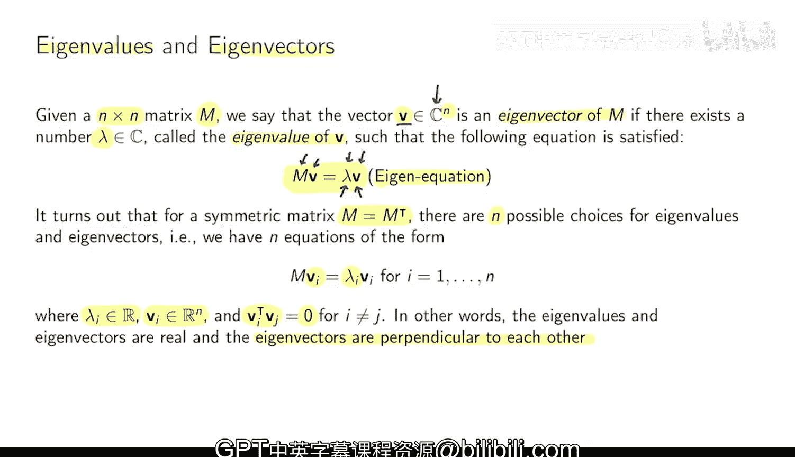

# 11：特征值与特征向量 📐

在本节课中，我们将学习线性代数中的几个核心概念，包括向量的表示、内积与外积，并最终引入机器学习中至关重要的**特征值与特征向量**概念。

## 向量代数基础

首先，我们介绍向量的基本表示。一个向量通常用小写粗体字母表示，例如 **x**。它包含实数元素，本质上是 **R^n** 空间中的一个元素。按照惯例，一个 n 维向量 **x** 是一个 n 行 1 列的矩阵，即一个列向量。

我们可以使用下标 **x_i** 来索引向量 **x** 中的元素。注意，在表示元素时，我们移除了粗体。

接下来，我们看看向量之间的运算。以下是两种主要的向量乘积。

### 内积

内积是两个同维度向量 **x** 和 **y** 之间的运算，其结果是一个标量。我们使用 **<x, y>** 的符号来表示内积。

根据定义，内积等于 **x^T y**。由于 **x** 是列向量，**x^T** 是一个行向量。**y** 是列向量。这个矩阵乘法的维度是 (1×n) 乘以 (n×1)，结果是一个 1×1 的矩阵，即一个实数。

其显式计算公式为：
`<x, y> = x^T y = Σ_{i=1}^{n} x_i * y_i`

内积满足交换律，即 **<x, y> = <y, x>**。

### 外积

外积是另一种向量乘积。两个同维度向量 **x** 和 **y** 的外积定义为 **x y^T**。注意，转置符号在 **y** 上。

**x** 是 (n×1) 的列向量，**y^T** 是 (1×n) 的行向量。因此，外积的结果是一个 (n×n) 的矩阵。

该矩阵的第 (i, j) 个元素为：
`(x y^T)_{ij} = x_i * y_j`

### 矩阵与向量的乘积

对于一个 (m×n) 的矩阵 **A** 和一个 n 维向量 **x**，我们可以定义乘积 **A x**。矩阵 **A** 的维度是 (m×n)，向量 **x** 的维度是 (n×1)，内维匹配，因此结果是 (m×1) 的向量 **y**。

结果向量 **y** 的第 i 个元素由以下公式给出：
`y_i = Σ_{j=1}^{n} A_{ij} * x_j`

## 特征值与特征向量 🎯

上一节我们介绍了向量和矩阵的基本运算，本节中我们来看看线性代数中一个核心且强大的概念：特征值与特征向量。

这些概念与方阵（即行数和列数相等的矩阵）相关。考虑一个 (n×n) 的方阵 **M**。

我们说一个 n 维的列向量 **v**（其元素可以是复数）是矩阵 **M** 的一个**特征向量**，如果存在一个复数 **λ**（称为**特征值**），使得以下方程成立：
`M v = λ v`

这个方程被称为**特征方程**。如果我们能找到满足该方程的 **λ** 和 **v**，那么 **λ** 就是特征值，**v** 就是对应的特征向量。

对于一个 (n×n) 的方阵，通常存在 n 组可能的特征值和特征向量解。

### 对称矩阵的特殊性质

对于一类特殊的矩阵——**对称矩阵**（满足条件 **M = M^T**），其性质更加优良：

1.  所有特征值 **λ** 都是**实数**。
2.  所有特征向量 **v** 都是 n 维的**实向量**。
3.  任意两个不同特征向量之间的内积为零，即它们是**相互垂直（正交）**的。这可以表示为：
    `<v_i, v_j> = 0` （当 i ≠ j 时）

## 总结

本节课中，我们一起学习了线性代数的关键基础。我们从向量的表示和两种乘积（内积与外积）开始，然后深入探讨了矩阵与向量的乘法。最后，我们引入了机器学习中至关重要的**特征值与特征向量**概念，并了解了对称矩阵在此背景下所具有的优良数学性质（实数特征值、正交特征向量）。理解这些概念是掌握后续更复杂机器学习算法（如主成分分析PCA）的基石。