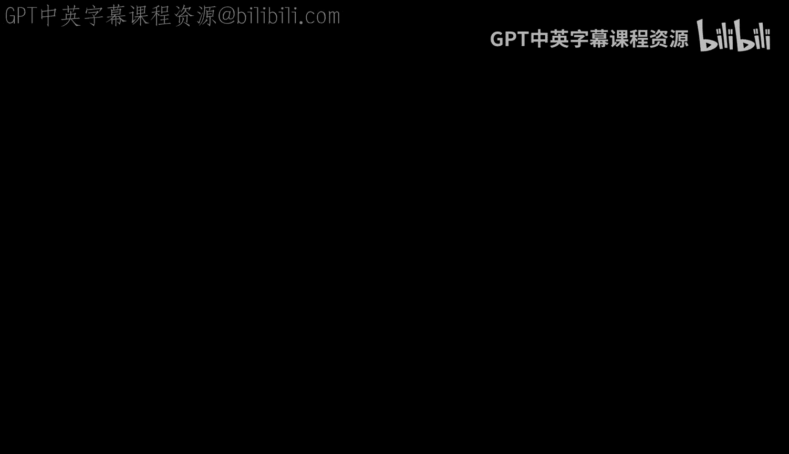

# 14：置信区间 📊

在本节课中，我们将要学习如何为线性回归模型的参数构建置信区间。我们将从回顾参数估计量的分布特性开始，逐步推导出置信区间的计算公式，并讨论其背后的假设与注意事项。

上一节我们介绍了参数估计量 `beta1_hat` 的抽样分布特性。本节中我们来看看如何利用这种分布特性来构建一个区间，使我们能以一定的概率确信真实的参数值位于该区间内。

## 参数估计量的分布回顾

通过绘制 `beta1_hat` 在1000个不同数据集上的1000个不同实现值的直方图，我们得到了一个接近正态分布的图形，其中心位于真实值 `beta1` 附近。

理论上可以证明，`beta1_hat` 的概率密度函数近似服从正态分布。我们知道 `beta1_hat` 的期望值等于真实的 `beta1`，因此我们知道这个钟形曲线的中心。同时，我们也有给定数据下 `beta1_hat` 方差的表达式。

## 从正态分布到置信区间

尽管我们永远无法精确获知自然界用于生成观测数据的真实 `beta1` 值，但我们可以基于数据按照以下步骤构建置信区间。

一个关键的观察是：对于一个均值为 `mu`、方差为 `sigma^2` 的正态分布，其95%的概率质量位于区间 `mu ± 2*sigma` 内。换句话说，如果我们观察正态分布曲线下 `mu - 2*sigma` 到 `mu + 2*sigma` 之间的面积，该面积等于0.95，表明随机变量有95%的概率会落在这个区间段内。

将这一事实应用于我们的随机变量 `beta1_hat`，我们可以说 `beta1_hat` 有95%的概率位于区间 `beta1 ± 2*sigma_{beta1_hat}` 内。我们可以用以下不等式序列来重写这个事件：
`beta1 - 2*sigma_{beta1_hat} <= beta1_hat <= beta1 + 2*sigma_{beta1_hat}`。

通过一个简单的代数变换，我们可以将上述不等式改写为以下形式：
`beta1_hat - 2*sigma_{beta1_hat} <= beta1 <= beta1_hat + 2*sigma_{beta1_hat}`。

## 构建置信区间

现在，我们将这个不等式序列以概率区间的形式重新表述。我们得到以下结论：`beta1` 位于区间 `[beta1_hat - 2*sigma_{beta1_hat}, beta1_hat + 2*sigma_{beta1_hat}]` 内的概率是95%。

这个表达式告诉我们，有95%的概率，自然界用于生成数据的真实参数值 `beta1` 位于这个给定的区间内。重要的是，我们可以使用训练数据集来计算 `beta1_hat` 及其标准差的估计值。

以下是计算 `beta1_hat` 及其标准差的关键公式：
*   `beta1_hat` 的计算公式：`beta1_hat = sum((x_i - x_mean)*(y_i - y_mean)) / sum((x_i - x_mean)^2)`
*   `beta1_hat` 的方差公式：`Var(beta1_hat) = sigma^2 / sum((x_i - x_mean)^2)`

将计算出的 `beta1_hat` 值和 `sigma_{beta1_hat}` 代入上述区间表达式，我们就能得到一个明确的数值区间。我们以95%的置信度认为，真实的 `beta1` 位于该区间内。这就是 `beta1` 的95%置信区间。

## 扩展到截距项

我们可以使用完全相同的逻辑来计算截距项 `beta0` 的置信区间。

以下是计算 `beta0` 置信区间的步骤：
1.  使用 `beta0_hat` 的均值和方差表达式。
2.  得出结论：`beta0` 有95%的概率位于区间 `beta0_hat ± 2*sigma_{beta0_hat}` 内。

## 重要假设与警告

在应用上述结论之前，必须牢记我们为得出这些结论所做的假设。

以下是构建置信区间所依赖的关键假设：
1.  **正态性假设**：我们假设 `beta1_hat` 服从正态分布。这仅在特定情况下近似成立。对于某些问题，这一假设可能不适用，需要特别注意。
2.  **噪声方差已知**：我们假设我们知道测量噪声的方差 `sigma^2`。在实践中，这通常不成立。不过，我们将在后续课程中看到估计 `sigma^2` 的实用方法。

本节课中我们一起学习了如何为线性回归模型的斜率 `beta1` 和截距 `beta0` 构建95%置信区间。我们回顾了估计量的正态分布特性，利用正态分布的性质推导出区间公式，并强调了该方法所依赖的正态性和已知噪声方差这两个关键假设。理解置信区间有助于我们量化参数估计的不确定性。