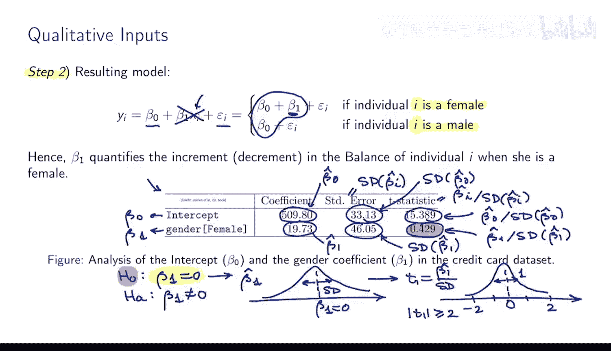

# 17：分类输入 📊

在本节课中，我们将要学习如何将线性模型扩展到处理分类输入变量。我们将回顾线性模型的基础，并学习如何将性别等定性变量纳入回归分析。

## 概述 📋

在之前的章节中，我们研究了形式为 **y = β₀ + β₁x₁ + ... + βₚxₚ + ε** 的线性模型。我们假设输入变量 **x₁, ..., xₚ** 是定量的，即它们取实数值。然而，在实际应用中，我们经常遇到性别、婚姻状况等定性变量，也称为分类变量。本节将介绍如何扩展线性模型以处理这类输入。

上一节我们介绍了线性模型参数估计与假设检验的基础，本节中我们来看看如何处理分类变量。

## 线性模型回顾 🔄

我们研究的线性模型形式如下：

**y = β₀ + β₁x₁ + β₂x₂ + ... + βₚxₚ + ε**

其中：
*   **y** 是输出变量。
*   **β₀** 是截距（常数项）。
*   **x₁, ..., xₚ** 是 **p** 个输入变量。
*   **β₁, ..., βₚ** 是每个输入变量对应的权重（参数）。
*   **ε** 是测量噪声，服从某个分布 **f_ε**。

我们从一个未知的总体分布 **F_X** 中随机抽取输入向量 **X**，然后根据上述模型生成对应的输出 **Y**，从而形成一个包含 **n** 个观测值的数据集 **D = {(Xᵢ, Yᵢ)}**。

模型的真实参数 **β₀, ..., βₚ** 对我们来说是未知的。我们只能使用数据集 **D** 来估计这些参数，得到估计值 **β̂₀, ..., β̂ₚ**。这些估计值是随机变量，通常围绕真实参数值呈高斯分布。

为了量化估计的不确定性，我们使用**置信区间**。例如，参数 **βᵢ** 的95%置信区间为：

**[β̂ᵢ - 2 × SE(β̂ᵢ), β̂ᵢ + 2 × SE(β̂ᵢ)]**

其中 **SE(β̂ᵢ)** 是估计值 **β̂ᵢ** 的标准误差（即标准差）。我们可以声称，真实参数 **βᵢ** 有95%的概率落在这个区间内。

此外，我们使用**假设检验**来判断某个输入变量 **xᵢ** 是否对输出 **y** 有显著影响。原假设 **H₀** 通常为 **βᵢ = 0**，意味着该变量无影响。我们计算 **t 统计量**：

**t = β̂ᵢ / SE(β̂ᵢ)**

如果 **|t| ≥ 2**，我们就有足够的统计证据在95%置信水平下拒绝原假设，认为该变量有显著影响。

## 引入分类变量 👥

在实践中，输入变量可能是定性的（分类变量）。例如：
*   性别：男性或女性。
*   婚姻状况：单身、已婚等。
*   种族：白种人、非裔、亚裔等。

为了在线性模型中纳入这类变量，我们需要对其进行编码。下面以分析性别对信用卡余额的影响为例进行说明。

在这个例子中，我们只考虑性别这一个输入变量（**p = 1**）。
*   输出变量 **Yᵢ**：个体 **i** 的信用卡余额。
*   输入变量 **Xᵢ**：个体 **i** 的性别（分类变量）。

我们需要将分类变量“性别”转换为模型可以处理的数值形式。

以下是处理分类变量的标准步骤：

**第一步：创建虚拟变量**
我们创建一个新的数值变量 **x** 来编码性别信息。
*   如果个体 **i** 是女性，则令 **xᵢ = 1**。
*   如果个体 **i** 是男性，则令 **xᵢ = 0**。

这样，分类信息就被转换成了0或1的数值。

**第二步：建立模型**
将编码后的变量 **x** 代入线性模型：

**y = β₀ + β₁x + ε**

现在，我们可以分析这个模型：
*   当 **x = 1**（女性）时，模型为：**y = β₀ + β₁ + ε**
*   当 **x = 0**（男性）时，模型为：**y = β₀ + ε**

通过比较可以看出，参数 **β₁** 量化了性别为女性时，对信用卡余额的**额外影响**（增量或减量）。**β₀** 则代表了男性（基准组）的平均余额水平。

## 实例分析：性别与信用卡余额 💳

我们使用一个真实的信用卡数据集来拟合上述模型，并得到参数估计。

以下是回归分析的结果摘要表（部分）：

| 变量     | 系数估计 (Coefficient) | 标准误差 (Std. Error) | t 统计量 (t-statistic) |
| :------- | :--------------------- | :-------------------- | :--------------------- |
| 截距     | β̂₀ = 509.80            | 33.13                 | 15.39                  |
| 性别[x=1] | β̂₁ = 19.73             | 46.05                 | 0.43                   |

**结果解读：**
1.  **截距 β̂₀ = 509.80**：这表示在模型中，当 **x=0**（即男性）时，预测的信用卡平均余额约为509.80美元。
2.  **性别系数 β̂₁ = 19.73**：这表示女性（**x=1**）的平均信用卡余额预计比男性高约19.73美元。女性的预测余额为 **β̂₀ + β̂₁ = 509.80 + 19.73 = 529.53** 美元。
3.  **标准误差**：衡量了系数估计的波动性。
4.  **t 统计量**：用于假设检验。

## 假设检验：性别是否有显著影响？❓

现在，我们检验性别是否对信用卡余额有显著影响。
*   **原假设 H₀**：**β₁ = 0**（性别无影响）。
*   **备择假设 H₁**：**β₁ ≠ 0**（性别有影响）。

检验统计量就是上表中的 **t = β̂₁ / SE(β̂₁) = 0.43**。

决策规则：在95%置信水平下，如果 **|t| ≥ 2**，则拒绝原假设。

由于 **|0.43| < 2**，我们**无法拒绝**原假设 **H₀**。

**结论**：基于当前数据，我们没有足够的统计证据表明性别对信用卡余额有显著影响。也就是说，观测到的男女之间19.73美元的余额差异，很可能只是由随机波动引起的，而非系统性差异。

需要注意的是，假设检验的结果是“无法拒绝原假设”，而非“证明原假设为真”。我们只能说数据没有提供支持“性别有影响”这一结论的强有力证据。

## 总结 🎯

本节课中我们一起学习了如何在线性回归模型中处理分类输入变量。

1.  **核心方法**：通过创建**虚拟变量**（如0和1）将分类变量转化为数值形式。
2.  **模型解释**：在 **y = β₀ + β₁x + ε** 模型中，**β₀** 代表基准组（**x=0**）的平均输出，**β₁** 代表另一组（**x=1**）相对于基准组的平均差异。
3.  **统计推断**：我们同样可以使用**置信区间**和**假设检验**（基于t统计量）来分析分类变量影响的显著性和不确定性。
4.  **实例结论**：在信用卡余额的例子中，分析显示性别的影响在统计上不显著。

这为我们分析包含定性因素（如用户类型、地区、产品类别）的现实世界数据提供了强大的工具。在接下来的课程中，我们将探讨更复杂的模型扩展。