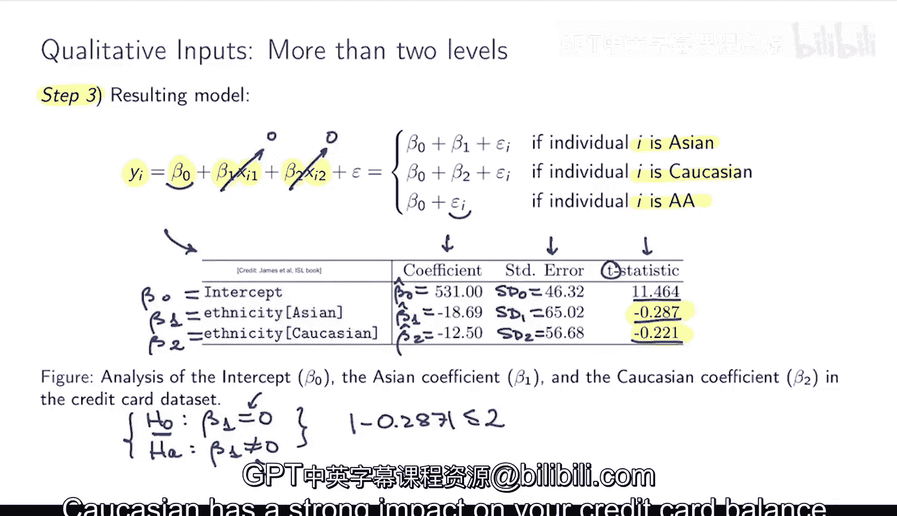

# 18：处理多类别分类输入 📊

在本节课中，我们将学习如何处理具有**两个以上类别**的分类变量作为线性模型的输入。我们将以“种族”为例，探讨如何将其编码并纳入模型，以分析其对信用卡余额的影响。

---

## 概述

上一节我们介绍了如何处理一个具有两个水平（例如，男/女）的分类变量。本节中，我们来看看当分类变量具有**三个或更多水平**时，应如何构建线性模型。我们将以种族（简化分为非裔美国人、亚裔、白种人）为例，演示完整的建模与分析步骤。

---

## 构建模型的具体步骤

以下是处理多类别分类变量的标准流程。

### 步骤一：选择基线类别

首先，我们需要从所有类别中选择一个作为**基线**或**参照组**。在本例中，我们选择“非裔美国人”作为基线。你可以选择集合中的任何标签作为基线，选择不同基线会影响模型系数的解释，但不会改变模型的整体预测。

### 步骤二：定义虚拟变量

对于一个具有 `K` 个类别的分类变量，我们需要创建 `K-1` 个**虚拟变量**。本例中有三个类别，因此需要创建两个虚拟变量。

我们为每个个体 `i` 定义两个虚拟变量：
*   `X_i1`：表示个体 `i` 是否为亚裔。
*   `X_i2`：表示个体 `i` 是否为白种人。

其赋值规则如下：
*   如果个体 `i` 是亚裔，则 `X_i1 = 1`，否则 `X_i1 = 0`。
*   如果个体 `i` 是白种人，则 `X_i2 = 1`，否则 `X_i2 = 0`。
*   如果个体 `i` 是非裔美国人（基线），则 `X_i1 = 0` 且 `X_i2 = 0`。

### 步骤三：建立线性模型

引入虚拟变量后，我们可以建立以下线性模型：

`Balance_i = β_0 + β_1 * X_i1 + β_2 * X_i2 + ε_i`

其中：
*   `Balance_i` 是个体 `i` 的信用卡余额。
*   `β_0` 是截距。
*   `β_1` 和 `β_2` 是模型参数，分别衡量亚裔和白种人相对于基线（非裔美国人）对余额的平均影响。
*   `ε_i` 是随机误差项。

这个模型会根据个体 `i` 的种族分化为三种情况：
1.  如果个体 `i` 是亚裔 (`X_i1=1， X_i2=0`)：`Balance_i = β_0 + β_1 + ε_i`
2.  如果个体 `i` 是白种人 (`X_i1=0， X_i2=1`)：`Balance_i = β_0 + β_2 + ε_i`
3.  如果个体 `i` 是非裔美国人 (`X_i1=0， X_i2=0`)：`Balance_i = β_0 + ε_i`

这里，`β_0` 代表了基线类别（非裔美国人）的平均信用卡余额估计值。

---

## 模型估计与假设检验

使用真实数据集对模型进行拟合后，我们可以得到参数估计值，并评估其统计显著性。

### 参数估计结果

以下是模型拟合后可能得到的输出表格示例：

| 系数 | 估计值 | 标准误 | t 统计量 |
| :--- | :--- | :--- | :--- |
| 截距 (β_0) | β̂_0 | SE(β̂_0) | t_0 = β̂_0 / SE(β̂_0) |
| 亚裔 (β_1) | β̂_1 | SE(β̂_1) | t_1 = β̂_1 / SE(β̂_1) |
| 白种人 (β_2) | β̂_2 | SE(β̂_2) | t_2 = β̂_2 / SE(β̂_2) |

*   **估计值**：参数 `β` 的点估计。
*   **标准误**：衡量估计值的不确定性。
*   **t 统计量**：用于检验系数是否显著不等于零。

### 进行假设检验

我们可以针对每个系数提出研究问题，并通过假设检验来寻找答案。例如，要检验“身为亚裔是否对信用卡余额有影响”，可以设立以下假设：

*   **原假设 H₀**: `β_1 = 0` （身为亚裔对信用卡余额无影响）
*   **备择假设 H₁**: `β_1 ≠ 0` （身为亚裔对信用卡余额有影响）

**决策规则**：通常，如果 `t` 统计量的绝对值大于 2（近似对应 5% 的显著性水平），我们就有足够的证据拒绝原假设，认为该效应是统计显著的。

**结果解读**：
*   如果 `|t_1| ≤ 2`，如上例所示，则我们不能拒绝原假设。这意味着**没有强有力的统计证据表明身为亚裔会对信用卡余额产生显著影响**。
*   同理，如果 `|t_2| ≤ 2`，我们也不能拒绝 `β_2 = 0` 的原假设。即，**没有强有力的统计证据表明身为白种人会对信用卡余额产生显著影响**。

---

## 总结

本节课中我们一起学习了如何处理具有多个水平的分类变量。核心步骤包括：**选择基线类别**、**创建虚拟变量**、**将其纳入线性模型**，以及**通过假设检验解读系数的统计显著性**。我们了解到，当某个类别对应的 `t` 统计量绝对值较小时，意味着该类别与基线组之间的差异在统计上并不显著。这种方法使我们能够系统性地评估多个分类属性对连续结果变量的影响。