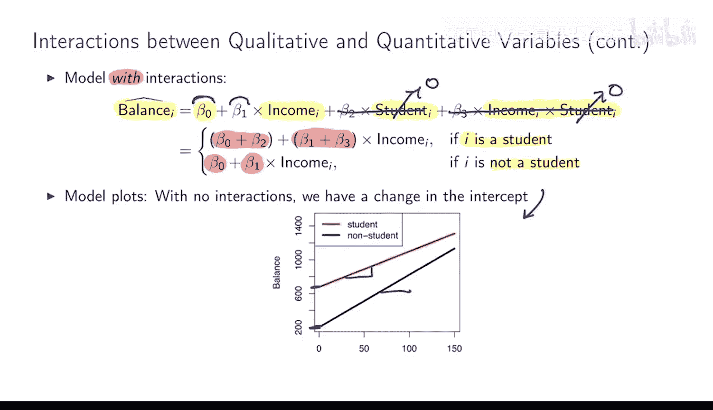

# 20：交互项

在本节课程中，我们将学习一种在回归模型中引入非线性效应的方法：**交互项**。我们将探讨如何通过创建新的人工变量来捕捉两个或多个预测变量之间的协同效应，并理解其在模型中的意义。

上一节我们介绍了处理非线性关系的基本方法。本节中，我们来看看如何通过引入**交互项**来建模变量之间的相互作用。

## 交互项的概念与应用

我们回到之前见过的一个数据集，其中分析了200个不同的营销活动。对于每个活动，我们将输出变量**销售额**视为电视广告和广播广告的函数。在这个模型中，我们只考虑两个输入变量。

**注意**：这个模型假设电视广告和广播广告的效果是彼此独立的。然而，在实际情况中，广播广告可能会提高电视广告的效果。

在统计学中，变量之间的这种协同效应被称为**交互作用**。我们可以通过创建新的人工变量来分析和建模这种效应，如下方公式所示。

**核心模型公式**：
`销售额 = β₀ + β₁ * TV + β₂ * Radio + β₃ * (TV * Radio)`

在这个特定模型中，除了原始变量TV和Radio，我们还添加了一个人工变量，它考虑了电视广告和广播广告投入的**乘积**。

事实证明，使用我们之前介绍的线性回归工具，我们可以从数据中估计出 β₁、β₂ 和 β₃ 的值。本质上，TV被视为第一个输入变量，Radio是第二个，而 `TV * Radio` 被视为第三个输入变量。我们暂时忽略这第三个变量是TV和Radio乘积构成的人工变量这一事实。

利用这种抽象，我们可以执行线性拟合。具体来说，对于每个营销活动：
*   输出变量 `y_i` 是该活动产生的销售额。
*   输入向量 `X_i` 是一个 `p=3` 维的向量，包含三个特征：电视广告投入、广播广告投入以及这两个值的乘积。

## 模型结果解读

在下表中，我们可以找到线性回归得到的系数。

以下是回归系数表：
*   第一列：估计的系数值 `β_hat`。
*   第二列：系数的标准误差。
*   第三列：t统计量。

注意，所有t统计量的绝对值都大于2。因此，所有被视为输入的项都与输出相关。换句话说，任何假设这三个输入中有一个不相关的检验都会被拒绝。

通俗地讲，这告诉我们广播广告和电视广告之间的**交互作用**是一个重要因素。

## 使用交互项的注意事项：层级原则

在使用交互项时，有一个重要原则需要牢记，即**层级原则**。

层级原则告诉我们：如果模型中包含了一个交互项（例如 `TV * Radio`），那么即使t统计量显示这些项不显著，我们也应该同时包含构成该交互项的**主效应项**（即TV和Radio）。

例如，在我们之前看到的表中，每当交互项 `TV * Radio` 是重要的，其主效应项TV和Radio也必须包含在模型中，即使它们的t统计量小于2。这个原则的原因是，如果没有主效应项，交互项将难以解释。

## 定性与定量变量的交互

现在，我们来看一个包含**定性变量**和**定量变量**之间交互作用的案例。

考虑一个预测个人信用卡余额的问题，输入变量包括一个定量变量（如收入）和一个定性变量（如是否是学生）。变量“学生”有两个水平（是/否），变量“收入”是一个实数。

**1. 无交互项的模型**

我们可以建立一个不考虑交互作用的模型，将收入和“学生”状态作为两个独立变量。在这种情况下，模型如下：

**核心模型公式**：
`余额_i = β₀ + β₁ * 收入_i + β₂ * 学生_i`

其中，如果个体i是学生，则 `学生_i = 1`，否则为0。

这个模型会 bifurcate（分叉）成两种情况：
*   当个体是学生时（`学生_i = 1`），模型为：`余额 = (β₀ + β₂) + β₁ * 收入`
*   当个体不是学生时（`学生_i = 0`），模型为：`余额 = β₀ + β₁ * 收入`

我们可以绘制这两条回归线。注意，这两条线的**斜率完全相同**（都是β₁），但**截距不同**。这告诉你，如果你是学生，你的回归函数会在非学生的基础上增加一个值β₂，但这两条线是平行的。

**2. 包含交互项的模型**

现在考虑包含交互项的模型。在这种情况下，个体i的余额计算如下：

**核心模型公式**：
`余额_i = β₀ + β₁ * 收入_i + β₂ * 学生_i + β₃ * (收入_i * 学生_i)`

同样，这个模型也分为两种情况：
*   如果个体i是学生（`学生_i = 1`），模型简化为：`余额 = (β₀ + β₂) + (β₁ + β₃) * 收入`
*   如果个体i不是学生（`学生_i = 0`），模型简化为：`余额 = β₀ + β₁ * 收入`

与之前一样，我们可以比较这些模型的斜率和截距。特别地，**截距会改变**，而且在这个案例中，**斜率也会改变**。不仅截距增加了β₂，斜率也改变了β₃。

在下图中，我们看到学生和非学生的回归线不仅**截距不同**，**斜率也不同**。

## 总结

本节课中，我们一起学习了**交互项**在回归分析中的应用。我们了解到：
1.  交互项可以捕捉预测变量之间的协同效应，为模型引入非线性。
2.  通过将变量的乘积作为新特征加入，可以使用线性回归工具进行拟合和解释。
3.  必须遵循**层级原则**：当模型中包含交互项时，应同时包含其对应的主效应项。
4.  交互项不仅适用于两个定量变量之间，也适用于定性与定量变量之间，这允许不同组别的回归线拥有不同的斜率和截距。

至此，我们完成了线性回归主题的学习。下周，我们将开始一个全新的主题：**分类**。