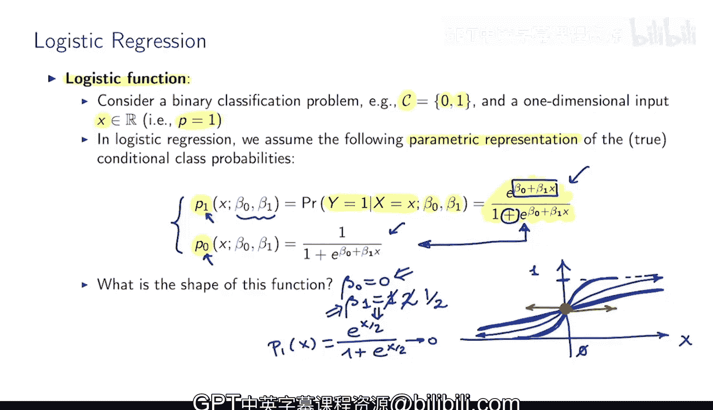

# 26：逻辑回归 📊

在本节课中，我们将要学习一种重要的参数化模型——逻辑回归。我们将探讨其核心函数形式、参数含义以及函数形状如何随参数变化。

## 概述

上一节我们介绍了维数灾难如何阻碍我们使用局部方法准确估计数据集的类别条件概率。因此，我们需要转向参数化模型。逻辑回归就是其中一种重要的参数化模型。

## 逻辑函数模型

在逻辑回归中，我们考虑一个二元分类问题，类别为 C0 和 C1。目前，我们假设输入是一维的，即 `p = 1`，因此输入只是一个标量值。

类别条件概率的具体参数化表示如下：

*   给定输入 `x`，标签为 1 的概率是一个由参数 `β0` 和 `β1` 参数化的函数，其表达式如下：
    `P(Y=1 | X=x) = e^(β0 + β1*x) / (1 + e^(β0 + β1*x))`
    我们称此函数为 `P1`，即类别 1 的条件概率。

*   类别 0 的条件概率表达式与 `P1` 类似，但分子为 1：
    `P(Y=0 | X=x) = 1 / (1 + e^(β0 + β1*x))`

你应该意识到，输出为 1 的概率加上输出为 0 的概率之和应为 1，因为这是仅有的两种可能输出。你可以验证，这两个条件概率函数之和确实为 1。

## 函数形状分析

这个函数被称为 **Sigmoid 函数**。我们可以通过观察一些具体例子来研究其形状。

首先，为简化分析，假设 `β0 = 0`，`β1 = 1`。此时，Sigmoid 函数为：
`P1(x) = e^x / (1 + e^x)`

现在，我们来看 `P1(x)` 作为 `x` 的函数时的形状：

*   当 `x = 0` 时，`e^0 = 1`，所以 `P1(0) = 1 / (1 + 1) = 1/2`。
*   当 `x` 趋近于正无穷时，`e^x` 也趋近于正无穷，分母中的 `e^x` 将主导常数 1，因此函数值渐近地趋近于 1。
*   当 `x` 趋近于负无穷时，`e^x` 趋近于 0，因此函数值渐近地趋近于 0。

所以，我们得到一个从 0 增长到 1 的 S 形曲线，这也是“Sigmoid”（源自希腊字母 Sigma）一词的由来。

## 参数的影响

接下来，我们看看参数 `β1` 和 `β0` 如何改变这个函数的形状。

**改变 `β1` 的值：**

*   如果将 `β1` 从 1 增加到 2，函数 `P1(x)` 的 S 形曲线会变得更陡峭。这实质上加速了函数的增长和下降速率。
*   相反，如果将 `β1` 减小到 0.5（即小于 1），函数 `P1(x)` 的 S 形曲线会变得更平缓，增长速率会慢得多。

因此，通过改变 `β1` 的值，我们可以调节 Sigmoid 函数的增长速率。

**改变 `β0` 的值：**

参数 `β0` 的作用是使整个 Sigmoid 函数曲线在水平方向上左右平移。

综上所述，两个参数 `β0` 和 `β1` 共同作用，使我们能够：
1.  调节 Sigmoid 函数的增长速率。
2.  将 Sigmoid 函数曲线向左或向右平移。

## 总结

本节课中，我们一起学习了逻辑回归的核心——Sigmoid 函数。我们了解了其数学表达式，并分析了参数 `β0`（控制平移）和 `β1`（控制曲线陡峭度）如何影响这个 S 形函数的形状。这为我们理解逻辑回归模型如何对数据进行分类奠定了基础。