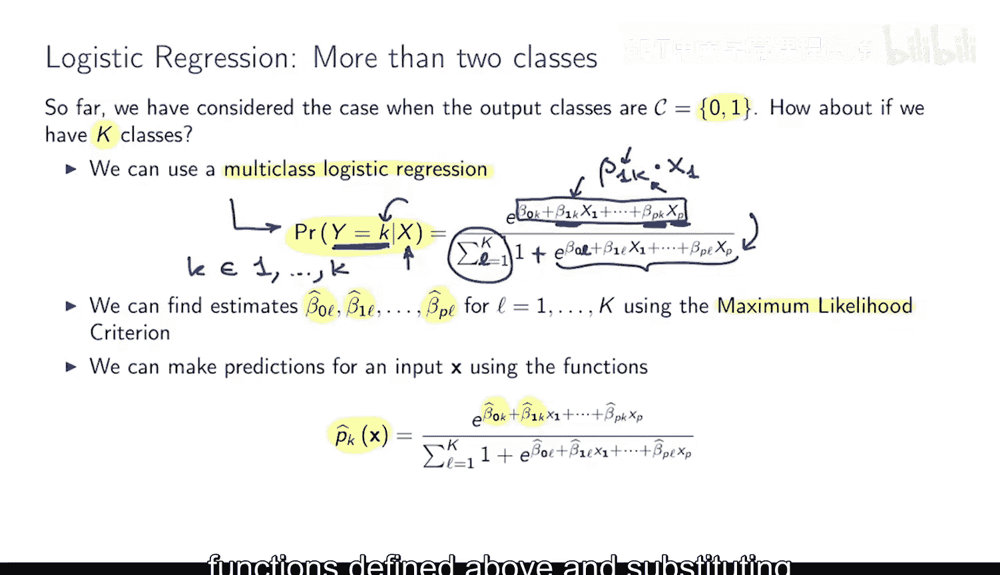

# 29：多类别逻辑回归

在本节课中，我们将要学习逻辑回归的扩展形式——多类别逻辑回归。我们将探讨当输出类别超过两个时，如何对模型进行建模和参数估计。

## 概述

到目前为止，我们学习的逻辑回归仅适用于两个输出类别的情况，这被称为二元分类设置。然而，在许多实际场景中，我们会遇到K个不同的类别，其中K通常大于2。在这种情况下，我们可以使用多类别逻辑回归。

## 多类别逻辑回归模型

上一节我们介绍了二元逻辑回归，本节中我们来看看当类别数量K大于2时，模型形式如何变化。

多类别逻辑回归使用以下参数化形式来表示条件类别概率。具体来说，输出等于标签k（k可以从1到K）的概率，在给定输入x的条件下，由以下公式给出：

$$
P(Y=k | X=x) = \frac{e^{\beta_{0k} + \beta_{1k}x_1 + ... + \beta_{pk}x_p}}{\sum_{l=1}^{K} e^{\beta_{0l} + \beta_{1l}x_1 + ... + \beta_{pl}x_p}}
$$

请注意，在这个特定情况下，参数β有两个下标：β_{pk}。第一个下标p表示该β值对应于第p个输入变量。第二个下标k表示这个β_{pk}对应于类别k的条件概率。

因此，对于每个类别k，我们有一组参数：β_{0k}, β_{1k}, ..., β_{pk}，其中β_{pk}是变量x_p的权重。

在分母中，我们对所有可能的类别（从1到大写K）进行求和，求和项是与分子形式相同的指数项，但对应于类别l。

## 参数估计与预测

在这个模型设定下，我们仍然可以使用最大似然估计法来估计未知参数β_hat。这在形式上与我们之前看到的二元逻辑回归是等价的。

以下是参数估计与模型应用的核心步骤：

1.  **参数估计**：使用训练数据和最大似然估计法，计算出所有类别对应的参数估计值β_hat。
2.  **概率计算**：一旦获得了β_hat的值，我们就可以通过将上述条件类别概率函数中的β替换为β_hat，来构建条件类别概率的估计。
3.  **类别预测**：对于一个新的输入x，我们计算它属于每个类别k的概率P(Y=k|X=x)，然后将概率最高的类别作为预测结果。

## 总结

本节课中我们一起学习了逻辑回归技术的最后一部分——多类别逻辑回归。我们了解了当分类问题中存在两个以上类别时，如何扩展逻辑回归模型。该模型通过为每个类别定义一组参数，并使用Softmax函数来确保所有类别的预测概率之和为1。模型的参数同样可以通过最大似然估计法进行学习，并用于对新样本进行类别预测。