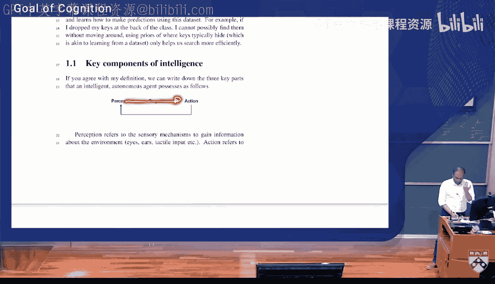
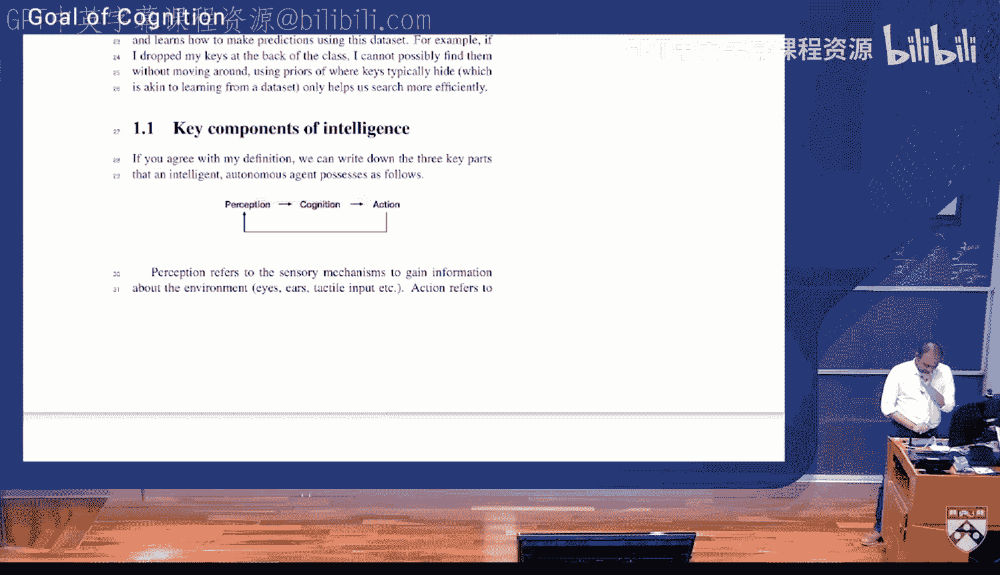
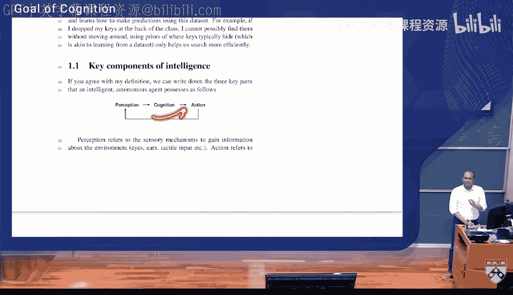
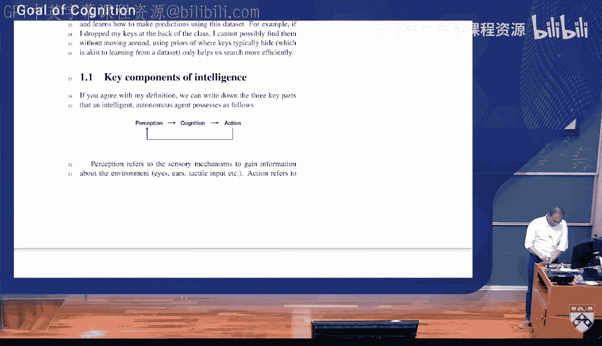

# 05：认知的目标 🎯

在本节课中，我们将探讨学习和认知的核心目标，理解为什么在资源有限的情况下，学习对于智能体至关重要。

上一节我们讨论了智能体的基本概念，本节中我们来看看学习和认知的根本目的。

## 学习的必要性：从“超级智能体”说起

我想强调的第二点是协调或学习的目标。为了让你理解这一点，让我举一个例子。

想象你是一个“超级智能体”。这个智能体拥有无限快的速度、无限的智慧，并且在性能上没有任何限制。现在，你正在驾驶一辆汽车。为了理解如何驾驶汽车，你必然需要知道你周围其他汽车会做什么。

“超级智能体”并不觉得这是个问题，因为对于其他汽车可能做的每一件小事，它都能在脑海中非常快速地模拟出它们将要做什么，并采取必要的行动。例如，当你在车道上行驶时，如果有一辆车要插到你前面，“超级智能体”能精确地知道将会发生什么，因为它以无限快的速度感知到了，并且它精确地知道它应该稍微踩一下刹车。

所以，如果你在所能进行的计算类型上没有限制，如果你在所能获得的刺激或感知类型上没有限制，那么你就不需要任何学习。因为你可以直接使用你的刺激并采取行动，而无需总结这些刺激，也无需使用过去的知识。

## 学习的核心目标：总结与效率

因此，我们使用学习的原因，是因为我们希望使这个过程更有效率。我们希望在当前的观察与过去的观察相似时，能够理解这种相似性，然后基本上重复我们过去采取的那些行动。因为我们无法像“超级智能体”那样快速地模拟事物，也无法像“超级智能体”那样高效地计算事物。

所以，学习归根结底是一个总结过去经验，并利用这种总结来采取当前行动的过程。它本质上是你所采取行动的一种**先验**。

仅仅因为昨天有辆车插了你的队，并不意味着那辆车今天也会插你的队。这就是为什么你今天不应该因为这个原因而刹车——你应该根据你现在接收到的观察来刹车。学习提供了一种先验，例如，它使得“驾驶野马汽车的人通常喜欢插队”这种可能性增加。这些正是我们将要从过去数据和经验中学习的先验类型。

## 机器学习算法的本质：输出先验

因此，一个运行算法的机器，并不是直接给你输出。它给你的是关于输出的一个**先验**。你实际采取的输出或行动，取决于你当前的观察是什么。

这与一个国际象棋程序非常不同。国际象棋程序对状态有非常清晰的概念，它不需要过多依赖于这种“给定状态应该采取什么行动”的推理，其行动是确定性的。

以下是机器学习与“超级智能体”直接计算的关键区别：

*   **资源有限性**：我们无法进行无限快、无限复杂的计算。
*   **学习的角色**：学习是对过去经验的**总结**，用于提高当前决策的效率。
*   **先验知识**：学习的结果是形成**先验**，它影响但**不直接决定**当前行动。
*   **决策流程**：最终行动 = **当前观察** + 从学习中获得的行为**先验**。

本节课中我们一起学习了认知和学习的目标。我们通过“超级智能体”的例子认识到，学习之所以必要，是因为现实中的智能体（包括人类和机器）都受到计算和感知资源的限制。学习的核心是**总结过去经验**以形成**先验知识**，从而提高在面临新情况时的决策效率，而非直接给出答案。理解这一点是区分简单程序与具备学习能力的智能系统的关键。