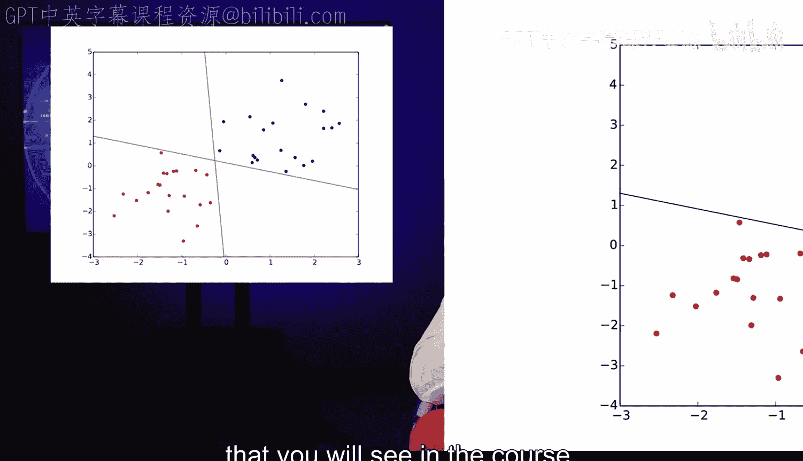

# 12：引言-感知机-随机梯度下降-核方法

在本节课中，我们将要学习机器学习中的几个核心概念：感知机、随机梯度下降以及核方法。我们将从最简单的线性分类模型开始，逐步深入到更复杂的非线性分类技术。

## 感知机：第一个神经网络 🧠

上一节我们介绍了线性回归，本节中我们来看看感知机。感知机是你在本课程中将会遇到的众多神经网络中的第一个。

它与线性回归非常相似。但感知机的目标不是用一条直线拟合一系列点，而是找到一条直线，将两组点分开。这条直线的一侧是所有红色点，另一侧是所有蓝色点。

感知机是1958年在康奈尔大学建造的第一个人工网络。正如其建造者弗兰克·罗森布拉特所说，这是第一台能够产生原创想法的机器。

感知机的核心思想是找到一个线性决策边界。其基本公式可以表示为：

**`y = sign(w·x + b)`**

其中，`w`是权重向量，`x`是输入特征，`b`是偏置项，`sign`是符号函数，输出+1或-1代表不同的类别。

## 随机梯度下降：优化学习过程 📉

理解了感知机的目标后，我们需要一种方法来找到那条最优的分离直线。这就是随机梯度下降的用武之地。

随机梯度下降是一种优化算法，用于最小化模型的误差（或损失函数）。与标准的梯度下降每次迭代使用全部数据计算梯度不同，SGD每次只随机选取一个（或一小批）样本来更新模型参数，这使得它在处理大规模数据时效率更高。

以下是其参数更新过程的核心步骤：

1.  **初始化参数**：随机初始化权重`w`和偏置`b`。
2.  **循环迭代**：对于训练集中的每个样本（或小批量样本）：
    *   计算当前样本的预测值。
    *   计算预测值与真实标签之间的误差（损失）。
    *   计算损失函数关于参数`w`和`b`的梯度。
    *   沿梯度反方向更新参数：**`w = w - η * ∇w`**, **`b = b - η * ∇b`**。其中`η`是学习率，控制更新步长。
3.  **重复**：直到损失函数收敛或达到预设的迭代次数。

## 核方法：处理非线性问题 ✨

上一节我们介绍了用直线（线性模型）进行分类的感知机。然而，现实世界中的数据往往不是线性可分的。本节中我们来看看核方法如何解决这个问题。

核方法是能够以更复杂的方式分离两组点的技术。想象一条蜿蜒的曲线，它穿过散布的红点和蓝点，但始终将红点保持在其左侧，蓝点保持在其右侧。这比一条直线要复杂得多。核方法构建的模型比线性模型更复杂。

核方法的精髓在于“核技巧”。它通过一个映射函数`φ`，将原始低维空间中的数据点`x`映射到高维特征空间。在高维空间中，原本非线性可分的数据可能变得线性可分。感知机等线性模型就可以在这个新空间中找到分离超平面。

我们无需显式计算复杂的高维映射`φ(x)`，只需计算原始空间中数据点的核函数`K(x_i, x_j)`，其等价于高维空间中的内积`φ(x_i)·φ(x_j)`。常用的核函数包括：

*   **线性核**：`K(x_i, x_j) = x_i·x_j`
*   **多项式核**：`K(x_i, x_j) = (x_i·x_j + c)^d`
*   **径向基函数核**：`K(x_i, x_j) = exp(-γ * ||x_i - x_j||^2)`

## 总结

本节课中我们一起学习了机器学习中三个紧密相连的基础概念。我们从**感知机**开始，认识了第一个能够进行线性分类的神经网络模型。为了训练这个模型，我们引入了**随机梯度下降**算法，它通过迭代更新参数来高效地最小化误差。最后，为了突破线性模型的限制，我们探讨了**核方法**，它利用核技巧将数据映射到高维空间，从而巧妙地处理了非线性分类问题。这些概念为理解更复杂的现代神经网络和深度学习模型奠定了重要的基础。