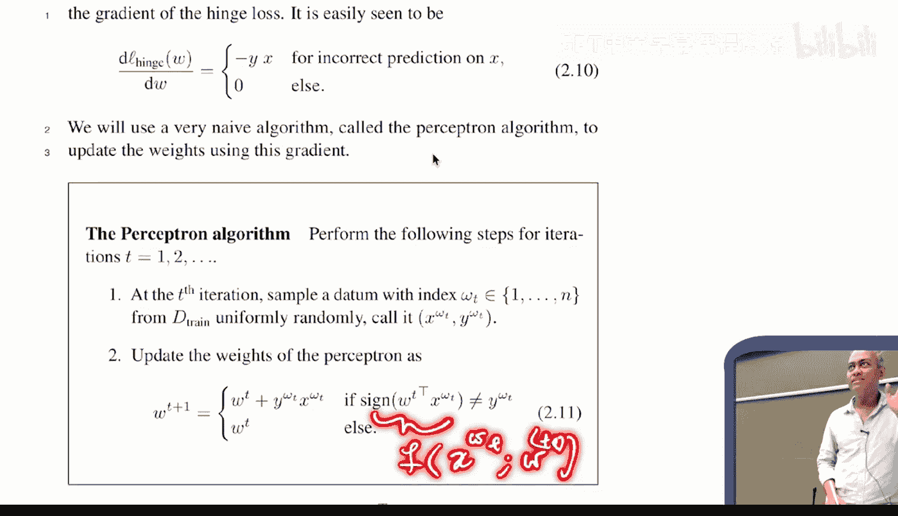
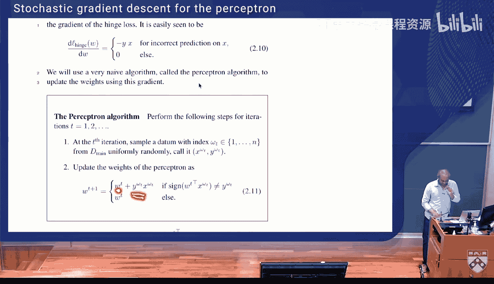
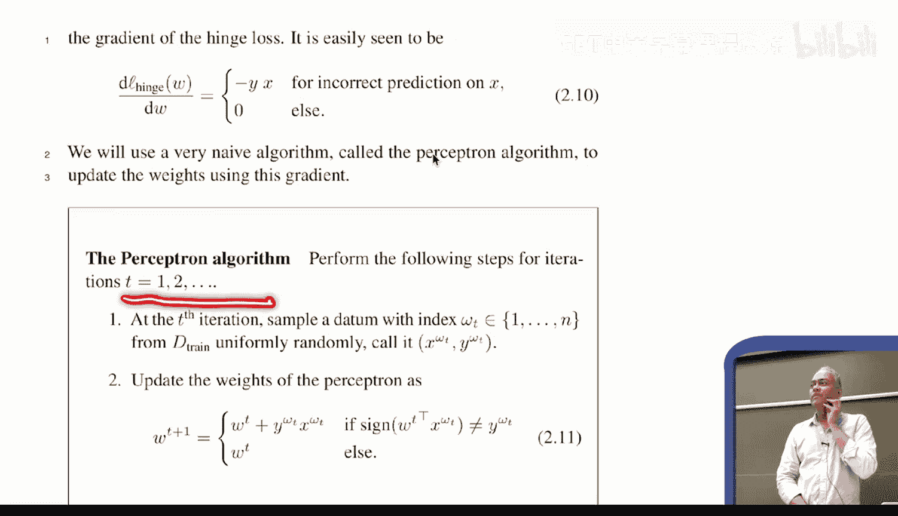
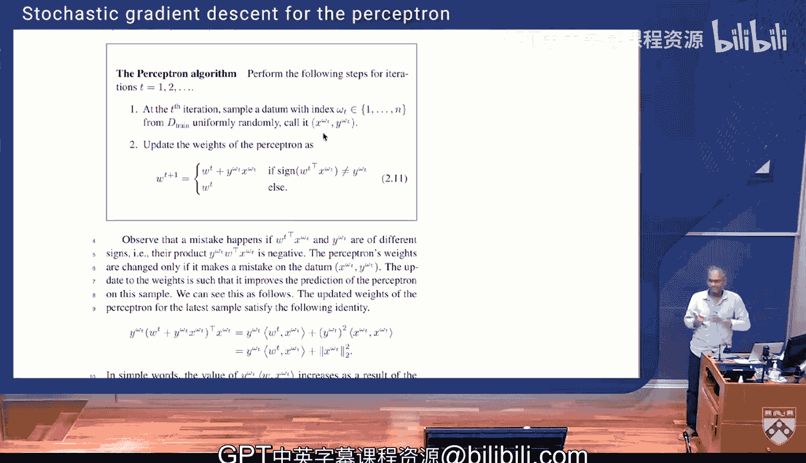

# 14：感知机的随机梯度下降 - 第二部分 🧠

在本节课中，我们将要学习如何利用随机梯度下降算法来训练感知机模型。我们将深入探讨算法的具体更新规则、其背后的直观理解，以及算法在何种条件下会收敛。

上一节我们介绍了感知机的损失函数，本节中我们来看看如何通过梯度下降来最小化这个损失。

我们知道，逻辑损失函数在原点右侧为零，在原点左侧为负。如果感知机对一个样本的预测正确，那么它很可能位于原点右侧，此时损失为零，损失函数关于权重 **W** 的导数也为 **0**。如果感知机预测错误，那么它很可能位于原点左侧，此时损失函数的导数是多少呢？是 **-y * x**。

这为我们提供了一个非常自然的训练感知机的算法。以下是其工作原理：

你拥有你的数据。在每一次迭代中（你会进行很多次迭代），首先初始化感知机的权重，例如初始化为 **0**。在第 **t** 次迭代时，你从训练数据（假设有 **n** 个样本）中随机、均匀地抽取一个样本。我们称这个样本为 **x_ω_t, y_ω_t**。

你在这个样本上运行感知机。如果感知机预测正确，你完全不改变权重。如果感知机预测错误（可以通过比较真实标签 **y_ω_t** 和感知机的预测 **sign(W_t * x_ω_t)** 来检查），这意味着我们位于原点左侧。

现在，我将按照负梯度的方向更新我的旧权重。我们知道合页损失函数是这样的：如果我将权重稍微向右移动，就能稍微减少在这个样本上的损失，从而可能对这个新样本做出稍好的预测。

所以我取我的旧权重 **W_t**，这个梯度是 **y_ω_t * x_ω_t**，然后将它们相加。这意味着我在旧权重的基础上向右移动了一点，从而改进了在这个特定样本上的损失。

正如她所说，我不必按照梯度的精确幅度移动，我可以移动 **0.5 * y * x** 或 **0.1 * y * x**。通常，我可以相对于某个标量常数（我们称之为学习率 **η**）乘以梯度来移动。在这个表达式中，我将学习率设为 **1**，所以暂时不用担心它。假设我们向右移动一个单位的梯度。

是否每个人都清楚，这样移动权重会改善感知机的误差？如果你位于非常靠近原点的位置，那么像这样移动会将你带到原点的右侧，现在你在更新后就能正确分类那个特定样本了。

这样的移动会改善感知机在其他样本上的性能吗？一个稍微简单的说法是：权重 **W** 是一个向量，对于所有样本都是相同的权重。我们改进了在这个特定样本上的性能，它也会改善在相似样本上的性能。假设还有其他样本也处于这个损失水平，一旦我们将权重稍微向右移动，那些样本的性能也会自动改善。

但也可能存在一些样本位于原点右侧，当你将权重向右移动时，它们的误差反而会恶化。对一个样本正确的权重，对另一个样本可能并不正确。因此，感知机从数据中均匀随机地采样一个样本和标签时，它改进了在该样本上的性能。这可能会改善其他一些样本的性能，也可能会恶化另一些样本的性能，但关键在于这个过程会无限进行下去。

这个过程会停止吗？我们将讨论线性可分数据的含义。粗略的理解是：如果存在一个 **W***，使得感知机在训练数据集上的误差为 **0**（即所有样本都被正确分类），那么这个方法将找到那个 **W***。这是一个我们稍后会做的简单证明，这就是数据集线性可分的含义：如果存在一个解，你将在有限次迭代后找到它，从而停止这种误差的来回震荡。

如果不存在这样的 **W***（例如，所有橙子在这里，所有苹果在这里，但橙子和苹果的点云有重叠），那么就不存在一个能干净地分隔这两个点云的 **W***。在这种情况下，感知机将像这样在误差之间持续震荡，永远不会停止。

这被称为感知机算法，也是弗兰克·罗森布拉特在60年代实现的。我们将以一个稍微不同的名字来认识它：随机梯度下降。

它被称为随机梯度下降，因为我们在每次迭代中使用梯度来更新权重。它被称为“随机”梯度下降，因为我们从整个数据中选取一个特定样本来计算梯度，并且仅使用该样本来更新权重。因此，当我们更新一次权重时，我们并不确切知道这对所有其他样本做了什么，我们只知道它对这一个特定样本做了什么。这里存在某种随机性，因为我们随机选择想要改进的样本。我们将更深入地探讨这一点，但就目前而言，这是我们实现随机梯度下降最简单的方式。

正如你所见，这并不复杂。只要你有一个可以求导的目标函数，并且有一个可以均匀采样的数据集，你就可以实现随机梯度下降。这就是为什么它既是最简单的方法，也是最通用的方法。

---

本节课中我们一起学习了感知机的随机梯度下降算法。我们理解了算法的核心更新规则：当预测错误时，按照 **W_new = W_old + y * x** 的规则更新权重。我们探讨了算法在数据线性可分时会收敛到解，在非线性可分时会持续震荡。最后，我们认识到这个简单算法是更广泛的随机梯度下降方法的一个具体实例，其核心思想是通过随机采样单个样本的梯度来迭代优化模型参数。