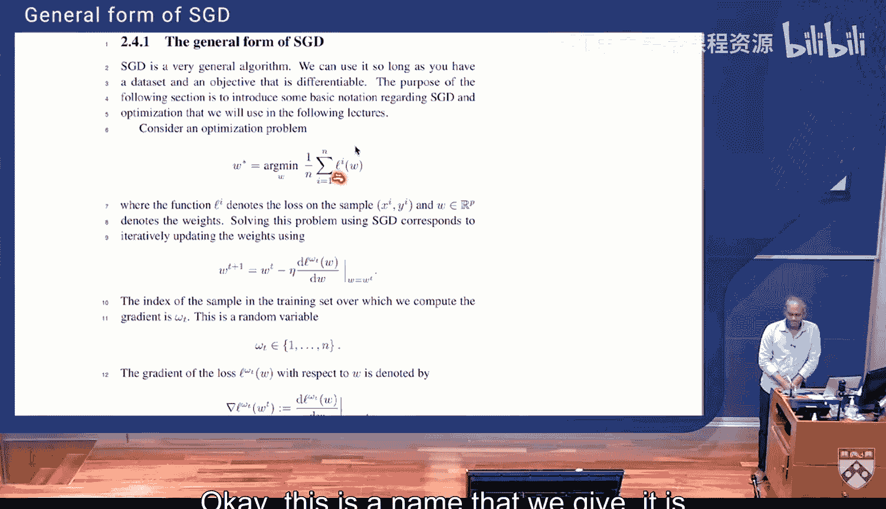
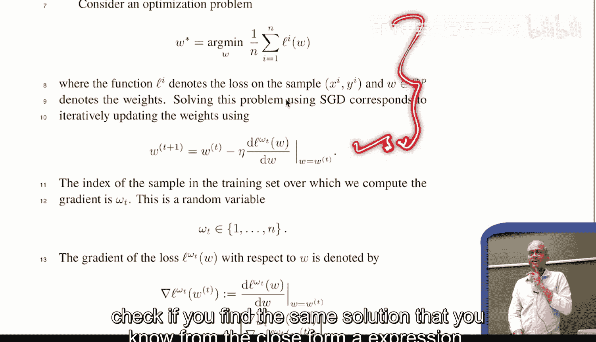
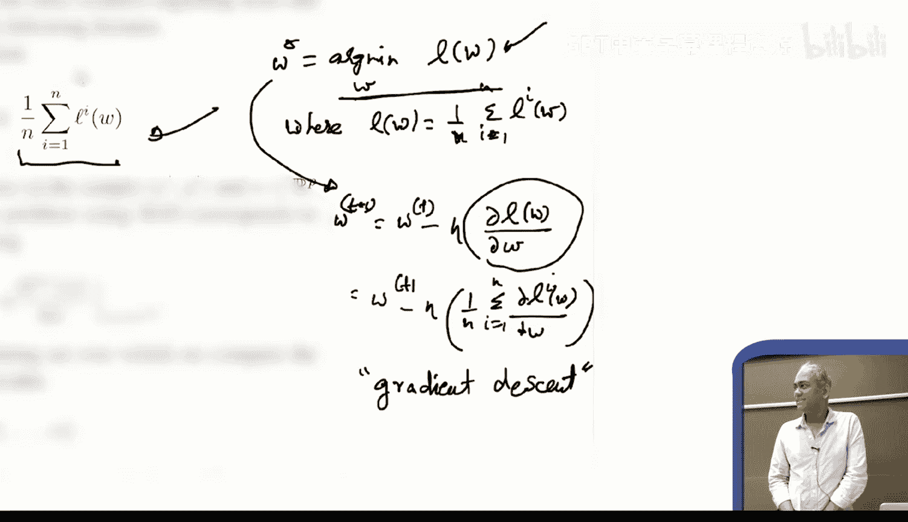
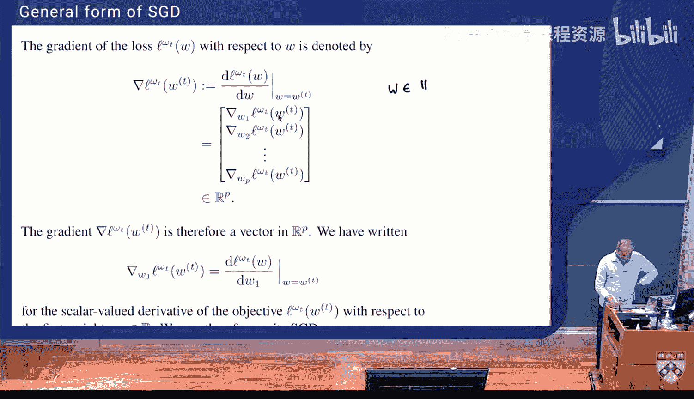
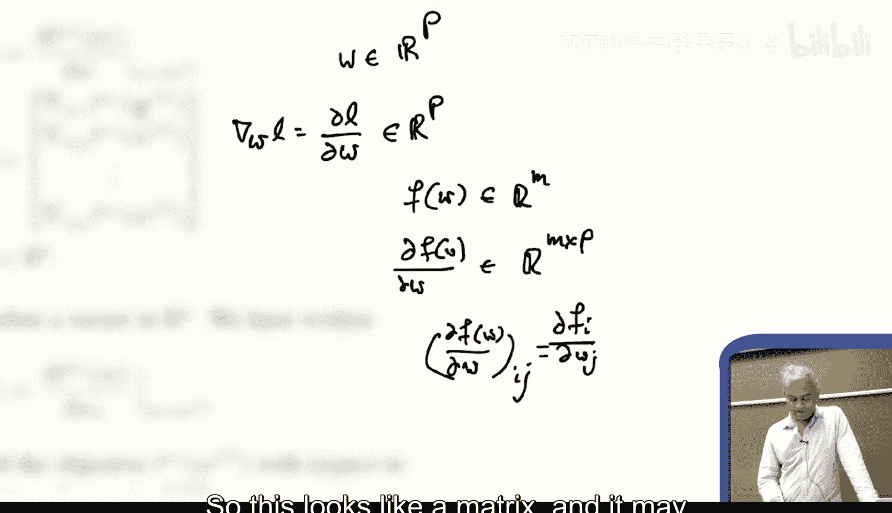
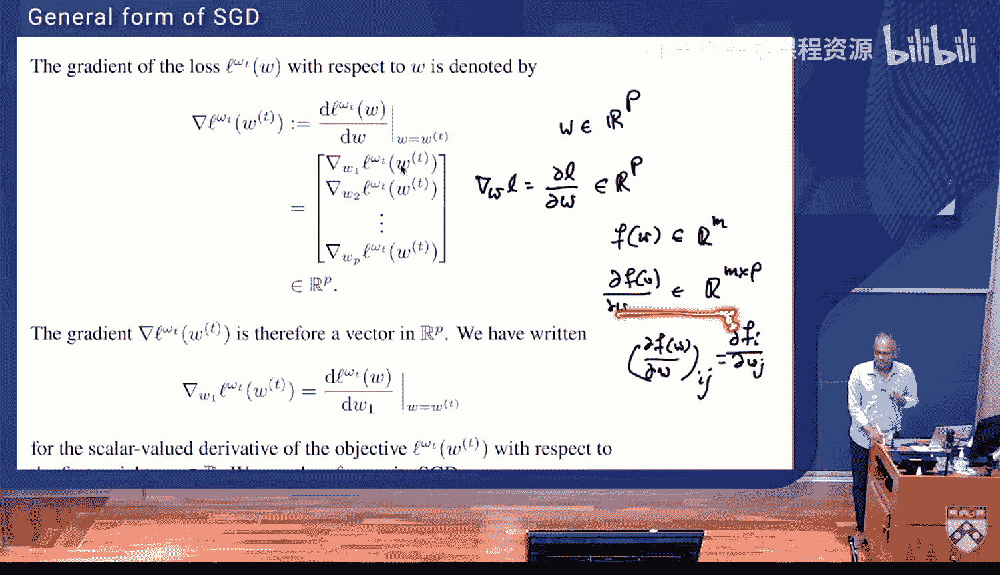

# 16：SGD的通用形式 🎯

在本节课中，我们将学习如何用更通用的语言重写随机梯度下降（SGD），并理解其在拟合机器学习模型中的核心作用。我们将从定义损失函数开始，逐步推导出SGD和梯度下降（GD）的更新公式，并解释其中的关键概念。

---

## 概述

我们将讨论如何用更通用的语言重写优化过程，并在后续课程中沿用此形式。给定任何我们希望求解的目标函数，都可以应用此方法。

假设 **L⁽ⁱ⁾** 是模型在数据集中第 i 个样本上的某种损失。这是我们赋予它的名称。它是你选择的某种替代损失函数。

拟合我们的机器学习模型，等同于最小化整个数据集上的平均损失。我们希望找到能最小化此目标函数的 **W***。

我们假设此目标函数是可微的，因此可以对 **L⁽ⁱ⁾** 关于权重 **W** 求导。

---

## 随机梯度下降（SGD）的引入

这便将我们引向了SGD。在每次迭代中，我们可以从数据集中均匀随机地采样一个样本。我们有一个权重 **wₜ**（我用括号表示这是第 t 次迭代的权重）。

在每次迭代中，我们随机采样一个样本，称其索引为 **ωₜ**。我们计算该特定损失在当前权重向量 **wₜ** 下关于 **w** 的导数，然后沿着负梯度的方向更新权重向量 **wₜ**。

通常，我们不会简单地用一个单位的梯度来更新权重，而是用一个标量参数 **η** 来缩放梯度。**η** 被称为学习率，它大于 0。你稍后会明白它为何重要，但目前它只是我们应用于梯度的一个缩放因子。这就是SGD。

**wₜ₊₁ = wₜ - η * ∇L⁽ωₜ⁾(wₜ)**

这两个公式在某种意义上是一种非常通用的拟合模型的方法。任何时候，只要你有一个具有合理损失函数的模型和一个包含 n 个样本的数据集，你都可以运行这个方法来拟合模型。

我们已经为感知器模型这样做了。如果你好奇，可以回家为线性回归尝试这个方法。你知道线性回归的解析解，你可以为线性回归运行这个方法，并检查是否能得到与你已知的闭式解相同的答案。

你应该得到相同的答案。我们沿着负梯度的方向下降，因为函数的导数指向这个方向。你不必只选取一个特定样本 **ωₜ**，你可以选取10个样本，可以选取100个样本。通常，你可以选取整个数据集来计算梯度。

---

## 从SGD到梯度下降（GD）

我可以重写这个问题。我不必像上面那样写，我可以写成：**w*** 是 **arg min over w of L(w)**，其中 **L(w)** 是所有小损失的平均值。

现在，我可以用梯度下降（而不是随机梯度下降）来求解这个方程。在这个目标函数中没有求和的概念，我可以直接求导。

**wₜ₊₁ = wₜ - η * ∇L(wₜ)**

一系列函数之和的导数是什么？和的导数就是各个导数的和。因此，一堆量的平均值的导数就是所有这些量导数的平均值。

所以在这种情况下，上式等于 **wₜ - η * (1/n) * Σ ∇L⁽ⁱ⁾(wₜ)**。这被称为梯度下降（GD），而不是随机梯度下降，因为我们没有采样任何东西，而是取了所有样本并平均了梯度。😊

这是拟合感知器模型的另一种方法。你可以在家尝试，会发现它的效果稍差一些。

---

## 术语与重要概念

好的。所以，这只是一些术语或重写。如前所述，**ωₜ** 是一个随机变量，取值范围从1到n，它告诉我们从数据集中采样了哪个索引（哪个图像）。

传统上，将 **dL/dW** 写作 **∇L**，这只是同一量的不同名称。然而，需要记住的重要一点是：**标量关于向量的梯度是一个向量**。

损失是一个实数值。当你求损失关于权重的导数时，你是在问自己：如果我以某种方式扰动我的权重，这个标量会如何变化？如果你扰动权重的第一个元素，你会得到这一项，它是损失关于第一个权重的导数；如果你扰动第二个权重，你会得到这一项，它是损失关于第二个权重的导数，依此类推。因此，损失关于一组权重（即一个向量 **w**）的梯度也是一个向量。

这在现在看来非常简单，但当你实现反向传播时，我保证你们中有一半人会犯这个错误。简单来说，如果我们的权重是 **P** 维向量。

那么损失的导数也是一个 **P** 维向量。如果 **L** 是标量，这是成立的。如果 **L** 是一个向量会发生什么？我也可以求一个向量关于另一个向量的导数，结果将是一个矩阵。

所以，向量和矩阵的导数在某种意义上是非常简单的量。思考这个问题的唯一方式是：如果 **F(w)** 是一个取值在 **Rᵐ** 中的函数，那么 **dF(w)/dw** 是一个取值在 **Rᵐˣᵖ** 中的函数。这个函数的第 **ij** 个元素恰好是 **dFᵢ/dwⱼ**，即你函数（导数的分子）的第 **i** 个元素关于第 **j** 个权重的导数。

所以，这看起来像一个矩阵，可能看起来有点复杂，它是一个向量关于另一个向量的导数，但从根本上说，它只是所有小标量导数排列成的一个矩阵。

---

## 总结

在本节课中，我们一起学习了随机梯度下降（SGD）的通用数学形式。我们定义了基于单个样本的损失 **L⁽ⁱ⁾**，并说明了最小化平均损失是模型拟合的目标。我们推导了SGD的更新规则 **wₜ₊₁ = wₜ - η∇L⁽ωₜ⁾(wₜ)**，其中 **ωₜ** 是随机采样的索引。接着，我们通过考虑所有样本的平均损失，自然过渡到了梯度下降（GD）的更新规则 **wₜ₊₁ = wₜ - η∇L(wₜ)**。最后，我们强调了梯度的维度：**标量关于向量的梯度是一个同维度的向量**，而**向量关于向量的梯度是一个矩阵**，这是理解后续算法实现的关键基础。