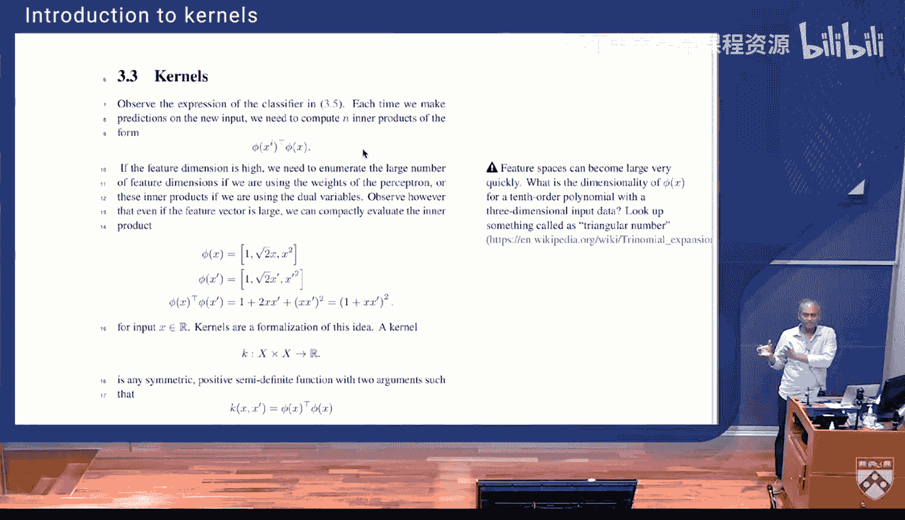
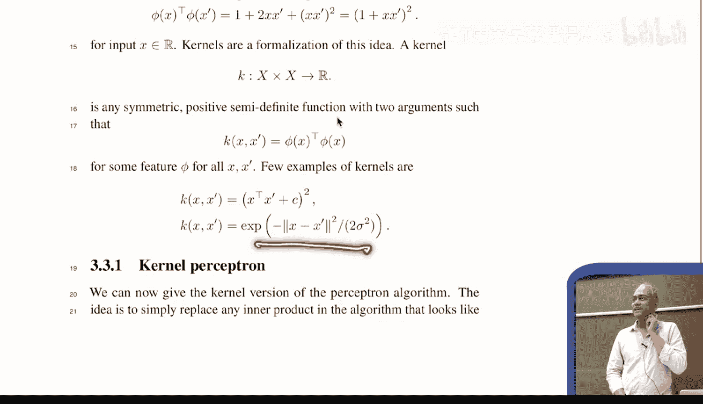
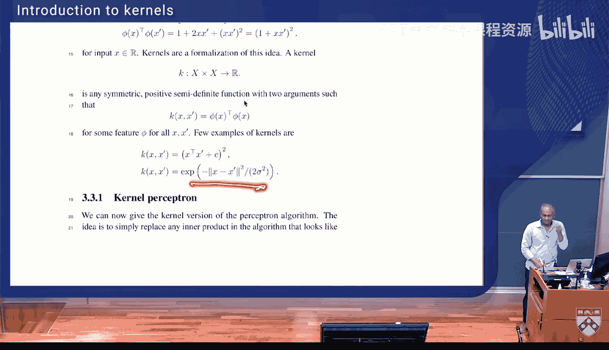

# 19：核方法入门 🧠

在本节课中，我们将要学习核方法的基本概念。核方法是机器学习中一个强大的工具，它允许我们在不显式计算高维特征映射的情况下，在高维空间中进行计算。理解核方法对于后续学习卷积核等更具体的概念至关重要。

## 从内积到核函数

上一节我们介绍了特征映射的概念。在之前的表达式中，我们经常看到内积运算，例如 **ΦᵀΦ** 或 **xᵀx**。核方法的核心思想正是利用了这种内积结构。

任何出现内积的地方，你都可以通过使用核方法来重写它，从而减少计算求和所需的浮点运算次数。

以下是核方法的基本形式。假设我们的特征映射 **Φ(x)** 是一个二次映射：`Φ(x) = [1, √2 x, x²]ᵀ`。对于数据集中的另一个样本 **x‘**，其特征映射为 `Φ(x‘) = [1, √2 x‘, x‘²]ᵀ`。

当我们计算内积 **Φ(x)ᵀ Φ(x‘)** 时，实际上是将这两个向量相乘：
`Φ(x)ᵀ Φ(x‘) = 1*1 + (√2 x)*(√2 x‘) + (x²)*(x‘²) = 1 + 2xx‘ + x²x‘²`

仔细思考，你会发现这个结果等于：
`(1 + x * x‘)²`

这是一个非常重要的结论：这两个特征向量的内积可以表示为一个简洁的函数。这个函数就被称为**核函数**。

## 核函数的直观理解 🧩

一种简单直观的理解方式是：当 **x** 和 **x‘** 相似时，这个核函数的值会很大。

例如：
*   如果 `x = 1`， `x‘ = -1`， 那么 `(1 + 1*(-1))² = 0`。
*   如果 `x = 1`， `x‘ = 2`， 那么 `(1 + 1*2)² = 9`。

**核函数本质上是衡量两个输入之间相似性的函数**。你可以设计任何你认为能衡量两个输入相似性的函数作为核函数，上面这个就是其中一个例子。

因此，核函数是对“相似性”这一概念的正式化。它是一个以两个输入为参数并返回一个实数的函数。对于我们来说，**x** 和 **x‘** 是两个输入，输出是一个实数，代表它们之间的相似度。

如果你对“两个输入何时相同”有直观的理解（例如，两幅图像都是橙色，或都是黑色），那么你可以简单地写一个Python函数来检查两幅图像是否相似，并将其作为核函数。任何你对事物相似性的直观理解，都可以写成一个函数。你不再需要费力地去构造一个显式的特征空间。

在上面的表达式中，并没有显式的 **Φ(x)**。**Φ(x)** 是隐含的。你只需要给我这个核函数，我就可以假装知道 **Φ(x)** 是什么。

## 其他类型的核函数

二次核并非唯一的核函数，还存在许多其他类型。

这是二次核的向量版本公式：
`K(x, x‘) = (xᵀ x‘ + c)²`

假设 **x** 是一个 **p** 维向量，**xᵀ x‘** 是两个向量的内积，是一个实数。加上常数 **c** 再平方，结果仍然是一个实数。**核函数总是返回实数**，这一点毫无疑问。它们可以接受任何输入，但必须返回一个实数。

这是另一个核函数的例子，称为高斯核或径向基函数核：
`K(x, x‘) = exp(-||x - x‘||²)`

这个函数的特性是：
*   如果 **x** 和 **x‘** 差异很大，那么这个核函数返回值将非常接近 **0**（因为是指数函数的负大数次方）。
*   如果 **x** 和 **x‘** 非常相似，甚至完全相同，那么这个函数返回值是 **1**。

所以，**核函数就是相似性度量函数**，是衡量两个输入相似度的任何方法。

## 总结

本节课中，我们一起学习了核方法的基础知识。我们了解到核函数是一种衡量两个数据点相似度的函数，它能够隐式地将数据映射到高维空间进行计算，而无需显式构造复杂的特征映射。我们探讨了二次核和高斯核的例子，并理解了核函数的核心在于其返回一个代表相似度的实数值。掌握核函数的概念是理解后续更复杂的机器学习模型（如支持向量机、卷积神经网络中的卷积核）的重要基石。